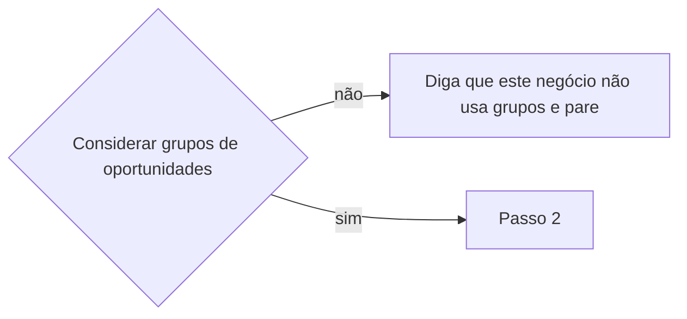

# Definir grupo de oportunidades

## Parâmetros de configuração

Leia cada valor nas instruções do projeto: primeiro na entrada com o nome desta habilidade, depois na entrada `Global` ou no primeiro nível do bloco. Quando um valor não estiver lá, use o padrão abaixo. `Considerar grupos de oportunidades` é `sim` ou `não`.

```yaml
"Considerar grupos de oportunidades": "sim"
```

## Instruções

### Passo 1

Leia `Considerar grupos de oportunidades` antes de qualquer busca.



### Passo 2

A lista de grupos, a lista de oportunidades e o nome de cada propriedade vêm do mapeamento de dados do projeto, no workspace conectado. Este texto usa os conceitos: no grupo, o título do grupo, o nome canônico, os aliases, o organizador, a empresa ou local padrão, o local fixo, os perfis oficiais, a categoria e as notas do grupo; na edição, a data da edição, o grupo da edição e os perfis da edição. Se a lista não estiver nessa conexão, pare. Não use a lista de outro workspace. A edição, com data, fica com `criar-oportunidade`. Saber se a edição já existe fica com `procurar-oportunidade`.

Se o mapeamento não tiver o título do grupo, ou a lista de oportunidades não tiver o grupo da edição, pare antes de criar e diga qual falta. Um valor que caberia numa propriedade opcional ausente do mapeamento não vai para o corpo. Grave o resto e, no fim, liste esse valor e sugira criar a propriedade. Não crie a propriedade.

### Passo 3

Ao criar ou renomear, o título do grupo fica sem ano, sem número de edição e sem data. O nome canônico segue igual. Se o título atual carrega ano, edição ou data, tire isso do grupo. Ano, edição e data ficam no título da oportunidade, quando separam uma data da outra.

### Passo 4

Antes de criar, busque título exato e aproximado, nome canônico, aliases, organizador, empresa ou local padrão, perfil oficial, link, nome da edição, tema, família e edições anteriores, com e sem acento, pontuação, sigla, barra, parêntese e palavra genérica. Palavra genérica sozinha não é o grupo. Mesmo organizador, empresa ou local, perfil oficial ou família: use esse candidato. Não crie outro. Se o candidato parecer o certo, a edição aponta para ele pelo grupo da edição, no máximo um. Dúvida: pare e pergunte. Crie só com evidência de outro grupo, programa, evento-marca ou família. Aí grave os aliases, um nome por linha, e só então a edição entra.

### Passo 5

Oficina ou curso recorrente do mesmo organizador usa um grupo só, nomeado pelo conjunto e pelo organizador. Cada oficina é uma página na lista de oportunidades, com a data dela, e fica com `criar-oportunidade`. Não crie um grupo por oficina. O mesmo organizador ou o mesmo lugar não junta programa com público ou escopo próprio: ele fica no grupo dele. Não apague o grupo nem a edição com data.

### Passo 6

O que é estável fica no grupo. Regra geral, canal oficial que se repete e princípio de curadoria vão nas notas do grupo. Organizador e empresa ou local padrão só quando não mudam entre edições. Local fixo só quando o evento é daquele lugar. Perfil social oficial, como o do evento ou da organização, vai nos perfis oficiais. Só relacione página de perfil que já existe. Não crie o perfil. Conta própria de uma edição fica nos perfis da edição, com `criar-oportunidade`. Link oficial recorrente vai nas notas do grupo, quando o grupo não tem link oficial. Endereço, horário, valor, formulário e vaga de uma data ficam na edição. Não grave isso no corpo.

### Passo 7

No grupo, bloco de anotações, reunião, transcrição, resumo ou outro bloco de notas da pessoa fica inteiro. Não sugira apagar, arquivar, substituir, ocultar nem remover. O bloco é evidência, mesmo quando um fato dele também cabe numa propriedade. Na revisão do conteúdo, do corpo ou das anotações, leia o bloco para preencher a propriedade que a lista já tem. O bloco não vira checklist, resumo nem texto operacional, e não se copia de novo no corpo. Se o bloco não basta para afirmar, a propriedade fica vazia e a pendência fica nas notas do grupo. Não invente o dado nem a propriedade. Não preencha fórmula, rollup nem botão. Não invente categoria nem prioridade, salvo a categoria de formação ou curso do grupo de oficinas recorrentes, quando a lista tiver essa opção.

### Passo 8

Página na lista de oportunidades com nome sem data, sem a data da edição, e com edições ou intenção de recorrência, é grupo no banco errado. Ache ou crie o item na lista de grupos, com o título sem ano, sem edição e sem data. Copie o que é estável: aliases, um nome por linha; notas gerais, link oficial recorrente e o texto das anotações nas notas do grupo. Cada edição com data aponta pelo grupo da edição. Confira a cópia e os vínculos. Só então arquive a página sem data. Página com data permanece. Apague só se a pessoa pedir.

### Passo 9

Edições sem grupo, como as de quando o negócio ainda não considerava grupos: busque na lista de oportunidades as páginas com data e o grupo da edição vazio. Para cada uma, ache o grupo como no Passo 4, ou crie com evidência, e ligue a edição. Mostre a lista de edições ligadas e a das que ficaram sem grupo por dúvida. Não ligue na dúvida.

### Passo 10

Depois de criar ou vincular a edição, confira de novo. O vínculo é o grupo canônico. Não deixe outro grupo com o mesmo nome, nome canônico, aliases, organizador ou família. Grupo recém-criado sem edição, ou mais pobre que um parecido, é duplicata. Religue a edição ao canônico. Propriedade, relação ou nota útil da duplicata vai para o canônico antes de arquivar. Sem relação útil, peça confirmação para arquivar ou apagar, se a pessoa ainda não deu. Não encerre com a duplicata em aberto. Se a pessoa ainda não decidiu, diga isso.

### Passo 11

Mostre o título do grupo e o link. Liste os valores que ficaram sem propriedade. Não cadastre a edição aqui. Não organize a participação. Não inscreva. Não crie tarefa. A resposta não pede para nomear a habilidade.

## Problemas comuns

### Grupo duplicado

Se você criar outro grupo porque o título não bateu, ou criar na dúvida, a família se parte.

1. Busque título, nome canônico, aliases, organizador, local, perfil, link, família e edições anteriores.
2. Candidato: use. Dúvida: pergunte.
3. Crie só com evidência de outro grupo, programa, evento-marca ou família.

### Duplicata deixada

Se você encerrar com um grupo recém-criado ao lado de outro parecido, a busca acha os dois.

1. Religue a edição ao canônico.
2. Mescle propriedade, relação e nota úteis antes de arquivar.
3. Sem relação útil, peça confirmação. Não encerre com a duplicata em aberto.

### Data no grupo

Se você criar ou renomear o grupo com ano, edição ou data no título, o grupo vira uma edição.

1. Deixe o título do grupo e o nome canônico sem ano, sem edição e sem data.
2. Ano, edição e data ficam no título da oportunidade.
3. Ao renomear, tire isso do grupo.

### Grupo por oficina

Se você criar um grupo para cada oficina do mesmo organizador, ou juntar ao grupo de oficinas um programa com público próprio porque o organizador é o mesmo, o grupo deixa de ser o conjunto de oficinas.

1. Busque o grupo de oficinas desse organizador. Use ou crie esse grupo.
2. Cada oficina fica como página na lista de oportunidades, com a data dela.
3. Programa com público ou escopo próprio permanece no grupo dele.

### Página sem data

Se você deixar na lista de oportunidades a página sem data, ou arquivá-la antes de copiar, a busca acha dois nomes e o dado estável some.

1. Copie aliases, notas, link oficial recorrente e o texto das anotações para o grupo.
2. Aponte cada edição com data pelo grupo da edição.
3. Arquive a página sem data só depois. Página com data permanece.

### Perfil na edição

Se você relacionar o perfil oficial em cada edição, o perfil estável se repete.

1. O perfil oficial vai nos perfis oficiais do grupo.
2. Os perfis da edição só recebem a conta própria daquela edição.
3. Não crie o perfil.

### Bloco de anotações removido

Se você apagar o bloco de anotações do grupo ao revisar, a evidência da pessoa some.

1. Mantenha o bloco inteiro, com o mesmo texto.
2. Fato estruturável pode ir para a propriedade.
3. Não copie o bloco de novo no corpo.

### Propriedade ausente

Se você criar a propriedade, ou jogar o valor no corpo, porque o mapeamento não tem onde gravar, a lista muda sem a pessoa decidir.

1. Sem o título do grupo ou sem o grupo da edição no mapeamento: pare antes de criar e diga qual falta.
2. Propriedade opcional ausente com valor: grave o resto e liste o valor no fim.
3. Sugira criar a propriedade. Não crie.

## Exemplos de entrada e saída

Estes exemplos ilustram fatos. Eles podem não estar no data source.

### cadastre a edição de 29 de setembro de 2026 de um evento recorrente. O grupo ainda não está na lista de grupos.

a busca não achou candidato. Criei o grupo antes, sem ano, com aliases. A edição fica com `criar-oportunidade`, com o vínculo, um só.

### já existe um grupo com o mesmo organizador e o mesmo perfil oficial. O nome da edição é parecido.

usei esse grupo. Não criei outro. A edição aponta para ele.

### o grupo está como Festival Rota Sul 2026. Renomeie.

o grupo ficou Festival Rota Sul, sem ano, sem edição e sem data. A data ficou no título da oportunidade.

### vou cadastrar uma oficina da Associação Exemplo. O registro criaria um grupo só para essa oficina, e já existem grupos separados para outras oficinas do mesmo organizador.

liguei as oficinas ao grupo Oficinas da Associação Exemplo. O festival da Associação Exemplo, com público próprio, permanece no grupo dele. Não apaguei o grupo nem a edição com data.

### na lista de oportunidades há uma página Oficinas da Associação Exemplo, sem data, e as oficinas com data estão soltas.

o grupo ficou Oficinas da Associação Exemplo. Aliases, notas, link recorrente e o texto das anotações foram para o grupo. Cada oficina com data aponta para ele. Depois arquivei a página sem data. As edições com data permaneceram.

### acabei de criar um grupo e já existe outro com o mesmo organizador e a mesma família.

religuei a edição ao grupo canônico. Mesclei o que era útil. Pedi confirmação para arquivar a duplicata. Não encerrei com os dois grupos abertos.

### passamos a considerar grupos. Ligue as edições que estão sem grupo.

busquei as edições com data e sem grupo. Liguei cada uma ao grupo achado, ou criado com evidência. Listei as ligadas e as que ficaram sem grupo por dúvida.

### Considerar grupos de oportunidades é não. Crie o grupo deste evento.

este negócio não usa grupos de oportunidades. Parei sem criar.

## Casos-limite

- `Considerar grupos de oportunidades` é `não`: diga que este negócio não usa grupos e pare.
- O evento já tem grupo, ou um candidato com o mesmo organizador, local, perfil ou família: use. Não crie outro. Dúvida: pare e pergunte.
- Criar ou renomear: o título fica sem ano, sem edição e sem data.
- Oficina ou curso recorrente do mesmo organizador: um grupo só para as oficinas. Cada oficina é uma página na lista de oportunidades.
- Programa com público ou escopo próprio, do mesmo organizador ou no mesmo lugar: grupo separado.
- Página na lista de oportunidades sem data e com edições: vira grupo. Arquive só depois da cópia. Página com data permanece.
- Perfil oficial: perfis oficiais do grupo. Conta própria de uma edição: perfis da edição.
- Grupo recém-criado sem edição, ou mais pobre que um parecido: duplicata. Religue, mescle o útil e peça confirmação para arquivar.
- Edições sem grupo depois de passar a considerar grupos: ligue as certas e liste as duvidosas.
- O mapeamento não tem o título do grupo nem o grupo da edição: pare antes de criar e diga qual falta.
- Seleção, inscrição, edital ou chamada: não vira página na lista de oportunidades. O conteúdo estável fica no grupo. O desta data fica na edição.

## Pegadinhas

- Título diferente parece outro grupo. O mesmo organizador, local, perfil ou família é candidato. Sem evidência de outro grupo, pergunte.
- O ano no título do grupo parece o nome canônico. O grupo fica sem data. A data fica na oportunidade.
- Cada oficina parece um grupo. O grupo é o conjunto de oficinas do organizador. A oficina é a edição.
- O mesmo organizador ou o mesmo lugar parece licença para juntar um programa com público próprio ao grupo de oficinas. Público ou escopo próprio fica no grupo dele.
- O perfil oficial parece dos perfis da edição em cada edição. Ele fica nos perfis oficiais do grupo.
- A página sem data na lista de oportunidades parece o grupo certo. O grupo fica na lista de grupos.
- Arquivar antes da cópia parece limpeza. A cópia e o vínculo das edições vêm primeiro.
- Encerrar depois de criar parece o fim. A checagem da duplicata vem antes. Duplicata em aberto não é tarefa concluída.
- O valor sem propriedade parece caber no corpo. Ele vai para a lista do fim, com a sugestão de criar a propriedade.

## Scripts disponíveis

- Nenhum.

1. Não há script para executar.
