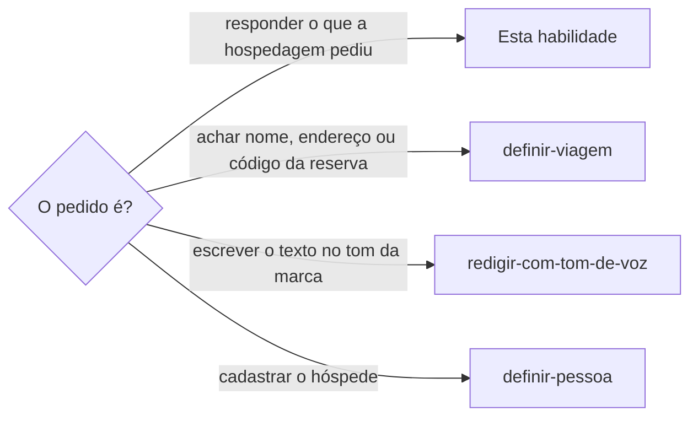

# Definir hospedagem

## Parâmetros de configuração

```yaml
# `Nome civil na resposta` é `não`, que manda só o nome completo do cadastro, ou `sim`, que acrescenta o nome civil de registro entre parênteses.
"Nome civil na resposta": "não"
"Modo de aprendizado": "perguntar"
```

## Instruções

### Passo 1



Esta habilidade cuida da hospedagem depois da reserva, hoje o pedido de dados do anfitrião ou do hotel. Achar a reserva e ligar a hospedagem à viagem segue `definir-viagem`.

A hospedagem pede os dados logo depois da reserva, e a reserva feita à mão não deixa rastro no Notion.

Procure o pedido antes de perguntar à pessoa: na conversa da plataforma de hospedagem, no e-mail da reserva e no WhatsApp ou no e-mail do hotel.
Leia o que a hospedagem pediu e a data da mensagem.

Para ler a conversa, siga a ordem de `definir-viagem`: CLI, API, MCP, skill e, por último, o navegador na aba em que a pessoa já entrou.
Não entre na plataforma por ela.

Hotel responde por e-mail ou WhatsApp, com `procurar-email` ou `conversar-no-whatsapp`.
Anfitrião de plataforma responde na própria conversa da reserva.

### Passo 2

Junte só o que a hospedagem pediu, nesta ordem de busca: a viagem e a hospedagem no Notion, o cadastro de cada pessoa e, para o veículo, o cadastro que `acompanhar-veiculo` usa.

Quem viaja vem das pessoas da viagem ou dos hóspedes da hospedagem, e o veículo vem dos veículos da viagem, nas propriedades que o mapeamento de dados do projeto indica.
O banco de veículos tem a placa como título e a pessoa proprietária.

Sem a lista de quem viaja, pergunte, e não suponha uma pessoa pelo histórico de outra viagem.

O nome de cada hóspede é o nome completo do cadastro, o mesmo do documento oficial de quem tem nome social.
Com `Nome civil na resposta` em `não`, o nome civil de registro não vai na resposta nem na tela de confirmação, e a hospedagem recebe só o nome do documento.

Documento, placa e telefone são dados sensíveis: leia do cadastro, mostre na tela de confirmação e nunca copie para outro lugar além da resposta.
Dado que falta no cadastro, pergunte uma vez, com o nome da pessoa, e grave a resposta por `definir-pessoa`.

O banco da viagem ou da hospedagem sem propriedade para as pessoas ou para os veículos é limitação do banco.
Diga isso na resposta e recomende a propriedade, uma relação com o banco de pessoas e outra com o de veículos.
Não crie nem altere propriedade sem a autorização da pessoa.

Veículo só entra quando a pessoa vai de carro.
Sem o transporte definido, pergunte antes de pedir a placa.

### Passo 3

O rascunho mostrado à pessoa segue este formato:

```
Hospedagem: <nome ou endereço, com o código da reserva>
Canal: <plataforma, e-mail ou WhatsApp em que a resposta vai>
O que a hospedagem pediu: <o pedido em uma linha, com a data da mensagem>

Hóspedes
| Hóspede | Nome completo | Documento | Origem do dado |
| 1 | <nome> | <documento, ou "falta"> | <página do cadastro, ou "informado agora"> |

Veículo: <marca, modelo, cor e placa, ou "não vai de carro">
Chegada: <dia e horário previstos, ou "falta">
Dados que não entram: <o que a hospedagem não pediu>

<texto exato da resposta, num bloco de código>

Falta antes de enviar: <o que a pessoa ainda precisa informar, ou "nada">
Posso enviar? <pergunta que pede o sim>
```
O texto da resposta passa por `redigir-com-tom-de-voz` antes de ser mostrado. A resposta traz só o pedido: quem chega, o veículo se foi pedido e o horário previsto. Não acrescente dado que a hospedagem não pediu.
Mostre o rascunho completo, com o que falta, e espere o sim. Enviar dado pessoal a outra empresa é ação que só a pessoa autoriza, e o sim dado a um dado não vale para o seguinte.

### Passo 4

Com o sim, envie pelo canal em que o pedido chegou e confira na conversa que a mensagem saiu. Na plataforma de hospedagem, a conversa mostra a mensagem como enviada e lida.
Registre na hospedagem do Notion que os dados foram enviados e quando, sem repetir o documento nem a placa. Se a hospedagem prometeu algo em troca, como liberar a portaria ou a vaga, registre o combinado e o prazo na viagem.

### Passo 5

Toda reserva com canal de mensagens do anfitrião entra no acompanhamento no mesmo turno, sem perguntar, por `acompanhar-retornos-pendentes`.
Não crie uma rotina para a reserva: etiquete a conversa do e-mail como aguardando retorno e acrescente uma linha ao registro das pendências.

A hospedagem costuma mandar o que falta, como a senha de acesso, perto do check-in.
Não espere ela escrever primeiro.

Hospedagem com vaga ou garagem de parceiro: pergunte ao anfitrião, pelo canal da reserva, os dias e os horários em que a garagem funciona em toda a estadia, do check-in ao check-out, se é preciso interfonar ou avisar antes de entrar e se há outra opção quando ela fecha cedo.
A pergunta não cita só o dia do problema: o anfitrião entenderia que a pessoa só chega nesse dia. Também não conta o motivo da volta tarde, como o evento.
Compare a resposta com a hora mais tarde em que a pessoa volta, como o fim de uma desmontagem, e registre-a na hospedagem.

A rotina do canal avisa a pessoa a cada mensagem nova e entrega o resumo à sessão que espera.
A senha de acesso nunca vai no aviso, no Notion nem em outro lugar: o aviso só diz que ela chegou e onde ver.

Quando a hospedagem faz uma pergunta, deixe um rascunho de resposta, sem enviar.
O envio segue o Passo 3.

A cada resposta, registre na hospedagem em quantos minutos ela veio.
Esse tempo ensina quando conferir.

### Passo 6

O dado da hospedagem vai nas propriedades da página, nunca no corpo dela.
Uma hospedagem nova nasce do modelo de hospedagem do banco, cujo aviso no topo repete essa regra.
Registre o check-in e o check-out com data e hora, os hóspedes, o anfitrião quando se sabe quem é, e o endereço.
Uma viagem pode ter várias hospedagens, cada uma com o seu registro. Viagem longa com poucas noites cadastradas é lacuna: pergunte onde a pessoa ficou nas outras.

Antes de sugerir onde ficar, leia a avaliação das hospedagens anteriores no mesmo lugar e com o mesmo anfitrião. A avaliada como evitar não é sugerida, e a avaliada como talvez vem com o motivo.
A avaliação tem o motivo, o dia e quem avaliou, cada um na sua propriedade. Grave quando a pessoa a disser, com o nome de quem decidiu. A casa de um parente segue a mesma regra.
Avaliação que a pessoa ainda não fez fica como pendência: não a preencha por ela.
Estadia deixada antes do fim ou trocada por outra registra o check-out do dia em que a pessoa saiu, não o da reserva, e o motivo da troca vai no motivo da avaliação, com o que deu errado e o que foi resolvido.

### Passo 7

Para completar viagens passadas, leia o histórico de reservas na conta da plataforma de quem reservou, numa aba em que a pessoa já esteja logada. A conta pode não ser a da sessão: peça à pessoa que entre na conta certa e não troque de usuário por ela.
Leia só datas, horários e o primeiro nome do anfitrião, nunca valor, documento nem endereço, e compare com o Notion antes de gravar.
A reserva vale mais que a cotação: a data e o status vêm dela, e a cotação fica como histórico.
Hospedagem paga por terceiro, como a de uma missão ou de um evento, não aparece na plataforma: pergunte quem foi e quem pagou, em vez de concluir que falta.
A tabela do que achou cita, em cada linha, a viagem e o ponto de contato, ou diz que não há. Viagem sem ponto de contato, como uma formatura, também é viagem, e se cadastra por `definir-viagem`.
Com só o primeiro nome do anfitrião, não cadastre a pessoa: o nome vai no título da hospedagem e a relação fica vazia.
Grave só depois que a pessoa aprovar a tabela.

### Passo 8

Ao terminar, siga `evoluir-habilidade` conforme `Modo de aprendizado`.

## Problemas comuns

### Mensagem do anfitrião sem ninguém lendo

Se você deixar para a pessoa abrir a conversa da plataforma, a mensagem com a senha ou com uma exigência chega e fica sem leitura até o dia da chegada.

1. Etiquete a conversa e acrescente a linha ao registro, sem criar rotina.
2. A rotina do canal avisa a pessoa e a sessão a cada mensagem nova, sem escrever a senha.
3. Registre o tempo de resposta da hospedagem.

### Dado inventado

Se você preencher o nome de quem viaja com a pessoa da última viagem ou completar um documento que falta, a hospedagem libera o acesso para a pessoa errada.

1. Leia quem viaja na viagem do Notion.
2. Dado que falta fica marcado como falta.
3. Pergunte à pessoa só o que faltar, uma vez.

### Documento fora da tela de confirmação

Se você enviar o documento ou a placa sem mostrá-los antes, a pessoa não decide o que sai da empresa.

1. Mostre o rascunho completo com cada dado sensível.
2. Espere o sim.
3. Envie só depois dele.

### Dado a mais

Se você mandar telefone, endereço ou documento que a hospedagem não pediu, a resposta expõe a pessoa sem necessidade.

1. Releia o pedido.
2. Mande só o que ele lista.
3. Dado fora do pedido fica no cadastro.

### Resposta fora do canal

Se você responder o anfitrião de plataforma por e-mail, ou o hotel pela plataforma, a hospedagem não vê a resposta e o acesso não sai.

1. Responda no canal em que o pedido chegou.
2. Sem acesso a esse canal, entregue o texto pronto e diga onde colar.

## Exemplos de entrada e saída

Estes exemplos ilustram fatos. Eles podem não estar no data source.

### o anfitrião pediu, na conversa da reserva, o nome do segundo hóspede, o CPF de ambos e os dados do carro

Li o pedido na conversa da plataforma, pelo navegador, na aba em que a pessoa já estava.

A viagem não traz o segundo hóspede e o transporte não está definido: perguntei quem é e se vão de carro.

Com as respostas, montei o rascunho no modelo, mostrei o CPF de cada um e a placa, e esperei o sim.
Com o sim, enviei na conversa, conferi que saiu e registrei o envio na hospedagem, sem repetir os documentos.

### o hotel pediu por e-mail a lista de hóspedes e o horário de chegada

Respondi pelo e-mail em que o pedido chegou. Mandei nomes e horário. Não mandei documento, porque o hotel não pediu.

## Casos-limite

- A hospedagem pede um dado que o cadastro não tem e a pessoa não sabe: avise a pessoa, não envie a resposta pela metade e registre a pendência na viagem.
- A pessoa não vai de carro: a resposta diz isso só se a hospedagem perguntou pelo veículo.
- O pedido chegou por um canal que a sessão não alcança: entregue o texto pronto e diga onde colar.
- A pessoa já respondeu à mão: leia a conversa, não repita os dados e só registre o envio.
- O pedido é só uma pergunta de confirmação, sem dado pessoal: responda sem o modelo.

## Pegadinhas

- A reserva da plataforma parece mostrar a estadia vivida. Quem trocou de lugar no meio mostra o período reservado, e o vivido é o que a pessoa conta.
- A conta da plataforma que está logada parece ter todas as reservas. Cada pessoa tem a sua, e as viagens de outra só aparecem na conta dela.
- A hospedagem de um parente parece não precisar de avaliação. A decisão de não voltar vale também para ela, e o motivo é o que a pessoa disse.
- A reserva feita à mão não cria página no Notion, e o banco de viagens e o de hospedagens podem nem ter onde registrar quem viaja e o veículo. Quem viaja e o transporte podem não estar em lugar nenhum.
- A vaga que a hospedagem oferece parece valer a qualquer hora. A garagem de um parceiro tem horário, e quem volta à noite precisa saber até quando ela abre e se deve interfonar.
- O pedido de documento costuma vir antes do check-in e some da lista de mensagens com a tradução automática. Leia a mensagem original, não a prévia da lista.
- O cadastro tem o nome completo e o nome civil de registro, e quem tem nome social usa o nome completo no documento oficial. O nome civil só sai com `Nome civil na resposta` em `sim`, ou se a pessoa pedir.
- Dado sensível não vira texto de memória, de nota nem de comentário na negociação. Ele fica no cadastro e na resposta enviada.
- A hospedagem que pede os dados também libera o acesso com base neles: um erro no documento trava a entrada.

## Scripts disponíveis

- Nenhum.

1. Não há script para executar.
