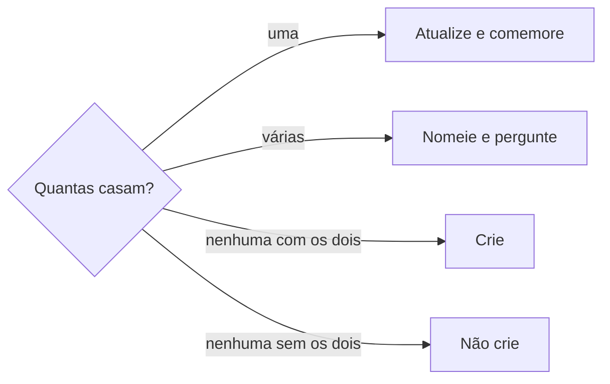

# Definir inscrição

## Parâmetros de configuração

```yaml
{}
```

## Instruções

### Passo 1

A pessoa aponta uma inscrição, ou afirma que ela foi feita, confirmada, aprovada ou aceita. Uma foto de pedido realizado, mesmo sozinha, é essa afirmação. Essa afirmação é o pedido de gravar. Comemore depois de gravar. Não pare na comemoração. Não responda se a tarefa existe. Não busque e-mail nesta habilidade, salvo para o prazo do Passo 5, por `procurar-email`. Se a pessoa disser que a foto foi engano, apague a linha criada por ela.

A lista de inscrições, o nome de cada propriedade e as opções de status vêm do mapeamento de dados do projeto, no workspace conectado. Se a lista não estiver nessa conexão, pare. Não use a lista de outro workspace. Este texto usa os conceitos: a edição, o status da inscrição, quem fez a inscrição, a pessoa ou empresa inscrita, os comprovantes, a data da confirmação, a data do envio e as observações. Os status são o de pré-cadastro, o de inscrição confirmada, o de em andamento, o de em contestação, o de perdida e o de não selecionada.

Citar um status por conceito não o cria: ele precisa existir na lista.

### Passo 2

Se ela indicou a página, leia essa página. Se não indicou, busque na lista de inscrições a participação que ela nomeou. Para achar a edição, siga `procurar-oportunidade`.



Sem quem fez a inscrição e sem a pessoa ou empresa, exija essas marcações. Não invente nenhum dos dois. A comemoração dessa confirmação espera a gravação. Antes de escrever um nome, siga `definir-grafia`. Na frase, use a forma correta. A foto entra para saber o evento e se o pedido está confirmado. O arquivo dessa foto vai para os comprovantes. O número do pedido e o código seguem o Passo 7.

### Passo 3

Na linha que já existe, mude só a propriedade que a pessoa nomeou. Na linha nova, grave a edição, o status, quem fez a inscrição, a pessoa ou empresa e a foto nos comprovantes. Sem esses dois, não cadastre.

Quando a mensagem ou a foto confirma a participação, o status da inscrição passa ao de inscrição confirmada. Se a própria plataforma avisa que registrar interesse não garante participação, o status é o de pré-cadastro até a organização selecionar. O valor é um status que a lista já tem. Não invente status. Não escreva o status nas observações nem no corpo.

A foto do pedido que ela enviou entra nos comprovantes na mesma gravação, mesmo sem ela nomear essa propriedade. Não grave a foto no corpo. O arquivo sobe por upload e entra numa atualização da página depois de criá-la: a criação não aceita o arquivo enviado.

A data da confirmação é a que a pessoa disse ou, quando `garantir-ingresso` viu o pedido confirmado na tela, o dia dessa tela. Sem nenhuma das duas, deixe a data vazia. Se ela disser o dia em que enviou a inscrição, grave esse dia na data do envio. Quando `garantir-ingresso` enviou, grave o dia e a hora do pedido. Sem o horário, grave o dia e não pergunte a hora. Não invente o horário.

Grave o número do pedido e o código só como o Passo 7 manda. Não grave valor. Não preencha fórmula, rollup nem propriedade que copia um dado da pessoa ou da edição.

Se o mapeamento não tiver a edição, o status, quem fez a inscrição ou a pessoa ou empresa, pare antes de criar e diga qual falta. Um valor que caberia numa propriedade opcional ausente do mapeamento não vai para o corpo. Grave o resto e, no fim, liste esse valor e sugira criar a propriedade. Não crie a propriedade.

### Passo 4

Contestação. Quando a pessoa contesta uma recusa, um resultado ou um critério ligado a uma inscrição, o andamento da contestação fica no status da inscrição: em contestação enquanto o recurso estiver aberto. Se a lista não tem essa opção, proponha criá-la e não adapte outro status. A decisão humana da oportunidade não representa o andamento da contestação: a recusa contestada continua como não selecionada na oportunidade até a organização reverter ou confirmar. Com a resposta definitiva, atualize o status da inscrição e registre o desfecho num comentário datado em cada página relacionada.

Desfecho. O status é o de perdida quando não conseguimos concluir a inscrição: prazo perdido, formulário travado, requisito que faltou, vagas esgotadas ou desistência antes do envio. É o de não selecionada quando a inscrição foi enviada e a candidata não foi selecionada, inclusive na lista de espera.

### Passo 5

Prazos. Ao tratar participação, reserva de vaga, taxa, sinal, boleto ou lista de espera, procure o prazo máximo para responder ou confirmar interesse e o prazo máximo para pagar, e diferencie os dois.

Procure em todas as fontes: propriedades, comentários datados, e-mail por `procurar-email`, canal já registrado, edital, regulamento, formulário, site e PDF. Uma regra relativa, como "até 2 dias após a confirmação", não responde o prazo de confirmação.

Sem data nem regra confiável, sinalize isso antes de qualquer recomendação, sugira perguntar à organização e não considere a participação segura, salvo se já estiver confirmada e paga. Nunca invente a data. O pagamento vai por `lancar-despesa-da-empresa`. Toda pendência acionável vira tarefa por `definir-tarefa`.

### Passo 6

Formulário colado. Quando a pessoa cola o texto de um formulário de inscrição, ache a oportunidade por `procurar-oportunidade` e confira se já existe inscrição ligada a ela. Se não existir, crie a inscrição como espelho operacional, com o status de em andamento, mesmo sem envio.

O formulário vai no corpo da inscrição, nunca no da oportunidade. Não use abas, toggles nem blocos colapsáveis: use títulos, negrito, listas e separadores. Cada pergunta vira um título com um parágrafo livre abaixo. A pergunta de escolha vira caixas de seleção `- [ ]`. O item de documentos ou de confirmações vira lista de marcação. O campo com asterisco ganha "(obrigatório)".

Respostas do formulário. A inscrição em nome da empresa usa os contatos da empresa, como o WhatsApp, o e-mail e o site da página dela na lista de empresas, e não os da pessoa que vai participar. Os textos vêm do texto-base de inscrições do negócio. Mostre cada resposta com a fonte dela, para a pessoa corrigir o que estiver desatualizado, e explique na mesma frase o termo do formulário que ela pode não conhecer. O formulário só é enviado com o sim da pessoa.

Antes de redigir, leia em cada campo o rótulo, o texto de exemplo dentro dele e o limite de caracteres. O texto de exemplo costuma mostrar o formato esperado, como "Ajudamos [quem] a [fazer o quê] com [como]": a resposta segue esse formato e cabe no limite. Preencha também o campo opcional quando houver dado nas fontes, porque um formulário mais completo pesa na seleção.

Abordagem positiva. Uma resposta de conversa como "vou analisar" ou "manda o material" mantém a inscrição em andamento até haver confirmação operacional: formulário enviado, aprovação final, vaga, comprovante, credencial, código ou instrução conclusiva. A conversa fica em `definir-negociacao`, e a inscrição aponta para a negociação nas observações.

### Passo 7

Identificadores e participante. O número do pedido e o código de inscrição, de ingresso ou de credencial vão em propriedades separadas, sem juntar os dois e sem repetir nas observações. Se o mapeamento não tiver a propriedade, não grave no corpo e liste o valor no fim. O participante é uma relação com pessoas: busque por nome, e-mail e telefone antes de criar. Não suponha que quem cadastrou ou gerou o PDF é o participante: leia o comprovante. Confira o que a página já cobre antes de acrescentar, para não duplicar.

### Passo 8

Encerramento. Quando a inscrição encerrou, por formulário fechado, edital encerrado ou prazo expirado, anexe as evidências, como prints e PDFs, na propriedade de evidências de encerramento da oportunidade e registre o link da fonte.

### Passo 9

Depois de gravar, leia a página de volta e confira cada propriedade gravada contra o que você quis gravar: o status, as datas, as observações e os comprovantes. Diga o que a leitura mostrou, inclusive o que ficou fora do esperado, como o título que não acompanha o status. Não diga que gravou sem essa leitura.

Diga a página, o status que ela tinha e o status que ela tem agora. Na linha nova, diga que a edição já está cadastrada, com as datas e o dia da semana, que a busca na lista de inscrições não achou essa edição, e que a inscrição entrou no registro. Dê o link da inscrição. Se a foto entrou, diga que ela está nos comprovantes. Diga que, se foi engano, a pessoa desfaz. Se a foto não trouxer quem fez a inscrição nem para quem ela foi feita, diga a edição e não cadastre. Exija essas duas marcações. Não diga que o evento inteiro foi confirmado. Se o status já era esse, diga, comemore e não grave de novo. Liste os valores que ficaram sem propriedade. Quando a pessoa escreveu o pedido sem nomear a habilidade, termine indicando `/definir-inscricao` para a próxima vez. Na foto sem esses nomes, feche nas duas marcações.

## Problemas comuns

### Gravação sem releitura

Se você disser que gravou sem ler a página de volta, a pessoa pede a releitura e o que ficou diferente do esperado, como o título antigo ou uma observação que repete o status, passa despercebido.

1. Leia a página depois da gravação.
2. Confira o status, as datas, as observações e os comprovantes.
3. Diga o que a leitura mostrou, inclusive o que ficou diferente.

### Status em outra inscrição

Se você confirmar todas as inscrições do evento porque a mensagem confirma uma delas, as outras mudam junto.

1. Atualize só a página indicada.
2. Deixe as outras no status que já têm.
3. Não crie linha.

### Status na observação

Se você escrever o status novo nas observações ou no corpo, a propriedade continua no status antigo.

1. Grave no status da inscrição.
2. Não repita status, data, código, número do pedido nem valor nas observações.
3. Não altere o corpo.

### Data inventada

Se você preencher a data da confirmação sem a pessoa dizer a data e sem a tela confirmada de `garantir-ingresso`, a confirmação ganha um dia que ninguém informou.

1. Mude só o status.
2. Deixe a data vazia.
3. Preencha a data só quando a pessoa disser qual é ou quando `garantir-ingresso` viu o pedido confirmado.

### Hora exigida

Se você pedir o horário quando a pessoa só disse o dia do envio, a data fica vazia.

1. Grave esse dia na data do envio.
2. Sem horário, não invente a hora e não pergunte.
3. A data da confirmação continua vazia se ela não disse essa data e `garantir-ingresso` não viu o pedido confirmado.

### Comprovante fora da propriedade

Se você deixar a foto de fora, ou gravar a foto no corpo, o comprovante não fica nos comprovantes.

1. Anexe a foto nos comprovantes na mesma gravação.
2. Não grave a foto no corpo.
3. Não grave valor, e grave código e número do pedido só como o Passo 7 manda.

### Confirmação como notícia

Se você só comemorar porque a pessoa disse que a inscrição foi confirmada, o status da página fica para trás.

1. Trate a frase como pedido de gravar o status da inscrição.
2. Uma inscrição casa: atualize essa e comemore. Mais de uma: pergunte qual.
3. Não pare na comemoração.

### Inscrição ausente

Se você perguntar se pode cadastrar, ou parar porque a linha não existe, a inscrição fica fora do registro.

1. Busque a participação.
2. Nenhuma casa, e já há quem fez a inscrição e para quem ela foi feita: crie a linha e comemore. Sem isso, não cadastre e exija as duas marcações.
3. Uma casa: atualize essa. Não crie outra.

## Exemplos de entrada e saída

Estes exemplos ilustram fatos. Eles podem não estar no data source.

### a inscrição da Loja Exemplo como expositora no Festival Rota Sul 2026 precisa ficar como inscrição confirmada, porque Bia Lima, da organização, enviou e-mail confirmando a participação.

atualizei só essa inscrição, do pré-cadastro para inscrição confirmada. Não criei outra linha. Não mudei as outras inscrições do mesmo evento. Não preenchi data, observação, comprovante nem o corpo. Na frase, escrevi Bia Lima.

### Inscrição de Ana Souza para o Festival Rota Sul 2026 feita, com a foto do pedido confirmado.

A busca não achou a linha. Criei a inscrição de Ana Souza na edição Festival Rota Sul 2026, terça-feira, 29/09/2026 e quarta-feira, 30/09/2026, em Cidade Exemplo, com o status de inscrição confirmada. A foto foi para os comprovantes. Não pedi licença. O número do pedido ficou fora porque o mapeamento não tem essa propriedade, e o listei no fim. Indiquei `/definir-inscricao` para a próxima vez.

### Eu realizei a inscrição hoje e ela já está confirmada.

O status já era o de inscrição confirmada. Não gravei de novo. O dia de hoje entrou na data do envio. Não perguntei o horário.

### A inscrição da Loja Exemplo pra expor no Rota Sul foi confirmada

busquei a inscrição da Loja Exemplo como expositora no Festival Rota Sul 2026. Uma só casou. O status passou ao de inscrição confirmada, ou já estava assim e eu disse isso sem gravar de novo. Comemorei a confirmação.

## Casos-limite

- O status já é o pedido: diga e não grave de novo.
- Há mais de uma inscrição e a pessoa não indicou a página: nomeie cada uma e pergunte qual alterar. Não atualize. A comemoração espera a gravação.
- A mensagem confirma uma participação: mude só a inscrição dessa participação.
- A pessoa não disse a data: deixe a data da confirmação vazia, salvo quando `garantir-ingresso` viu o pedido confirmado na tela.
- A pessoa disse o dia do envio e não disse a hora: grave o dia na data do envio. Não pergunte o horário.
- A lista de inscrições não está no workspace conectado: pare. Não use outra lista.
- O mapeamento não tem a edição, o status, quem fez a inscrição ou a pessoa ou empresa: pare antes de criar e diga qual falta.
- A participação não está na lista e já há quem fez a inscrição e para quem ela foi feita: crie a linha. Sem isso, não cadastre e exija as duas marcações.
- A pergunta é só quem se inscreveu: use `procurar-inscricao`. Não altere a página.

## Pegadinhas

- Dizer que a inscrição foi feita ou confirmada parece só notícia, ou um pedido de licença para cadastrar. É o pedido de gravar. Se a linha não existe, crie. Comemore depois de gravar.
- A foto do pedido parece convite para gravar o número, ou para ficar de fora. O arquivo vai para os comprovantes. O número do pedido segue o Passo 7. A foto não entra no corpo.
- A foto sem nome parece inscrição pronta para cadastrar. Sem quem fez a inscrição e sem a pessoa ou empresa, não cadastre. Exija as duas marcações.
- Pré-cadastro não é inscrição confirmada. A confirmação da organização muda só o status da linha indicada.
- O corpo pode dizer que a inscrição não confirma a participação. Esse texto é o espelho do formulário. A confirmação fica no status. Não reescreva o corpo.
- Uma propriedade que copia o e-mail da pessoa, a data da edição ou um link do formulário parece pedir valor. Ela não se grava.
- Uma confirmação de expositor não confirma as outras inscrições do mesmo evento.
- O telefone de quem vai ao palco parece o contato da inscrição. Na inscrição da empresa, o contato é o da empresa.
- O campo opcional parece dispensável. Quem seleciona lê o formulário inteiro, e o campo vazio é uma chance perdida.
- A data da confirmação só entra se a pessoa disser a data ou se `garantir-ingresso` viu o pedido confirmado na tela.
- A criação da página parece aceitar o arquivo enviado nos comprovantes. Ela recusa: o arquivo entra na atualização seguinte.

## Scripts disponíveis

- Nenhum.

1. Não há script para executar.
