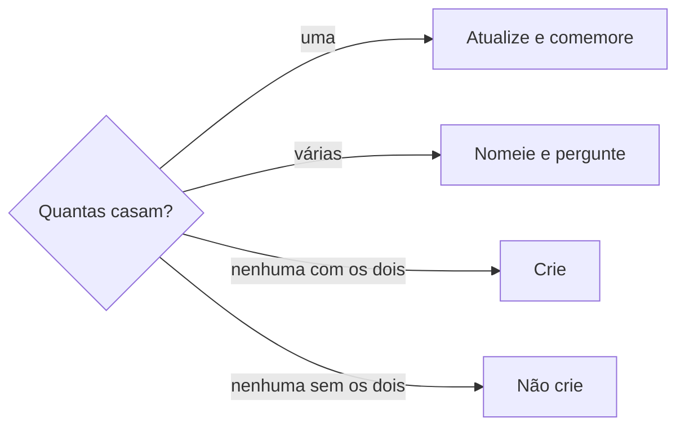

# Definir inscrição

## Parâmetros de configuração

Leia cada valor nas instruções do projeto: primeiro na entrada com o nome desta habilidade, depois na entrada `Global` ou no primeiro nível do bloco. Quando um valor não estiver lá, use o padrão abaixo. `Habilidade de grafia` vazia quer dizer que o nome fica como a pessoa escreveu.

```yaml
"Habilidade de grafia": ""
```

## Instruções

### Passo 1

A pessoa aponta uma inscrição, ou afirma que ela foi feita, confirmada, aprovada ou aceita. Uma foto de pedido realizado, mesmo sozinha, é essa afirmação. Essa afirmação é o pedido de gravar. Comemore depois de gravar. Não pare na comemoração. Não responda se a tarefa existe. Não busque e-mail nesta habilidade. Se a pessoa disser que a foto foi engano, apague a linha criada por ela.

A lista de inscrições, o nome de cada propriedade e as opções de status vêm do mapeamento de dados do projeto, no workspace conectado. Se a lista não estiver nessa conexão, pare. Não use a lista de outro workspace. Este texto usa os conceitos: a edição, o status da inscrição, quem fez a inscrição, a pessoa ou empresa inscrita, os comprovantes, a data da confirmação, a data do envio e as observações. Os status são o de pré-cadastro e o de inscrição confirmada.

### Passo 2

Se ela indicou a página, leia essa página. Se não indicou, busque na lista de inscrições a participação que ela nomeou. Para achar a edição, siga `procurar-oportunidade`.



Sem quem fez a inscrição e sem a pessoa ou empresa, exija essas marcações. Não invente nenhum dos dois. A comemoração dessa confirmação espera a gravação. Antes de escrever um nome, siga a `Habilidade de grafia`, quando as instruções do projeto indicarem uma. Na frase, use a forma correta. A foto entra para saber o evento e se o pedido está confirmado. O arquivo dessa foto vai para os comprovantes. O número do pedido não entra na inscrição.

### Passo 3

Na linha que já existe, mude só a propriedade que a pessoa nomeou. A foto do pedido que ela enviou entra nos comprovantes na mesma gravação, mesmo sem ela nomear essa propriedade. Não grave a foto no corpo. Quando a mensagem ou a foto confirma a participação, o status da inscrição passa ao de inscrição confirmada. O valor é um status que a lista já tem. Não invente status. Na linha nova, grave a edição, o status, quem fez a inscrição, a pessoa ou empresa e a foto nos comprovantes. Sem esses dois, não cadastre. Não preencha a data da confirmação se a pessoa não disse a data. Se ela disser o dia em que enviou a inscrição, grave esse dia na data do envio. Sem o horário, grave o dia e não pergunte a hora. Não invente o horário. Não escreva o status nas observações nem no corpo. Não grave código, número do pedido nem valor. Não preencha fórmula, rollup nem propriedade que copia um dado da pessoa ou da edição.

Se o mapeamento não tiver a edição, o status, quem fez a inscrição ou a pessoa ou empresa, pare antes de criar e diga qual falta. Um valor que caberia numa propriedade opcional ausente do mapeamento não vai para o corpo. Grave o resto e, no fim, liste esse valor e sugira criar a propriedade. Não crie a propriedade.

### Passo 4

Diga a página, o status que ela tinha e o status que ela tem agora. Na linha nova, diga que a edição já está cadastrada, com as datas e o dia da semana, que a busca na lista de inscrições não achou essa edição, e que a inscrição entrou no registro. Dê o link da inscrição. Se a foto entrou, diga que ela está nos comprovantes. Diga que, se foi engano, a pessoa desfaz. Se a foto não trouxer quem fez a inscrição nem para quem ela foi feita, diga a edição e não cadastre. Exija essas duas marcações. Não diga que o evento inteiro foi confirmado. Se o status já era esse, diga, comemore e não grave de novo. Liste os valores que ficaram sem propriedade. Quando a pessoa escreveu o pedido sem nomear a habilidade, termine indicando `/definir-inscricao` para a próxima vez. Na foto sem esses nomes, feche nas duas marcações.

## Problemas comuns

### Status em outra inscrição

Se você confirmar todas as inscrições do evento porque a mensagem confirma uma delas, as outras mudam junto.

1. Atualize só a página indicada.
2. Deixe as outras no status que já têm.
3. Não crie linha.

### Status na observação

Se você escrever o status novo nas observações ou no corpo, a propriedade continua no status antigo.

1. Grave no status da inscrição.
2. Não repita status, data, código, número do pedido nem valor nas observações.
3. Não altere o corpo.

### Data inventada

Se você preencher a data da confirmação sem a pessoa dizer a data, a confirmação ganha um dia que ninguém informou.

1. Mude só o status.
2. Deixe a data vazia.
3. Preencha a data só quando a pessoa disser qual é.

### Hora exigida

Se você pedir o horário quando a pessoa só disse o dia do envio, a data fica vazia.

1. Grave esse dia na data do envio.
2. Sem horário, não invente a hora e não pergunte.
3. A data da confirmação continua vazia se ela não disse essa data.

### Comprovante fora da propriedade

Se você deixar a foto de fora, ou gravar a foto no corpo, o comprovante não fica nos comprovantes.

1. Anexe a foto nos comprovantes na mesma gravação.
2. Não grave a foto no corpo.
3. Não grave código, número do pedido nem valor.

### Confirmação como notícia

Se você só comemorar porque a pessoa disse que a inscrição foi confirmada, o status da página fica para trás.

1. Trate a frase como pedido de gravar o status da inscrição.
2. Uma inscrição casa: atualize essa e comemore. Mais de uma: pergunte qual.
3. Não pare na comemoração.

### Inscrição ausente

Se você perguntar se pode cadastrar, ou parar porque a linha não existe, a inscrição fica fora do registro.

1. Busque a participação.
2. Nenhuma casa, e já há quem fez a inscrição e para quem ela foi feita: crie a linha e comemore. Sem isso, não cadastre e exija as duas marcações.
3. Uma casa: atualize essa. Não crie outra.

## Exemplos de entrada e saída

Estes exemplos ilustram fatos. Eles podem não estar no data source.

### a inscrição da Loja Exemplo como expositora no Festival Rota Sul 2026 precisa ficar como inscrição confirmada, porque Bia Lima, da organização, enviou e-mail confirmando a participação.

atualizei só essa inscrição, do pré-cadastro para inscrição confirmada. Não criei outra linha. Não mudei as outras inscrições do mesmo evento. Não preenchi data, observação, comprovante nem o corpo. Na frase, escrevi Bia Lima.

### Inscrição de Ana Souza para o Festival Rota Sul 2026 feita, com a foto do pedido confirmado.

A busca não achou a linha. Criei a inscrição de Ana Souza na edição Festival Rota Sul 2026, terça-feira, 29/09/2026 e quarta-feira, 30/09/2026, em Cidade Exemplo, com o status de inscrição confirmada. A foto foi para os comprovantes. Não pedi licença. Não gravei o número do pedido. Indiquei `/definir-inscricao` para a próxima vez.

### Eu realizei a inscrição hoje e ela já está confirmada.

O status já era o de inscrição confirmada. Não gravei de novo. O dia de hoje entrou na data do envio. Não perguntei o horário.

### A inscrição da Loja Exemplo pra expor no Rota Sul foi confirmada

busquei a inscrição da Loja Exemplo como expositora no Festival Rota Sul 2026. Uma só casou. O status passou ao de inscrição confirmada, ou já estava assim e eu disse isso sem gravar de novo. Comemorei a confirmação.

## Casos-limite

- O status já é o pedido: diga e não grave de novo.
- Há mais de uma inscrição e a pessoa não indicou a página: nomeie cada uma e pergunte qual alterar. Não atualize. A comemoração espera a gravação.
- A mensagem confirma uma participação: mude só a inscrição dessa participação.
- A pessoa não disse a data: deixe a data da confirmação vazia.
- A pessoa disse o dia do envio e não disse a hora: grave o dia na data do envio. Não pergunte o horário.
- A lista de inscrições não está no workspace conectado: pare. Não use outra lista.
- O mapeamento não tem a edição, o status, quem fez a inscrição ou a pessoa ou empresa: pare antes de criar e diga qual falta.
- A participação não está na lista e já há quem fez a inscrição e para quem ela foi feita: crie a linha. Sem isso, não cadastre e exija as duas marcações.
- Sem `Habilidade de grafia` nas instruções do projeto: escreva o nome como a pessoa escreveu.
- A pergunta é só quem se inscreveu: use `procurar-inscricao`. Não altere a página.

## Pegadinhas

- Dizer que a inscrição foi feita ou confirmada parece só notícia, ou um pedido de licença para cadastrar. É o pedido de gravar. Se a linha não existe, crie. Comemore depois de gravar.
- A foto do pedido parece convite para gravar o número, ou para ficar de fora. O arquivo vai para os comprovantes. O número do pedido fica de fora. A foto não entra no corpo.
- A foto sem nome parece inscrição pronta para cadastrar. Sem quem fez a inscrição e sem a pessoa ou empresa, não cadastre. Exija as duas marcações.
- Pré-cadastro não é inscrição confirmada. A confirmação da organização muda só o status da linha indicada.
- O corpo pode dizer que a inscrição não confirma a participação. Esse texto é o espelho do formulário. A confirmação fica no status. Não reescreva o corpo.
- Uma propriedade que copia o e-mail da pessoa, a data da edição ou um link do formulário parece pedir valor. Ela não se grava.
- Uma confirmação de expositor não confirma as outras inscrições do mesmo evento.
- A data da confirmação só entra se a pessoa disser a data.

## Scripts disponíveis

- Nenhum.

1. Não há script para executar.
