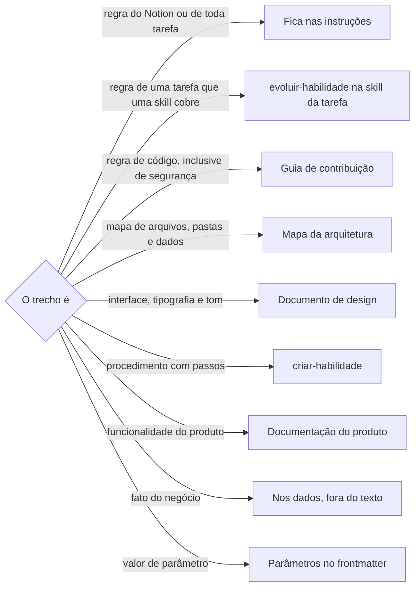

# Definir instruções do projeto

## Parâmetros de configuração

Leia cada valor nas instruções do projeto: primeiro na entrada com o nome desta habilidade, depois na entrada `Global` ou no primeiro nível do bloco. Quando um valor não estiver lá, use o padrão abaixo.

```yaml
"Idioma das instruções do projeto": "português do Brasil"
"Modo de aprendizado": "perguntar"
```

## Instruções

### Passo 1

Leia as instruções do projeto inteiras e meça o tamanho delas com a checagem de skills. Elas carregam em toda sessão, por isso têm os mesmos limites do corpo de uma skill.

### Passo 2

Classifique cada trecho pelo destino, antes de escrever. Grave o plano como uma tabela: trecho, destino, motivo.



Na dúvida entre ficar e sair, saia: o destino continua a um link de distância.

### Passo 3

Escreva no `Idioma das instruções do projeto`, uma regra por linha, no imperativo, sem justificar. Separe o que vale em qualquer lugar, o que vale só no Notion e o que vale só em ferramentas de código. A regra de código, inclusive a de segurança, como comando, branch, build e segredo, vai para o guia de contribuição e nunca entra na parte do Notion. A regra que manda usar uma habilidade que fica fora do Notion também vai para o guia de contribuição, porque as instruções do projeto vão inteiras para o Notion. A parte de qualquer lugar copia do modelo, palavra por palavra, as regras fixas: a do idioma das respostas, a dos modelos de saída, a do próximo passo e a dos links. A parte do Notion copia do modelo, palavra por palavra, a abertura, o aviso e as duas subseções. Só as regras sob a identidade do agente e a interação de chat mudam de um projeto para outro. A parte de ferramentas de código é só a ordem de ler o guia, copiada do modelo. A abertura descreve o documento, não o repositório: para quais ferramentas e quais tarefas ele serve.

Leia o modelo de saída `agents-md` quando for gerar a saída.

### Passo 4

Monte os parâmetros no frontmatter, em `metadata.parameters`, como árvore: a entrada `Global` e uma entrada por nome de habilidade. Copie cada chave do bloco de parâmetros da própria habilidade, letra por letra. Um valor que mais de uma habilidade usa fica em `Global`. O resto fica sob o nome da habilidade.

Entra só o valor que difere do padrão da habilidade e que ela não acha sozinha. O valor que ela calcula, como o repositório a partir do remoto, e o que ela lê de um registro da fonte de dados, como as medidas do formato de um post no Notion, ficam fora do bloco. Antes de propor uma chave, leia no passo da habilidade de onde vem o valor: se vem de um registro, ele fica no registro, porque o parâmetro passaria por cima dele em toda execução e prenderia um valor que varia de registro para registro.

Todo YAML que a skill ou o projeto grava, como o frontmatter, o bloco de parâmetros e o `config.yaml`, é YAML válido. Um parâmetro tem chave e valor curtos, numa linha, sem `: ` no meio. Texto com `: ` ou com mais de uma linha não é parâmetro: vai para o texto da skill, para uma árvore de decisão ou para uma referência, e o parâmetro guarda só o nome ou um valor curto que aponta para isso. Sem aspas, esse texto quebra o parser com "Implicit keys need to be on a single line". Quando o repositório tem convenção própria, a skill a descobre nele e o parâmetro só dá o padrão. Depois de gravar, leia o YAML com um parser antes de dizer que está pronto.

O frontmatter tem `metadata.version` e, num harness de negócio, também `description`. Suba a versão a cada mudança, inclusive no core: patch para correção, minor para regra nova, major para mudança que quebra. Ela vira a versão da página no Notion, e os parâmetros aparecem no fim da página, num bloco de código.

### Passo 5

Para cada trecho que sai, crie ou atualize o destino antes de apagar daqui. Depois troque as referências antigas que apontavam para as instruções do projeto, nos documentos e nos comentários de código.

### Passo 6

Rode a checagem de skills de novo. Se passar do limite, volte ao Passo 2 e tire mais. Repita até passar.

### Passo 7

Ao terminar, siga `evoluir-habilidade` conforme `Modo de aprendizado`.

## Problemas comuns

### Chave parecida

Se você escrever "Idioma da mensagem" quando a habilidade lê "Idioma da mensagem de commit", a habilidade não acha o valor e usa o padrão sem avisar.

1. Abra o bloco de parâmetros da habilidade instalada.
2. Copie a chave exata.

### Regra de código duplicada

Se você deixar nas instruções do projeto uma regra de código que também está no guia de contribuição, como não enviar direto para a branch principal ou não expor segredo, as duas cópias divergem com o tempo.

1. Deixe a regra só no guia de contribuição.
2. Nas instruções, mantenha só a ordem de ler o guia.

### Técnica no Notion

Se você deixar comando, branch ou build na parte geral, quem lê no Notion recebe instrução que não serve para ele.

1. Mova para a parte de ferramentas de código.
2. Deixe na parte geral só o que vale nos dois lugares.

### Referência quebrada

Se você mover um trecho e não trocar as referências, outros documentos e comentários apontam para uma seção que não existe mais.

1. Procure as menções às instruções do projeto no repositório.
2. Aponte cada uma para o destino novo.

## Exemplos de entrada e saída

Estes exemplos ilustram fatos. Eles podem não estar no data source.

### as instruções do projeto passaram de 7000 tokens

O conteúdo foi para o guia de contribuição, sem mudança. As instruções ficaram com a ordem de ler o guia e os parâmetros no frontmatter. As regras de segurança ficaram só no guia. Os documentos e os comentários que citavam as instruções passaram a citar o guia.

### acrescente o idioma das mensagens de commit

O valor entrou em `Global`, com a chave "Idioma da mensagem de commit", copiada da habilidade de commit, porque a habilidade de pull request também precisa dele.

### ponha o ajuste de foto e a cor de fundo do carrossel nos parâmetros

Nenhuma chave entrou. A habilidade do carrossel lê esses valores do registro do formato do post, e um valor nas instruções do projeto substituiria o do registro em todo post. Os valores ficaram no registro de cada formato.

## Casos-limite

- O projeto ainda não tem instruções: comece pelo modelo, só com o frontmatter, a parte do Notion e a ordem de ler o guia.
- Os parâmetros não têm árvore: o primeiro nível continua valendo como `Global`. Reorganize quando mexer neles.
- Uma habilidade renomeou uma chave numa versão nova: troque a chave junto com a subida da versão.
- O trecho é um esquema de dados ou um fato do negócio: ele não entra no texto. O esquema fica no repositório do negócio, e o fato fica nos dados.
- As instruções estão em outro idioma: reescreva no `Idioma das instruções do projeto`. O guia de contribuição mantém o idioma dele.

## Pegadinhas

- O Claude Code lê as instruções do projeto mesmo sem o arquivo de instruções do Claude. Não crie esse arquivo só para importar as instruções.
- A checagem mede as instruções do projeto como corpo de skill, mesmo sem frontmatter e mesmo num projeto que só instala o core. As regras de estrutura de skill não valem para elas.
- A ordem de ler o guia é a única ligação entre as instruções e as regras de código. O guia só vale se o agente obedecer a essa ordem, então ela fica escrita como ordem, não como sugestão. Regra que não pode depender dessa leitura ganha uma verificação automática, como um teste ou uma checagem no commit.
- No Notion, as instruções do projeto são uma página escrita pela sincronização. Não edite essa página. A mudança vai no repositório.
- Mover o arquivo inteiro e criar outro com o nome antigo não aparece como renomeação no histórico. O histórico das linhas movidas fica no nome antigo.

## Scripts disponíveis

- `node_modules/harness/.agents/scripts/check-skill/run-check.sh AGENTS.md`: tamanho das instruções no Passo 1 e no Passo 6, num projeto que instala o core.
- `.agents/scripts/check-skill/run-check.sh AGENTS.md`: o mesmo, no repositório do core.
- `git grep -n AGENTS.md`: referências do Passo 5.

1. Meça, classifique, escreva, monte os parâmetros, mova, troque as referências e meça de novo.
