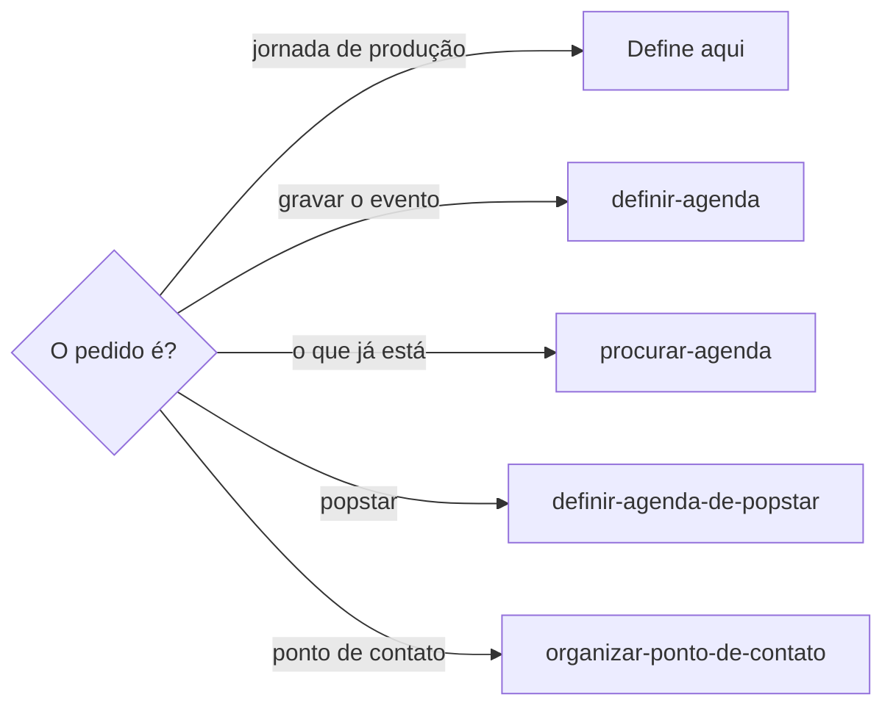

# Definir jornada de produção

## Parâmetros de configuração

Leia cada valor nas instruções do projeto: primeiro na entrada com o nome desta habilidade, depois na entrada `Global` ou no primeiro nível do bloco. Quando um valor não estiver lá, use o padrão abaixo.

```yaml
"Duração da produção em dia útil": 8 horas
"Duração da produção reduzida": 6 horas
"Fim da produção reduzida": 17h00
```

## Instruções

### Passo 1

Definir a jornada de produção é esta habilidade. O dia útil, o feriado, o sábado, o domingo e a alternância de sábados ficam aqui. A gravação do evento segue `definir-agenda`. Saber o que já está no dia segue `procurar-agenda`. Agenda de popstar segue `definir-agenda-de-popstar`. O ponto de contato segue `organizar-ponto-de-contato`.



### Passo 2

Dia útil de produção dura a duração da produção em dia útil, na janela combinada com a pessoa. Sem essa janela, peça. Não invente o início.

### Passo 3

Feriado, sábado ou domingo só vira dia de produção com pedido explícito. Confirmado o regime, o bloco dura a duração da produção reduzida e encerra no fim da produção reduzida, salvo outro horário que a pessoa informe naquele dia. Esse horário não altera a lista. O início do dia útil permanece quando couber nesse bloco. Se não couber, o fim da produção reduzida define o início. A descrição do evento registra que o dia segue a jornada reduzida e o motivo: feriado, sábado ou domingo. Quem grava essa descrição é `definir-agenda`.

### Passo 4

Alternância de sábados respeita o intervalo que a pessoa definiu. Sem o intervalo, peça. Sábado com feira, pop-up ou evento comercial fica livre de produção.

## Problemas comuns

### Fim de semana em produção

Se você usar a duração da produção em dia útil em feriado, sábado ou domingo, ou transformar esse dia em produção sem pedido, a jornada reduzida não acontece.

1. Sem pedido explícito, deixe o dia livre.
2. Com o pedido, use a duração da produção reduzida e encerre no fim da produção reduzida, salvo outro horário informado naquele dia.
3. A descrição registra a jornada reduzida e o motivo. A gravação segue `definir-agenda`.
4. Sábado de feira, pop-up ou evento comercial fica livre. Respeite o intervalo de alternância que a pessoa definiu.

## Exemplos de entrada e saída

Estes exemplos ilustram fatos. Eles podem não estar no data source.

### este sábado entra na produção? a feira é no outro

Confirmei o pedido. Usei a duração da produção reduzida e o fim da produção reduzida, e mantive o início do dia útil se coube. A descrição registra a jornada reduzida e o motivo. O sábado da feira ficou livre. A gravação do evento ficou com `definir-agenda`.

## Casos-limite

- Feriado, sábado ou domingo sem pedido explícito de produção: deixe livre. Não use a duração da produção em dia útil.
- A janela do dia útil ou o intervalo da alternância de sábados não foi combinado: peça. Não invente o início.
- Sábado com feira, pop-up ou evento comercial: fica livre de produção. O ponto de contato segue `organizar-ponto-de-contato`.
- O pedido é gravar o evento: `definir-agenda`.
- O pedido é saber o que já está no dia: `procurar-agenda`.

## Pegadinhas

- Feriado, sábado e domingo parecem dia útil de produção. Sem pedido explícito, ficam livres. Com o pedido, o bloco usa a duração da produção reduzida e o fim da produção reduzida, salvo outro horário naquele dia.
- O número no meio do passo parece o lugar da edição. O valor mora no bloco `yaml` de `Parâmetros de configuração`.
- Decidir a jornada parece permissão para gravar o evento. A gravação segue `definir-agenda`.

## Scripts disponíveis

- Nenhum.

1. Não há script para executar.
