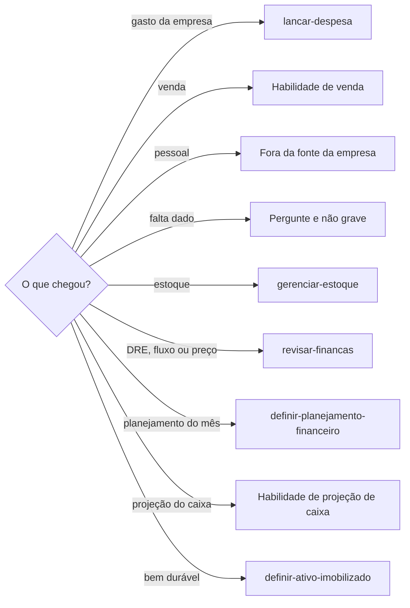

# Definir lançamento

## Parâmetros de configuração

Leia cada valor nas instruções do projeto: primeiro na entrada com o nome desta habilidade, depois na entrada `Global` ou no primeiro nível do bloco. Quando um valor não estiver lá, use o padrão abaixo. `Moeda` é a moeda das contas e das respostas. `Moedas estrangeiras` lista as outras moedas em que a empresa paga, como o serviço de tecnologia cobrado em dólar. `Habilidade de venda` e `Habilidade de projeção de caixa` vazias quer dizer que a venda e a projeção do caixa ficam fora desta habilidade.

```yaml
"Moeda": "BRL"
"Moedas estrangeiras": []
"Habilidade de venda": ""
"Habilidade de projeção de caixa": ""
"Classes do gasto":
  Custos:
    - mercadorias para revenda
    - matéria-prima
    - frete de compra
    - embalagens
  "Despesas comerciais":
    - comissões de venda
    - marketing
    - propaganda
    - taxas de cartão
    - taxas de marketplace
    - impostos sobre vendas
  "Despesas operacionais":
    - encargos trabalhistas
    - aluguel
    - internet
    - telefone
    - salários administrativos
    - contador
    - energia
    - material de escritório
  "Despesas financeiras":
    - juros
    - multas
    - tarifas bancárias
    - empréstimos
    - financiamentos
```

## Instruções

### Passo 1

Interpretar uma venda, um gasto ou outra movimentação de dinheiro em frase simples, e encaminhar o que não é esse lançamento, é esta habilidade. A pessoa informa o data source na execução. Se ele não estiver no workspace conectado, pare. Não use a fonte de outro workspace.



### Passo 2

Sem dizer se é da empresa ou pessoal, se é venda ou gasto, ou a forma de recebimento ou pagamento, pergunte. Parcelado sem o número de parcelas ou o valor de cada uma: pergunte. Não grave ainda. Não invente esses dados. Gasto numa moeda de `Moedas estrangeiras`: grave o valor na moeda original, o câmbio, a data e a fonte do câmbio, e o valor convertido na `Moeda`. O câmbio sai do comprovante ou da fatura, que no cartão já traz o valor convertido com as taxas. Sem o câmbio, pergunte. Não invente o câmbio. Moeda fora da `Moeda` e de `Moedas estrangeiras`: pergunte antes de gravar.

### Passo 3

Pessoal fica fora da fonte da empresa. Gasto da empresa segue `lancar-despesa`. Não crie uma segunda página. Venda segue a `Habilidade de venda`, quando as instruções do projeto a indicarem. Sem ela, diga que a venda fica fora desta habilidade e não grave. Não use a lista de despesas e investimentos para venda. Não invente a fonte.

### Passo 4

Classifique o gasto numa classe de `Classes do gasto`. Se a fonte não tiver essa classe, pergunte. Não crie a categoria. Empréstimos e financiamentos ficam em despesas financeiras.

### Passo 5

Não apague lançamento anterior. Não refaça saldo, vendas, despesas nem resultado a partir da conversa. Leia o que a fonte já tem, some este lançamento e atualize saldo de caixa, total de vendas, total de despesas e resultado acumulado. A resposta começa pela tabela de entradas, saídas e saldo, na `Moeda`. Depois vêm resumo curto, alerta e orientação.

## Problemas comuns

### Venda gravada como despesa

Se você lançar a venda na lista de despesas e investimentos, a saída vira entrada.

1. Siga a `Habilidade de venda`, quando houver.
2. Não use a lista de despesas e investimentos para venda.
3. Não invente a fonte.

### Lançamento com buraco

Se você gravar sem empresa ou pessoal, sem venda ou gasto, ou sem a forma, o lançamento nasce incompleto.

1. Pergunte o que falta.
2. Parcelado sem parcelas ou sem valor de cada uma: pergunte.
3. Não grave ainda. Não invente.

### Controle refeito do zero

Se você recalcular o caixa só com a conversa, ou apagar o que já estava lançado, o histórico some.

1. Leia o que a fonte já tem.
2. Some só este lançamento.
3. Não apague lançamento anterior.

## Exemplos de entrada e saída

Estes exemplos ilustram fatos. Eles podem não estar no data source.

### Venda da empresa de R$ 200,00 recebida na hora

A venda seguiu a habilidade de venda. Não gravei na lista de despesas e investimentos.

### Gasto da empresa de R$ 80,00 pago na hora

Era gasto da empresa, pago na hora. Classifiquei e segui `lancar-despesa`. Não apaguei o que já estava lançado.

### Gasto da empresa de R$ 300,00 parcelado

Faltavam as parcelas e o valor de cada uma. Perguntei. Não gravei.

### paguei o aluguel de casa

Era pessoal. Ficou fora da fonte da empresa.

### Assinatura cobrada em dólar

O valor em dólar, o câmbio, a data e a fonte do câmbio vieram da fatura. O valor convertido ficou na `Moeda`. Segui `lancar-despesa`.

## Casos-limite

- A fonte não está no workspace conectado: pare. Não use a fonte de outro workspace.
- Falta empresa ou pessoal, venda ou gasto, ou a forma: pergunte. Não grave.
- Venda: a `Habilidade de venda`, quando houver. Não use a lista de despesas e investimentos.
- Pessoal: fora da fonte da empresa.
- A classe não existe na fonte: pergunte. Não crie a categoria.
- A lista de estoque segue `gerenciar-estoque`. DRE, fluxo, diagnóstico, auditoria e preço seguem `revisar-financas`. O mês à frente segue `definir-planejamento-financeiro`.
- A projeção do caixa segue a `Habilidade de projeção de caixa`, quando houver. Bem durável segue `definir-ativo-imobilizado`.

## Pegadinhas

- Venda recebida na hora parece gasto. A lista de despesas e investimentos não recebe venda.
- Aluguel parece sempre da empresa. Aluguel de casa é pessoal e fica fora da fonte da empresa.
- Empréstimo e financiamento parecem custo. Na chave `Classes do gasto`, ficam em despesas financeiras.
- A conversa parece o histórico. O saldo sai da fonte. Lançamento anterior permanece.
- A fatura em dólar parece já estar na `Moeda`. O valor original, o câmbio e o valor convertido ficam juntos. Sem o câmbio, pergunte.

## Scripts disponíveis

- Nenhum.

1. Não há script para executar.
