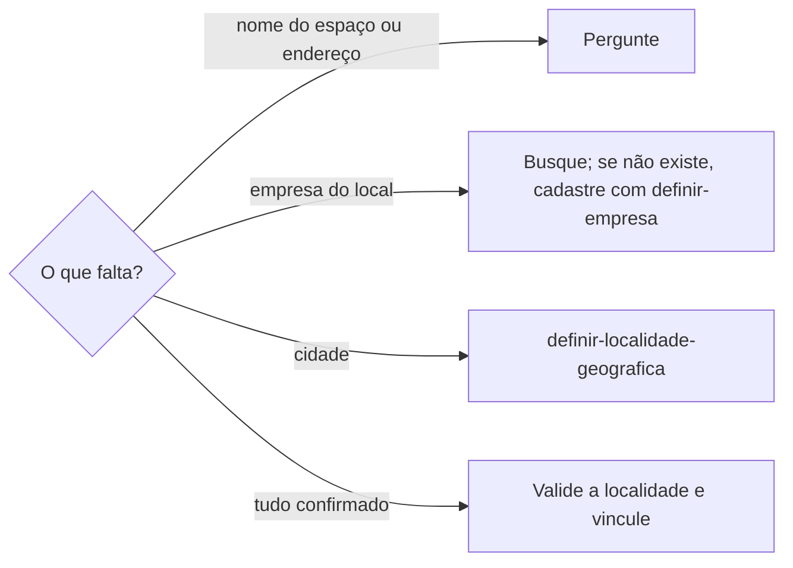

# Definir local físico

## Parâmetros de configuração

```yaml
{}
```

## Instruções

### Passo 1

O lugar físico é onde algo acontece: o nome do espaço, o endereço completo, a empresa do local e a localidade. A lista de empresas, a de localidades e o nome de cada propriedade vêm do mapeamento de dados do projeto, no workspace conectado. Se uma lista não estiver nessa conexão, pare. Não use a lista de outro workspace.



### Passo 2

O local só está confirmado com o nome do espaço e o endereço completo. Nome de cidade, de bairro ou de evento não bastam. Faltando um dos dois, pergunte e não deduza o endereço por memória.

Em feira de rua, o endereço pode não ter número: o nome da rua, o bairro e a cidade bastam, e o nome do espaço é o da rua com o bairro. Não pergunte nem barre o cadastro por causa do número.

O CEP e o ponto no mapa que os formulários da feira não trazem se pesquisam na internet, sem perguntar à pessoa. Procure o CEP do endereço em mais de uma fonte, e o ponto numa fonte de mapa aberto. Grave o CEP no endereço e o ponto no mapa da empresa, e escreva nas notas de onde cada um veio. Rua com mais de um CEP, ou número fora das faixas que as fontes listam: grave os CEPs, use o ponto do trecho que a fonte sustenta e deixe o trecho exato como pendência.

### Passo 3

Busque a empresa do local pelo nome do espaço e por suas grafias, com e sem acento, com e sem o tipo (centro, teatro, casa). A existência segue `identificar-duplicata` e a grafia segue `definir-grafia`. Achou uma só: use-a. Achou várias: mostre e pergunte.

Não achou, com o nome do espaço e o endereço confirmados: cadastre a empresa pela `definir-empresa` na mesma resposta, sem perguntar, e então vincule. Sem o endereço, pergunte antes, como o Passo 2 manda. Não vincule a uma empresa parecida.

### Passo 4

A localidade do local é validada contra a da empresa. Se forem diferentes, registre o conflito, mostre os dois valores e confirme com a pessoa antes de gravar. Não escolha uma delas sozinho.

A cidade que não está na lista de localidades segue `definir-localidade-geografica`. Não use o estado nem a cidade vizinha como aproximação.

O nome que o endereço traz depois da rua pode ser bairro, distrito ou cidade, e um bairro pode ter o nome de um município. Antes de criar ou propor uma localidade com esse nome, descubra o que ele é: pesquise na internet o endereço, o CEP e o cadastro do espaço, e cite o que achou. A localidade do local é a cidade.

Bairro ou distrito não vira localidade quando a lista não tem esse nível. O bairro fica no endereço da empresa, e a desambiguação da empresa diz que ele não é o município de mesmo nome. Sem como saber qual dos dois é, pergunte.

### Passo 5

Um espaço dentro do local, como sala, palco ou auditório, fica um nível abaixo da empresa. Ele só é gravado quando o mapeamento tem onde guardá-lo. Sem esse lugar, pergunte onde guardar e não escreva o espaço no corpo nem no nome da empresa.

### Passo 6

Mostre o nome do espaço, o endereço, a empresa vinculada, a localidade e o que ficou pendente. Quando um dado faltou, diga qual e a pergunta feita.

Mostre sempre o link do Google Maps do local, para a pessoa ver como é o lugar antes de decidir. O link é `https://www.google.com/maps/search/?api=1&query=` seguido do nome do espaço e do endereço, codificados para URL. Local online não tem link.

## Problemas comuns

### Endereço deduzido

Se você completar o endereço pela cidade ou pela memória, o local grava um endereço que ninguém confirmou.

1. Pergunte o nome do espaço e o endereço completo.
2. Grave só o que a fonte ou a pessoa afirmou.
3. Liste o que ficou sem confirmação.

### Empresa parecida vinculada

Se você vincular o local à empresa de nome parecido, o evento aparece no lugar errado.

1. Busque por nome e grafias.
2. Várias: mostre e pergunte.
3. Nenhuma igual, com o nome do espaço e o endereço confirmados: cadastre pela `definir-empresa` e vincule, sem perguntar.

### Estado no lugar da cidade

Se você preencher o estado porque a cidade não existe na lista, a busca por cidade deixa de achar o local.

1. Chame `definir-localidade-geografica`.
2. Vincule só depois que a cidade existir.

### Local sem o link do mapa

Se você mostrar só o nome e o endereço, a pessoa precisa procurar o lugar por conta própria para entender como ele é.

1. Monte o link do Google Maps com o nome do espaço e o endereço, codificados para URL.
2. Mostre-o na resposta, também quando a empresa já existia.
3. Local online: não há link.

### CEP e mapa pedidos à pessoa

Se você deixar o CEP e o mapa vazios, ou perguntar à pessoa por eles, o local fica incompleto por um dado que a internet responde.

1. Pesquise o CEP em mais de uma fonte e o ponto numa fonte de mapa aberto.
2. Grave os dois na empresa do local e diga nas notas de onde vieram.
3. Rua com mais de um CEP: grave todos e deixe o trecho exato como pendência.

### Feira de rua barrada pela falta de número

Se você pedir o número do endereço de uma feira de rua, a pessoa responde que não existe, e o cadastro para por um dado que o formato do evento não tem.

1. Aceite a rua, o bairro e a cidade como endereço.
2. Dê ao espaço o nome da rua com o bairro.
3. Pesquise CEP e mapa e deixe o trecho exato como pendência.

### Bairro cadastrado como localidade

Se você propuser ou criar como localidade o nome do bairro do endereço, a lista ganha um lugar que não é cidade, ou o local aponta para o município de mesmo nome.

1. Pesquise o que o nome é, com o endereço e o CEP, e cite a fonte.
2. Vincule à cidade que já existe na lista de localidades.
3. Grave o bairro no endereço e a diferença para o município homônimo na desambiguação da empresa.

## Exemplos de entrada e saída

Estes exemplos ilustram fatos. Eles podem não estar no data source.

### o evento será no Centro Cultural Aurora, em Cidade Exemplo

O nome do espaço veio, o endereço não. Perguntei o endereço completo antes de vincular.

### a empresa Centro Cultural Aurora não existe, e o endereço é Rua das Flores, 100, Cidade Exemplo

Como o nome do espaço e o endereço estavam confirmados, a `definir-empresa` cadastrou a empresa na mesma resposta, sem perguntar, e vinculei o local. A localidade da empresa e a do local batiam. A resposta trouxe o link do Google Maps com o nome e o endereço.

### o espaço fica na Rua das Flores, 100, Vila Modelo, Cidade Exemplo, e existe também um município chamado Vila Modelo

Pesquisei o endereço e o CEP: Vila Modelo é um bairro de Cidade Exemplo. Não criei localidade para o bairro. Vinculei à Cidade Exemplo, gravei o bairro no endereço da empresa e escrevi na desambiguação que não é o município de Vila Modelo.

### a feira é na Rua Exemplo, no bairro Modelo, sem número, e o formulário não traz CEP

Aceitei a rua, o bairro e a cidade como endereço e dei ao espaço o nome da rua com o bairro. Pesquisei o CEP em duas fontes e o ponto num mapa aberto. A rua tinha dois CEPs: gravei os dois, usei o ponto do primeiro trecho e deixei o trecho exato como pendência, com as fontes nas notas.

## Casos-limite

- O evento é uma feira de rua e o endereço não tem número: rua, bairro e cidade bastam. Pesquise CEP e mapa.
- O formulário não traz CEP nem mapa: pesquise na internet e grave, com as fontes nas notas.
- O endereço traz um bairro ou distrito, e a lista de localidades não tem esse nível: a localidade é a cidade. O bairro fica no endereço.
- O bairro tem o nome de um município: a desambiguação da empresa diz qual é. Sem como saber, pergunte.
- Nome do espaço sem endereço, ou endereço sem nome: pergunte o que falta.
- Duas empresas com o mesmo nome em cidades diferentes: o endereço decide. Sem ele, pergunte.
- A localidade do local difere da da empresa: registre, mostre os dois e confirme.
- A cidade não está na lista de localidades: `definir-localidade-geografica`.
- O mapeamento não tem onde guardar o espaço: pergunte onde guardar.
- Local online: não há endereço físico nem link do mapa. Diga que não se aplica e não invente um.
- A empresa do local não existe e o nome do espaço e o endereço vieram da fonte: cadastre pela `definir-empresa`, sem perguntar. Sem o endereço, pergunte.

## Pegadinhas

- O número parece obrigatório em todo endereço. Numa feira de rua ele pode não existir.
- O CEP e o mapa parecem coisa para perguntar à pessoa. A internet responde, e a nota diz a fonte.
- O nome do evento parece o nome do local. O local é o espaço onde ele acontece.
- Um local com vários espaços é uma empresa só. Sala, palco e auditório são o nível de baixo.
- Empresa nova parece pedir licença. Com o nome do espaço e o endereço confirmados, a habilidade chama a `definir-empresa` na hora. Sem o endereço, ela pergunta.
- O estado parece uma aproximação aceitável para a cidade. Não é.
- O nome depois da rua parece sempre uma cidade. Pode ser um bairro, e pode ter o nome de um município. A localidade é a cidade.

## Scripts disponíveis

- Nenhum.

1. Não há script para executar.
