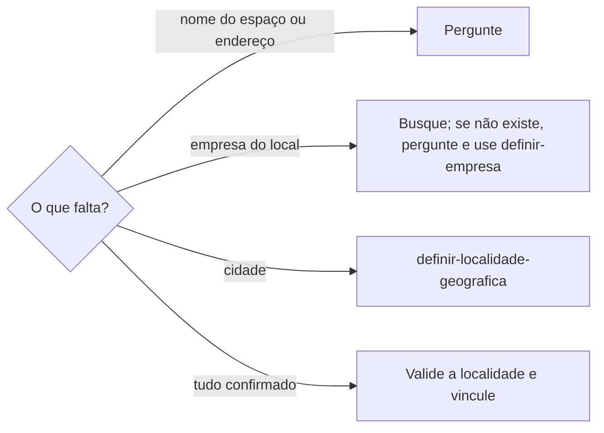

# Definir local físico

## Parâmetros de configuração

```yaml
{}
```

## Instruções

### Passo 1

O lugar físico é onde algo acontece: o nome do espaço, o endereço completo, a empresa do local e a localidade. A lista de empresas, a de localidades e o nome de cada propriedade vêm do mapeamento de dados do projeto, no workspace conectado. Se uma lista não estiver nessa conexão, pare. Não use a lista de outro workspace.



### Passo 2

O local só está confirmado com o nome do espaço e o endereço completo. Nome de cidade, de bairro ou de evento não bastam. Faltando um dos dois, pergunte e não deduza o endereço por memória.

### Passo 3

Busque a empresa do local pelo nome do espaço e por suas grafias, com e sem acento, com e sem o tipo (centro, teatro, casa). A existência segue `identificar-duplicata` e a grafia segue `definir-grafia`. Achou uma só: use-a. Achou várias: mostre e pergunte.

Não achou: pergunte se cadastra agora. Só com o sim, cadastre pela `definir-empresa` e então vincule. Sem o sim, deixe o vínculo vazio e liste a pendência. Não vincule a uma empresa parecida.

### Passo 4

A localidade do local é validada contra a da empresa. Se forem diferentes, registre o conflito, mostre os dois valores e confirme com a pessoa antes de gravar. Não escolha uma delas sozinho.

A cidade que não está na lista de localidades segue `definir-localidade-geografica`. Não use o estado nem a cidade vizinha como aproximação.

### Passo 5

Um espaço dentro do local, como sala, palco ou auditório, fica um nível abaixo da empresa. Ele só é gravado quando o mapeamento tem onde guardá-lo. Sem esse lugar, pergunte onde guardar e não escreva o espaço no corpo nem no nome da empresa.

### Passo 6

Mostre o nome do espaço, o endereço, a empresa vinculada, a localidade e o que ficou pendente. Quando um dado faltou, diga qual e a pergunta feita.

## Problemas comuns

### Endereço deduzido

Se você completar o endereço pela cidade ou pela memória, o local grava um endereço que ninguém confirmou.

1. Pergunte o nome do espaço e o endereço completo.
2. Grave só o que a fonte ou a pessoa afirmou.
3. Liste o que ficou sem confirmação.

### Empresa parecida vinculada

Se você vincular o local à empresa de nome parecido, o evento aparece no lugar errado.

1. Busque por nome e grafias.
2. Várias ou nenhuma: pergunte.
3. Cadastre pela `definir-empresa` só com o sim.

### Estado no lugar da cidade

Se você preencher o estado porque a cidade não existe na lista, a busca por cidade deixa de achar o local.

1. Chame `definir-localidade-geografica`.
2. Vincule só depois que a cidade existir.

## Exemplos de entrada e saída

Estes exemplos ilustram fatos. Eles podem não estar no data source.

### o evento será no Centro Cultural Aurora, em Cidade Exemplo

O nome do espaço veio, o endereço não. Perguntei o endereço completo antes de vincular.

### a empresa Centro Cultural Aurora não existe, e o endereço é Rua das Flores, 100, Cidade Exemplo

Perguntei se cadastra agora. Com o sim, a `definir-empresa` cadastrou e vinculei o local. A localidade da empresa e a do local batiam.

## Casos-limite

- Nome do espaço sem endereço, ou endereço sem nome: pergunte o que falta.
- Duas empresas com o mesmo nome em cidades diferentes: o endereço decide. Sem ele, pergunte.
- A localidade do local difere da da empresa: registre, mostre os dois e confirme.
- A cidade não está na lista de localidades: `definir-localidade-geografica`.
- O mapeamento não tem onde guardar o espaço: pergunte onde guardar.
- Local online: não há endereço físico. Diga que não se aplica e não invente um.

## Pegadinhas

- O nome do evento parece o nome do local. O local é o espaço onde ele acontece.
- Um local com vários espaços é uma empresa só. Sala, palco e auditório são o nível de baixo.
- Empresa nova parece cadastro automático. Esta habilidade pergunta antes de chamar a `definir-empresa`.
- O estado parece uma aproximação aceitável para a cidade. Não é.

## Scripts disponíveis

- Nenhum.

1. Não há script para executar.
