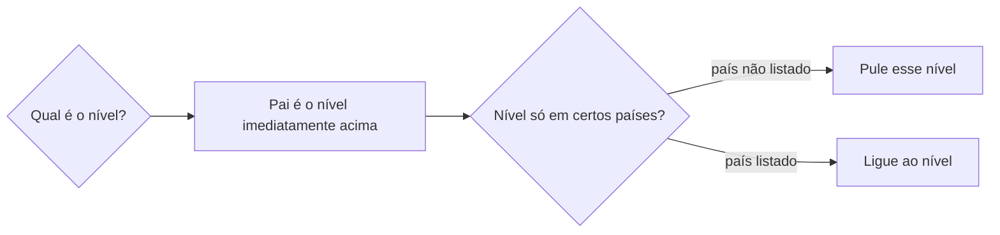

# Definir localidade geográfica

## Parâmetros de configuração

Leia cada valor nas instruções do projeto: primeiro na entrada com o nome desta habilidade, depois na entrada `Global` ou no primeiro nível do bloco. Quando um valor não estiver lá, use o padrão abaixo.
```yaml
# `Padrão do nome do estado` usa `{artigo}` (do, de ou da, pela forma natural) e `{nome}`. Vazio: o nome puro.
"Padrão do nome do estado": "Estado {artigo} {nome}"
# `Padrão do nome da cidade` usa `{nome}` e `{UF}`. A sigla só entra quando ajuda a desambiguar.
"Padrão do nome da cidade": "{nome} ({UF})"
# `Níveis da hierarquia` lista os tipos do mais alto ao mais baixo, como planeta, continente, país, região, estado e cidade. Vazio: detecte no workspace.
"Níveis da hierarquia": ""
# `Níveis só em certos países` liga um nível aos países em que ele existe, como região: [país]. Vazio: nenhum.
"Níveis só em certos países": {}
```
## Instruções

### Passo 1

A lista de localidades e o nome de cada propriedade vêm do mapeamento de dados do projeto, no workspace conectado. Se o mapeamento não a traz ou ela não abre, não pare: procure nos bancos do workspace conectado um que corresponda. Achou mais de um, confirme qual com a pessoa. Não achou nenhum, pergunte se deve criar ou peça que ela indique onde está. Criar o banco só com o sim, seguindo a regra do projeto para banco novo.

Não use a lista de outro workspace. Este texto usa os conceitos: o nome, o tipo, que é um dos níveis da hierarquia, o pai, o código ISO 3166, a abreviatura, a prioridade de oportunidades e as observações. Se o nome, o tipo ou o pai faltar no mapeamento, pare antes de gravar e diga qual.

Uma propriedade opcional que falta e para a qual há valor: grave o resto e liste o valor no fim, com a proposta da propriedade. Nunca crie schema nem grave o valor no corpo.

### Passo 2

Antes de criar, use `identificar-duplicata` com o tipo, o nome, as variações e o código ISO. Existe equivalente: atualize ou relacione a página existente, sem duplicata. Resultado ambíguo: pergunte antes de criar. A grafia fica com `definir-grafia` e juntar páginas do mesmo item fica com `mesclar-registro`.

### Passo 3

Os níveis da hierarquia e a ordem deles vêm de `Níveis da hierarquia`. Vazio: detecte no workspace conectado, pelas opções do tipo e pela relação do pai na lista. Sem ordem clara, pergunte uma vez. A hierarquia padrão é país, estado, cidade. Um negócio pode acrescentar níveis acima do país, como continente ou o planeta como pai de todos, ou entre o país e o estado, como região.

Cada página tem como pai uma página do nível imediatamente acima. O nível mais alto não tem pai. Pai vazio ou errado se corrige antes de concluir. Nunca pule um nível que existe para aquele lugar.

Um nível de `Níveis só em certos países` existe só nos países listados: nos outros, o filho liga ao nível de cima. Um tipo da hierarquia que o mapeamento não tem como opção: pergunte antes de criar a opção.



### Passo 4

O país usa o ISO 3166-1, como `BR`. O estado usa o ISO 3166-2, como `BR-RS`. Continente, planeta e região não têm ISO. Ausente ou fora do padrão, ajuste. Na cidade o código é opcional e pode ficar vazio. A abreviatura é opcional.

O nome do estado segue `Padrão do nome do estado`, com o artigo mais natural. O padrão do estado não se aplica a cidade. A cidade segue `Padrão do nome da cidade` quando a sigla ajuda a buscar ou evita confusão entre nomes iguais ou parecidos, como uma cidade e um estado de mesmo nome.

### Passo 5

Cidade que a pessoa cita e não existe na lista: pergunte a prioridade de oportunidades dela e crie já com essa prioridade e com o nível acima como pai, o estado na hierarquia padrão. Não invente a prioridade. Nunca use o estado no lugar da cidade como aproximação, nem ligue a oportunidade à página do estado. Nível acima que falta, como o estado, crie primeiro, com o pai dele.

### Passo 6

Fonte incompleta ou dúvida de interpretação, como cidade ou região, grafia ou local exato: registre nas observações a origem, como texto do formulário, print, post ou site, e a dúvida pendente. Não afirme o que não validou.

### Passo 7

Para concluir, o registro tem o nome padronizado, o tipo certo, o pai certo quando há e o código ISO certo quando há. Faltando algo, diga o que falta e peça o dado antes de concluir. Mostre a página, o tipo, o pai, o código e o link. O lugar físico, como um espaço ou um endereço, e a empresa dele não são desta habilidade.

## Problemas comuns

### Duplicata criada

Se você criar sem buscar, a hierarquia ganha dois registros do mesmo lugar.

1. Busque por tipo, nome, variações e código.
2. Existindo, atualize ou relacione.
3. Ambíguo, pergunte.

### Estado no lugar da cidade

Se você ligar uma oportunidade ao estado porque a cidade não existe, a praça some da busca por cidade.

1. Pergunte a prioridade de oportunidades da cidade.
2. Crie a cidade já com ela e com o estado como pai.
3. Nunca use o estado como aproximação.

### Pai errado

Se você deixar a cidade com o país como pai ou sem pai, a hierarquia quebra.

1. Estado tem o país como pai. Cidade tem o estado.
2. Corrija antes de concluir.

### Padrão do estado na cidade

Se você aplicar o padrão do estado a uma cidade, o nome sai errado.

1. O padrão do estado é só do tipo estado.
2. A cidade segue o padrão da cidade.

### Dúvida sem registro

Se você gravar sem validar e sem anotar, a dúvida some.

1. Registre a origem e o que falta confirmar nas observações.

## Exemplos de entrada e saída

Estes exemplos ilustram fatos. Eles podem não estar no data source.

### cadastre o estado do Rio Grande do Sul

Busquei antes e não havia. Criei com o nome "Estado do Rio Grande do Sul", o país como pai e o código `BR-RS`.

### a oportunidade é em Cidade Exemplo, que não está na lista

Perguntei a prioridade de oportunidades da cidade, criei a cidade com ela e com o estado como pai, e não usei o estado como aproximação.

### cadastre a cidade Cidade Exemplo, mas não sei se é cidade ou região

Criei com a dúvida nas observações: origem "texto do formulário" e pendente confirmar se é cidade ou região.

## Casos-limite

- Já existe equivalente: atualize ou relacione. Não duplique.
- Cidade e estado com o mesmo nome: a cidade leva a sigla pelo padrão; o estado leva o padrão do estado.
- Estado sem o país: crie o país antes.
- Nível só em certos países, como região: o filho liga a ele nos países listados e ao nível de cima nos outros.
- Planeta ou continente como pai do país: valem quando estão em `Níveis da hierarquia`. Sem eles, o país não tem pai.
- A lista não está no mapeamento: procure o banco, confirme se houver vários, pergunte se não houver nenhum.
- Prioridade da cidade desconhecida: pergunte. Não invente.
- Código ISO de cidade: opcional, pode ficar vazio.
- Falta uma propriedade obrigatória no mapeamento: pare e diga qual.

## Pegadinhas

- O estado parece bastar quando a cidade não existe. Não basta: crie a cidade.
- "Estado do …" parece valer para toda localidade. Só vale para o tipo estado.
- O ISO parece obrigatório em toda linha. Na cidade é opcional.
- Uma sigla parece sempre necessária na cidade. Só entra quando desambigua.

## Scripts disponíveis

- Nenhum.

1. Não há script para executar.
