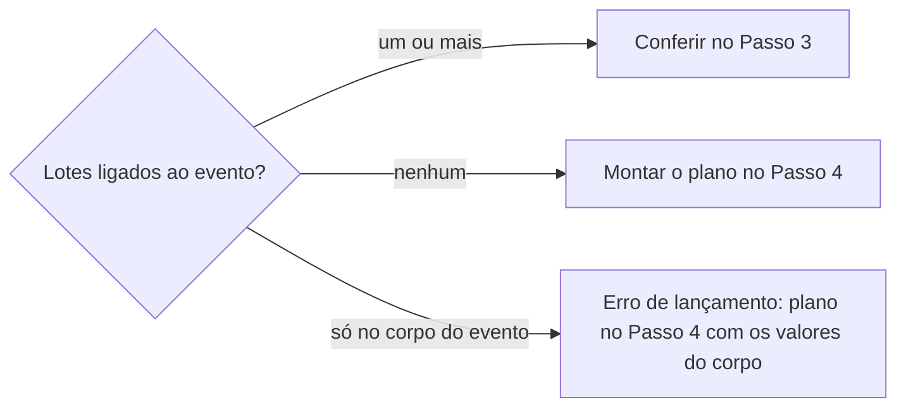

# Definir lote de ingresso

## Parâmetros de configuração

Leia cada valor nas instruções do projeto: primeiro na entrada com o nome desta habilidade, depois na entrada `Global` ou no primeiro nível do bloco. Quando um valor não estiver lá, use o padrão abaixo.

```yaml
# `Nome do data source de lotes` é o banco que a página de venda na porta lê.
"Nome do data source de lotes": ""
"Nome do data source de eventos": ""
# `Nome do data source de contas` guarda a conta recebedora e o status dela.
"Nome do data source de contas": ""
# `Campos do lote` liga cada papel ao nome da propriedade no banco de lotes.
"Campos do lote":
  "nome": ""
  "evento": ""
  "valor": ""
  "quantidade": ""
  "taxa percentual": ""
  "taxa fixa": ""
  "descrição pública": ""
  "observações": ""
  "janela de venda": ""
  "tipo de janela": ""
  "status da janela": ""
  "conta recebedora": ""
# `Campos do evento` liga cada papel ao nome da propriedade no banco de eventos.
"Campos do evento":
  "data": ""
  "status": ""
  "link de ingressos": ""
  "praça": ""
# `Status da janela que vende` é o valor que o lote novo recebe, como `Ativa`.
"Status da janela que vende": ""
# `Status da janela encerrada` é o valor que tira o lote da página, como `Encerrada`.
"Status da janela encerrada": ""
"Tipo de janela padrão": ""
"Status do evento com vendas abertas": ""
# `Campo de status da conta` e `Status da conta ativa` dizem se a conta pode receber o Pix.
"Campo de status da conta": ""
"Status da conta ativa": ""
# `Conta recebedora padrão` é o nome da conta que a página usa quando o lote não tem conta.
"Conta recebedora padrão": ""
# `Endereço da venda na porta` aceita `{praça}`, o slug da praça ou da cidade, e `{evento}`, o ID da página do evento.
"Endereço da venda na porta": ""
# `Quem decide a taxa` é a área que diz se há taxa na porta e de quanto.
"Quem decide a taxa": ""
# `Artigo da venda na porta` é o título do passo a passo para quem faz à mão.
"Artigo da venda na porta": ""
"Modo de aprendizado": "perguntar"
```

## Instruções

### Passo 1

Receba o evento: a praça e a data, ou o link.
Procure no workspace conectado os data sources de `Nome do data source de lotes`, `Nome do data source de eventos` e `Nome do data source de contas` e use-os sem perguntar.
Se algum parâmetro estiver vazio, pergunte uma vez e pare.
Não use um banco de outro workspace.

Ache o evento pela `praça` e pela `data`.
O lote da porta é o mesmo lote da tiqueteira, vendido por outro caminho: não crie outro registro para a porta quando o lote da tiqueteira já está ligado ao evento.
Abrir as vendas na tiqueteira não é esta habilidade.
Preço e quantidade de um loteamento novo não se decidem aqui: pergunte os valores ou copie os da edição anterior da mesma praça e do mesmo produto, com o sim da pessoa.

### Passo 2

Liste os lotes do banco de lotes com o `evento` igual a este evento.
Leia também o corpo da página do evento, porque lote escrito ali não aparece na página.



### Passo 3

Confira cada lote e o evento, na ordem, e diga o campo, o valor atual e o valor que a venda na porta exige.

- [ ] O evento com `status` igual a `Status do evento com vendas abertas`, `link de ingressos` preenchido e `praça` ligada.
- [ ] O `status da janela` diferente de `Status da janela encerrada` em cada lote que deve vender na porta. Lote que não deve, como um lote antigo, recebe `Status da janela encerrada` com o sim da pessoa.
- [ ] A `conta recebedora` preenchida e, em `Nome do data source de contas`, com `Campo de status da conta` igual a `Status da conta ativa`. Para cadastrar ou corrigir a conta, siga `definir-conta-bancaria`.
- [ ] O `valor` igual ao que o público paga na porta, com a taxa já somada quando houver.
- [ ] A `quantidade` preenchida. Ela não fecha o lote sozinha.
- [ ] A `descrição pública` sem link, ID nem instrução interna. Isso vai em `observações`.

### Passo 4

Monte o plano com cada campo de `Campos do lote`: o valor atual, o proposto e a origem.
O lote novo recebe `Status da janela que vende`, `Tipo de janela padrão`, a `janela de venda` com início e o `evento` ligado.
Sem a taxa clara, pergunte a `Quem decide a taxa` se há taxa na porta e de quanto.
Com taxa, o `valor` é o preço do ingresso mais a taxa, e a taxa vai em `taxa percentual` ou `taxa fixa`.
Sem taxa, os campos de taxa ficam em zero.
Mostre o plano e grave só o que a pessoa aprovou.
Conta descontinuada sai do lote, mas fica no banco de contas.

### Passo 5

Abra `Endereço da venda na porta` com o slug da praça e o ID do evento.
A página está certa quando mostra cada lote ativo com o `valor` e, depois de escolher a cota, a chave Pix da conta recebedora.
A página atualiza alguns minutos depois da edição: confira de novo antes de dizer que falhou.

### Passo 6

Entregue o link do evento, o link de cada lote criado ou conferido, com nome, valor, quantidade, status da janela e conta recebedora, o link da página de venda na porta e as pendências, cada uma com quem a resolve.
Lote sem link não está lançado.
Para quem prefere fazer à mão, cite `Artigo da venda na porta`.

### Passo 7

Ao terminar, siga `evoluir-habilidade` conforme `Modo de aprendizado`.

## Problemas comuns

### Página sem nenhuma cota

Se você conferir só o evento, deixa passar a falta de lote, e a página abre sem cota no dia do show.

1. Liste os lotes pelo `evento` antes de olhar o resto.
2. Se não houver nenhum, monte o plano do Passo 4.

### Cópia do lote da tiqueteira

Se você criar um lote só para a porta quando o lote da tiqueteira já está ligado ao evento, a página mostra a mesma cota duas vezes e as vendas se dividem entre dois registros.

1. Confira o lote que já está ligado ao evento.
2. Corrija esse lote em vez de criar outro.

### Pix da conta errada

Se você aceitar a página com Pix como prova de conta certa, deixa passar o lote sem `conta recebedora`, que mostra o Pix da `Conta recebedora padrão`.

1. Abra a `conta recebedora` do lote no banco de contas.
2. Se estiver vazia, pergunte qual conta ativa recebe e grave no lote.

### Valor sem a taxa

Se você gravar no `valor` o preço sem a taxa esperando que a página some, o público paga menos.

1. Confirme a taxa com `Quem decide a taxa`.
2. Grave no `valor` o total que o público paga.

### Link fixo abrindo outro evento

Se você abrir o endereço da praça sem o ID do evento com duas datas em vendas abertas, a página vai para a data mais próxima.

1. Use o endereço com o ID do evento.
2. Para o link fixo, confira que a outra data não está em vendas abertas antes do tempo.

## Exemplos de entrada e saída

Estes exemplos ilustram fatos. Eles podem não estar no data source.

### os ingressos de porta do show de hoje estão ok?

O show de hoje está com vendas abertas, mas nenhum lote do banco de lotes está ligado a ele, então a página de venda na porta abriria sem cota.
Plano com os valores da edição anterior da mesma praça: três cotas, com o status da janela que vende, o tipo de janela padrão e a conta ativa, e a taxa na porta pendente para quem decide a taxa.
Depois do sim, os três lotes são gravados, a página mostra as cotas com o Pix, e a resposta traz o link de cada lote.

### libere na porta o 2º lote que está na tiqueteira

O 2º lote já está ligado ao evento, com o ID da tiqueteira. Conferi esse mesmo registro: faltava a conta recebedora. Não criei outro lote para a porta.

### cadastre um lote de 10 reais com taxa de 10%

Valor de R$ 11,00, taxa percentual de 10%, conta recebedora ativa, e o link do lote depois da conferência na página.

## Casos-limite

- O evento já passou: confira e corrija os lotes para o fechamento, sem abrir a página.
- O lote esgotou na porta: ele não fecha sozinho. Proponha `Status da janela encerrada` com o sim de quem está na porta.
- O lote está ligado a outro evento, como a edição da semana anterior: proponha trocar o `evento` só com o sim, porque as vendas já ligadas vão junto.
- A porta cobra outro valor que a tiqueteira: o `valor` do lote é o da porta, e a decisão é de `Quem decide a taxa`.

## Pegadinhas

- A página mostra todo lote ligado ao evento que não está em `Status da janela encerrada`, inclusive o da tiqueteira. `Status da janela` vazio ou não iniciado não tira o lote da página.
- A página de venda na porta cobra só o `valor`. Ela não soma os campos de taxa.
- Uma coluna calculada de valor com taxa soma a taxa ao `valor` e não é o que a porta cobra.
- Sem `conta recebedora`, a página não fica sem Pix: ela usa a `Conta recebedora padrão`.
- O endereço da praça sem o ID do evento leva à data mais próxima em vendas abertas, não à de hoje.
- O banco de lotes é a fonte da verdade. A página não lê o corpo da página do evento nem comentários.
- A página não confirma o pagamento por Pix. Quem está na porta confere cada Pix.

## Scripts disponíveis

- Nenhum.

1. Com terminal, abra a página com `curl -sL <endereço>` e procure o nome de cada cota.
2. No Notion, sem terminal, abra o endereço pela busca na web. Se não der, peça à pessoa para abrir o link e dizer o que aparece.
