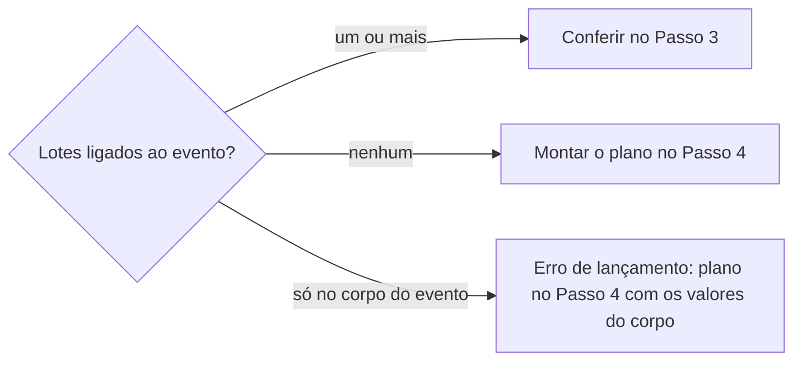

# Definir lote de ingresso

## Parâmetros de configuração

Leia cada valor nas instruções do projeto: primeiro na entrada com o nome desta habilidade, depois na entrada `Global` ou no primeiro nível do bloco. Quando um valor não estiver lá, use o padrão abaixo.

```yaml
"Nome do data source de lotes": ""
"Nome do data source de eventos": ""
# `Nome do data source de contas` guarda a conta recebedora e o status dela.
"Nome do data source de contas": ""
# `Campos do lote` liga cada papel ao nome da propriedade no banco de lotes.
"Campos do lote":
  "nome": ""
  "evento": ""
  "valor": ""
  "quantidade": ""
  "taxa percentual": ""
  "taxa fixa": ""
  "descrição pública": ""
  "observações": ""
  "janela de venda": ""
  "tipo de janela": ""
  "status da janela": ""
  "conta recebedora": ""
# `Campos do evento` liga cada papel ao nome da propriedade no banco de eventos. `local` é a cidade, a praça ou a casa do evento.
"Campos do evento":
  "data": ""
  "local": ""
  "produto": ""
# `Status da janela que vende` é o valor que o lote novo recebe, como `Ativa`.
"Status da janela que vende": ""
# `Status da janela encerrada` é o valor que encerra o lote, como `Encerrada`.
"Status da janela encerrada": ""
"Tipo de janela padrão": ""
# `Campo de status da conta` e `Status da conta ativa` dizem se a conta pode receber.
"Campo de status da conta": ""
"Status da conta ativa": ""
# `Valor inclui a taxa` é `sim` quando o `valor` guarda o total que o público paga, ou `não` quando guarda o preço sem a taxa.
"Valor inclui a taxa": ""
# `Quem decide a taxa` é a área ou a pessoa que diz se há taxa e de quanto.
"Quem decide a taxa": ""
"Modo de aprendizado": "perguntar"
```

## Instruções

### Passo 1

Receba o evento: o local e a data, ou o link.
Procure no workspace conectado os data sources de `Nome do data source de lotes`, `Nome do data source de eventos` e `Nome do data source de contas` e use-os sem perguntar.
Se algum parâmetro estiver vazio, pergunte uma vez e pare.
Não use um banco de outro workspace.

Ache o evento pelo `local` e pela `data`.
Abrir as vendas numa tiqueteira e conferir uma página de venda não são esta habilidade.
Preço e quantidade de um loteamento novo não se decidem aqui: pergunte os valores ou proponha os da edição anterior do mesmo `produto` no mesmo `local`, com a origem e com o sim da pessoa.

### Passo 2

Liste os lotes do banco de lotes com o `evento` igual a este evento.
Leia também o corpo da página do evento, porque lote escrito ali não é lote.



Um lote pedido que já está ligado ao evento é conferido e corrigido. Não crie outro registro para ele.

### Passo 3

Confira cada lote, na ordem, e diga o campo, o valor atual e o valor esperado.

- [ ] O `status da janela` diferente de `Status da janela encerrada` enquanto o lote vende. Lote que já não vende recebe `Status da janela encerrada` com o sim da pessoa.
- [ ] A `conta recebedora` preenchida e, em `Nome do data source de contas`, com `Campo de status da conta` igual a `Status da conta ativa`. Para cadastrar ou corrigir a conta, siga `definir-conta-bancaria`.
- [ ] O `valor` de acordo com `Valor inclui a taxa`, e a taxa em `taxa percentual` ou `taxa fixa`.
- [ ] A `quantidade` preenchida. Ela não encerra o lote sozinha.
- [ ] A `descrição pública` sem link, ID nem instrução interna. Isso vai em `observações`.

### Passo 4

Monte o plano com cada campo de `Campos do lote`: o valor atual, o proposto e a origem.
O lote novo recebe `Status da janela que vende`, `Tipo de janela padrão`, a `janela de venda` com início e o `evento` ligado.
Sem a taxa clara, pergunte a `Quem decide a taxa` se há taxa e de quanto.
Com `Valor inclui a taxa` em `sim`, o `valor` é o preço mais a taxa. Com `não`, o `valor` é o preço.
A taxa vai em `taxa percentual` ou `taxa fixa`. Sem taxa, os campos de taxa ficam em zero.
Mostre o plano e grave só o que a pessoa aprovou.
Conta descontinuada sai do lote, mas fica no banco de contas.

### Passo 5

Entregue o link do evento, o link de cada lote criado ou conferido, com nome, valor, quantidade, status da janela e conta recebedora, e as pendências, cada uma com quem a resolve.
Lote sem link não está lançado.

### Passo 6

Ao terminar, siga `evoluir-habilidade` conforme `Modo de aprendizado`.

## Problemas comuns

### Evento sem nenhum lote

Se você conferir só o evento, deixa passar a falta de lote.

1. Liste os lotes pelo `evento` antes de olhar o resto.
2. Se não houver nenhum, monte o plano do Passo 4.

### Lote duplicado

Se você criar um lote quando o mesmo lote já está ligado ao evento, as vendas se dividem entre dois registros.

1. Confira o lote que já está ligado ao evento.
2. Corrija esse lote em vez de criar outro.

### Valor com a taxa errada

Se você gravar o `valor` sem olhar `Valor inclui a taxa`, o lote cobra a taxa duas vezes ou nenhuma.

1. Confirme a taxa com `Quem decide a taxa`.
2. Grave o `valor` como `Valor inclui a taxa` manda.

## Exemplos de entrada e saída

Estes exemplos ilustram fatos. Eles podem não estar no data source.

### os lotes do show de sábado foram lançados?

Nenhum lote do banco de lotes está ligado ao show de sábado. O corpo da página do evento lista três lotes, o que é erro de lançamento.
Plano com os valores do corpo: três lotes, com o status da janela que vende, o tipo de janela padrão e a conta ativa, e a taxa pendente para quem decide a taxa.
Depois do sim, os três lotes são gravados, e a resposta traz o link de cada um.

### cadastre o 2º lote, que já está na tiqueteira

O 2º lote já está ligado ao evento. Conferi esse mesmo registro: faltava a conta recebedora. Não criei outro lote.

### cadastre um lote de 10 reais com taxa de 10%

Com `Valor inclui a taxa` em `sim`: valor de R$ 11,00, taxa percentual de 10%, conta recebedora ativa, e o link do lote.

## Casos-limite

- O evento já passou: confira e corrija os lotes para o fechamento.
- O lote esgotou: ele não encerra sozinho. Proponha `Status da janela encerrada` com o sim da pessoa.
- O lote está ligado a outro evento, como a edição da semana anterior: proponha trocar o `evento` só com o sim, porque as vendas já ligadas vão junto.

## Pegadinhas

- `Status da janela` vazio ou não iniciado não encerra o lote. Só `Status da janela encerrada` encerra.
- Uma coluna calculada de valor com taxa pode somar a taxa a um `valor` que já a inclui. O que vale é `Valor inclui a taxa`.
- O banco de lotes é a fonte da verdade. Lote no corpo da página do evento ou num comentário não conta.

## Scripts disponíveis

- Nenhum.

1. Não há script para executar.
