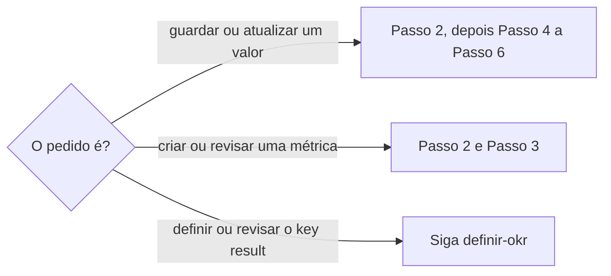

# Definir medição de métrica

## Parâmetros de configuração

Leia cada valor nas instruções do projeto: primeiro na entrada com o nome desta habilidade, depois na entrada `Global` ou no primeiro nível do bloco. Quando um valor não estiver lá, use o padrão abaixo.
```yaml
# `Propriedades de desambiguação` são os campos da métrica que separam dois conceitos com nome parecido.
"Propriedades de desambiguação":
  - "plataforma"
  - "origem do dado"
  - "escopo"
  - "unidade"
  - "período"
  - "granularidade"
"Modo de aprendizado": "perguntar"
```
## Instruções

### Passo 1

As listas de métricas, do histórico de medições e das entidades medidas vêm do mapeamento de dados do projeto, no workspace conectado.
O nome de cada propriedade também vem desse mapeamento: a métrica, a quantidade, o período de referência, a data de registro, a entidade medida, o recorte geográfico e os sinônimos da métrica.
Se a lista não estiver nessa conexão, pare.
Não use a lista de outro workspace.
Se o número vem de imagem, leia o texto com `reconhecer-imagem` antes de seguir.



### Passo 2

Ache a métrica do pedido na lista de métricas antes de qualquer gravação.
Procure o nome, o singular e o plural, as variações de grafia e de acento e as abreviações comuns, seguindo `identificar-duplicata`.
Procure também os sinônimos: o nome que outra ferramenta ou outra tela dá ao mesmo número, o nome interno e o oficial da plataforma, e a versão em outro idioma.
Para cada candidata, compare as `Propriedades de desambiguação` que a lista tem.
Mesmo nome com plataforma, unidade ou escopo diferente é outra métrica.
Nome diferente com as mesmas propriedades é a mesma métrica.
Se uma métrica existente é o mesmo conceito, use essa e mostre o nome e o link.
Quando a lista tem onde guardar sinônimos, acrescente o nome do pedido como sinônimo.

### Passo 3

Crie a métrica só quando a busca do Passo 2 não achou o conceito.
Preencha as `Propriedades de desambiguação` que a lista tem e que o pedido ou a fonte do dado deixam claras.
Mostre o plano com o nome e essas propriedades antes de gravar.
Ao revisar uma métrica, mostre o que muda antes de gravar.

### Passo 4

Cada valor vira um registro no histórico de medições.
O registro tem a quantidade, o período de referência, a data de registro e a ligação com a métrica.
Ligue o registro à entidade medida, quando houver uma.
Antes de criar, procure o registro da mesma métrica, entidade, recorte geográfico e período de referência.
Se ele existe, atualize esse registro e mostre o valor antigo e o novo.
Se o pedido não diz a que data ou período o número se refere, pergunte antes de gravar.
Não invente quantidade nem período.

### Passo 5

O número de uma métrica fica só no histórico de medições.
Não grave o número na página da entidade medida: nem em propriedade, nem em campo de observação, nem no corpo.
Mesmo quando a pessoa pede para guardar o número na página da entidade, grave no histórico e diga onde ficou.
O valor atual de um key result ligado à métrica sai desse histórico, como exige `definir-okr`.
Não digite o valor atual no key result.

### Passo 6

Preencha o recorte geográfico só quando o dado traz o recorte explícito, como um relatório com o número de cada cidade.
Nesse caso, crie um registro por recorte.
Com um total, deixe o recorte em branco.
Não deduza o recorte pelo nome do perfil, pela praça, pela origem do perfil nem pelo contexto da conversa.
O alcance de um perfil com nome de cidade inclui pessoas de qualquer lugar.

### Passo 7

Com mais de um registro, mostre o plano antes de gravar: a métrica, a entidade, o recorte, o período e a quantidade de cada um.
Depois de gravar, mostre o link de cada registro criado ou atualizado.

### Passo 8

Ao terminar, siga `evoluir-habilidade` conforme `Modo de aprendizado`.

## Problemas comuns

### Métrica repetida com outro nome

Se você criar "Contas alcançadas" quando a lista já tem "Alcance" da mesma plataforma, o histórico se divide em duas métricas e o key result lê só metade.

1. Compare as `Propriedades de desambiguação` antes de criar.
2. Use a métrica existente e guarde o nome novo como sinônimo.

### Número na página da entidade

Se você escrever o número na página da entidade medida, ele fica sem período, não entra no histórico e envelhece sem aviso.

1. Grave o valor como registro no histórico de medições.
2. Tire o número da página, se já estiver lá, depois de conferir que o histórico o tem.

### Recorte deduzido

Se você preencher a cidade pelo nome do perfil, um total vira número de uma cidade só.

1. Deixe o recorte em branco quando o dado é um total.
2. Preencha só com o recorte explícito do relatório.

## Exemplos de entrada e saída

Estes exemplos ilustram fatos. Eles podem não estar no data source.

### atualize os ouvintes mensais do Spotify desta artista: 48.200 em outubro

achei a métrica "Ouvintes mensais" com plataforma Spotify. Criei um registro com quantidade 48.200, período outubro de 2026, data de registro de hoje, a métrica e a artista. O recorte ficou em branco porque o número é um total. A página da artista não recebeu o número.

### registre o alcance do @perfilrecife: Recife 120, São Paulo 30, Outros 15

criei três registros da métrica de alcance, um por recorte: Recife, São Paulo e Outros. Perguntei o período de referência antes de gravar, porque o pedido não dizia.

## Casos-limite

- O pedido é definir ou revisar o key result: siga `definir-okr`.
- A métrica tem o mesmo nome e outra plataforma: é outra métrica.
- A lista de métricas não tem onde guardar sinônimos: use a métrica existente e não crie campo.
- O mesmo período já tem registro: atualize, não duplique.
- O dado vem de imagem: leia com `reconhecer-imagem` antes de registrar.
- A lista não está no workspace conectado: pare.

## Pegadinhas

- A página da entidade medida pode ter um campo de observação que parece o lugar do número. O número vai só para o histórico.
- O nome do perfil cita uma cidade, mas o alcance dele não é dessa cidade.
- Duas ferramentas chamam o mesmo número por nomes diferentes. O nome não basta: compare as `Propriedades de desambiguação`.
- A data de registro e o período de referência são datas diferentes. Um número de setembro registrado em outubro tem período setembro.
- O workspace conectado pode ser de outra empresa. Se a lista não estiver na conexão, pare.

## Scripts disponíveis

- Nenhum.

1. Não há script para executar.
