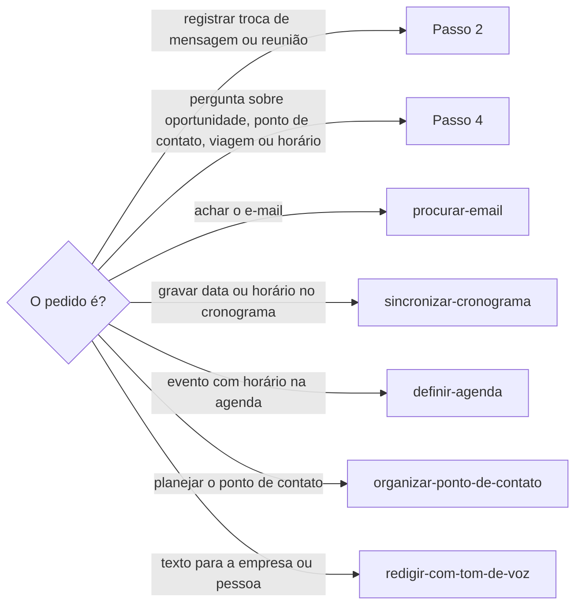

# Definir negociação

## Parâmetros de configuração

Leia cada valor nas instruções do projeto: primeiro na entrada com o nome desta habilidade, depois na entrada `Global`. Quando um valor não estiver lá, use o padrão abaixo.

```yaml
# `Modo de aprendizado` diz se a habilidade pergunta antes de evoluir ou evolui sozinha.
"Modo de aprendizado": "perguntar"
# `Ordem dos canais de execução` é a ordem em que a habilidade tenta ler ou enviar uma mensagem ou fazer uma inscrição. Passa ao canal seguinte só quando o anterior não existe ou falha.
"Ordem dos canais de execução": ["conector", "linha de comando", "API", "navegador do app", "extensão do navegador"]
```

## Instruções

### Passo 1

Conversa ligada a um negócio, como cotação, proposta, parceria ou venda, fica na página da negociação, na lista de negociações. Conversa sem negócio, como convite, agradecimento ou networking, fica na discussão da página da pessoa, e na da empresa quando há uma. Não crie negociação para ela.

Leia a descrição da lista de negociações no esquema antes de gravar: se ela proíbe o contato com a organização de uma oportunidade, como a de uma feira, esse contato não é negociação. Ele fica na discussão da página da pessoa e na da empresa organizadora, e a inscrição fica na página da inscrição.

Os nomes das listas e das propriedades vêm do mapeamento de dados do projeto, ou dos parâmetros das instruções do projeto onde a ferramenta não lê o mapeamento. Este texto usa os conceitos: negociação, pessoa, empresa, cronograma, inscrição, empresa abordada, pessoa abordada e oportunidade. Se o nome da lista não estiver no mapeamento nem nos parâmetros, use `procurar-banco-de-dados`, dizendo para que serve a lista. Se a lista não estiver no workspace conectado, pare e peça. Não adivinhe o nome.



### Passo 2

Com negócio, a negociação é uma por oportunidade, a edição com data. Ache a negociação dessa oportunidade antes de criar outra. Uma edição nova da mesma empresa e da mesma pessoa é negociação nova: ela cita o link da anterior e não herda o histórico, que fica na antiga. Ligue a página à empresa abordada, à pessoa abordada e a uma oportunidade só. Se uma segunda pessoa da mesma empresa falar, confira no schema se a pessoa abordada aceita mais de uma antes de somar. Se não aceitar, pergunte.

### Passo 3

Quando a pessoa só avisa que alguém entrou em contato por um canal, como uma DM do Instagram, sem colar o texto, não peça o texto. Leia a conversa você mesmo, pela `Ordem dos canais de execução`, e passe ao canal seguinte só quando o anterior não existir ou falhar. Sem conector, o navegador do app e a extensão do navegador leem a conversa na conta em que a pessoa já está logada. Peça a colagem só quando nenhum canal ler, e diga o que falhou em cada um.

Grave cada troca como um comentário na discussão da página da negociação, ou da pessoa quando não há negócio, uma por data ou bloco de mensagens. Comece com `Data da mensagem:` e a data, ou `Data do registro:` quando for uma ação do negócio sem mensagem, e diga o canal e quem falou. Resuma os fatos: datas, horários, valores, decisões e pendências. Cite entre aspas só a frase cuja grafia importa, como um horário dito de outro jeito. Antes de gravar, leia os comentários que já existem e não repita a mesma mensagem.

Quando o e-mail da empresa diz que o status se acompanha num painel, a pendência segue `acompanhar-retornos-pendentes`, que registra também o painel.

Depois de enviar uma mensagem, um e-mail ou um comprovante de pagamento a uma empresa ou pessoa, registre a troca na mesma rodada, sem perguntar se deve registrar. Na resposta, diga o que registrou, com o link da página, e o que não registrou e por quê.

Quando a empresa recusa, a recusa fica em três lugares, na mesma rodada: o comentário da troca, com as palavras dela; a nota do contato no WhatsApp, com a data e o que ela recusou; e a conversa, que leva o rótulo de estado de concluída, por `rotular-item`. Diga o que a recusa não deixou claro, como a que pode valer só para um material. Quando a decisão é da marca, como o veto de uma feira ou o cliente dispensado, o estado é `Sem fit`, por `rotular-item`, com o motivo no comentário.

### Passo 4

Antes de perguntar à pessoa um fato sobre oportunidade, ponto de contato, viagem ou horário, consulte nesta ordem e marque cada fonte:

- [ ] Comentários da negociação e da página da pessoa
- [ ] Cronograma
- [ ] Inscrições
- [ ] Página da oportunidade e do ponto de contato
- [ ] E-mail, com `procurar-email`

Pergunte só o que nenhuma fonte responde e diga quais você consultou. Se duas fontes divergem, mostre as duas com a data de cada uma. Não escolha uma.

Antes de redigir ou enviar a retomada de um contato, leia nos comentários a data e o canal da troca anterior. A mensagem anterior que a pessoa cola vale com a data que ela tem: "hoje", "agora" e "estamos" eram do dia dela, e o que mudou desde então vem das fontes.

Não presuma que o contato anterior foi no mesmo canal do atual: confirme o canal antes de escrever. O texto diz o canal certo, como "pelo Instagram", e não "por aqui" quando o canal mudou. Diga como o contato foi achado quando a pessoa contar, como a postagem ou o site, e não invente a origem.

Quando a pergunta é se já houve contato com uma empresa ou pessoa e nenhuma fonte tem registro, não encerre com "não achei". Confira se a oportunidade dela está cadastrada, com `procurar-oportunidade`. Pesquise na internet o site, o perfil social e o contato público da empresa, da pessoa ou da oportunidade, e veja se há edição futura e formulário de inscrição ou de curadoria. Diga o que achou, com os links.

Com formulário aberto, tente a inscrição já. Antes de abrir o formulário, carregue `inscrever-na-oportunidade` e preencha só como ela manda, com o contato da empresa e o formato que cada campo valida.

Com ou sem inscrição, proponha também o contato direto, pelo canal em que a organização responde, para a marca se apresentar e avisar da inscrição. O texto cita quem indicou a marca quando a pessoa contar, e não inventa indicação. Ele sai por `redigir-com-tom-de-voz`.

A primeira mensagem se apresenta em primeira pessoa por quem assina, com nome e papel, e não só pela marca. Quem assina vem do cadastro de pessoas e das instruções do projeto, que dizem quem representa a marca e quando outra pessoa pode aparecer. Sem essa fonte, pergunte. Não ponha uma segunda pessoa sem a condição que a fonte pede.

A organização e quem a dirige costumam ter perfis separados. Procure o perfil de cada um, na bio, no site de links e nas publicações, e proponha uma mensagem para cada, escrita para quem lê aquele perfil: o perfil da organização recebe um texto para a equipe, no plural, e o perfil pessoal recebe um texto com o nome da pessoa. Não mande ao perfil da organização um texto endereçado a uma pessoa.

Antes de redigir, pergunte como o contato nasceu quando nenhuma fonte diz, como o evento em que a marca esteve, quem apresentou ou o encontro que não aconteceu. O texto conta essa cena, com quem indicou e o que cada um disse, só com o que a pessoa contou.

Com o texto e o destino aprovados, envie você mesmo, sem pedir à pessoa que envie. Tente os canais na `Ordem dos canais de execução` e passe ao seguinte só quando o anterior não existir ou falhar. Se nenhum enviar, entregue o texto pronto e diga o que falhou em cada canal. Sem a aprovação, não envie nem cadastre a empresa ou a pessoa. Depois do envio, registre a troca como o Passo 3 manda.

Quando a organização atende num grupo, como o de uma feira, e a marca escreveu a ela no privado, proponha também uma mensagem curta ao grupo, endereçada à pessoa da organização pelo nome. Ela só avisa que a marca já escreveu no privado, o que pediu, como a baia escolhida, e que aguarda o retorno. Não repete valor nem dado do privado. Ela sai com o sim da pessoa, pelo mesmo caminho, e o registro do Passo 3 a inclui.

### Passo 5

Ao terminar, siga `evoluir-habilidade` conforme `Modo de aprendizado`.

## Problemas comuns

### Pergunta já respondida

Se você perguntar um horário ou combinado sem ler a negociação, a pessoa repete o que já disse no WhatsApp ou no e-mail.

1. Siga o checklist do Passo 4.
2. Responda com o que achou e a fonte.
3. Pergunte só o que faltou.

### Texto da mensagem pedido à pessoa

Se você pedir o texto de uma DM que a pessoa só avisou que chegou, ela cola o que a conta dela já mostra e o contato espera. Falta de conector não é falta de canal.

1. Leia a conversa pela `Ordem dos canais de execução`: conector, linha de comando, API, navegador do app e extensão do navegador.
2. Siga com o texto lido: registre a troca como o Passo 3 manda e escreva a resposta por `redigir-com-tom-de-voz`.
3. Peça a colagem só quando nenhum canal ler, e diga o que falhou em cada um.

### Contato retomado no canal errado

Se você escrever a retomada com a data e o canal que a mensagem anterior parecia ter, o texto diz "hoje" de um dia que já passou ou "por aqui" de um canal que já mudou.

1. Leia a data e o canal da troca anterior nos comentários, ou pergunte quando faltarem.
2. Confirme o canal do contato atual. Não presuma que é o mesmo.
3. Escreva o canal certo e a origem do contato que a pessoa contou.

### Histórico no corpo da página

Se você gravar o histórico no corpo da página ou num comentário de propriedade, ele some do topo da página e quebra a linha do tempo.

1. Grave na discussão da página.
2. Deixe o corpo como está.
3. Se o fato tiver propriedade própria, como status ou valor, atualize a propriedade.

### Recusa só contada à pessoa

Se você só relatar a recusa, a empresa volta à lista na próxima compra e a conversa segue entre as que esperam resposta.

1. Grave a troca com as palavras da empresa, como o Passo 3 manda.
2. Escreva a data e o que ela recusou na nota do contato no WhatsApp.
3. Aplique o rótulo de estado de concluída, por `rotular-item`.

### Privado sem aviso ao grupo

Se você escrever à organização só no privado, quem atende o grupo pode não ligar a mensagem à marca e responder as outras primeiro.

1. Depois do envio, proponha ao grupo uma mensagem curta, endereçada à pessoa da organização.
2. Ela diz que a marca já escreveu no privado, o que pediu e que aguarda o retorno.
3. Envie só com o sim da pessoa e registre a mensagem como o Passo 3 manda.

### Registro que espera pergunta

Se você enviar a mensagem e só oferecer registrar a troca, a negociação fica sem o que o negócio disse e a pessoa tem de pedir o registro.

1. Registre na mesma rodada do envio, sem perguntar.
2. Diga na resposta o que registrou, com o link, e o que não registrou.
3. Um pagamento já registrado como despesa entra no comentário com o link da despesa.

### Negociação que junta edições

Se você gravar a conversa de uma edição nova na negociação de outra, o histórico, a taxa, o prazo e a decisão de duas oportunidades ficam misturados.

1. Procure a negociação da oportunidade, não só a da empresa.
2. Sem ela, crie uma nova, ligada só a essa oportunidade, com o link da anterior.
3. Não mova o histórico antigo para a nova.

### Sem registro e sem proposta

Se você responder só que não achou registro de contato, a pessoa tem de pedir a pesquisa e a abordagem, e o contato não anda.

1. Depois do checklist do Passo 4, confira se a oportunidade está cadastrada e pesquise na internet o site, o perfil social, o contato público, a próxima edição e o formulário de inscrição.
2. Com formulário aberto, tente a inscrição. Responda com o que achou, com os links, e proponha o canal, o motivo e o texto da primeira mensagem, apresentada por quem fala e com a indicação quando a pessoa contar.
3. Não envie nem cadastre sem a aprovação do texto e do destino.

### Envio devolvido à pessoa

Se você escrever o texto aprovado e esperar a pessoa mandar, o contato atrasa e a negociação fica sem o registro do envio.

1. Com a aprovação, envie o texto pela `Ordem dos canais de execução`.
2. Só entregue o texto à pessoa quando nenhum canal enviar, e diga o que falhou em cada um.
3. Registre a troca na mesma rodada do envio, como o Passo 3 manda.

### Um texto para dois perfis

Se você escrever uma só mensagem para a organização e a mandar ao perfil dela endereçada a uma pessoa, quem lê não se reconhece no texto, e o perfil pessoal de quem dirige fica sem contato.

1. Procure o perfil da organização e o da pessoa que a dirige.
2. Proponha uma mensagem para cada um: plural para a equipe, o nome da pessoa no perfil pessoal.
3. Assine em primeira pessoa quem a fonte diz que representa a marca, com nome e papel.

### Divergência escondida

Se você escolher uma das fontes quando elas divergem, a pessoa chega na hora errada.

1. Mostre as duas versões, com fonte e data.
2. Pergunte qual vale ou sugira confirmar com a empresa.

## Exemplos de entrada e saída

Estes exemplos ilustram fatos. Eles podem não estar no data source.

### a Dora mandou no WhatsApp que a montagem é depois das 17

Gravei na discussão da negociação com Mel Almeida sobre a Feira Exemplo 2026: "Data da mensagem: 16/10/2026, 4h09 (WhatsApp, Dora Ribeiro)", com "Ideal que seja montado hoje, após as 17". Avisei que o manual da organização diz montagem a partir das 18h.

### que horas a gente chega na Feira Exemplo amanhã?

Consultei os comentários da negociação, o cronograma, as inscrições e o e-mail. O manual de 14/10 diz chegar às 6h para credenciamento e montagem da mesa. Não perguntei.

### a palestrante agradeceu e a gente convidou ela pra um café

Não havia cotação, proposta, parceria nem venda. Gravei na discussão da página da pessoa, com a data, o canal e quem falou, e a pendência da resposta ao café. Não criei negociação.

### o pessoal da Feira Exemplo acabou de entrar em contato com a gente via DM no Instagram

Não havia conector do Instagram. Não pedi o texto: abri a conversa no navegador do app, na conta em que a pessoa já estava logada, e li a mensagem com a data e o horário. Registrei a troca na discussão da página da pessoa, sem criar negociação, e propus a resposta no tom de voz. Se o navegador do app não abrisse a conversa, tentaria a extensão do navegador, e só então pediria a colagem, dizendo o que falhou em cada um.

### cole a mensagem que mandei à organização da Feira Exemplo e escreva a retomada pelo WhatsApp

A mensagem colada não tinha data. Li os comentários: foi enviada pelo Instagram em 9 de maio, e a retomada sai seis meses depois, pelo WhatsApp. Troquei o "hoje" dela pelo que mudou desde então, escrevi "no Instagram" para o contato anterior e perguntei como o número foi achado antes de afirmar a origem.

### já falamos com a Lia, do Ateliê Exemplo?

Consultei os comentários, o cronograma, as inscrições e o e-mail, e nenhum tem registro. A oportunidade não estava cadastrada. Pesquisei na internet: o Ateliê Exemplo tem site e perfil no Instagram, que responde a mensagens, e não tem formulário de inscrição. Propus abordar pelo Instagram, para pedir uma cotação de bordado, com o texto no tom de voz. Não enviei nem cadastrei a empresa antes da aprovação. Aprovado o texto, enviei pelo conector do Instagram, registrei a troca na discussão da página da pessoa e disse o que registrei.

### já falamos com a organização da Feira Exemplo?

Sem registro, achei a feira cadastrada e, no Instagram dela, um formulário aberto de curadoria para a edição de março. Tentei a inscrição e propus também duas mensagens pelo Instagram, uma para o perfil da organização, no plural, e outra para o perfil pessoal da organizadora, as duas assinadas pela Ana, que representa a marca, com nome e papel, e citando a Lia como quem indicou a marca, porque a pessoa contou isso.

Depois do envio, registrei o formulário na página da inscrição e a mensagem na discussão da organizadora, sem criar negociação, porque a lista de negociações proíbe o contato com a organização de feiras.

### a Isadora também respondeu pela Feira Exemplo

Conferi se a pessoa abordada aceita mais de uma pessoa antes de somar Isadora Ribeiro à negociação.

## Casos-limite

- A negociação não existe, ou é de outra edição da mesma empresa: busque pela empresa e pela oportunidade antes de criar, e só crie quando há negócio.
- O perfil pessoal de quem dirige a organização não aparece na busca: proponha só a mensagem do perfil da organização e diga que não achou o pessoal.
- A conversa é um convite, um agradecimento ou um café, sem negócio: grave na discussão da página da pessoa. Não crie negociação.
- A lista de negociações proíbe o contato com a organização de feiras: grave a DM e o formulário na discussão da pessoa e da inscrição. Não crie negociação.
- A pessoa avisa de um contato por um canal sem conector e sem colar o texto: leia a conversa pelo navegador do app e, se não abrir, pela extensão do navegador. Não peça o texto antes.
- Nenhum canal consegue ler a conversa: peça a colagem e diga o que falhou em cada canal.
- A conversa não tem data: use `Data aproximada:` e diga de onde veio.
- Várias mensagens no mesmo dia e assunto: um comentário só, com os horários.
- A pessoa corrige um fato já gravado: novo comentário datado com a correção. Não apague o anterior.
- A mensagem anterior chega colada, sem data nem canal: pergunte os dois antes de escrever a retomada. Não presuma que o canal é o mesmo do atual.
- O canal do contato mudou, como do Instagram para o WhatsApp: o texto diz o canal do contato anterior e a origem do novo, como a pessoa contou.
- A lista não está no workspace conectado, ou o nome dela não está no mapeamento: pare e peça.
- Sem registro de contato, e a pesquisa na internet não acha site, perfil nem contato público: diga o que pesquisou e peça à pessoa o canal. Não invente um contato.
- Nenhum canal de execução consegue enviar: entregue o texto pronto e diga o que falhou em cada canal. Não peça à pessoa que tente primeiro.
- A pesquisa acha mais de uma empresa ou pessoa com o mesmo nome: mostre as candidatas com o link de cada uma e pergunte qual é, antes de propor a abordagem.

## Pegadinhas

- A página da negociação pode ter um callout com a regra. O corpo não é linha do tempo.
- A linha do tempo do cliente numa loja parece o lugar da conversa, mas a API da loja pode não gravar comentário nela. A conversa fica na discussão da página da pessoa.
- Toda conversa parece pedir uma negociação. Sem cotação, proposta, parceria ou venda, não há negócio: a linha do tempo é a discussão da página da pessoa.
- Um comentário de propriedade fica escondido no campo. Só a discussão da página aparece no topo.
- O mesmo fato pode estar no WhatsApp, no e-mail e no manual com horários diferentes. A data mais recente não é automaticamente a certa.
- A mensagem anterior parece valer como está hoje. O "hoje" e o "estamos" dela eram do dia em que foi enviada, e o canal dela pode não ser o de agora.
- Sem conector do canal, parece que só a pessoa tem a mensagem. A conta dela está logada no navegador do app e na extensão do navegador, e a leitura é sua.
- O texto aprovado parece o fim do trabalho. A aprovação é o sim ao envio, e quem envia é você, pelos canais da `Ordem dos canais de execução`.
- "Não achei registro" parece uma resposta completa. Ela só diz que as fontes do workspace estão vazias: a próxima ação é pesquisar na internet e propor a abordagem.
- A empresa abordada e a pessoa abordada são relações. Telefone e grafias vêm por rollup e não se gravam aqui.
- Um formulário aberto parece pedir só os campos preenchidos com os dados que você já tem. A skill de inscrição define de onde vem cada dado e o formato de cada campo, como o celular só com dígitos: carregue-a antes de digitar.

## Scripts disponíveis

- Nenhum.

1. Não há script para executar.
