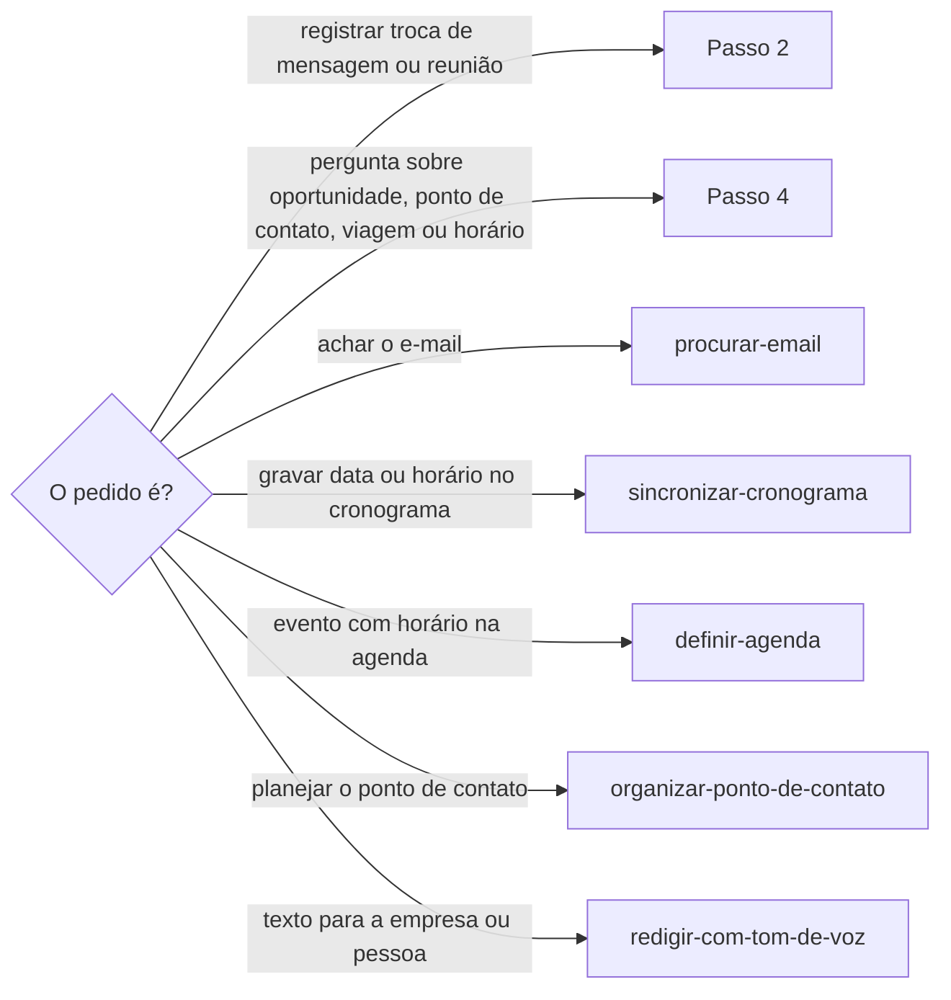

# Definir negociação

## Parâmetros de configuração

Leia cada valor nas instruções do projeto: primeiro na entrada com o nome desta habilidade, depois na entrada `Global`. Quando um valor não estiver lá, use o padrão abaixo.

```yaml
# `Modo de aprendizado` diz se a habilidade pergunta antes de evoluir ou evolui sozinha.
"Modo de aprendizado": "perguntar"
```

## Instruções

### Passo 1

Conversa ligada a um negócio, como cotação, proposta, parceria ou venda, fica na página da negociação, na lista de negociações. Conversa sem negócio, como convite, agradecimento ou networking, fica na discussão da página da pessoa, e na da empresa quando há uma. Não crie negociação para ela.

Os nomes das listas e das propriedades vêm do mapeamento de dados do projeto, ou dos parâmetros das instruções do projeto onde a ferramenta não lê o mapeamento. Este texto usa os conceitos: negociação, pessoa, empresa, cronograma, inscrição, empresa abordada, pessoa abordada e oportunidade. Se o nome da lista não estiver no mapeamento nem nos parâmetros, use `procurar-banco-de-dados`, dizendo para que serve a lista. Se a lista não estiver no workspace conectado, pare e peça. Não adivinhe o nome.



### Passo 2

Com negócio, a negociação é uma por oportunidade, a edição com data. Ache a negociação dessa oportunidade antes de criar outra. Uma edição nova da mesma empresa e da mesma pessoa é negociação nova: ela cita o link da anterior e não herda o histórico, que fica na antiga. Ligue a página à empresa abordada, à pessoa abordada e a uma oportunidade só. Se uma segunda pessoa da mesma empresa falar, confira no schema se a pessoa abordada aceita mais de uma antes de somar. Se não aceitar, pergunte.

### Passo 3

Grave cada troca como um comentário na discussão da página da negociação, ou da pessoa quando não há negócio, uma por data ou bloco de mensagens. Comece com `Data da mensagem:` e a data, ou `Data do registro:` quando for uma ação do negócio sem mensagem, e diga o canal e quem falou. Resuma os fatos: datas, horários, valores, decisões e pendências. Cite entre aspas só a frase cuja grafia importa, como um horário dito de outro jeito. Antes de gravar, leia os comentários que já existem e não repita a mesma mensagem.

Depois de enviar uma mensagem, um e-mail ou um comprovante de pagamento a uma empresa ou pessoa, registre a troca na mesma rodada, sem perguntar se deve registrar. Na resposta, diga o que registrou, com o link da página, e o que não registrou e por quê.

### Passo 4

Antes de perguntar à pessoa um fato sobre oportunidade, ponto de contato, viagem ou horário, consulte nesta ordem e marque cada fonte:

- [ ] Comentários da negociação e da página da pessoa
- [ ] Cronograma
- [ ] Inscrições
- [ ] Página da oportunidade e do ponto de contato
- [ ] E-mail, com `procurar-email`

Pergunte só o que nenhuma fonte responde e diga quais você consultou. Se duas fontes divergem, mostre as duas com a data de cada uma. Não escolha uma.

Antes de redigir ou enviar a retomada de um contato, leia nos comentários a data e o canal da troca anterior. A mensagem anterior que a pessoa cola vale com a data que ela tem: "hoje", "agora" e "estamos" eram do dia dela, e o que mudou desde então vem das fontes.

Não presuma que o contato anterior foi no mesmo canal do atual: confirme o canal antes de escrever. O texto diz o canal certo, como "pelo Instagram", e não "por aqui" quando o canal mudou. Diga como o contato foi achado quando a pessoa contar, como a postagem ou o site, e não invente a origem.

### Passo 5

Ao terminar, siga `evoluir-habilidade` conforme `Modo de aprendizado`.

## Problemas comuns

### Pergunta já respondida

Se você perguntar um horário ou combinado sem ler a negociação, a pessoa repete o que já disse no WhatsApp ou no e-mail.

1. Siga o checklist do Passo 4.
2. Responda com o que achou e a fonte.
3. Pergunte só o que faltou.

### Contato retomado no canal errado

Se você escrever a retomada com a data e o canal que a mensagem anterior parecia ter, o texto diz "hoje" de um dia que já passou ou "por aqui" de um canal que já mudou.

1. Leia a data e o canal da troca anterior nos comentários, ou pergunte quando faltarem.
2. Confirme o canal do contato atual. Não presuma que é o mesmo.
3. Escreva o canal certo e a origem do contato que a pessoa contou.

### Histórico no corpo da página

Se você gravar o histórico no corpo da página ou num comentário de propriedade, ele some do topo da página e quebra a linha do tempo.

1. Grave na discussão da página.
2. Deixe o corpo como está.
3. Se o fato tiver propriedade própria, como status ou valor, atualize a propriedade.

### Registro que espera pergunta

Se você enviar a mensagem e só oferecer registrar a troca, a negociação fica sem o que o negócio disse e a pessoa tem de pedir o registro.

1. Registre na mesma rodada do envio, sem perguntar.
2. Diga na resposta o que registrou, com o link, e o que não registrou.
3. Um pagamento já registrado como despesa entra no comentário com o link da despesa.

### Negociação que junta edições

Se você gravar a conversa de uma edição nova na negociação de outra, o histórico, a taxa, o prazo e a decisão de duas oportunidades ficam misturados.

1. Procure a negociação da oportunidade, não só a da empresa.
2. Sem ela, crie uma nova, ligada só a essa oportunidade, com o link da anterior.
3. Não mova o histórico antigo para a nova.

### Divergência escondida

Se você escolher uma das fontes quando elas divergem, a pessoa chega na hora errada.

1. Mostre as duas versões, com fonte e data.
2. Pergunte qual vale ou sugira confirmar com a empresa.

## Exemplos de entrada e saída

Estes exemplos ilustram fatos. Eles podem não estar no data source.

### a Dora mandou no WhatsApp que a montagem é depois das 17

Gravei na discussão da negociação com Mel Almeida sobre a Feira Exemplo 2026: "Data da mensagem: 16/10/2026, 4h09 (WhatsApp, Dora Ribeiro)", com "Ideal que seja montado hoje, após as 17". Avisei que o manual da organização diz montagem a partir das 18h.

### que horas a gente chega na Feira Exemplo amanhã?

Consultei os comentários da negociação, o cronograma, as inscrições e o e-mail. O manual de 14/10 diz chegar às 6h para credenciamento e montagem da mesa. Não perguntei.

### a palestrante agradeceu e a gente convidou ela pra um café

Não havia cotação, proposta, parceria nem venda. Gravei na discussão da página da pessoa, com a data, o canal e quem falou, e a pendência da resposta ao café. Não criei negociação.

### cole a mensagem que mandei à organização da Feira Exemplo e escreva a retomada pelo WhatsApp

A mensagem colada não tinha data. Li os comentários: foi enviada pelo Instagram em 9 de maio, e a retomada sai seis meses depois, pelo WhatsApp. Troquei o "hoje" dela pelo que mudou desde então, escrevi "no Instagram" para o contato anterior e perguntei como o número foi achado antes de afirmar a origem.

### a Isadora também respondeu pela Feira Exemplo

Conferi se a pessoa abordada aceita mais de uma pessoa antes de somar Isadora Ribeiro à negociação.

## Casos-limite

- A negociação não existe, ou é de outra edição da mesma empresa: busque pela empresa e pela oportunidade antes de criar, e só crie quando há negócio.
- A conversa é um convite, um agradecimento ou um café, sem negócio: grave na discussão da página da pessoa. Não crie negociação.
- A conversa não tem data: use `Data aproximada:` e diga de onde veio.
- Várias mensagens no mesmo dia e assunto: um comentário só, com os horários.
- A pessoa corrige um fato já gravado: novo comentário datado com a correção. Não apague o anterior.
- A mensagem anterior chega colada, sem data nem canal: pergunte os dois antes de escrever a retomada. Não presuma que o canal é o mesmo do atual.
- O canal do contato mudou, como do Instagram para o WhatsApp: o texto diz o canal do contato anterior e a origem do novo, como a pessoa contou.
- A lista não está no workspace conectado, ou o nome dela não está no mapeamento: pare e peça.

## Pegadinhas

- A página da negociação pode ter um callout com a regra. O corpo não é linha do tempo.
- A linha do tempo do cliente numa loja parece o lugar da conversa, mas a API da loja pode não gravar comentário nela. A conversa fica na discussão da página da pessoa.
- Toda conversa parece pedir uma negociação. Sem cotação, proposta, parceria ou venda, não há negócio: a linha do tempo é a discussão da página da pessoa.
- Um comentário de propriedade fica escondido no campo. Só a discussão da página aparece no topo.
- O mesmo fato pode estar no WhatsApp, no e-mail e no manual com horários diferentes. A data mais recente não é automaticamente a certa.
- A mensagem anterior parece valer como está hoje. O "hoje" e o "estamos" dela eram do dia em que foi enviada, e o canal dela pode não ser o de agora.
- A empresa abordada e a pessoa abordada são relações. Telefone e grafias vêm por rollup e não se gravam aqui.

## Scripts disponíveis

- Nenhum.

1. Não há script para executar.
