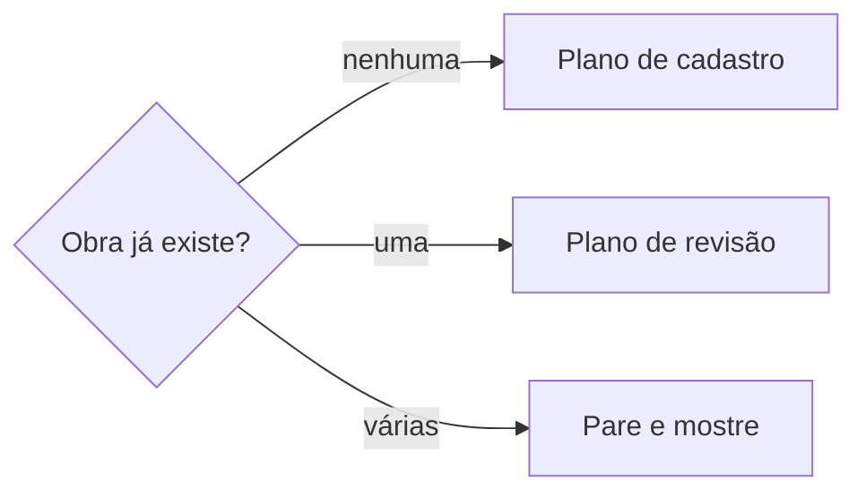

# Definir obra musical

## Parâmetros de configuração

Leia cada valor nas instruções do projeto: primeiro na entrada com o nome desta habilidade, depois na entrada `Global` ou no primeiro nível do bloco. Quando um valor não estiver lá, use o padrão abaixo.

```yaml
"Nome do data source de obras": "Obras musicais"
"Campos da base de obras":
  "título": ""
  "Participação na obra": ""
  "Intérpretes": ""
  "Escrita em": ""
  "Situação cadastral": ""
  "Obra verificada": ""
  "UBC da obra": ""
  "Protocolo": ""
  "Sociedade": ""
  "Data do copyright": ""
  "ISWC": ""
  "1.ª linha da letra musical": ""
  "1.ª linha do refrão": ""
  "Letra autenticada": ""
  "Letra sem autoria": ""
"Modo de aprendizado": "perguntar"
```

## Instruções

### Passo 1

Procure no workspace conectado o data source com o nome `Nome do data source de obras` e use-o sem perguntar: busque um termo da base e tome o data source de origem dos resultados cujo caminho tem esse nome. Abra o data source e leia o esquema. Só peça o link se a busca não achar nenhum ou achar mais de um. Não use um banco de outro workspace. Se `Campos da base de obras` estiver vazio, pergunte uma vez e pare.

Antes de criar ou revisar, procure se a obra já existe: busque pelo título e pelos primeiros versos da letra. Não crie duplicata.



### Passo 2

Monte o plano com cada campo de `Campos da base de obras`: o valor atual, o proposto e a origem. Campo sem fonte fica vazio e vira pendência. Na revisão, entra só o que muda. Um campo preenchido não é trocado por uma fonte mais fraca sem a pessoa decidir.

- `título`: a grafia oficial da obra, como está registrada ou como o artista assina.
- `Participação na obra`: os créditos de composição, com função de cada participante.
- `Intérpretes`: os artistas que interpretaram a obra, ligados ao banco de artistas.
- `Escrita em`: a data de criação da obra.
- `Situação cadastral`: o status do cadastro na UBC ou sociedade arrecadadora.
- `Obra verificada`: marcado quando os dados foram conferidos e validados.
- `UBC da obra`: o número do cadastro na UBC.
- `Protocolo`: o número do protocolo de cadastro ou registro.
- `Sociedade`: a sociedade arrecadadora responsável.
- `Data do copyright`: a data do copyright da obra.
- `ISWC`: o código internacional da obra, obtido via UBC/ECAD.
- `1.ª linha da letra musical`: o primeiro verso da letra.
- `1.ª linha do refrão`: o primeiro verso do refrão.
- `Letra autenticada`: arquivo com letra autenticada, obrigatório para editais. Só com comprovação.
- `Letra sem autoria`: arquivo com letra em seleção cega, obrigatório para editais. Sem identificação do autor.

A letra completa fica no corpo da página, na seção `# Letra`, separada em versos e refrão. Não grave a letra em propriedades nem em comentários.

### Passo 3

Valide o plano antes de mostrar:

- [ ] cada valor tem origem no material ou numa leitura feita nesta conversa
- [ ] a letra completa está preparada para o corpo, na seção `# Letra`
- [ ] `Letra autenticada` e `Letra sem autoria` só entram com comprovação
- [ ] nenhuma subpágina será criada no Notion
- [ ] nenhum dado foi inventado: o que falta fica vazio

Corrija e valide de novo até passar.

### Passo 4

Mostre o plano e as pendências, e espere a confirmação. Depois crie a página com o corpo contendo a seção `# Letra`, ou atualize só os campos que mudam.

### Passo 5

Releia a página gravada e confira cada campo contra o plano. Corrija o que divergir. Entregue o link da página, o que foi gravado e as pendências, cada uma com quem a resolve.

### Passo 6

Ao terminar, siga `evoluir-habilidade` conforme `Modo de aprendizado`.

## Problemas comuns

### Obra duplicada

Se você criar a página sem procurar pelo título e primeiros versos, a obra ganha uma segunda página e os dados se dividem.

1. Procure pelo título completo e pelos primeiros versos da letra.
2. Se achar uma página, revise essa.
3. Se achar várias, pare e mostre.

### Letra em propriedade

Se você gravar a letra completa em propriedades ou comentários, ela fica truncada e desorganizada.

1. Grave a letra completa no corpo da página, na seção `# Letra`.
2. Separe versos e refrão.
3. Mantenha `1.ª linha da letra musical` e `1.ª linha do refrão` nas propriedades.

### Dado inventado

Se você preencher campos sem fonte, o registro fica com dados incorretos que ninguém validou.

1. Deixe vazio o campo sem fonte.
2. Registre como pendência.
3. Não invente ISWC, UBC, protocolo nem datas.

### Letra sem comprovação

Se você gravar `Letra autenticada` ou `Letra sem autoria` sem comprovação, a obra não serve para editais.

1. Só grave esses arquivos quando houver comprovação.
2. Deixe vazio quando faltar.
3. Registre como pendência para editais.

## Exemplos de entrada e saída

Estes exemplos ilustram fatos. Eles podem não estar no data source.

### Cadastre a obra Linha do Horizonte com letra e participação

A busca não achou nada. Plano: título "Linha do Horizonte", como o artista assina; participação com compositor e letrista; primeira linha da letra e do refrão; letra completa no corpo na seção `# Letra`; situação cadastral da UBC. Pendências: ISWC ainda não recebido, letra autenticada e letra sem autoria para futuros editais.

### Atualize o ISWC da obra Linha do Horizonte

A página existe com UBC cadastrado. Plano: só o ISWC novo, com origem no comprovante do ECAD. Data do copyright atualizada conforme registro.

## Casos-limite

- A obra tem letra mas não foi registrada na UBC: cadastre com título, participação e letra; deixe UBC, ISWC e protocolo vazios como pendência.
- A obra é instrumental: deixe campos de letra vazios; não é pendência.
- O título tem pontuação: mantenha exatamente como o artista assina.
- A obra tem várias versões: cada versão é uma obra separada no banco.
- Letra autenticada existe mas letra sem autoria não: registre o que existe e marque o que falta como pendência para editais.
- O ISRC vem junto com dados da obra: ISRC é do fonograma, não da obra; siga `definir-fonograma`.
- A obra está na Biblioteca Nacional ou em cartório: registre em comentário datado; cadastro EDA e cartório ficam fora desta habilidade.

## Pegadinhas

- O título da obra só parece igual ao do álbum ou do single. Uma pontuação ou uma caixa diferente separa os dois; mantenha a grafia que o artista assina para a obra.
- ISWC vem da UBC/ECAD, não da distribuidora. Não invente.
- Letra completa vai no corpo, na seção `# Letra`. Propriedades só guardam a primeira linha da letra e do refrão.
- Nunca criar subpáginas no Notion. Obras são páginas no mesmo nível do banco.
- UBC é o cadastro de obras; ISRC é do fonograma. Não confunda os códigos.
- Uma obra pode ter vários fonogramas. A relação entre eles fica em `definir-fonograma`.
- Letra autenticada e letra sem autoria só parecem opcionais. Muitos editais as exigem, e sem elas a obra não se qualifica.
- O cadastro na UBC gera o UBC da obra. O ISWC vem depois, via UBC/ECAD. Não espere os dois ao mesmo tempo.

## Scripts disponíveis

- Nenhum.

1. Não há script para executar.
