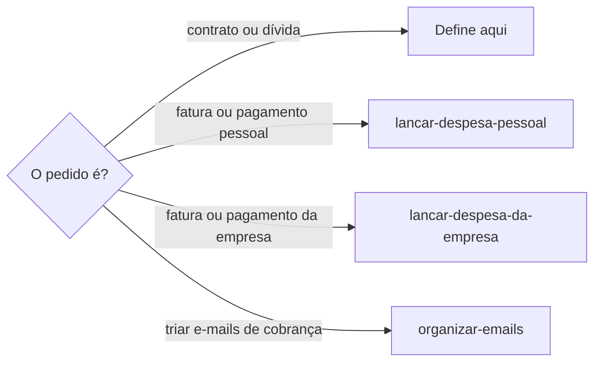
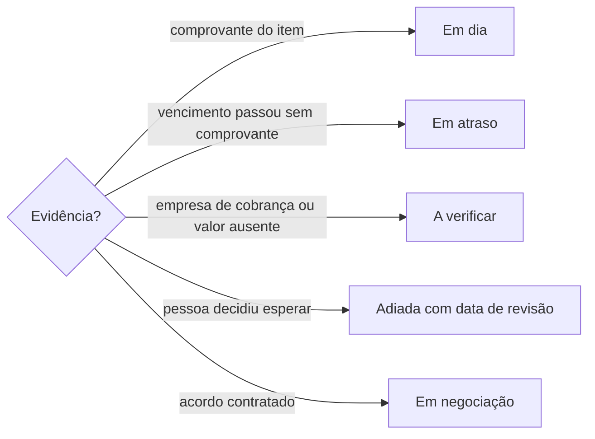

# Definir obrigação financeira

## Parâmetros de configuração

Leia cada valor nas instruções do projeto: primeiro na entrada com o nome desta habilidade, depois na entrada `Global`. Quando um valor não estiver lá, use o padrão abaixo. `Agendas por contexto` liga cada contexto à agenda que recebe os lembretes dele.

```yaml
"Moeda": "BRL"
"Situações":
  - "Em dia"
  - "Em atraso"
  - "Em negociação"
  - "Adiada"
  - "A verificar"
  - "Quitada"
"Agendas por contexto": []
"Antecedência do lembrete": "1 dia"
"Modo de aprendizado": "perguntar"
```

## Instruções

### Passo 1

Obrigação é o compromisso que gera cobranças ao longo do tempo: plano, consórcio, cartão, empréstimo, conta recorrente ou dívida. Cada fatura, parcela ou pagamento dela é uma despesa e fica com `lancar-despesa-pessoal`, ou com `lancar-despesa-da-empresa` quando a obrigação é da empresa. Uma obrigação pode existir sem despesa, como a dívida que ainda não está sendo paga, e uma compra avulsa é despesa sem obrigação.



### Passo 2

A pessoa informa o data source na execução. Sem essa indicação, use a lista de obrigações do mapeamento de dados do projeto, com os nomes de propriedade dele. Se a lista não estiver no workspace conectado, pare. Não use a lista de outro workspace. Busque a obrigação pelo credor, pelo contrato e pelos remetentes antes de criar. Um credor pode ter mais de uma obrigação.

### Passo 3

Grave credor, tipo, contexto, situação, dia de vencimento, valor da parcela ou da fatura, parcelas pagas e total, remetentes das cobranças e as empresas de cobrança que falam em nome do credor. O contexto vem da finalidade original, não do remetente nem da conta que recebeu o e-mail. Uma separação financeira posterior não muda a finalidade de uma dívida antiga. A situação é uma das `Situações`. Uma obrigação `Adiada` ou `A verificar` leva a próxima ação e a data de revisão, para continuar no radar. Quando a pessoa amarra a revisão a uma condição, como "quando houver renda", grave a condição na próxima ação e deixe a data vazia. O histórico fica nos comentários da página, não no corpo.

### Passo 4

A situação sai de evidência. Um comprovante quita só o que descreve. Recibo do pagador num boleto não é quitação. Oferta de negociação não é acordo, e o assunto "seu CPF foi notificado" não prova medida formal: leia o corpo. Cobrança enviada por empresa de cobrança não confirma a dívida nem o valor; marque `A verificar` e indique o canal oficial do credor, sem usar os links nem os boletos da mensagem. Fatura de cartão no rotativo pode ter pagamento mínimo igual ao total e parcelamento automático, que o e-mail não confirma.



### Passo 5

Toda fatura vencida ou a vencer citada na resposta traz o vencimento e o valor. Sem o valor, diga que falta e onde a pessoa o encontra: o app ou o site do credor. Um PDF protegido por senha não fornece o valor.

### Passo 6

Lembrete de vencimento vai para a agenda do contexto em `Agendas por contexto`, com `Antecedência do lembrete`, como evento privado e sem valor na descrição. Sem agenda para o contexto, pergunte. Não use a agenda de outro contexto.

### Passo 7

Confira a página salva. Entregue a obrigação, a situação, o próximo vencimento com o valor e as pendências. Ao terminar, siga `evoluir-habilidade` conforme `Modo de aprendizado`.

## Problemas comuns

### Dívida tratada como despesa

Se você lançar uma dívida que ainda não está sendo paga como despesa sem valor nem data, os relatórios de gasto ficam errados.

1. Cadastre a dívida como obrigação.
2. Deixe a despesa para quando houver fatura ou pagamento.

### Cobrança de terceiro aceita

Se você registrar o valor de uma empresa de cobrança como dívida confirmada, a obrigação nasce com um número que o credor não confirmou.

1. Marque `A verificar`.
2. Indique o canal oficial do credor.
3. Não use os links nem os boletos da mensagem.

### Fatura sem valor

Se você avisar de uma fatura vencida sem o valor, a pessoa não consegue decidir o que fazer.

1. Diga o vencimento e o valor.
2. Sem o valor, diga que falta e onde encontrá-lo.

## Exemplos de entrada e saída

Estes exemplos ilustram fatos. Eles podem não estar no data source.

### o consórcio do carro é pessoal; a parcela 77 de 100 vence dia 20

Cadastrei o consórcio como obrigação pessoal, em dia, com 100 parcelas. A fatura da parcela 77 seguiu para `lancar-despesa-pessoal`, com vencimento e valor.

### a dívida do banco está no backlog, não vou negociar agora

Cadastrei a dívida como `Adiada`, com a próxima ação e a data de revisão. As ofertas de negociação não mudam a situação.

### chegou uma notificação de dívida do plano de saúde por uma empresa de cobrança, sem valor

Cadastrei como `A verificar`, com a empresa de cobrança entre os remetentes. Indiquei o app e o site oficiais do plano. Não usei o link do e-mail.

## Casos-limite

- O credor tem cartão e empréstimo: duas obrigações.
- A obrigação muda de situação: atualize a situação e registre o motivo nos comentários.
- A pessoa não sabe o total de parcelas: grave o que a evidência mostra e deixe o resto pendente.

## Pegadinhas

- Pagamento mínimo parece sempre menor que o total. No rotativo, o mínimo pode ser o total.
- "Recibo do pagador" no boleto parece comprovante. É só a parte destacável do boleto.
- Empresa de cobrança parece o credor. Ela fala em nome dele, mas não confirma o saldo.
- O e-mail chega na caixa pessoal e parece obrigação pessoal. O contexto vem da finalidade.

## Scripts disponíveis

- Nenhum.

1. Não há script para executar.
