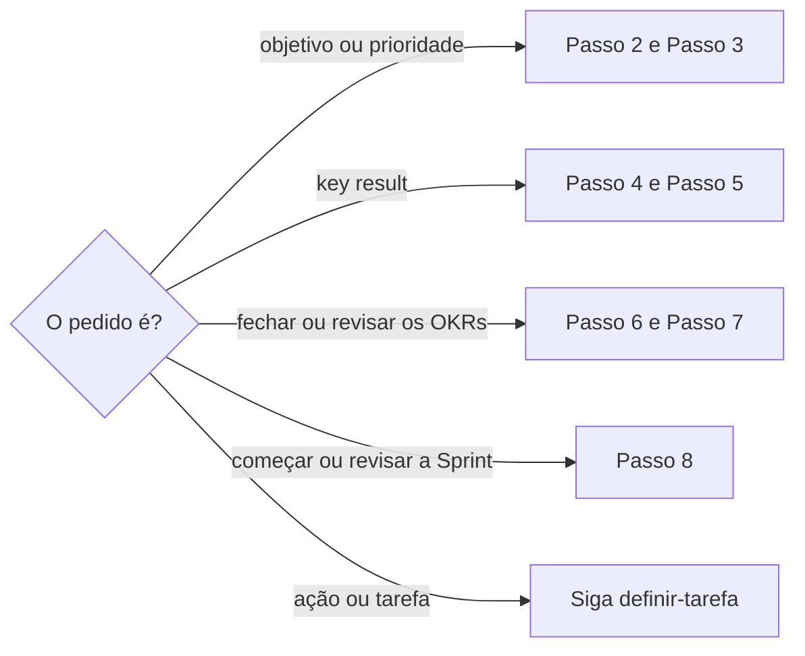

# Definir OKR

## Parâmetros de configuração

Leia cada valor nas instruções do projeto: primeiro na entrada com o nome desta habilidade, depois na entrada `Global` ou no primeiro nível do bloco. Quando um valor não estiver lá, use o padrão abaixo.
```yaml
# `Nome da área` é como o negócio chama a área dona dos objetivos, como `diretoria` ou `time`.
"Nome da área": "área"
# `Máximo de objetivos por área` vale para cada área dentro de um ciclo.
"Máximo de objetivos por área": 3
# `Máximo de key results por objetivo` vale para cada objetivo.
"Máximo de key results por objetivo": 3
# `Verbos do key result` abrem o título de cada key result.
"Verbos do key result":
  - "Obter"
  - "Atingir"
  - "Aumentar"
  - "Diminuir"
# `Fontes da estratégia` lista as páginas com a estratégia, a tática, a cultura e o planejamento que cada objetivo segue; vazia quer dizer que a pessoa indica na execução.
"Fontes da estratégia": []
"Modo de aprendizado": "perguntar"
```
## Instruções

### Passo 1

As listas de objetivos, de key results, de áreas, de métricas, de ciclos, de Sprints e de tarefas vêm do mapeamento de dados do projeto, no workspace conectado.
O nome de cada propriedade também vem desse mapeamento.
Se a lista não estiver nessa conexão, pare.
Não use a lista de outro workspace.



Antes de criar, busque o mesmo objetivo ou key result na lista, por consulta direta no título e por busca semântica.
Se ele já existe, mostre o nome, o status e o link, e revise esse em vez de criar outro.

### Passo 2

Antes de propor objetivos, leia a página da `Nome da área`: missão, princípios e limites.
Leia também as `Fontes da estratégia`.
Comece pela visão da área no ciclo, respondida por escrito: qual é o papel da área no resultado do ciclo, e o que terá acontecido de concreto se dissermos que a área foi muito bem.
Os objetivos nascem dessa resposta, não de uma lista solta.

### Passo 3

O objetivo é específico e qualitativo.
Ele não é número, métrica nem key result.
O título faz sentido lido em voz alta, sem número nem prefixo.
Cada `Nome da área` tem no máximo `Máximo de objetivos por área` objetivos no ciclo.
Prefira poucos objetivos bem definidos a muitos rasos, genéricos ou repetidos.
O objetivo tem a área responsável vinculada e uma pessoa responsável, a champion.
Ele conversa com as `Fontes da estratégia`.
Se não conversa, ajuste o objetivo ou descarte.

### Passo 4

Cada objetivo tem no máximo `Máximo de key results por objetivo` key results.
Para cada objetivo, pergunte como saberemos, em números, que estamos chegando lá, e qual é o mínimo mensurável que mostra o objetivo andando.
O key result mede o objetivo: explique numa frase como o progresso dele mostra se o objetivo está sendo alcançado.
Ele é numérico, com valor-alvo, métrica ou fonte de medição e data-alvo.
A unidade é número, quantidade, frequência, porcentagem ou valor em moeda.
O título segue: um dos `Verbos do key result` + descrição + "para" + valor-alvo + "até" + data-alvo.
O valor-alvo fica no título e na propriedade, e a data-alvo também fica na propriedade.
Quando o resultado tem um "quanto" absoluto, como receita, membros ou eventos, o valor-alvo é absoluto.
Uma porcentagem é leitura derivada do absoluto, com a base de cálculo escrita.
Use porcentagem como alvo só quando não houver absoluto melhor.
O key result é desafiador, mas possível com a capacidade, o tempo e as alavancas reais do ciclo.

### Passo 5

O key result não é tarefa nem checklist, como configurar, criar ou fazer algo.
Esse item vira tarefa, por `definir-tarefa`, ou o key result vira métrica de resultado.
"Fazer X vezes" ou "acompanhar Y itens" sem dizer o resultado está mal especificado, mesmo com número.
Reescreva com o resultado esperado, a evidência coletada, o critério de qualidade e a ligação com o objetivo.
Evite valor-alvo 1, que vira fez ou não fez.
Evite 100% de cobertura: prefira a quantidade absoluta coberta.
O key result é transversal à área e não se vincula a um conteúdo individual.
Esse vínculo é erro de modelagem: oriente a remover.
Um key result sem título, ou mostrado como "Nova página", é erro de cadastro.
Pare o que depende dele e renomeie no padrão do Passo 4 antes de seguir.
Não edite à mão a porcentagem de conclusão nem outro campo calculado.

### Passo 6

Cada key result tem pelo menos uma tarefa vinculada, ou a lista explícita das ações planejadas, e chega a 2 ou 3 ações antes de os OKRs fecharem.
A tarefa responde o que será feito para atingir o key result.
Para cada ação, escreva o mecanismo: "se fizermos esta ação, o key result melhora porque…".
Sem mecanismo, não vincule.
Peça esclarecimento e sugira a ação que ataca a alavanca do key result.

### Passo 7

Antes de considerar os OKRs fechados, a área responde sem ambiguidade o que precisa entregar ou mudar no ciclo, nos objetivos e nas ações, e como mede em números se está chegando lá, nos key results.
Sem essas respostas, é erro de especificação: ajuste ou peça esclarecimento antes de seguir.
Confira o checklist:

- [ ] No máximo `Máximo de objetivos por área` objetivos na área.
- [ ] Cada objetivo claro, específico e sem número.
- [ ] No máximo `Máximo de key results por objetivo` key results por objetivo, todos mensuráveis.
- [ ] Cada key result com pelo menos 2 ou 3 ações.
- [ ] As ações nas Sprints, com responsável.
- [ ] Objetivos e key results alinhados às `Fontes da estratégia`.
- [ ] Um ritual de revisão periódica dos OKRs combinado.
- [ ] Cada área relevante com pelo menos um objetivo no ciclo.

Na revisão periódica do ciclo, confira se cada key result ainda mede o sucesso do objetivo.
Se perdeu o sentido, ajuste o texto, a métrica, o valor-alvo ou o prazo, ou troque por um key result mais causal.
Registre o que mudou no mundo e qual decisão humana foi tomada.
O key result expõe a realidade.
Se ele não avança ou piora, isso vira insumo para decidir ações, escopo e prioridades, não culpa.

### Passo 8

No início da Sprint, comece pelos objetivos e key results do ciclo em vigor.
Escolha ou proponha as ações que mais empurram os key results prioritários.
Não puxe tarefa sem key result, salvo exceção justificada, como um desbloqueio crítico.
Cada ação escolhida vira tarefa da Sprint, com responsável e prazo dentro da janela dela, por `definir-tarefa`.
A Sprint tem tarefas vinculadas.
Cada pessoa da área sabe quais key results puxa e quais tarefas tem na Sprint.
Na revisão da Sprint, revisite os key results e o progresso dos objetivos: avanço, atrasos, bloqueios e se o objetivo segue válido.
Atualize os key results com as evidências do que mudou: entregas, números, decisões e escopo.

### Passo 9

Não invente valor-alvo, data-alvo, métrica, área nem pessoa responsável.
Se faltar um deles, pergunte antes de gravar.
Com mais de um objetivo ou key result, mostre o plano antes de gravar.
Depois de gravar, mostre o nome, o status e o link de cada um.

### Passo 10

Ao terminar, siga `evoluir-habilidade` conforme `Modo de aprendizado`.

## Problemas comuns

### Key result em porcentagem com absoluto disponível

Se você escrever "Diminuir em 20% os custos" quando o custo tem valor em moeda, o alvo esconde a base e o avanço não se audita.

1. Escreva o alvo absoluto, como o valor mensal a atingir.
2. Deixe a porcentagem como leitura derivada, com a base escrita.

### Key result que é tarefa

Se você aceitar "Configurar X" ou "Realizar 12 revisões" como key result, a área mede esforço e não resultado.

1. Mova a execução para uma tarefa, por `definir-tarefa`.
2. Reescreva o key result com resultado, evidência, critério de qualidade e prazo.

### Valor-alvo só na propriedade

Se você deixar o valor-alvo só na propriedade, o título não se explica na lista.

1. Ponha o valor-alvo e a data-alvo no título.
2. Mantenha os dois também nas propriedades.

### Ação sem mecanismo

Se você vincular uma ação sem dizer por que ela move o key result, o plano vira lista de desejos.

1. Escreva "se fizermos esta ação, o key result melhora porque…".
2. Sem resposta, não vincule e sugira outra ação.

## Exemplos de entrada e saída

Estes exemplos ilustram fatos. Eles podem não estar no data source.

### crie um KR para reduzir em 20% os custos de ferramentas de tecnologia até o fim do ano

o custo tem base em moeda, R$ 3.912,28 por mês. O título fica "Diminuir os custos mensais de ferramentas de tecnologia para R$ 3.130 até 31/12/2026", com valor-alvo 3130 e data-alvo 31/12/2026. Os 20% ficam na descrição, com a base. Perguntei o objetivo e a pessoa responsável antes de gravar.

### revise os OKRs da área de marketing

a área tinha 5 objetivos no ciclo. Sugeri manter os 3 que conversam com a estratégia. Um key result era "Criar 10 campanhas" e virou tarefa. Outro estava como "Nova página": parei e renomeei antes de seguir.

## Casos-limite

- O pedido é uma ação ou tarefa: siga `definir-tarefa`.
- A área já tem `Máximo de objetivos por área` objetivos no ciclo: proponha trocar ou aprofundar um, não criar outro.
- O key result já existe: revise esse, não crie outro.
- Não há absoluto possível: a porcentagem é o alvo, com a base escrita.
- As `Fontes da estratégia` estão vazias e as instruções não dizem: peça as páginas antes de validar os objetivos.
- A lista não está no workspace conectado: pare.

## Pegadinhas

- A porcentagem de conclusão, o valor atual e o atingimento são calculados pela lista. Editar à mão quebra a conta.
- Um key result recém-criado sem título aparece como "Nova página" e some na busca pelo assunto.
- A descrição da propriedade de título na lista traz o padrão de nome. Leia antes de gravar.
- Um alvo de 100% parece ambicioso, mas vira perfeccionismo e esconde o quanto já foi feito.
- O workspace conectado pode ser de outra empresa. Se a lista não estiver na conexão, pare.

## Scripts disponíveis

- Nenhum.

1. Não há script para executar.
