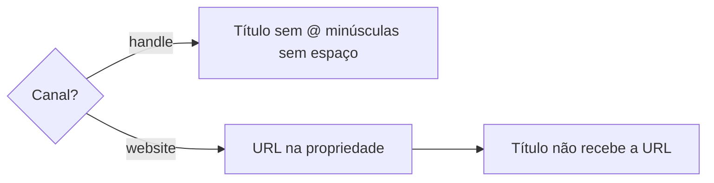

# Definir perfil social

## Parâmetros de configuração

```yaml
{}
```

## Instruções

### Passo 1

Cadastrar ou consolidar um perfil na lista de perfis sociais é esta habilidade. A pessoa informa o data source na execução. Sem essa indicação, use a lista de perfis sociais do mapeamento de dados do projeto. O nome de cada propriedade vem desse mapeamento. Este texto usa os conceitos: o título, que é o identificador canônico, o canal, a URL do perfil, o nome exibido, a bio, o link da bio, os seguidores, os seguindo, os posts, as capturas de tela, a pessoa, as Variações de nome, Não confundir com e o contexto da desambiguação. Se a lista não estiver no workspace conectado, pare. Saber se já existe fica com `identificar-duplicata`. Um perfil só não encerra essa checagem: a pessoa relacionada pode estar duplicada na lista de pessoas. Dois registros da mesma pessoa seguem para `mesclar-registro`. Não confundir com não separa essa duplicata. Juntar as páginas do mesmo item fica com `mesclar-registro`. Cravar a grafia de pessoa ou de empresa fica com `definir-grafia`. Esta habilidade normaliza o registro canônico.

### Passo 2

O título é o identificador canônico normalizado.



Instagram e canal de handle: o título fica sem `@`, em minúsculas e sem espaços. Website: a URL completa fica na URL do perfil. O título não recebe essa URL. Não invente o título a partir do domínio.

Um print da grafia que mostra um perfil ausente cadastra esse perfil na mesma resposta. Grave o que o print mostra e a lista já tem: o canal, o nome exibido, a bio, o link da bio, os seguidores, os seguindo e os posts. A URL do perfil é a do canal, não o link da bio. O print entra nas capturas de tela. Não grave o print no corpo. Não invente o que o print não trouxe. A pessoa do nome segue `definir-pessoa` e entra na pessoa do perfil. Já existe: use esse perfil. Não crie outro.

### Passo 3

Em Variações de nome, use uma lista de bullets, um nome alternativo por item, e termine cada item com ponto e vírgula. Entram a versão com `@`, a grafia com maiúsculas e minúsculas, o apelido, a URL alternativa da mesma origem, e as formas com e sem sigla e com e sem ano, quando forem do mesmo perfil. Forma que já está na lista não entra de novo. A forma igual ao título normalizado não entra de novo.

### Passo 4

Perfil parecido confirmado como outro perfil: verifique Não confundir com e diga se existe, mesmo sem a pessoa perguntar o esquema. Com segurança, relacione antes de concluir. Sem a propriedade, proponha a relação para o próprio banco. Com o sim, crie a propriedade e só então ligue. Variações de nome não substituem essa relação. A correção não fica só no chat. Sem segurança sobre quais páginas ligar, pergunte antes de salvar. Em Variações de nome, use uma lista de bullets, um nome por item, com ponto e vírgula no fim. Grave só nome, grafia, apelido e forma alternativa do mesmo perfil, inclusive com e sem sigla e com e sem ano. Forma que já está na lista não entra de novo. A diferença permanente vai no contexto da desambiguação, ou na propriedade equivalente, e não substitui Não confundir com. Contato, preço, disponibilidade, resposta, decisão, status, prazo e mudança operacional vão em comentário datado. Com a propriedade específica, não guarde o contexto permanente no corpo nem em observação geral. Não junte esses registros. Cada perfil permanece o seu registro canônico. Sem o contexto, avise e proponha a criação. Não dê a desambiguação por pronta. Não crie essa propriedade de contexto antes do sim.

## Problemas comuns

### Título com arroba

Se você gravar o handle com `@`, maiúscula ou espaço, a busca do título perde o perfil que já existe.

1. Tire o `@`.
2. Grave em minúsculas e sem espaços.
3. A forma com `@` vai para Variações de nome.

### URL de website no título

Se você gravar a URL do website no título, o identificador deixa de ser o nome do perfil.

1. A URL completa fica na URL do perfil.
2. O título não recebe essa URL.
3. Uma URL alternativa da mesma origem vai para Variações de nome.

### Print sem perfil

Se você usar o print só para corrigir a frase, o perfil que ele mostra fica fora da lista de perfis sociais.

1. Busque o handle.
2. Ausente: crie o perfil e grave o que o print mostra.
3. O print entra nas capturas de tela. A pessoa segue `definir-pessoa`.

### Parecido juntado

Se você tratar o perfil parecido como o mesmo cadastro, dois perfis viram um.

1. Ligue em Não confundir com na hora. Sem segurança sobre as páginas, pergunte antes de salvar.
2. Grave em Variações de nome a forma que separa a busca.
3. Cada perfil permanece o seu registro canônico. Sem a propriedade, avise e proponha a criação. Não dê por concluído.

## Exemplos de entrada e saída

Estes exemplos ilustram fatos. Eles podem não estar no data source.

### Cadastre o Instagram @PerfilExemplo.

O título ficou perfilexemplo. A forma com `@` entrou em Variações de nome. A URL do perfil ficou na propriedade da URL.

### Cadastre o website https://exemplo.com/.

A URL completa ficou na URL do perfil. O título não recebeu essa URL.

### Este perfil parece o outro e é outra conta.

Liguei os dois em Não confundir com na hora. A variação de nome recebeu a forma que separa a busca. Não juntei os registros. Cada perfil permaneceu o seu registro canônico.

## Casos-limite

- A lista de perfis sociais não está no workspace conectado: pare.
- Handle com `@`, maiúscula ou espaço: o título sai sem `@`, em minúsculas e sem espaços.
- Website: a URL completa fica na URL do perfil. O título não recebe a URL.
- Forma já listada em Variações de nome: não entra de novo.
- Perfil parecido que é outro: Não confundir com na hora. A variação separa a busca. Não junte. Sem segurança sobre as páginas, pergunte antes de salvar.
- Sem Não confundir com: avise, proponha a criação e não dê a desambiguação por concluída. Não crie a propriedade antes do sim.
- Só saber se já existe: pare e siga `identificar-duplicata`.
- O print mostra um perfil ausente: crie esse perfil, grave o que o print mostra e ponha o print nas capturas de tela.

## Pegadinhas

- O `@` parece parte do nome. No título de handle ele sai. A busca usa a forma com `@` em Variações de nome.
- A URL do website parece o título. Ela fica na URL do perfil.
- Não confundir com parece um comentário no chat. O vínculo entra na propriedade na hora e a variação separa a busca.
- Um perfil só parece pessoa única. A pessoa relacionada pode estar duplicada na lista de pessoas. Essa checagem fica com `identificar-duplicata`.

## Scripts disponíveis

- Nenhum.

1. Não há script para executar.
