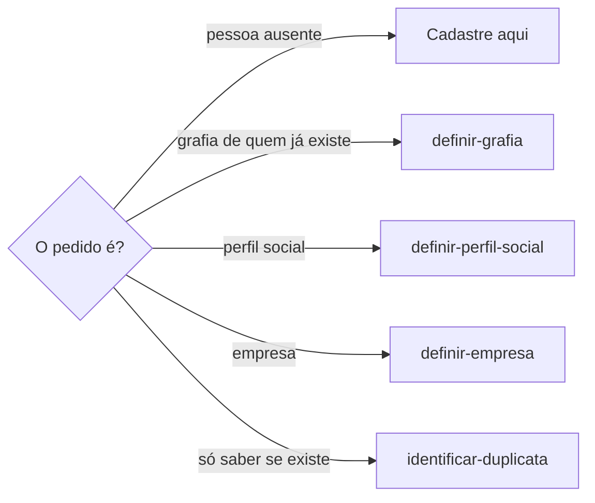
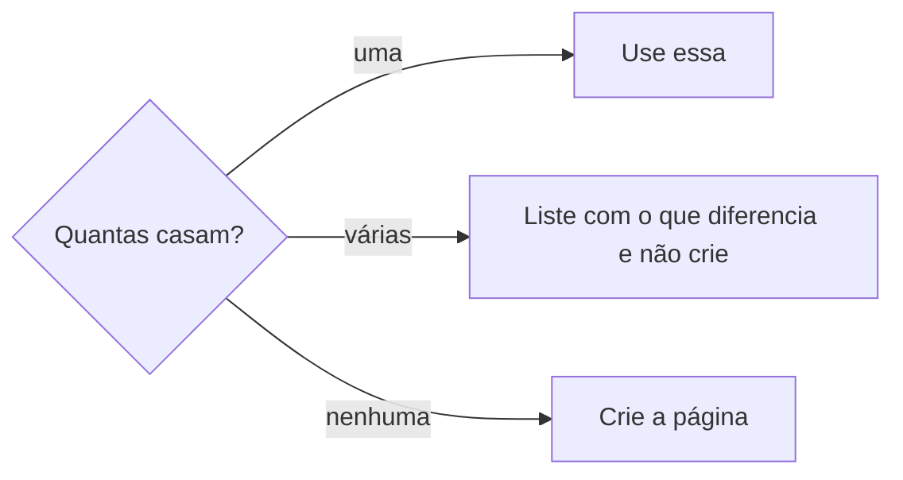
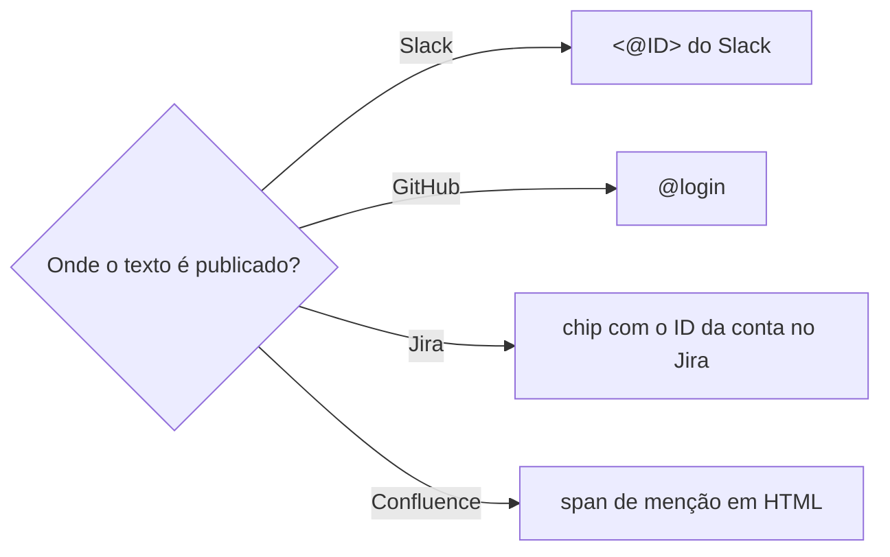

# Definir pessoa

## Parâmetros de configuração

Leia cada valor nas instruções do projeto: primeiro na entrada com o nome desta habilidade, depois na entrada `Global` ou no primeiro nível do bloco, depois nas instruções de usuário. Quando um valor não estiver lá, use o padrão abaixo. Um valor vazio não impõe regra.
```yaml
# `Tipo de armazenamento das pessoas` é `lista do projeto`, a lista do mapeamento de dados, ou `arquivos locais`.
"Tipo de armazenamento das pessoas": "lista do projeto"
# `Endereço das pessoas` é a pasta, nos arquivos locais.
"Endereço das pessoas": ""
"Nome do arquivo da pessoa": "e-mail.json"
# `Fontes para resolver identidade` lista as ferramentas em que achar dados de pessoas (o diretório) antes de perguntar, como agenda, Slack, Atlassian Confluence, Atlassian Jira, GitHub, Notion, Instagram, Google Contatos ou WhatsApp.
"Fontes para resolver identidade": ""
# `Cadastro na loja` é `sim`, que também cria ou atualiza a pessoa como cliente na loja on-line do projeto, mesmo sem compra, ou `não`.
"Cadastro na loja": "não"
# `Cadastro pelo Chrome` é `nunca`, `se o conector falhar` ou `sempre`. `nunca` usa só o conector e, se ele não responde, para e avisa. `se o conector falhar` cadastra pelo Notion no Claude in Chrome só quando o conector não responde. `sempre` cadastra pelo Chrome sem tentar o conector. O Chrome gasta mais token, então o padrão é `nunca` e o negócio escolhe o valor.
"Cadastro pelo Chrome": "nunca"
# `Campo do cliente na loja` é o nome da propriedade da lista de pessoas que guarda o link do cliente na loja. Vazio, o link fica nas notas.
"Campo do cliente na loja": ""
```
## Instruções

### Passo 1

Cadastrar ou atualizar uma pessoa na lista de pessoas é esta habilidade. A lista e o nome de cada propriedade vêm do mapeamento de dados do projeto, no workspace conectado. Este texto usa os conceitos: o nome completo, as variações de grafia e os perfis sociais relacionados. Se a lista não estiver nessa conexão, pare. Não use a lista de outro workspace.

O cadastro segue `Cadastro pelo Chrome`. Em `nunca`, use só o conector: se ele não responde, confira a conexão, diga o motivo e pare. Em `se o conector falhar`, confira a conexão e só então siga pelo Chrome. Em `sempre`, vá direto ao Chrome.

No Chrome, busque e cadastre pelo Notion no Claude in Chrome, com o login da pessoa, no mesmo workspace e na lista do mapeamento. Busque cada nome na busca do Notion, também por variações, e conte como resultado só a página da lista de pessoas. Crie a página pelo botão de nova página. O título nasce com "Nova pessoa": selecione o título inteiro, com triplo clique, antes de digitar. Grave o telefone na propriedade dele.

Nas observações vai só o contexto estável. O histórico vai em comentário da página, um por fato.

Releia a página criada antes de dizer que gravou e nunca clique em renomear, editar ou excluir propriedade.

Com `Tipo de armazenamento das pessoas` em `arquivos locais`, `Endereço das pessoas` é a pasta, com um arquivo por pessoa, nomeado pelo e-mail exato dela, no `Nome do arquivo da pessoa`, e um arquivo de índice com uma linha por pessoa: nome completo, como é chamada, e-mail, papel, time e o arquivo.
Os campos são o nome completo, como a pessoa é chamada, as variações de grafia, as transcrições erradas do nome, o papel, o time, o e-mail, o ID no Slack, o login no GitHub, o ID da conta no Jira, os pronomes e a fonte deles, e os canais e grupos em que ela aparece.
Os pronomes só se gravam quando a própria pessoa os declarou ou quem usa a habilidade os informou, e a fonte diz qual dos dois foi: sem isso, o campo fica vazio e os textos citam a pessoa sem pronome.
O login e o ID do Jira servem para citar a pessoa com menção real fora do Slack, como o Passo 4 manda.
O arquivo local tem ainda o campo `extensions`, que guarda dados de outras habilidades sobre a pessoa, uma entrada por habilidade ou assunto, como o idioma em que ela prefere receber uma revisão.
Esta habilidade não define nem valida o conteúdo de `extensions`: ao atualizar o registro, deixa o campo e tudo o que há nele como estão.



Um perfil colado por quem usa a habilidade, em texto ou imagem, é o pedido de cadastro, mesmo sem a palavra cadastrar. A mesma regra vale quando a pessoa só informa uma mudança sobre alguém, como a saída da empresa. Cadastre ou atualize o registro na mesma resposta, antes de responder o resto e sem perguntar. Quem saiu continua registrada: o campo de notas diz isso, para ninguém a indicar como contato. A resposta diz o que foi gravado e onde, ou que nada foi.

### Passo 2

Busque o nome na lista de pessoas, no nome e nas variações, por consulta direta e por busca semântica. Antes de perguntar qualquer dado de identidade, consulte o registro da pessoa. Se faltar, resolva pelas `Fontes para resolver identidade`: consulte cada ferramenta da lista que estiver conectada, pelo nome e, quando houver, pelo e-mail (perfil, autor, login). Um nome parcial, um apelido ou uma grafia estranha, sem e-mail, também se resolve nessas fontes. Compare o cargo, o time e os canais com o assunto da conversa.
Não peça à pessoa que desambigue antes dessa busca.
Só pergunte o que nem o registro nem essas fontes respondem. O telefone de quem tem conversa no WhatsApp está nos dados do contato: leia-o na mesma sequência do cadastro e grave no registro, em vez de perguntar.
Um candidato único e plausível pelo contexto entra como hipótese `inferido`, com a frase da fonte. Só o que a fonte responde com certeza entra como confirmado.
Com vários candidatos, liste cada um com o que ajuda a diferenciar, como cargo e e-mail, e com outros dados que as fontes tragam, junto da frase em que o nome aparece, e pergunte só qual deles. Nunca pergunte só pelo nome.
Uma variação com o estado `inferido` ajuda a achar a pessoa, mas é hipótese: o texto diz que é inferência e, havendo chance, pede a confirmação a quem esteve na conversa.
Confirmada, troque o estado para `confirmado` e grave a data. Contrariada, apague a entrada.



### Passo 3

O nome completo é o nome da pessoa. O handle não entra nesse nome. Não invente e-mail, telefone, pronome, tipo de público nem empresa.

Telefone vai no formato internacional. Celular do Brasil tem 9 dígitos depois do DDD: o WhatsApp às vezes mostra o número sem o 9. Número de 8 dígitos começado por 6, 7, 8 ou 9 é celular sem o 9: pergunte o número completo antes de gravar.

Com `Cadastro na loja` em `sim`, crie ou atualize o cliente na loja com o nome, o telefone, o e-mail e o idioma, sem consentimento de marketing. Grave o link do cliente em `Campo do cliente na loja`, ou nas notas quando o campo está vazio. O histórico das conversas fica nos comentários da página da pessoa, não na nota do cliente.

Todo perfil social que a pessoa informar, em link, print ou handle, como o LinkedIn ou o Instagram, é cadastrado por `definir-perfil-social` na mesma resposta e relacionado nos perfis sociais relacionados. O link do perfil nunca vai nas notas, e a skill não deixa o perfil de fora.

Não grave o print no corpo.

Grave como confirmado só o que veio direto da pessoa que usa a habilidade ou de uma fonte que respondeu com certeza. Nunca invente papel, time nem apelido. Sem e-mail em nenhuma fonte, o e-mail fica como pendência no registro.

Antes de encerrar, passe por cada propriedade da lista de pessoas e preencha a que uma fonte responde: telefone, e-mail, as empresas relacionadas e as que ela possui, os perfis sociais e os canais, a localidade, o tipo de público, as variações de grafia e o campo de não confundir com quando há homônimo na lista.

A empresa segue `identificar-duplicata` e `definir-empresa`, e o perfil segue `definir-perfil-social`. Ser dona da empresa só se grava quando a pessoa ou uma fonte diz isso. O nome que o WhatsApp mostra só indica a empresa relacionada.

O que nenhuma fonte responde fica pendente, e a resposta diz qual propriedade e por quê. Quando algo precisa ir à pessoa, use o canal que já existe: sem e-mail e com WhatsApp, mande pelo WhatsApp, por `conversar-no-whatsapp`. Só sem nenhum canal, peça o contato.
Uma transcrição errada do nome, como a de uma reunião transcrita por voz, que a pessoa confirma ser errada diante do nome canônico, entra nas variações de grafia, com a data e a fonte. O nome completo fica com o canônico, e a transcrição não se descarta nem vira o nome.
O que quem usa a habilidade diz sobre o papel de alguém numa empresa, como quem cuida dos recebimentos e quem só é informado, vem direto dela e entra na mesma rodada, sem perguntar. Na pessoa, vai no campo de papel, ou nas observações quando a lista não tem esse campo. Na empresa, a pessoa entra na lista de pessoas responsáveis, e o papel de cada uma vai nas notas da empresa e nas listas do negócio que o citam, como a negociação e o grupo do evento. Depois de gravar, leia as páginas de volta e diga o que gravou e o que não coube.
Um apelido ou uma grafia ambígua que a pessoa decide inferir, como "vamos inferir que Bia é a Beatriz", entra no registro de quem foi inferida, na lista das transcrições erradas do nome, com o estado `inferido`, a data, quem inferiu, a frase da transcrição e o que descartou as outras hipóteses.
A entrada não vira confirmada por ter sido pedida: o estado `confirmado` só vale quando alguém que sabe confirma. Uma entrada sem estado conta como confirmada. Ao atualizar um registro, mude o campo pontualmente: nunca regrave o registro inteiro descartando campos já confirmados ou o conteúdo de `extensions`. Todo texto que nomeia a pessoa usa como ela é chamada, e não o primeiro nome do nome completo quando os dois divergem.

### Passo 4

Quem cita uma pessoa num texto publicado, em qualquer plataforma, marca a pessoa com menção real e não com o nome em texto.
Ache o ID no registro da pessoa e escreva a menção como a plataforma pede:



- No Confluence, a menção é `<span data-type="mention" data-user-id="ID">@Nome</span>`, com o ID da conta no Jira.
- No Confluence, o corpo da página vai em HTML ao criar e ao atualizar, porque o markdown não gera menção.
- O login do GitHub vem do registro da pessoa ou do autor de pull requests recentes.
- Sem o ID no registro, procure pelo e-mail na plataforma e use só um resultado único.
- Grave o ID que achou no registro.
- Sem e-mail e com mais de um resultado, ou com dois registros de nome parecido, pergunte.
- Confira pelo assunto da fala quem é a pessoa e nunca escolha o primeiro resultado.
- A menção notifica a pessoa.
- Acrescentar menções a um texto já publicado há tempo pede o sim de quem escreve.

## Problemas comuns

### Cadastro só com o nome

Se você criar a página só com o nome, a pessoa fica sem o telefone, a empresa e o perfil que as fontes já respondiam, e o próximo cadastro volta a perguntar.

1. Passe por cada propriedade da lista antes de encerrar.
2. Preencha as que uma fonte responde e deixe a pendência dita no relatório, com a propriedade e o motivo.
3. Telefone de quem tem conversa no WhatsApp se lê nos dados do contato, também de um membro de grupo: peça a leitura à sessão do WhatsApp Web.

### Desambiguação pedida antes da busca

Se você perguntar à pessoa quem é um nome ambíguo antes de pesquisar, ela responde o que o diretório e as fontes já mostravam.

1. Consulte o diretório e cada ferramenta de `Fontes para resolver identidade`, pelo nome e pelo e-mail.
2. Compare cargo, time e canais com o assunto da conversa.
3. Um candidato plausível entra como `inferido`, com a frase.
4. Só pergunte o que sobrar, com os candidatos já pesquisados.

### Nome listado como pendente sem ter pesquisado

Se você listar um nome como pendente sem ter pesquisado, a pessoa confirma o que as fontes já mostravam.

1. Pesquise no mesmo turno, antes de listar, no diretório e em cada ferramenta de `Fontes para resolver identidade`, pelo nome e pelo e-mail.
2. Um candidato plausível entra como `inferido`, com a frase.
3. A lista de pendentes leva só o que a busca em todas as fontes não resolveu.

### Nome em texto onde cabia menção

Se você escrever o nome de quem participou ou de quem responde por uma ação só como texto, a pessoa não é notificada e o texto não leva até ela.

1. Ache o ID no registro, como o Passo 4 manda.
2. Escreva a menção real da plataforma.
3. Sem o ID, procure pelo e-mail.
4. Sem resultado único, pergunte.

### Texto emendado no cadastro pelo Chrome

Se você digitar sem selecionar o texto que já está no campo, como o título "Nova pessoa" ou uma propriedade com valor, o novo texto se junta ao antigo e a lista ganha um registro errado.

1. Entre no campo clicando no valor, nunca no nome da propriedade, que abre o menu de renomear e excluir. Depois dê triplo clique para selecionar tudo e digite.
2. Confira que a página aberta é a da pessoa antes de editar: a busca guarda o termo anterior e o primeiro resultado pode ser outro.
3. Releia o texto da página depois de gravar e corrija na mesma rodada, sem criar outra página.

### Pessoa ausente só na frase

Se você corrigir o nome na frase e não cadastrar a pessoa que o print mostrou, ela continua fora da lista de pessoas.

1. Busque na lista de pessoas.
2. Nenhuma casa: crie a página com o nome completo.
3. O handle fica no perfil, não no nome.

### Perfil colado e respondido sem cadastrar

Se você ler o perfil colado, usar a informação na resposta e não gravar o registro, a pessoa continua fora do diretório e o próximo turno repete a pergunta.

1. Chame esta habilidade no mesmo turno em que o perfil chegar, antes de seguir com o assunto.
2. Pessoa nova: crie. Pessoa já registrada: mude só o campo que o perfil trouxe.
3. A saída da empresa entra nas notas, e o registro fica.
4. Não pergunte se deve gravar. Depois, diga o que gravou.

### Papel dito e não gravado

Se você só explicar como cadastrar o papel de alguém numa empresa, o que a pessoa já disse fica na conversa, e a próxima consulta não o acha.

1. Grave o papel na pessoa e na empresa, como o Passo 3 manda.
2. Não pergunte se deve gravar.
3. Leia as páginas de volta e diga o que gravou.

### Inferência gravada como confirmada

Se você gravar o que a pessoa só inferiu como confirmado, a próxima consulta trata o palpite como fato e a dúvida some.

1. Grave a entrada com o estado `inferido`, a data, quem inferiu e a frase da transcrição.
2. Escreva nas notas o que descartou as outras hipóteses e quais ficam abertas.
3. Ao usá-la, diga que é inferência e peça a confirmação quando houver chance.

### Handle no nome

Se você gravar o arroba no nome completo, o perfil vira a pessoa.

1. O nome completo é o nome da pessoa.
2. O handle segue `definir-perfil-social`.
3. Relacione o perfil nos perfis sociais relacionados.

## Exemplos de entrada e saída

Estes exemplos ilustram fatos. Eles podem não estar no data source.

### o print do Instagram anaexemplo.oficial, com o nome Ana Exemplo, e ela ainda não está na lista de pessoas.

Busquei na lista de pessoas e não havia Ana Exemplo. Criei a página com o nome completo Ana Exemplo. O handle anaexemplo.oficial não entrou no nome. O perfil seguiu definir-perfil-social.

### a reunião transcrita escreveu Ana Souza, e o nome canônico é Ana Sousa

Cadastrei a página com o nome completo Ana Sousa. Gravei Ana Souza nas variações de grafia, como transcrição errada de uma reunião, com a data. Não usei a transcrição como nome.

### a Tula cuida dos recebimentos da Brasil 75 e o Thi só é informado

A Tula não estava na lista de pessoas. Criei a página dela, com o papel nas observações, e a coloquei nas pessoas responsáveis da empresa do local e da empresa que recebe. O papel de cada um entrou nas notas das duas empresas, e o Thi ficou com a nota de que só é informado. Li as páginas de volta e disse o que gravei.

## Casos-limite

- A lista de pessoas não está no workspace conectado: pare.
- Já existe uma pessoa: use essa página. Não crie outra.
- Há mais de uma: liste. Não crie.
- O print traz handle e nome: o nome fica aqui. O perfil segue `definir-perfil-social`.
- O pedido é só a grafia de quem já está na lista: siga `definir-grafia`. Não crie outra página.
- O perfil colado tem poucos campos: grave os que vieram e deixe o resto vazio. Não espere o perfil completo.
- A pessoa saiu da empresa: atualize ou crie o registro com a nota. Não apague.
- O apelido ambíguo cabe a mais de uma pessoa e a pessoa infere uma: grave só no registro da inferida, com as outras hipóteses nas notas. Não grave nas outras.
- Dois registros têm nomes parecidos, como Ana Souza e Ana Souza Lima: não marque pelo primeiro resultado. Confira pelo assunto da fala e pelo perfil nas fontes. Na dúvida, liste os candidatos com o que os diferencia, como cargo e e-mail, e pergunte.

## Pegadinhas

- O número do WhatsApp parece o telefone completo. Num celular do Brasil, ele pode vir sem o 9 depois do DDD, e a loja recusa o número de 8 dígitos.
- A linha do tempo do cliente na loja parece o lugar da conversa. A API da loja pode não gravar comentário nela: a conversa fica na página da pessoa.

- Um perfil colado parece só contexto para a resposta. É o pedido de cadastro: grave no mesmo turno.
- Corrigir a frase parece cadastrar. A pessoa ausente ganha página na lista de pessoas.
- O nome exibido com o nicho parece o nome completo. O nome completo é o nome da pessoa. O restante fica no perfil.
- O handle parece o título da pessoa. Ele fica no perfil.
- O primeiro nome do nome completo nem sempre é como a pessoa é chamada: um texto que usa o primeiro nome erra o nome dela.
- O markdown não gera menção no Confluence: o texto sai com o nome puro e ninguém é notificado. Use HTML.
- Uma menção parece só um jeito de escrever o nome. Ela notifica a pessoa.
- Uma inferência que a pessoa decidiu parece confirmação. Ela é hipótese até alguém que sabe confirmar.

## Scripts disponíveis

- Nenhum.

1. Não há script para executar.
