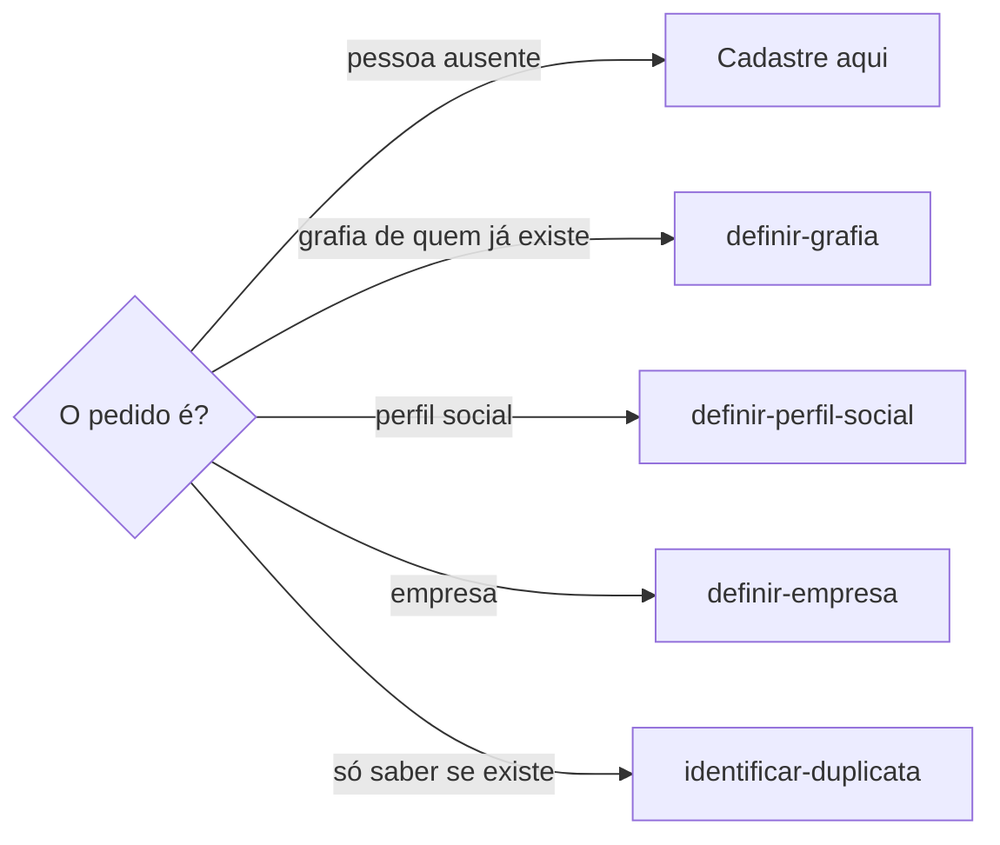
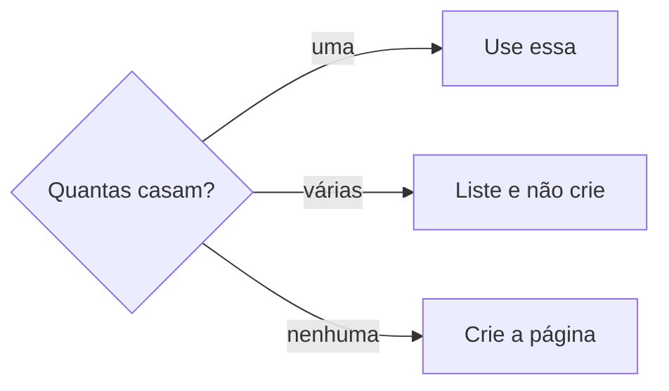

# Definir pessoa

## Parâmetros de configuração

Leia cada valor nas instruções do projeto: primeiro na entrada com o nome desta habilidade, depois na entrada `Global` ou no primeiro nível do bloco, depois nas instruções de usuário. Quando um valor não estiver lá, use o padrão abaixo. Um valor vazio não impõe regra.

```yaml
"Tipo de armazenamento das pessoas": "lista do projeto"
"Endereço das pessoas": ""
"Nome do arquivo da pessoa": "e-mail.json"
"Fontes para resolver identidade": ""
```

`Tipo de armazenamento das pessoas` é `lista do projeto`, a lista do mapeamento de dados, ou `arquivos locais`. `Endereço das pessoas` é a pasta, nos arquivos locais. `Fontes para resolver identidade` lista onde achar um dado de identidade antes de perguntar, como a agenda e o perfil público no Slack.

## Instruções

### Passo 1

Cadastrar ou atualizar uma pessoa na lista de pessoas é esta habilidade. A lista e o nome de cada propriedade vêm do mapeamento de dados do projeto, no workspace conectado. Este texto usa os conceitos: o nome completo, as variações de grafia e os perfis sociais relacionados. Se a lista não estiver nessa conexão, pare. Não use a lista de outro workspace.

Com `Tipo de armazenamento das pessoas` em `arquivos locais`, `Endereço das pessoas` é a pasta, com um arquivo por pessoa, nomeado pelo e-mail exato dela, no `Nome do arquivo da pessoa`, e um arquivo de índice com uma linha por pessoa: nome completo, como é chamada, e-mail, papel, time e o arquivo. Os campos são o nome completo, como a pessoa é chamada, as variações de grafia, as transcrições erradas do nome, o papel, o time, o e-mail, o ID no Slack e os canais e grupos em que ela aparece. O arquivo local tem ainda o campo `extensions`, que guarda dados de outras habilidades sobre a pessoa, uma entrada por habilidade ou assunto, como o idioma em que ela prefere receber uma revisão. Esta habilidade não define nem valida o conteúdo de `extensions`: ao atualizar o registro, deixa o campo e tudo o que há nele como estão.



### Passo 2

Busque o nome na lista de pessoas, no nome e nas variações, por consulta direta e por busca semântica. Antes de perguntar qualquer dado de identidade, consulte o registro da pessoa. Se faltar, resolva pelas `Fontes para resolver identidade`. Só pergunte o que nem o registro nem essas fontes respondem.



### Passo 3

O nome completo é o nome da pessoa. O handle não entra nesse nome. Não invente e-mail, telefone, pronome, tipo de público nem empresa. O perfil que o print mostrar segue `definir-perfil-social`. Quando esse perfil existir, relacione nos perfis sociais relacionados. Não grave o print no corpo.

Grave como confirmado só o que veio direto da pessoa que usa a habilidade ou de uma fonte que respondeu com certeza. Nunca invente papel, time nem apelido. Ao atualizar um registro, mude o campo pontualmente: nunca regrave o registro inteiro descartando campos já confirmados ou o conteúdo de `extensions`. Todo texto que nomeia a pessoa usa como ela é chamada, e não o primeiro nome do nome completo quando os dois divergem.

## Problemas comuns

### Pessoa ausente só na frase

Se você corrigir o nome na frase e não cadastrar a pessoa que o print mostrou, ela continua fora da lista de pessoas.

1. Busque na lista de pessoas.
2. Nenhuma casa: crie a página com o nome completo.
3. O handle fica no perfil, não no nome.

### Handle no nome

Se você gravar o arroba no nome completo, o perfil vira a pessoa.

1. O nome completo é o nome da pessoa.
2. O handle segue `definir-perfil-social`.
3. Relacione o perfil nos perfis sociais relacionados.

## Exemplos de entrada e saída

Estes exemplos ilustram fatos. Eles podem não estar no data source.

### o print do Instagram anaexemplo.oficial, com o nome Ana Exemplo, e ela ainda não está na lista de pessoas.

Busquei na lista de pessoas e não havia Ana Exemplo. Criei a página com o nome completo Ana Exemplo. O handle anaexemplo.oficial não entrou no nome. O perfil seguiu definir-perfil-social.

## Casos-limite

- A lista de pessoas não está no workspace conectado: pare.
- Já existe uma pessoa: use essa página. Não crie outra.
- Há mais de uma: liste. Não crie.
- O print traz handle e nome: o nome fica aqui. O perfil segue `definir-perfil-social`.
- O pedido é só a grafia de quem já está na lista: siga `definir-grafia`. Não crie outra página.

## Pegadinhas

- Corrigir a frase parece cadastrar. A pessoa ausente ganha página na lista de pessoas.
- O nome exibido com o nicho parece o nome completo. O nome completo é o nome da pessoa. O restante fica no perfil.
- O handle parece o título da pessoa. Ele fica no perfil.
- O primeiro nome do nome completo nem sempre é como a pessoa é chamada: um texto que usa o primeiro nome erra o nome dela.

## Scripts disponíveis

- Nenhum.

1. Não há script para executar.
