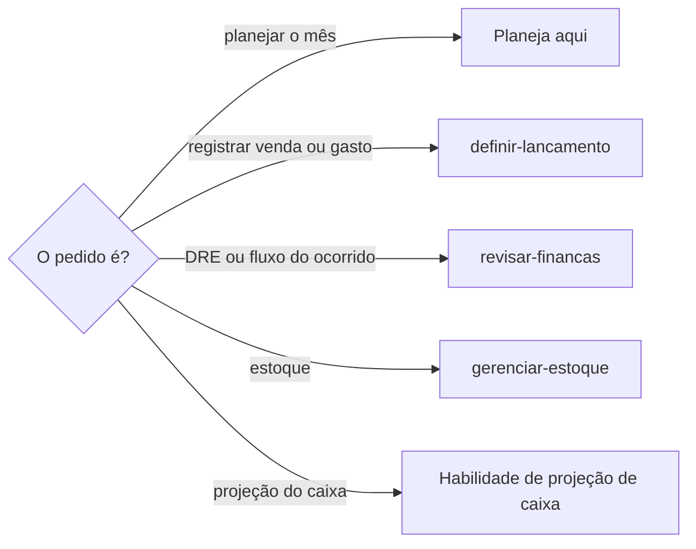

# Definir planejamento financeiro

## Parâmetros de configuração

Leia cada valor nas instruções do projeto: primeiro na entrada com o nome desta habilidade, depois na entrada `Global` ou no primeiro nível do bloco. Quando um valor não estiver lá, use o padrão abaixo. `Moeda` é a moeda das tabelas. `Habilidade de projeção de caixa` vazia quer dizer que a projeção do caixa fica fora desta habilidade.

```yaml
"Moeda": "BRL"
"Habilidade de projeção de caixa": ""
```

## Instruções

### Passo 1

Montar ou rever o planejamento financeiro de um mês é esta habilidade. A pessoa informa o data source na execução. Sem essa indicação, use as listas do mapeamento de dados do projeto. Se ele não estiver no workspace conectado, pare. Não use a fonte de outro workspace. Não grave lançamento aqui.



### Passo 2

O plano traz previsão de vendas, previsão de gastos, meta de lucro, controle de caixa e ações práticas. A base é o que a fonte já tem. Previsão ou meta que a pessoa não disse: pergunte. Não invente a venda do mês, o gasto do mês nem a meta. Não apague o histórico. A resposta começa por tabelas, na `Moeda`. Depois vêm resumo curto, alertas e orientações.

## Problemas comuns

### Meta inventada

Se você escolher a meta de lucro ou a previsão de vendas que a pessoa não disse, o plano deixa de ser o dela.

1. Use o que a fonte já tem como base.
2. Peça a previsão e a meta que faltarem.
3. Não invente venda, gasto nem meta do mês.

## Exemplos de entrada e saída

Estes exemplos ilustram fatos. Eles podem não estar no data source.

### planeje o mês que vem

Li o que já estava lançado. Faltava a meta de lucro. Perguntei. Não inventei a previsão de vendas.

## Casos-limite

- A fonte não está no workspace conectado: pare. Não use a fonte de outro workspace.
- Registrar venda ou gasto: `definir-lancamento`. DRE ou fluxo do que já ocorreu: `revisar-financas`. A lista de estoque: `gerenciar-estoque`. Projeção do caixa: a `Habilidade de projeção de caixa`, quando as instruções do projeto a indicarem.
- Previsão ou meta ausente: pergunte. Não grave lançamento neste plano.

## Pegadinhas

- Planejar o mês parece projetar o caixa. A projeção segue a `Habilidade de projeção de caixa`, quando as instruções do projeto a indicarem.
- O histórico da conversa parece base suficiente. A base é a fonte. O que a pessoa não previu, pergunte.

## Scripts disponíveis

- Nenhum.

1. Não há script para executar.
