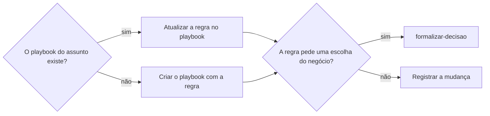

# Definir playbook

## Parâmetros de configuração

Leia cada valor nas instruções do projeto: primeiro na entrada com o nome desta habilidade, depois na entrada `Global` ou no primeiro nível do bloco. Quando um valor não estiver lá, use o padrão abaixo.
```yaml
"Formato da data com dia da semana": "terça-feira, 01/09/2026"
"Modo de aprendizado": "perguntar"
```

## Instruções

### Passo 1

A lista de playbooks e o nome de cada propriedade vêm do mapeamento de dados do projeto, no workspace conectado. Se a lista não estiver nessa conexão, pare e peça. Este texto usa os conceitos: o título do playbook, a área, a fonte e a data da revisão.

Receba a regra nova, quem a definiu, a data de vigência e o link da fonte, como o aviso da plataforma ou a decisão da pessoa.

### Passo 2

Busque o playbook pelo assunto e pela área antes de criar. Uma regra de uma plataforma entra no playbook do processo que ela muda, como envio, atendimento ou campanha, e não num playbook por plataforma.



### Passo 3

Escreva a regra com as próprias palavras, curta e aplicável: o que fazer, quando e o prazo. Não cole o texto do aviso. A regra antiga que a nova substitui é reescrita, sem deixar as duas valendo.

Quando a regra abre uma escolha do negócio, como entrar ou não numa campanha que cobra anúncio, siga `formalizar-decisao` e não decida no playbook.

### Passo 4

Cada mudança deixa um comentário datado na página, com a data de vigência no `Formato da data com dia da semana`, a fonte e o que mudou. Os comentários formam o histórico. Atualize a data da revisão.

A regra que pede ação até uma data também vira tarefa por `definir-tarefa`.

Mostre o link do playbook, a regra como ficou, a vigência e a tarefa, quando houver.

### Passo 5

Ao terminar, siga `evoluir-habilidade` conforme `Modo de aprendizado`.

## Problemas comuns

### Duas regras valendo

Se você acrescentar a regra nova e deixar a antiga, quem lê o playbook não sabe qual seguir.

1. Ache a regra antiga do mesmo assunto.
2. Reescreva-a com a nova.
3. Registre a troca no comentário datado.

### Aviso colado no playbook

Se você colar o texto do aviso, o playbook vira arquivo de e-mail e a regra se perde.

1. Escreva só a regra, com prazo e condição.
2. Ponha o link da fonte no comentário.

## Exemplos de entrada e saída

Estes exemplos ilustram fatos. Eles podem não estar no data source.

### a plataforma reduziu o prazo de revisão de reembolso para 2 dias úteis

O playbook de atendimento trocou o prazo de 3 por 2 dias úteis, com a vigência e o link do aviso no comentário datado. Não saiu tarefa, porque a regra não pedia ação até uma data.

### a campanha da plataforma cria anúncio automático cobrado de quem não configura

O playbook de campanhas ganhou a regra de configurar os anúncios 7 dias antes de cada campanha em que o negócio entrar. A escolha de entrar foi para `formalizar-decisao`.

## Casos-limite

- A lista de playbooks não está no mapeamento: pare e peça.
- A regra vale só para uma plataforma: ela entra no playbook do processo, com a plataforma na condição.
- A fonte não traz a data de vigência: use a data do aviso e diga isso.
- A regra contradiz uma decisão da pessoa: siga `formalizar-decisao` antes de mudar.

## Pegadinhas

- Um playbook por plataforma parece organizado. A pessoa procura pelo processo, como envio ou atendimento.
- A regra da plataforma parece obrigar o negócio a participar. Ela vale para quem participa; a escolha fica com a pessoa.

## Scripts disponíveis

- Nenhum.

1. Não há script para executar.
