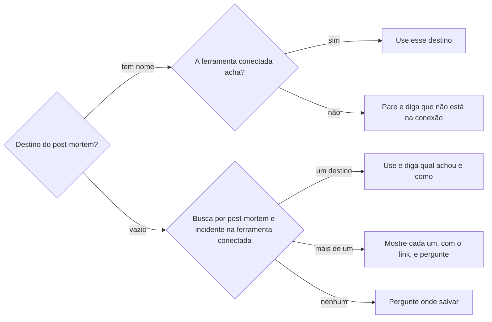

# Definir post-mortem

## Parâmetros de configuração

Leia cada valor nas instruções do projeto: primeiro na entrada com o nome desta habilidade, depois na entrada `Global` ou no primeiro nível do bloco. Quando um valor não estiver lá, use o padrão abaixo.
```yaml
# `Destino do post-mortem` é o nome do banco ou do espaço onde os post-mortems ficam na ferramenta conectada, como um banco do Notion ou um espaço do Confluence. Vazio, procure o destino na ferramenta conectada.
"Destino do post-mortem": ""
# `Modelo do post-mortem` é o nome do modelo que o post-mortem segue na ferramenta conectada. Vazio, procure o modelo na ferramenta conectada e, sem modelo, use `Seções do post-mortem`.
"Modelo do post-mortem": ""
# `Padrão do título` é o formato do título da página. Vazio, siga o título dos post-mortems já publicados no destino.
"Padrão do título": ""
# `Seções do post-mortem` são as seções, na ordem, quando não há modelo. O modelo e os post-mortems já publicados vencem esta lista.
"Seções do post-mortem":
  - "Resumo"
  - "Impacto"
  - "Linha do tempo"
  - "Causa raiz"
  - "Fatores que contribuíram"
  - "O que funcionou bem"
  - "Ações"
  - "O que muda no padrão"
  - "Referências"
"Modo de aprendizado": "perguntar"
```
## Instruções

### Passo 1

Junte os fatos do incidente na conversa e nas fontes que ela cita: o relato, as mensagens, a tarefa, a issue e o pull request.
Anote de cada fato a fonte e, quando houver, a data e o horário.
O que nenhuma fonte diz fica como `a verificar`.
Não complete com suposição.

### Passo 2

Ache o destino.



O destino é o banco ou o espaço onde já existem post-mortems, não um banco qualquer com o nome parecido.
Não crie banco nem espaço.
Não troque o destino do parâmetro por outro que a conexão mostrou.

### Passo 3

Ache o modelo do mesmo jeito: o `Modelo do post-mortem`, ou a busca por modelo de post-mortem na ferramenta conectada, ou `Seções do post-mortem` quando não há modelo.
Leia o modelo inteiro.
Leia também os dois post-mortems mais recentes do destino, para copiar o título, as seções, o aviso no topo e as propriedades preenchidas.
O que o modelo pede vence o que os post-mortems já publicados mostram, e os dois vencem `Seções do post-mortem`.
Uma regra do modelo que só vale para outro tipo de caso, como um ritual de reunião, não entra no texto.
Diga qual modelo usou.

### Passo 4

Procure no destino um post-mortem do mesmo incidente.
Se existe, revise essa página e mostre o que muda nela.
Não abra outra.

### Passo 5

Escreva o post-mortem.

1. O título segue o `Padrão do título` ou o dos post-mortems já publicados.
2. Um aviso no topo diz o estado do caso: resolvido, com a data, ou em andamento, com o que ainda falta e até quando.
3. O resumo diz em poucas frases o que aconteceu, a quem afetou, por quê e o que resolveu.
4. O impacto diz quem ou o que foi afetado, por quanto tempo e o que continuou funcionando.
5. A linha do tempo segue a ordem dos fatos, com data e horário quando a fonte os tem. Sem horário, o passo entra na ordem, sem horário.
6. A causa raiz é o processo, a configuração ou a regra que deixou o erro acontecer, nunca a pessoa.
7. Os fatores que contribuíram e o que funcionou bem saem dos fatos, um por item.
8. Cada ação é uma caixa de seleção: marcada quando feita, com o link do que a fez, e aberta com quem faz e o prazo quando a fonte os diz.
9. Uma medida temporária, como uma exceção de acesso ou um prazo adiado, entra como ação aberta para desfazê-la, com a data em que vence.
10. O que muda no padrão diz o que foi acrescentado, mudado e removido, e onde cada mudança foi aplicada, como um checklist, um modelo ou um manual. Uma mudança ainda não aplicada entra como ação.
11. As referências ficam numa seção só, no fim, com o link de cada tarefa, issue, pull request e caso parecido.

Nomeie as pessoas só pelo papel no caso, como quem relatou e quem resolveu.
Não escreva segredo, senha, código de acesso nem dado pessoal que o caso não pede.

### Passo 6

Preencha as propriedades do destino que o texto responde, pelo schema dele.
Uma propriedade que resume uma seção recebe o mesmo fato em itens curtos.
Uma propriedade que o texto não responde fica vazia e entra numa lista no fim da resposta.
Não crie propriedade.

### Passo 7

Antes de publicar, confira:

- [ ] cada fato tem fonte, ou está como `a verificar`;
- [ ] nenhuma frase culpa uma pessoa;
- [ ] cada medida temporária tem a ação de desfazê-la, com a data;
- [ ] cada heading aparece uma vez;
- [ ] nenhum segredo nem código de acesso está no texto.

### Passo 8

Mostre o título, o destino e o texto, e peça o sim.
Publique só depois do sim.
Responda com o link da página publicada e a lista do Passo 6.
Ofereça cadastrar cada ação aberta como tarefa, por `definir-tarefa`.

### Passo 9

Ao terminar, siga `evoluir-habilidade` conforme `Modo de aprendizado`.

## Problemas comuns

### Culpa no texto

Se você escrever que o incidente aconteceu porque uma pessoa errou, o post-mortem vira acusação e o time deixa de relatar o próximo caso.

1. Troque a pessoa pelo processo ou pela configuração que deixou o erro acontecer.
2. Nomeie quem participou só pelo papel no caso.
3. Leia de novo a causa raiz e as ações com essa pergunta.

### Medida temporária esquecida

Se você registrar a exceção que resolveu o caso sem a ação de desfazê-la, a exceção fica valendo depois do prazo.

1. Escreva a medida e a data em que vence.
2. Abra uma ação para desfazê-la até essa data.
3. Ofereça cadastrar a ação como tarefa.

### Post-mortem fora do formato do destino

Se você escrever pelas seções padrão quando o destino tem modelo ou post-mortems publicados, a página sai diferente das outras e a pessoa pede a reescrita.

1. Leia o modelo e os dois post-mortems mais recentes do destino.
2. Copie o título, as seções, o aviso e as propriedades deles.
3. Use `Seções do post-mortem` só quando não há nenhum dos dois.

### Destino trocado

Se você gravar no primeiro banco que a busca mostrou, o post-mortem pode cair noutro negócio ou num banco de outro assunto.

1. Use o destino que já tem post-mortems.
2. Com mais de um, mostre cada um e pergunte.
3. Com o parâmetro fora da conexão, pare.

### Horário inventado

Se você completar a linha do tempo com horários que a fonte não diz, o post-mortem registra um fato falso.

1. Ponha o passo na ordem, sem horário.
2. Marque como `a verificar` o que importa e falta.
3. Peça o dado à pessoa, se ele mudar a causa ou o impacto.

## Exemplos de entrada e saída

Estes exemplos ilustram fatos. Eles podem não estar no data source.

### escreva o post-mortem: a Ana perdeu o acesso à conta da empresa, mandei um código alternativo, desativei o desafio de login por 10 minutos e adiei a verificação em duas etapas até sexta

Achei o banco de post-mortems pela busca e o modelo pelo nome.
O título segue o dos já publicados: `Post-mortem: Perda de acesso à conta da empresa (Março/2026)`.
O aviso diz que o acesso voltou e que a verificação em duas etapas passa a ser obrigatória na sexta.
A causa raiz é a conta sem segundo fator de recuperação cadastrado, não a pessoa.
As ações abertas são cadastrar o fator de recuperação, conferir a verificação em duas etapas até sexta e incluir esse cadastro no checklist de entrada de quem chega.
O que muda no padrão: acrescentamos o cadastro do fator de recuperação no checklist de entrada.
O código alternativo não entrou no texto.
Mostrei o texto e o destino e pedi o sim para publicar.

## Casos-limite

- O incidente ainda está em andamento: o aviso diz o que falta, e o post-mortem fica no estado de rascunho do destino, se ele tiver um.
- O destino é um espaço de páginas sem propriedades, como no Confluence: o post-mortem é uma página filha do espaço, e o Passo 6 não se aplica.
- O mesmo caso aconteceu antes: o caso parecido entra nas referências, e o fator que se repete entra nos fatores que contribuíram.
- O modelo traz um ritual de reunião, como um timebox: ele não entra no texto do post-mortem.
- A pessoa pede para corrigir um post-mortem publicado: revise a página dele, sem abrir outra.
- A busca acha o destino em outro workspace: não use, pergunte.

## Pegadinhas

- O banco com post-mortems pode ter um nome que não diz post-mortem, como um banco de lições aprendidas. A busca procura pelas páginas, não só pelo nome do banco.
- O modelo de post-mortem pode morar num banco de modelos e trazer regras de outro ritual no topo. Só a parte do post-mortem vale para o texto.
- A medida que resolveu o caso costuma ser temporária. Sem ação de desfazê-la, ela vira o padrão sem ninguém decidir.
- Um código de acesso que resolveu o caso parece um fato da linha do tempo. Ele é segredo e fica fora do texto.

## Scripts disponíveis

- Nenhum.

1. Não há script para executar.
