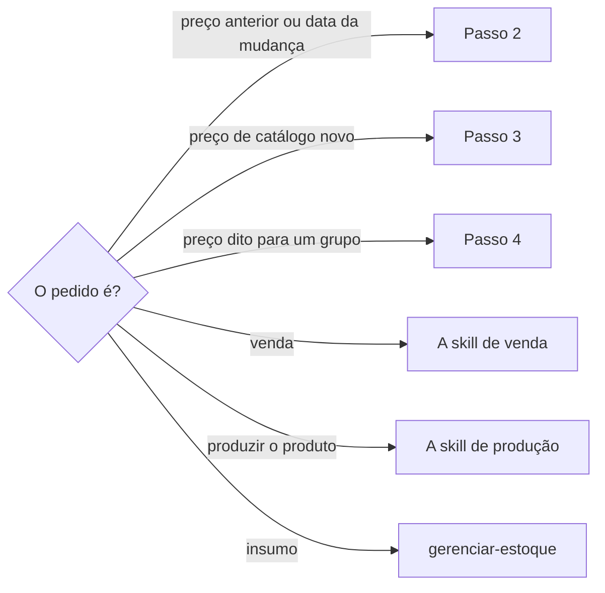

# Definir preço de produto

## Parâmetros de configuração

Leia cada valor nas instruções do projeto: primeiro na entrada com o nome desta habilidade, depois na entrada `Global` ou no primeiro nível do bloco. Quando um valor não estiver lá, use o padrão abaixo.

```yaml
"Modo de aprendizado": "perguntar"
# Opções: `banco do Notion`, `Shopify` e `banco do Notion e Shopify`.
"Fonte do histórico de preços": "banco do Notion"
# Opções: `sempre`, `nunca`, `perguntar` e `automático`. `automático` lê as versões só quando a fonte do histórico não responde. O Notion não garante guardar as versões, então diga até onde chegam.
"Leitura do histórico de versões da página": "perguntar"
"Banco de variações": ""
# Nomes de banco e de registro: o projeto define. Vazios, pergunte uma vez e não escolha.
"Banco de produtos": ""
"Banco do histórico de preços": ""
"Registro de mudança de preço no Shopify": ""
# Vazios: sem valor, pergunte à pessoa e não escolha.
"Destino do preço de um ponto de venda": ""
"Fonte do estoque por local": ""
```

## Instruções

### Passo 1

O produto fica em `Banco de produtos`. Os nomes das propriedades vêm do mapeamento de dados do projeto. `Banco de produtos` vazio: a pessoa informa o data source na execução. Se ele não estiver no workspace conectado, pare.



### Passo 2

Antes de perguntar um preço anterior ou a data da mudança, leia a fonte do histórico, conforme `Fonte do histórico de preços`.

O que for anterior às linhas dessa fonte pode estar no histórico de versões da página, conforme `Leitura do histórico de versões da página`:

- `sempre`: leia a fonte e as versões da página.
- `automático`: leia as versões só quando a fonte não responde.
- `perguntar`: quando a fonte não responde, pergunte se lê as versões e espere.
- `nunca`: não leia as versões.

Leia as versões da página do produto e, se o preço varia por variação, as da variação pedida. `Banco de variações` vazio: pergunte onde estão as variações. Não leia as da unidade.

O Notion não garante guardar as versões, então diga até onde chegam. Pergunte só o que nada respondeu e diga qual fonte consultou.

### Passo 3

Ao registrar uma mudança de preço de catálogo, acrescente uma linha na fonte do histórico. No banco do Notion, é uma linha em `Banco do histórico de preços`. No Shopify, é o `Registro de mudança de preço no Shopify` do produto. Com o banco ou o registro vazio, pergunte onde acrescentar.

Nunca edite nem apague uma linha antiga: a correção vai numa linha nova.

Campos da linha, ligados às propriedades pelo mapeamento de dados do projeto:

- o produto, a variação quando o preço varia por ela, e o canal, varejo ou atacado;
- o motivo, obrigatório, e quem decidiu, obrigatório;
- o preço anterior e o novo;
- a vigência, a partir de que data;
- o custo na data, copiado no dia e nunca recalculado;
- o preço de comparação, que não passa do menor preço praticado nos 30 dias anteriores à redução.

Falta motivo ou quem decidiu: pergunte antes de acrescentar. Preço de comparação acima do limite: mostre o menor preço dos 30 dias e não acrescente.

### Passo 4

Um preço dito para um grupo, como "o grupo ficou por 250 no local", vale só para os produtos que estavam naquele local e ainda tinham estoque. O grupo é definido pelo estoque do local, não pelo nome.

Liste os produtos pela `Fonte do estoque por local` e tire os vendidos antes. Mostre a lista e espere a confirmação da pessoa. Produto que não foi ao local, ou que já saiu do estoque, não muda de preço.

Para listar o estoque, o banco de unidades precisa dar as unidades de um local e a finalidade de cada uma. Piloto, figurino e acervo não contam como estoque de venda.

### Passo 5

Onde registrar o preço de um ponto de venda é `Destino do preço de um ponto de venda`. Com ele vazio, pergunte à pessoa onde registrar e não escolha. `Fonte do estoque por local` vazia também se pergunta.

Não invente nome de banco nem de propriedade para o que o projeto não definiu: nenhum nome de banco entra nesta skill.

### Passo 6

Ao terminar, siga `evoluir-habilidade` conforme `Modo de aprendizado`.

## Problemas comuns

### Preço do grupo aplicado ao nome

Se você mudar o preço de todos os produtos com o nome citado, os que não estavam no local ou já tinham sido vendidos ficam com um preço que ninguém disse.

1. Liste os produtos pelo estoque do local.
2. Tire os vendidos antes.
3. Mostre a lista e espere a confirmação.

### Pergunta que a fonte respondia

Se você perguntar o preço anterior sem ler a fonte do histórico, a pessoa repete o que o registro já guarda.

1. Leia a fonte do histórico de preços.
2. Para o que vem antes dela, siga `Leitura do histórico de versões da página`.
3. Responda com o que achou e diga qual fonte consultou.
4. Pergunte só o que nenhuma responde.

### Linha antiga editada

Se você editar ou apagar uma linha do histórico, o registro deixa de provar o que mudou.

1. Acrescente uma linha nova com a correção.
2. Deixe a linha antiga como está.

## Exemplos de entrada e saída

Estes exemplos ilustram fatos. Eles podem não estar no data source.

### o grupo de camisetas ficou por 80 no evento

Listei as camisetas pelo estoque do evento e tirei as vendidas antes. Mostrei a lista e esperei o sim antes de mudar o preço. A camiseta que não foi levada não mudou de preço.

### qual era o preço da camiseta antes e quando mudou?

Li o banco do histórico de preços, que começa em março. A mudança era de janeiro, então li as versões da página, que mostravam o preço e a data. Disse até onde cada fonte chega e não perguntei nada.

### baixa o preço da caneca de 60 para 50

Perguntei o motivo e quem decidiu. Acrescentei uma linha com o canal, os preços, a vigência e o custo na data. Não editei a linha antiga.

## Casos-limite

- Nenhuma fonte chega até a mudança: diga qual consultou, até onde cada uma chega, e pergunte só o que ficou antes.
- A lista do grupo fica vazia: diga isso e não mude nenhum preço.
- A pessoa diz o preço de um produto só: confirme o produto e o preço antes de mudar.
- O banco ou o workspace não está conectado: pare e peça.
- O destino do preço do ponto de venda está vazio: pergunte onde registrar.

## Pegadinhas

- O nome do produto parece o grupo inteiro. Quem define o grupo é o estoque do local.
- O preço dito no local parece valer para todos os produtos daquele tipo. Vale só para os que estavam lá e ainda tinham estoque.
- A página do produto parece só ter o preço de hoje. As versões do produto e da variação guardam preços antigos que o banco do histórico ainda não tem.
- O custo na data parece recalculável. Ele é o custo copiado no dia da mudança.

## Scripts disponíveis

- Nenhum.

1. Não há script para executar.
