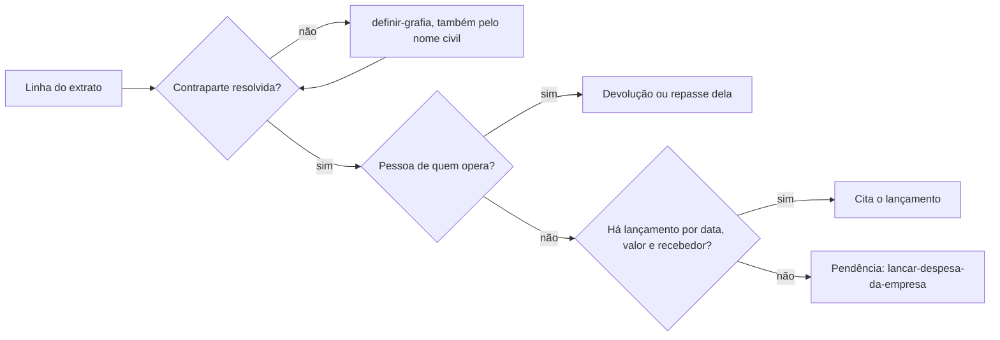

# Definir prestação de contas

## Parâmetros de configuração

Leia cada valor nas instruções do projeto: primeiro na entrada com o nome desta habilidade, depois na entrada `Global` ou no primeiro nível do bloco. Quando um valor não estiver lá, use o padrão abaixo.
```yaml
"Modo de aprendizado": "perguntar"
```

## Instruções

### Passo 1

Antes de montar, descubra o que o repasse pede e se a prestação já saiu.

- [ ] Quem repassou, quanto, para quê e a data em que o dinheiro entrou.
- [ ] O prazo e a quem a prestação vai, como a negociação ou o e-mail do repasse combinaram.
- [ ] Os comprovantes que a pessoa pediu para guardar.
- [ ] Se a prestação já foi enviada, no e-mail ou na conversa.

Leia o histórico da negociação com `definir-negociacao` e busque o e-mail com `procurar-email`. Prestação já enviada não se refaz: confira o que falta e diga a diferença.

### Passo 2

Ache a conta que recebeu o repasse, pelo cadastro da conta com `definir-conta-bancaria`, e o extrato do período. O extrato costuma chegar por e-mail em PDF, CSV e OFX.

O CSV e o OFX têm uma linha por lançamento, e o PDF mostra o saldo por transação. Abra os três antes de dizer que o extrato não traz a hora de um lançamento. O `Solicitado em` do PDF é a hora do pedido do extrato, não a de um lançamento.

Confirme com a pessoa de qual conta é o extrato quando o e-mail vier de outro endereço, e diga o período que ele cobre. Não presuma a titularidade.

### Passo 3

Dê um destino a cada linha do extrato do período do evento. O destino é o lançamento que a explica, a devolução ou o repasse que a anula, ou a pendência sem lançamento.



Resolva cada contraparte de Pix antes de tratá-la como terceira. Um Pix no nome civil de registro de quem opera é dessa pessoa, devolução ou repasse dela, não dinheiro de fora.

O nome que o extrato mostra diferente do cadastro, como o do titular da maquininha de um posto, é hipótese. Busque na internet e só afirme que é a mesma empresa com a confirmação, ou pergunte.

### Passo 4

Liste o que não foi pago com o repasse. Os gastos do mesmo evento que saíram de outra conta, de outra pessoa ou em dinheiro ficam declarados como fora do repasse, com a fonte de pagamento, para quem o enviou não os procurar no extrato.

Não afirme que um gasto não passou pela conta sem ter cruzado o extrato inteiro do período. Consulte os gastos da viagem ou do ponto de contato no Notion, com `fazer-fechamento` e `lancar-despesa-da-empresa`.

### Passo 5

Monte a prestação com o valor recebido, o total gasto com comprovante, a diferença, cada linha e seu destino, e a declaração do que ficou fora do repasse. Diga na resposta o que já está conciliado e o que está pendente, antes do texto.

Cada linha da prestação leva data e hora, não só a data, e a tabela vai do mais antigo ao mais recente, por data e hora. O repasse recebido e a emissão do documento também levam a hora.

O extrato costuma trazer só a data, e a ordem das linhas do mesmo dia nem sempre é a do relógio. Tire a hora do comprovante de cada pagamento, como a via da maquininha, a NFC-e ou o comprovante do Pix, e ordene por ela. Não deduza a hora pela ordem das linhas do extrato.

Para a hora de uma linha sem comprovante, como o Pix recebido do repasse, busque antes uma hora aproximada nos canais com quem repassou: o e-mail e as conversas de WhatsApp dessa pessoa e da equipe dela, lidas pela sessão dona do WhatsApp Web, só em leitura e só essas conversas, como `usar-whatsapp-web` manda.

A mensagem que pede o repasse e a resposta que diz que ele sai agora dão o limite de baixo. A mensagem que diz que o dinheiro caiu dá o limite de cima. Ponha no documento a hora do limite de baixo, marcada como aproximada, diga a base à pessoa e peça o comprovante do aplicativo do banco ou um extrato detalhado para confirmar. Sem nenhuma pista nos canais, peça a hora à pessoa.

As colunas de data e hora saem em fonte monoespaçada, como as de valor: os dígitos alinham linha a linha, e quem confere a tabela escaneia melhor. Use o recurso do design system do projeto para isso. Se ele não tiver, diga à pessoa e proponha a mudança ao design system.

O texto para quem repassou passa por `redigir-com-tom-de-voz`. O envio segue `enviar-email` ou o canal em que a conversa aconteceu, só com a confirmação da pessoa, com o extrato e os comprovantes que o repasse pediu. Quem assina é quem as instruções do projeto definem.

### Passo 6

Registre o envio no histórico da negociação, como `definir-negociacao` manda. Ao terminar, siga `evoluir-habilidade` conforme `Modo de aprendizado`.

## Problemas comuns

### Contraparte do Pix tratada como terceira

Se você chamar de terceira a pessoa de um Pix do extrato sem consultar o cadastro, ela pode ser quem opera, pelo nome civil de registro, e a conciliação conta a devolução dela como dinheiro de fora.

1. Resolva o nome do Pix com `definir-grafia`, também pelo nome civil.
2. Trate o Pix de quem opera como devolução ou repasse dela.
3. Dê um destino a cada linha do extrato.

### Linha do extrato sem destino

Se você deixar uma linha do extrato sem dizer onde está a despesa, quem recebe a prestação não consegue conferir e a pessoa tem de perguntar.

1. Busque por data, valor e recebedor antes de dizer que não há lançamento.
2. Diga onde está cada despesa e de que conta ela saiu.
3. Entregue o que não achou como pendência.

### Prestação que só lista o que passou pela conta

Se você prestar contas só do que está no extrato, quem repassou não sabe o que foi pago por fora e procura no extrato o que não está lá.

1. Liste os gastos do mesmo evento que não saíram do repasse.
2. Diga a fonte de pagamento de cada um.
3. Confirme o cruzamento do extrato inteiro antes de afirmar que não passaram pela conta.

### Linha só com data ou fora da ordem do relógio

Se você copiar a data e a ordem do extrato, a tabela perde a hora e fica numa ordem que o relógio dos comprovantes contradiz.

1. Leia a hora no comprovante de cada pagamento e no aviso do repasse.
2. Ordene a tabela do mais antigo ao mais recente, por data e hora.
3. Antes de pedir a hora, abra o extrato nos três formatos e diga à pessoa o que cada um traz.
4. Sem comprovante, busque a hora aproximada no e-mail e no WhatsApp de quem repassou, marque-a como aproximada e peça o comprovante do banco, em vez de deduzir pela ordem do extrato.

## Exemplos de entrada e saída

Estes exemplos ilustram fatos. Eles podem não estar no data source.

### precisamos fazer a prestação de contas do repasse do festival; o extrato já está no e-mail?

Achei o extrato do mês no e-mail, em CSV, PDF e OFX, e li o CSV. Cruzei cada linha com os gastos lançados: os três postos e o Uber batem, a devolução em nome civil de quem opera é dela, e as linhas sem lançamento ficaram como pendência. Listei pedágios, entrega, hospedagem e refeições como pagos por fora do repasse.

Pus a hora de cada comprovante em cada linha e ordenei a tabela do mais antigo ao mais recente. A hora do repasse recebido não aparece em nenhum comprovante: li o e-mail e as conversas de WhatsApp de quem repassou, usei a hora da mensagem que dizia que o Pix saía agora, marquei como aproximada e pedi o comprovante do aplicativo do banco. Não enviei nada.

## Casos-limite

- O extrato vem de um e-mail de outra pessoa: confirme de qual conta é e o período antes de cruzar.
- A prestação já foi enviada: compare com o extrato e diga só o que falta.
- O gasto do evento não está lançado: siga `lancar-despesa-da-empresa` e volte.
- O pedido é o acerto de caixa de um ponto de contato: `fazer-fechamento`.
- O repasse pede um formato próprio de documento: siga o que a negociação combinou e diga a diferença.
- Um pagamento ou o repasse só aparece no extrato, sem comprovante com hora: busque a hora aproximada nos canais de quem repassou, marque-a como aproximada e peça o comprovante do banco. Sem nenhuma pista, peça a hora à pessoa e não feche a tabela sem ela.

## Pegadinhas

- Um nome de pessoa que você não reconhece num Pix parece terceiro. Pode ser o nome civil de registro de quem opera.
- O status de conciliação de um gasto mede o comprovante, não o cruzamento com o banco.
- Um nome diferente no extrato parece outra empresa. Pode ser o titular da maquininha do mesmo posto.
- O prazo da prestação costuma estar na negociação, não no extrato.
- Data e hora parecem texto comum. Numa coluna de tabela, a fonte monoespaçada alinha os dígitos, como nos valores.
- A mensagem "o dinheiro caiu" parece a hora do repasse. É só o limite de cima: o dinheiro pode ter caído horas antes.
- A ordem das linhas do extrato parece a do relógio. Dentro do mesmo dia ela pode não ser, e o saldo corrido também pode contradizer a hora do comprovante.

## Scripts disponíveis

- Nenhum.

1. Não há script para executar.
