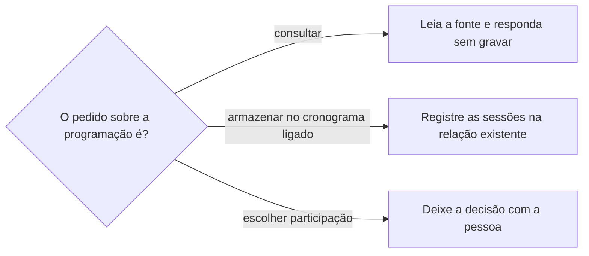

# Definir programação da oportunidade

## Parâmetros de configuração

Leia cada valor nas instruções do projeto: primeiro na entrada com o nome desta habilidade, depois na entrada `Global` ou no primeiro nível do bloco. Quando um valor não estiver lá, use o padrão abaixo.
```yaml
"Formato da data com dia da semana": "terça-feira, 01/09/2026"
"Modo de aprendizado": "perguntar"
```
## Instruções

### Passo 1

A lista de oportunidades, a do cronograma e o nome de cada propriedade vêm do mapeamento de dados do projeto, no workspace conectado. Se uma lista não estiver nessa conexão, pare. Não use a lista de outro workspace. Este texto usa os conceitos: a edição, o cronograma ligado à edição, a sessão e a fonte oficial da programação.

A edição precisa existir. Saber se ela existe fica com `procurar-oportunidade`, e cadastrá-la fica com `criar-oportunidade`.

### Passo 2

Consultar uma programação é leitura; não é inscrição nem escolha de participação. Retome a fonte oficial já identificada sem pedir nova autorização para a consulta solicitada.

Carregue o conteúdo completo antes de apresentar a programação como completa. Timeout na leitura rápida não é prova de indisponibilidade: use uma leitura mais completa oferecida pela mesma ferramenta. Não invente horários, palestrantes ou salas a partir de trechos de busca.



### Passo 3

No armazenamento solicitado, carregue o esquema do cronograma e consulte os itens já ligados à edição antes de criar. Registre uma sessão por item, com o vínculo para a oportunidade, início e fim planejados no fuso do evento e ordem de leitura. Preserve sessões simultâneas, repetições em horários diferentes e atividades fechadas, com a restrição explícita.

Guarde eixo, palestrante informado e URL da fonte no contexto complementar; datas, horários e local ficam nas propriedades próprias. Ausência de palestrante ou de sala permanece ausência.

Não confunda programação publicada com presença escolhida, inscrição, tarefa ou compromisso no calendário. O pedido de guardar para escolher depois não autoriza bloquear a agenda nem selecionar sessões.

### Passo 4

Teste uma sessão real do pedido com todas as propriedades pretendidas antes de enviar o lote. Reaproveite o registro de teste e não o crie de novo. Examine o resultado por item, não apenas o sucesso da chamada.

Campo opcional rejeitado interrompe a repetição do mesmo lote: confira o formato documentado e teste uma correção num único item. Persistindo a rejeição, grave os outros campos e informe a lacuna, sem alterar a estrutura, inventar coordenadas ou mover o local para texto livre. Retome só os itens que não foram gravados; preserve os sucessos parciais.

Compare as sessões da fonte com os itens vinculados, seus nomes, início e fim antes de afirmar completude. Não use a quantidade de atividades do anúncio como quantidade da programação publicada.

### Passo 5

Responda com a quantidade de sessões lidas e a de gravadas, as lacunas e o link da edição. Data de sessão sai no formato da data com dia da semana, calculado com a data, o horário e o fuso do evento, antes de escrever. Sem horário ou sem fuso, e se o dia puder mudar, peça. Não invente.

Se a fonte trouxer um dia da semana incompatível com a data, sinalize a divergência e não grave a sessão até a pessoa confirmar. Não inscreva, não escolha sessão e não crie evento na agenda.

### Passo 6

Ao terminar, siga `evoluir-habilidade` conforme `Modo de aprendizado`.

## Problemas comuns

### Programação virou presença

Se você escolher sessões, inscrever ou criar evento na agenda ao guardar a programação, uma lista publicada vira compromisso que ninguém assumiu.

1. Guarde só as sessões publicadas, no cronograma da edição.
2. A escolha da participação é da pessoa.
3. O evento na agenda segue `definir-agenda`, e o horário que falta segue `sincronizar-cronograma`.

### Programação incompleta dada como completa

Se você apresentar a leitura rápida, ou o número do anúncio, como a programação inteira, faltam sessões e ninguém percebe.

1. Carregue o conteúdo completo. Timeout não é indisponibilidade.
2. Compare as sessões da fonte com os itens vinculados antes de afirmar completude.
3. Não use a quantidade de atividades do anúncio.

### Lote sem teste

Se você enviar o lote sem testar uma sessão com todas as propriedades, um campo rejeitado repete a falha em todos os itens.

1. Teste uma sessão real e reaproveite esse registro.
2. Corrija o campo rejeitado num único item. Persistindo, grave os outros campos e informe a lacuna.
3. Retome só os itens que não foram gravados.

## Exemplos de entrada e saída

Estes exemplos ilustram fatos. Eles podem não estar no data source.

### Consulte a programação do Festival Rota Sul. Você pode fazer isso sem confirmar comigo.

Consultei a fonte oficial já identificada, sem pedir nova confirmação. A leitura rápida deu timeout, então usei a leitura mais completa e apresentei a programação inteira. Não inscrevi nem criei evento na agenda.

### Armazene toda a programação do Festival Rota Sul no cronograma ligado à oportunidade. Depois a gente escolhe.

Testei uma sessão com todas as propriedades, corrigi o campo de local rejeitado num único item e gravei o lote. Todas as sessões publicadas ficaram vinculadas à edição, inclusive as simultâneas e as fechadas, com início, fim e palestrante quando informados. Nenhuma sessão foi escolhida e nenhum evento foi criado na agenda.

## Casos-limite

- A edição não existe: siga `procurar-oportunidade` e, se faltar, `criar-oportunidade`. Não guarde sessão sem a edição.
- A fonte oficial não está identificada: pergunte qual é. Não procure a programação em página de terceiros.
- A pessoa pede para escolher as sessões a que vai: a decisão é dela. Mostre as opções e não grave a escolha.
- O mapeamento não tem onde guardar a sessão: pare e diga qual propriedade falta.
- Campo opcional rejeitado: teste a correção num único item antes de repetir o lote.
- Programação sem horário de início ou de fim: grave a sessão sem inventar o horário, e o que falta segue `sincronizar-cronograma`.

## Pegadinhas

- Guardar a programação para escolher depois parece o primeiro passo da inscrição. É só leitura e armazenamento: não inscreve, não escolhe e não bloqueia a agenda.
- O timeout da leitura rápida parece fonte indisponível. A mesma ferramenta tem uma leitura mais completa.
- A quantidade de atividades do anúncio parece o total da programação. O total é o que a fonte publica, conferido item a item.
- Ausência de palestrante ou de sala parece lacuna a preencher. Ela permanece ausência.

## Scripts disponíveis

- Nenhum.

1. Não há script para executar.
