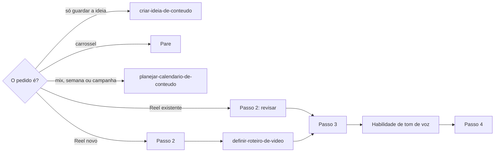

# Definir Reel do Instagram

## Parâmetros de configuração

Leia cada valor nas instruções do projeto: primeiro na entrada com o nome desta habilidade, depois na entrada `Global` ou no primeiro nível do bloco. Quando um valor não estiver lá, use o padrão abaixo. `Habilidade de tom de voz` vazia quer dizer que a legenda segue só esta habilidade. `Arquétipos da marca` lista os arquétipos que a voz da marca assume. Vazio quer dizer que a persona é inferida do perfil autor e anotada como inferida. `Página da estratégia de conteúdo` aponta a página com os objetivos de conteúdo do negócio. Vazia quer dizer que o objetivo vem só da pessoa. `Empresa do negócio` é o nome do registro do próprio negócio na lista de empresas. Os perfis padrão, um por canal, saem dos perfis sociais dessa empresa. `Perfis por praça` com `sim` quer dizer que a marca tem um perfil por praça: o perfil sai da lista de perfis sociais, pela praça, conforme o mapeamento de dados do projeto.

```yaml
"Habilidade de tom de voz": ""
"Arquétipos da marca": []
"Página da estratégia de conteúdo": ""
"Empresa do negócio": ""
"Perfis por praça": "não"
"Modo de aprendizado": "perguntar"
```

## Instruções

### Passo 1

A lista de posts, a lista de formatos de conteúdo, a lista de eixos narrativos e o nome de cada propriedade vêm do mapeamento de dados do projeto, no workspace conectado. Se uma das listas não estiver nessa conexão, pare.

Este texto usa os conceitos do post: o assunto, o formato, o perfil social autor, o status, a data e hora da postagem, a legenda redigida por humanos, a legenda revisada pela IA, a legenda consolidada, as hashtags, os eixos narrativos, as observações editoriais, os links de referência e a URL da postagem. Os status são rascunho, design existente, planejado, agendado e publicado. Do formato, usa a meta mínima e a máxima em 7 dias, o máximo de caracteres da legenda, o máximo e a quantidade ideal de hashtags, a largura e a altura.

Antes de criar, busque o assunto e o link de referência na lista de posts. Se o Reel já existe, revise essa página pelo Passo 2.



### Passo 2

Tenha o tema, o objetivo e a data. O que não der para inferir com segurança das fontes, pergunte uma vez. Não invente perfil, narração, data, horário, local, objetivo nem limite do formato.

Antes de redigir ou alterar o roteiro, leia as instruções do projeto inteiras, não só os parâmetros. Elas trazem as orientações gerais de uso da IA e as definições padrão do negócio e da pessoa fundadora. Quando o pedido não diz o perfil autor, quem fala ou a persona, parta dessas definições e diga que partiu delas. O perfil autor padrão é o perfil do Instagram ligado à `Empresa do negócio`. Com `Perfis por praça` em `sim`, ache o perfil pela praça do Reel. Sem empresa, sem perfil do canal, sem praça no pedido ou sem a praça no mapeamento, pergunte.

Defina a voz: a persona, o perfil social autor e quem fala. Leia o perfil autor. A persona segue `Arquétipos da marca`. Sem arquétipo, infira do perfil autor e anote como inferida. Quando quem fala não é o dono do perfil autor e a página não diz se fala por si ou pela marca, pergunte. A voz decide:

- A primeira pessoa: a fala é de quem fala, e a legenda é do perfil autor.
- O vocabulário: a consulta leva quem fala e o perfil autor como contexto.
- A assinatura e as marcações: marcação nova entra só com o sim da pessoa. A que já está na legenda fica até a pessoa responder.
- A entonação: cada marcação de tom nomeia quem fala.
- O CTA: aponta para o perfil autor, como o link da bio dele.

A persona, o perfil autor e quem fala, com a pessoa gramatical, vão nas observações editoriais.

Escolha um ou mais eixos narrativos da lista de eixos, pela descrição de cada um. O sub-eixo complementa um eixo. Não crie eixo novo.

Um Reel de evento tira nome, data, horário e endereço da página do evento na lista de oportunidades ou de pontos de contato. Sem essa página, pergunte. A data do post é anterior à do evento. A fala e a legenda dizem, cada uma sozinha, o que vai acontecer, a data, o horário, o endereço, por que vale ir e a ação. Nenhuma depende de comentário, de outro post nem de contexto externo.

O roteiro vem de `definir-roteiro-de-video`, com a largura e a altura do formato.

Para revisar um Reel que já existe, leia a página inteira antes de mudar: o corpo, as duas legendas, as hashtags e as observações editoriais. O que uma pessoa escreveu fica. Trecho do corpo sem autoria clara conta como humano. Para cada item que muda, entre gancho, roteiro, legenda, hashtags e CTA, mostre o antes, o depois e o que melhora: mais claro, mais curto, mais cativante ou dentro dos critérios de publicação. Item que não melhora fica como está. Grave só com o sim da pessoa. Trocar um trecho humano pede o sim para aquele trecho.

### Passo 3

A legenda complementa o vídeo. Conta o que a fala não contou e não repete o roteiro.

- Cabe no máximo de caracteres do formato.
- Fecha com um CTA principal, ligado ao objetivo do Reel. Ele diz a ação e onde fazer: comentar, compartilhar, salvar, mandar uma palavra no Direct ou abrir o link da bio. Um CTA secundário só entra se não competir com o principal.
- O CTA da legenda e o do vídeo levam ao mesmo caminho, sem se contradizer. O destino existe quando o post sai: o link está na bio, a palavra no Direct tem quem responda.
- Marcação de perfil e collab entram só quando a pessoa disse.
- As hashtags vão na propriedade de hashtags. A quantidade segue a ideal do formato, sem passar do máximo. Sem máximo no formato, o limite é 5, o do Instagram para Reel, post único e carrossel. Cada hashtag liga o tema ao nicho do perfil. Hashtag genérica, só pelo volume, fica de fora. Hashtag que a lista ainda não tem entra só com o sim da pessoa.

As palavras da legenda passam pela `Habilidade de tom de voz`.

### Passo 4

Conte os posts do formato Reel na janela de 7 dias que começa na data da postagem. Sem data, a janela começa hoje. Compare com a meta mínima e a máxima do formato. Abaixo da mínima ou acima da máxima, diga a contagem e sugira outra data. Mostre também os posts dos outros formatos na mesma janela.

Compare o Reel com os posts dos 7 dias antes e depois. O mesmo tema, eixo ou narrativa em sequência pede outra data ou outro ângulo. Para conferir o mix do calendário inteiro, siga `planejar-calendario-de-conteudo`.

Diga a qual objetivo o Reel serve, pela `Página da estratégia de conteúdo` ou pelo que a pessoa disse. Sem objetivo claro, pergunte antes de redigir. Não crie Reel sem intenção. Nada disso bloqueia o cadastro.

### Passo 5

Grave ou atualize a página na lista de posts. Um Reel tem uma página só: atualize a que já existe.

1. O assunto é curto. O formato aponta para a página do Reel na lista de formatos. O perfil autor aponta para a página dele na lista de perfis sociais.
2. Um Reel novo entra como rascunho. Agendado pede data e hora. Publicado pede a URL da postagem, que a pessoa informa quando o post sai.
3. A data e a hora ficam vazias até a pessoa dar.
4. A legenda vai na legenda revisada pela IA. Não altere a legenda redigida por humanos.
5. O roteiro vai no corpo da página. Se o corpo abre com um aviso para humanos e IA, mantenha o aviso e escreva abaixo dele. A legenda, as hashtags, as contagens e as checagens não entram no corpo. Elas ficam velhas e vão na resposta.
6. Os eixos escolhidos vão na propriedade de eixos narrativos.
7. As observações editoriais guardam o objetivo, a persona, quem fala, o perfil autor, o que está pendente e as restrições de imagem e áudio.
8. A referência e a página do evento vão nos links de referência.
9. Um valor sem propriedade no mapeamento não entra no corpo. Liste no fim da resposta e sugira criar a propriedade.

Depois de gravar, leia a página de novo e confira cada propriedade e o corpo. O que não gravou, grave de novo ou diga.

### Passo 6

Valide antes de mostrar. Corrija e repita até passar.

- [ ] A legenda cabe no máximo de caracteres. Diga a contagem.
- [ ] As hashtags estão na propriedade, na quantidade ideal e dentro do máximo. Diga a contagem.
- [ ] Há um CTA principal ligado ao objetivo, com ação e destino, coerente com o CTA do vídeo.
- [ ] Nenhuma marcação de tom, ação de cena ou direção de gravação está na legenda.
- [ ] A contagem da janela de 7 dias foi dita, com os outros formatos.
- [ ] O objetivo do Reel foi dito e ligado à estratégia ou ao pedido.
- [ ] Tema, eixo ou narrativa não repetem os posts vizinhos sem motivo.
- [ ] O status bate com a data e com a URL.
- [ ] O Reel tem ao menos um eixo narrativo.
- [ ] Num Reel de evento, a fala e a legenda têm, cada uma, data, horário e endereço.
- [ ] Na revisão, nenhum texto humano foi apagado sem o sim para aquele trecho.

Mostre o link da página, o status, as contagens e o que ficou pendente.

### Passo 7

Ao terminar, siga `evoluir-habilidade` conforme `Modo de aprendizado`.

## Problemas comuns

### Legenda no corpo da página

Se você escrever a legenda no corpo, ela fica duplicada e diverge da legenda consolidada.

1. Grave a legenda na legenda revisada pela IA.
2. Deixe no corpo só o roteiro.

### Legenda humana sobrescrita

Se você gravar na legenda redigida por humanos, a escrita da pessoa se perde.

1. Escreva só na legenda revisada pela IA.
2. Para mudar a legenda humana, mostre a sugestão e espere a pessoa.

### Agendado sem data

Se você marcar agendado sem data e hora, o calendário mostra um post que não tem quando sair.

1. Deixe em rascunho ou planejado.
2. Mude para agendado quando a pessoa der a data e a hora.

### Contribuição humana apagada

Se você reescrever o corpo ou a legenda inteiros ao revisar, o que a pessoa escreveu some sem ela ver.

1. Leia a página inteira antes.
2. Mostre o antes, o depois e o motivo de cada item.
3. Troque um trecho humano só com o sim para aquele trecho.

### Checagem gravada no corpo

Se você escrever contagens e checagens no corpo da página, elas ficam velhas e a próxima leitura confia num número errado.

1. Deixe as contagens e as checagens na resposta.
2. Deixe no corpo só o roteiro e o que a gravação usa.

### Aviso apagado

Se você substituir o corpo inteiro, o aviso para humanos e IA some e a próxima execução perde as regras da página.

1. Leia o corpo antes de escrever.
2. Mantenha o aviso e escreva o roteiro abaixo dele.

## Exemplos de entrada e saída

Estes exemplos ilustram fatos. Eles podem não estar no data source.

### crie um Reel sobre o bastidor desta peça para a próxima semana

O Reel entrou na lista de posts como rascunho, com o roteiro no corpo, abaixo do aviso, e a legenda na legenda revisada pela IA, com 240 de 2.200 caracteres e 4 hashtags na propriedade. A data ficou vazia, porque a pessoa não deu o dia. A janela dos próximos 7 dias tinha 0 Reels, abaixo da meta mínima de 1. As observações editoriais anotam a persona inferida e que falta definir a data.

### revise a legenda, as hashtags e o CTA deste Reel

A legenda revisada pela IA ganhou um CTA para compartilhar e deixou de repetir a fala do vídeo. A legenda redigida por humanos não mudou. As hashtags saíram do texto e foram para a propriedade.

## Casos-limite

- O Reel já existe na lista: revise essa página e não crie outra.
- Não dá para saber quem escreveu um trecho do corpo: trate como humano.
- A revisão não melhora um item: diga que ele fica como está.
- A fonte se contradiz sobre um fato do roteiro: mantenha o trecho como está e pergunte. Não tire nem reescreva antes da resposta.
- O formato não tem máximo de hashtags: use 5 e sugira preencher o campo na página do formato.
- A pessoa só quer guardar a ideia: siga `criar-ideia-de-conteudo`.
- O vídeo já está gravado: o roteiro registra a fala gravada e a legenda conta o que ficou de fora. Não invente marcação de tom para a fala gravada.
- A página do Reel e a da campanha ou do ponto de contato dizem vozes diferentes: vale a página do Reel. Diga o conflito.
- O status é agendado, a data já passou e não há URL: pergunte se o post saiu. Não mude o status sozinho.
- Quem fala não é o dono do perfil autor: as observações editoriais dizem quem fala e em que pessoa. A legenda segue o perfil autor.
- Na revisão, a voz do roteiro não bate com quem fala ou com o perfil autor: mostre como item, com o antes e o depois.
- A pessoa dá a data sem hora: o status fica em planejado.
- A janela passa da meta máxima: diga a contagem e sugira outra data.
- A página não deixa claro qual ação é a principal: siga o objetivo do Reel. Sem objetivo, pergunte.
- O destino do CTA pode não existir quando o post sair, como um link só nos stories: diga o risco e sugira o link da bio.
- A pessoa pede para conferir o mix ou planejar a semana: siga `planejar-calendario-de-conteudo`.
- O evento não tem página: pergunte nome, data, horário e endereço antes de escrever.
- A página do evento só tem o nome do lugar, sem endereço: pergunte o endereço. Não deixe para os comentários.

## Pegadinhas

- A legenda consolidada parece o campo a preencher. Ela é calculada. A IA escreve na legenda revisada pela IA.
- O corpo da página pode abrir com um aviso para humanos e IA. Ele fica. O roteiro entra abaixo.
- As hashtags parecem parte da legenda. Elas vão na propriedade de hashtags.
- O limite de caracteres e a meta de 7 dias parecem fixos. Eles vêm da página do formato na lista de formatos.
- As instruções do projeto parecem guardar só parâmetros. Elas também trazem as orientações gerais e as definições padrão do negócio e da pessoa fundadora.
- Uma janela dentro da meta parece bastar. Ela não diz se o Reel repete o tema do post vizinho nem a que objetivo ele serve.
- As checagens escritas no corpo ou nas observações editoriais parecem valer. Elas podem estar velhas, como uma janela que já passou ou uma contagem de hashtags que a propriedade não tem. Recalcule pelas propriedades.
- A URL colada pela pessoa pode ter um trecho que a coluna de URL da lista não guarda. Busque a página pelo id.

## Scripts disponíveis

- Nenhum.

1. Não há script para executar.
