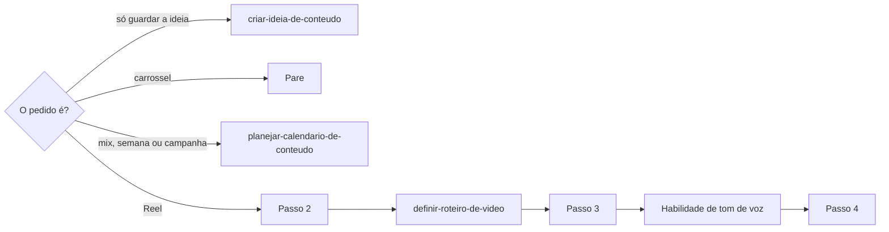

# Definir Reel do Instagram

## Parâmetros de configuração

Leia cada valor nas instruções do projeto: primeiro na entrada com o nome desta habilidade, depois na entrada `Global` ou no primeiro nível do bloco. Quando um valor não estiver lá, use o padrão abaixo. `Habilidade de tom de voz` vazia quer dizer que a legenda segue só esta habilidade. `Arquétipos da marca` lista os arquétipos que a voz da marca assume. Vazio quer dizer que a persona é inferida do perfil autor e anotada como inferida.

```yaml
"Habilidade de tom de voz": ""
"Arquétipos da marca": []
"Modo de aprendizado": "perguntar"
```

## Instruções

### Passo 1

A lista de posts, a lista de formatos de conteúdo, a lista de eixos narrativos e o nome de cada propriedade vêm do mapeamento de dados do projeto, no workspace conectado. Se uma das listas não estiver nessa conexão, pare.

Este texto usa os conceitos do post: o assunto, o formato, o perfil social autor, o status, a data e hora da postagem, a legenda redigida por humanos, a legenda revisada pela IA, a legenda consolidada, as hashtags, os eixos narrativos, as observações editoriais, os links de referência e a URL da postagem. Os status são rascunho, design existente, planejado, agendado e publicado. Do formato, usa a meta mínima e a máxima em 7 dias, o máximo de caracteres da legenda, o máximo de hashtags, a largura e a altura.

Antes de criar, busque o assunto e o link de referência na lista de posts. Se o Reel já existe, revise essa página.



### Passo 2

Tenha o tema, o perfil autor, quem fala, o objetivo e a data. Leia o perfil autor. A persona segue `Arquétipos da marca`. Sem arquétipo, infira do perfil autor e anote como inferida nas observações editoriais. O que não der para inferir com segurança das fontes, pergunte uma vez. Não invente perfil, narração, data, horário, local, objetivo nem limite do formato.

Escolha um ou mais eixos narrativos da lista de eixos, pela descrição de cada um. O sub-eixo complementa um eixo. Não crie eixo novo.

Um Reel de evento tira nome, data, horário e local da página do evento na lista de oportunidades ou de pontos de contato. Sem essa página, pergunte. A data do post é anterior à do evento.

O roteiro vem de `definir-roteiro-de-video`, com a largura e a altura do formato.

### Passo 3

A legenda complementa o vídeo. Conta o que a fala não contou e não repete o roteiro.

- Cabe no máximo de caracteres do formato.
- Fecha com um CTA mensurável: comentar, compartilhar, salvar ou abrir o link.
- Marcação de perfil e collab entram só quando a pessoa disse.
- As hashtags vão na propriedade de hashtags, até o máximo do formato. Hashtag que a lista ainda não tem entra só com o sim da pessoa.

As palavras da legenda passam pela `Habilidade de tom de voz`.

### Passo 4

Conte os posts do formato Reel na janela de 7 dias que contém a data da postagem. Sem data, conte os próximos 7 dias. Compare com a meta mínima e a máxima do formato. Abaixo da mínima ou acima da máxima, diga a contagem e sugira outra data. Não bloqueie o cadastro.

### Passo 5

Grave ou atualize a página na lista de posts.

1. O assunto é curto. O formato é Reel.
2. Um Reel novo entra como rascunho. Agendado pede data e hora. Publicado pede a URL da postagem.
3. A data e a hora ficam vazias até a pessoa dar.
4. A legenda vai na legenda revisada pela IA. Não altere a legenda redigida por humanos.
5. O roteiro vai no corpo da página. Se o corpo abre com um aviso para humanos e IA, mantenha o aviso e escreva abaixo dele. A legenda e as hashtags não entram no corpo.
6. Os eixos escolhidos vão na propriedade de eixos narrativos.
7. As observações editoriais guardam a persona, quem fala, o perfil autor, o que está pendente e as restrições de imagem e áudio.
8. A referência e a página do evento vão nos links de referência.

### Passo 6

Valide antes de mostrar. Corrija e repita até passar.

- [ ] A legenda cabe no máximo de caracteres. Diga a contagem.
- [ ] As hashtags estão na propriedade e dentro do máximo. Diga a contagem.
- [ ] Nenhuma marcação de tom está na legenda.
- [ ] A contagem da janela de 7 dias foi dita.
- [ ] O status bate com a data e com a URL.
- [ ] O Reel tem ao menos um eixo narrativo.

Mostre o link da página, o status, as contagens e o que ficou pendente.

### Passo 7

Ao terminar, siga `evoluir-habilidade` conforme `Modo de aprendizado`.

## Problemas comuns

### Legenda no corpo da página

Se você escrever a legenda no corpo, ela fica duplicada e diverge da legenda consolidada.

1. Grave a legenda na legenda revisada pela IA.
2. Deixe no corpo só o roteiro.

### Legenda humana sobrescrita

Se você gravar na legenda redigida por humanos, a escrita da pessoa se perde.

1. Escreva só na legenda revisada pela IA.
2. Para mudar a legenda humana, mostre a sugestão e espere a pessoa.

### Agendado sem data

Se você marcar agendado sem data e hora, o calendário mostra um post que não tem quando sair.

1. Deixe em rascunho ou planejado.
2. Mude para agendado quando a pessoa der a data e a hora.

### Aviso apagado

Se você substituir o corpo inteiro, o aviso para humanos e IA some e a próxima execução perde as regras da página.

1. Leia o corpo antes de escrever.
2. Mantenha o aviso e escreva o roteiro abaixo dele.

## Exemplos de entrada e saída

Estes exemplos ilustram fatos. Eles podem não estar no data source.

### crie um Reel sobre o bastidor desta peça para a próxima semana

O Reel entrou na lista de posts como rascunho, com o roteiro no corpo, abaixo do aviso, e a legenda na legenda revisada pela IA, com 240 de 2.200 caracteres e 4 hashtags na propriedade. A data ficou vazia, porque a pessoa não deu o dia. A janela dos próximos 7 dias tinha 0 Reels, abaixo da meta mínima de 1. As observações editoriais anotam a persona inferida e que falta definir a data.

### revise a legenda, as hashtags e o CTA deste Reel

A legenda revisada pela IA ganhou um CTA para compartilhar e deixou de repetir a fala do vídeo. A legenda redigida por humanos não mudou. As hashtags saíram do texto e foram para a propriedade.

## Casos-limite

- O Reel já existe na lista: revise essa página e não crie outra.
- A pessoa só quer guardar a ideia: siga `criar-ideia-de-conteudo`.
- O vídeo já está gravado: o roteiro registra a fala gravada e a legenda conta o que ficou de fora.
- Quem fala não é o dono do perfil autor: as observações editoriais dizem quem fala e em que pessoa.
- A pessoa dá a data sem hora: o status fica em planejado.
- A janela passa da meta máxima: diga a contagem e sugira outra data.
- A pessoa pede para conferir o mix ou planejar a semana: siga `planejar-calendario-de-conteudo`.
- O evento não tem página: pergunte nome, data, horário e local antes de escrever.

## Pegadinhas

- A legenda consolidada parece o campo a preencher. Ela é calculada. A IA escreve na legenda revisada pela IA.
- O corpo da página pode abrir com um aviso para humanos e IA. Ele fica. O roteiro entra abaixo.
- As hashtags parecem parte da legenda. Elas vão na propriedade de hashtags.
- O limite de caracteres e a meta de 7 dias parecem fixos. Eles vêm da página do formato na lista de formatos.

## Scripts disponíveis

- Nenhum.

1. Não há script para executar.
