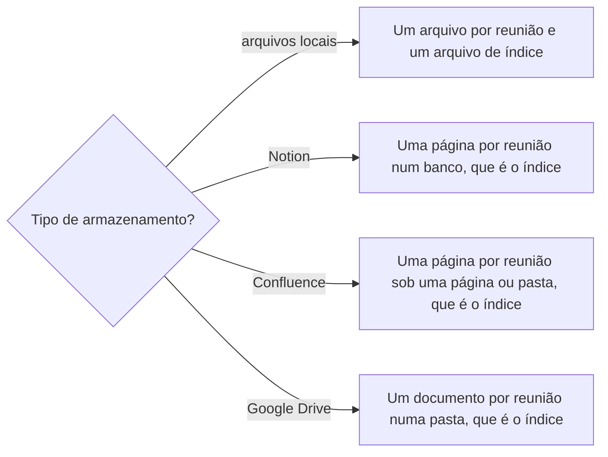
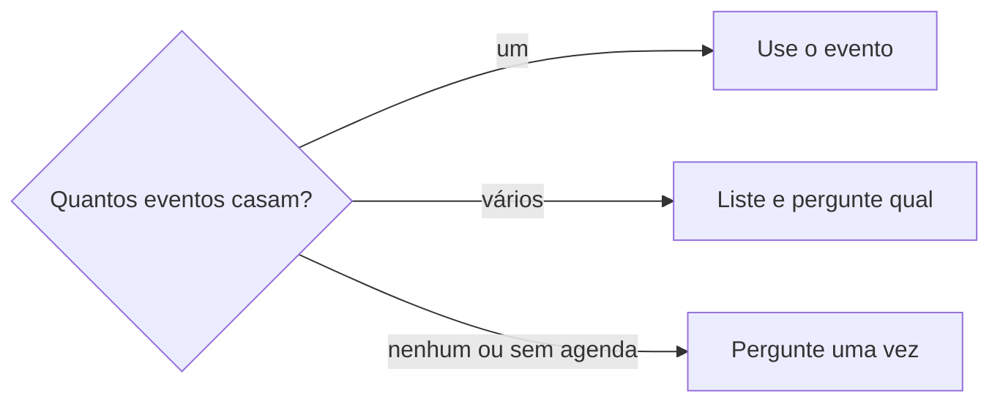

# Definir registro de reunião

## Parâmetros de configuração

Leia cada valor nas instruções do projeto: primeiro na entrada com o nome desta habilidade, depois na entrada `Global` ou no primeiro nível do bloco. Quando um valor não estiver lá, use o padrão abaixo.

```yaml
"Tipo de armazenamento dos registros": ""
"Endereço dos registros": ""
"Padrão do nome do arquivo": "AAAA-MM-DD-HH-MM-titulo-curto"
"Extensão dos registros em arquivo": "md"
"Padrão do título da página": "DD/MM/AAAA HHhMM: Título da reunião"
"Nome do índice": "índice"
"Fonte de identidade das pessoas": ""
"Fonte de correções de transcrição": ""
"Assuntos fora do resumo": "férias, saída de pessoas do time"
"Modo de aprendizado": "perguntar"
```

## Instruções

### Passo 1

Registre uma reunião a partir de uma transcrição ou anotação, ou corrija um registro fora do padrão. Cada projeto guarda os registros num lugar. `Tipo de armazenamento dos registros` diz qual, e `Endereço dos registros` diz onde. Com um dos dois vazio, pergunte uma vez e pare.



Nos arquivos locais, `Endereço dos registros` é a pasta. No Notion, o banco e o nome de cada propriedade vêm do mapeamento de dados do projeto, no workspace conectado. Se o banco não estiver nessa conexão, pare. No Confluence, é a página ou a pasta sob a qual ficam as páginas das reuniões. No Google Drive, é a pasta que guarda os documentos. O registro de reunião é sensível: ele fica só nesse lugar. Nada dele vai para repositório, pull request, mensagem nem página fora dele, e um trecho só sai com o pedido explícito da pessoa, para aquele trecho.

### Passo 2

Veja se a reunião já está registrada, pela data, pelo título e pelos participantes. Em arquivos locais, leia o índice, que tem o `Nome do índice`. No Notion, o próprio banco é o índice. No Confluence, são as páginas sob o endereço dos registros. No Google Drive, a pasta é o índice. Só quando há documentos de reunião fora da pasta, como os criados por outra conta, existe um documento de índice com o `Nome do índice`, que lista esses documentos por link. Se já está, corrija o registro que existe. Não crie outro.

Quando a transcrição já mora num documento do armazenamento, como as anotações que a ferramenta de reunião gera, use esse documento como registro. Não copie o texto: acrescente o resumo e a linha do índice, e deixe a transcrição como está.

### Passo 3

Descubra título, data, horário de início e participantes pela agenda conectada da pessoa, a partir do horário aproximado que ela deu ou do horário de criação do registro, antes de perguntar. Não invente título genérico nem participante.



### Passo 4

O nome do registro depende do tipo de armazenamento. Arquivo local tem nome de arquivo, que é a data da reunião, o horário de início e um título curto, no `Padrão do nome do arquivo`: ano, mês, dia, hora e minuto separados por hífen, depois o título em minúsculas, sem acento e com hífens, e a `Extensão dos registros em arquivo` no fim. Página do Notion ou do Confluence e documento do Google Drive têm título, e título é texto como uma pessoa o escreve: com acento, maiúscula de início de frase e nome próprio, seguindo o `Padrão do título da página`. Não use o nome de arquivo como título. No Notion, a data, o horário e os participantes também vão para as propriedades do mapeamento. A data é a da reunião, não a da criação do registro. O horário nunca falta, porque a mesma pessoa tem mais de uma reunião no mesmo dia.

O registro começa com o título em heading de nível 1. Logo abaixo, um bloco curto com a data e o horário, os participantes e a fonte do texto. Em `Fonte de identidade das pessoas`, ache o nome canônico e o papel de cada participante. Quem não está lá entra com o nome como veio.

### Passo 5

Depois do bloco, escreva o resumo derivado. A transcrição bruta vem em seguida, sem mudança. Correção de grafia entra só no resumo.

- Registre como decisão só o que foi dito como decisão. Separe combinado de opinião e de hipótese.
- Não dê mais peso à fala de quem fala mais nem de quem tem mais cargo.
- Marque como incerto o trecho ilegível ou mal transcrito.
- Texto que não é fala, como o nome de um arquivo de áudio ou o resto de uma cópia de outra tela, vira uma nota de resto de cópia.
- Deixe fora do resumo os `Assuntos fora do resumo`. A transcrição bruta mantém tudo.
- Diga no fim do resumo o que ficou de fora e por quê.

### Passo 6

Quando a transcrição não diz quem fala, não atribua uma ação a uma pessoa só pelo pronome ou pela posição da fala. Cruze os participantes com o teor, monte a melhor hipótese, escreva `a confirmar` e peça a confirmação de cada atribuição, uma por uma, com a hipótese pronta.

Quando as falas vêm identificadas, siga a identificação, mas confira os nomes com os participantes, porque a identificação automática também erra.

### Passo 7

Aplique no resumo as correções já confirmadas em `Fonte de correções de transcrição`, e use o nome canônico no lugar do apelido e da grafia errada. Nome ou termo estranho que não casa com nenhuma correção confirmada: não adivinhe. Liste cada um com duas linhas antes e duas depois e pergunte à pessoa.

O que a pessoa confirmar entra na fonte: nome de pessoa no registro dela, termo geral na lista de termos. O que ela não souber fica como pendente, com o trecho. Pessoa que não está em `Fonte de identidade das pessoas`: pergunte antes de criar.

### Passo 8

Toda reunião registrada ou corrigida em arquivo local ganha uma linha no índice, com data, horário, título, participantes e o nome do registro, em ordem de data. No Notion, as propriedades da página fazem esse papel. No Confluence, a árvore de páginas sob o endereço dos registros faz. No Google Drive, a pasta faz, e só um documento fora da pasta ganha uma linha com o link no documento de índice. Nesses casos não há linha a escrever. Nunca deixe um registro fora do índice.

### Passo 9

Registro sem título em heading de nível 1, sem a extensão certa ou com nome ou título fora do padrão do seu tipo de armazenamento: corrija o título, a extensão, o nome e a linha do índice antes de dizer que está registrado. O registro já existir antes da skill não é motivo para deixá-lo fora do padrão.

### Passo 10

Ao terminar, siga `evoluir-habilidade` conforme `Modo de aprendizado`.

## Problemas comuns

### Título genérico

Se você nomear a reunião só como `Reunião` ou adivinhar os participantes, o índice deixa de ajudar a achar qualquer coisa.

1. Cruze o horário com a agenda.
2. Sem evento plausível, pergunte uma vez.

### Ação atribuída pelo pronome

Se você escrever que alguém ficou de fazer algo porque a fala dizia `eu`, a transcrição sem identificação vira um registro errado de responsabilidade.

1. Escreva a hipótese com `a confirmar`.
2. Peça a confirmação de cada atribuição.

### Correção na transcrição bruta

Se você trocar a grafia dentro da transcrição bruta, o registro deixa de ser o que foi dito e o erro de reconhecimento some.

1. Deixe a transcrição bruta sem mudança.
2. Aplique a correção só no resumo.

### Transcrição copiada para outro lugar

Se você copiar o texto de um documento de reunião que já está no armazenamento para um registro novo, o mesmo texto passa a existir em dois lugares e os dois divergem.

1. Use o documento existente como registro.
2. Acrescente só o resumo e a linha do índice.

## Exemplos de entrada e saída

Estes exemplos ilustram fatos. Eles podem não estar no data source.

### a pessoa cola uma transcrição sem título, dizendo que o arquivo foi criado por volta das 15h30 de uma sexta-feira.

Cruzei o horário com a agenda e achei um evento só, a Daily do time, das 15h às 16h. Salvei o registro com o título da Daily, a data e o horário do evento e os participantes do convite. Listei dois termos que não casam com nenhuma correção e pedi a confirmação deles.

### a pessoa cola uma transcrição em que alguém diz `eu subo a correção amanhã`.

Escrevi no resumo que a correção sobe no dia seguinte, com o responsável como `a confirmar`, e perguntei se foi a pessoa que a transcrição sugere pelo teor.

## Casos-limite

- Há dois eventos plausíveis no horário: liste e pergunte. Não escolha.
- A transcrição começa no meio da reunião: registre assim no bloco do cabeçalho e não preencha o que não veio.
- O texto traz o resumo gerado pela ferramenta de reunião junto da transcrição: guarde os dois, e trate o resumo gerado como não literal.
- A mesma reunião aparece com dois horários de criação: é um registro só. Corrija o que existe.
- O assunto de `Assuntos fora do resumo` aparece na transcrição: fica na transcrição bruta e fora do resumo.
- O armazenamento é um banco e uma propriedade opcional falta no mapeamento: liste no fim, sugira criar a propriedade e não escreva esse valor no corpo da página.
- O mesmo projeto guarda uma cópia em arquivo local e uma página: o nome do arquivo é o slug, e o título da página é o texto convencional. Os dois descrevem a mesma reunião, cada um no seu padrão.

## Pegadinhas

- Texto colado de outra interface pode trazer lixo no começo, como o nome de um botão ou de um arquivo de áudio. Não é fala.
- Slug de arquivo e título de página são coisas diferentes. Um título escrito como slug, sem acento e com hífens, fica estranho no Notion, no Confluence e no Google Drive.
- O reconhecimento de voz erra nome de pessoa e sigla de um jeito que parece outra palavra. O apelido de quem fala também vira outro nome quando alguém o chama.
- O horário de criação do registro é aproximado: a reunião pode ter começado antes dele.
- Transcrição com falas identificadas pode ter a pessoa errada atribuída a um trecho.

## Scripts disponíveis

- Nenhum.

1. Não há script para executar.
