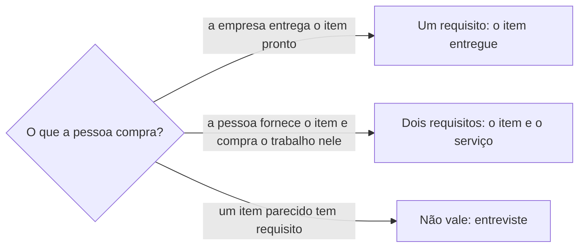

# Definir requisito de compra

## Parâmetros de configuração

Leia cada valor nas instruções do projeto: primeiro na entrada com o nome desta habilidade, depois na entrada `Global` ou no primeiro nível do bloco. Quando um valor não estiver lá, use o padrão abaixo.
```yaml
"Modo de aprendizado": "perguntar"
```

## Instruções

### Passo 1

A lista de requisitos de compra vem do mapeamento de dados do projeto. Sem ela no workspace conectado, diga qual falta, entregue a especificação na resposta e não use a lista de outro workspace.

Antes de entrevistar, procure nessa lista o requisito do que vai ser comprado, seguindo `identificar-duplicata` para o que tem outro nome. Achado, leia-o, complete só o que falta e não crie outro.



Não junte compras diferentes num requisito. A etiqueta de cuidados de uma peça, o serviço de imprimir nela e a etiqueta de marca que a empresa entrega pronta são três compras. O requisito de um item parecido não vale para este.

### Passo 2

Sem requisito, entreviste a pessoa antes de pesquisar empresas e de escrever a qualquer uma. Leia o modelo de saída `briefing-de-especificacao-de-compra` quando for entrevistar e gravar.

Adapte as perguntas ao que vai ser comprado, com o que você sabe do assunto e do que o fornecedor costuma perguntar. Deixe a pessoa adiantar o que já decidiu e tire a pergunta que ela já respondeu.

Anote cada resposta como a pessoa deu, sem completar com suposição. O que ela não sabe fica em aberto, com a pergunta que falta. Quando uma resposta mostra que a compra é de outro tipo, corrija o tipo antes de seguir.

A quantidade vem das unidades que o item atende, lidas nos dados do projeto, como `pesquisar-compra` manda, e a pessoa a confirma. Não use um número de costume nem o mínimo de uma empresa.

### Passo 3

Grave a especificação como requisito na lista de requisitos de compra do projeto, com o nome, o contexto, o objetivo, as restrições, o estado, o novo ou usado, o teto e a data. O corpo leva as respostas, as perguntas em aberto e o veredito vazio.

O estado fica em andamento enquanto há pergunta em aberto, e concluída quando a pessoa fecha a especificação. O veredito só se preenche depois das respostas das empresas.

Uma página criada com o tipo de compra errado se corrige no mesmo requisito. Se sobrar uma página que ficou sem uso, avise a pessoa e peça o sim antes de movê-la para a lixeira.

### Passo 4

Com a especificação fechada, devolva a tarefa a `pesquisar-compra`: a mensagem às empresas traz a especificação, e a dúvida que uma empresa levantar e a especificação não cobrir volta aqui, com a pergunta à pessoa.

### Passo 5

Ao terminar, siga `evoluir-habilidade` conforme `Modo de aprendizado`.

## Problemas comuns

### Requisito de item parecido

Se você usar o requisito de um item parecido para a compra nova, a especificação sai com o que não vale para este item, e as empresas perguntam o que ela devia ter fechado.

1. Procure o requisito do que vai ser comprado, e não de um item próximo.
2. Sem ele, entreviste a pessoa.
3. Grave um requisito novo, com o que a pessoa respondeu.

### Três compras num requisito só

Se você juntar o item, o serviço sobre ele e o item que a empresa entrega pronto num requisito, a especificação cobra da empresa o que não é dela e deixa de fora o que ela entrega.

1. Veja o tipo de compra no Passo 1.
2. Empresa que entrega o item pronto: um requisito.
3. Pessoa que fornece o item e compra o trabalho nele: dois requisitos.

### Pergunta repetida

Se você perguntar o que a pessoa já respondeu na conversa, ela repete o que disse e perde a vontade de especificar.

1. Leia o que ela já disse antes de entrevistar.
2. Tire a pergunta respondida e use a resposta.
3. Pergunte só o que falta.

### Resposta completada

Se você completar a resposta com o que o modelo supõe, a especificação afirma o que a pessoa nunca disse.

1. Grave cada resposta como a pessoa deu.
2. Deixe o que ela não sabe em aberto, com a pergunta.
3. Não feche a especificação com campo inventado.

## Exemplos de entrada e saída

Estes exemplos ilustram fatos. Eles podem não estar no data source.

### preciso orçar etiqueta bordada com o logo da marca

O requisito de etiqueta interna existia, mas era de outro item. Entrevistei a pessoa com o briefing, adaptado a uma etiqueta que a empresa entrega pronta, e a pessoa adiantou posição, formato, tamanho, fundo e cores. Gravei um requisito só, em andamento, com as perguntas em aberto, e voltei à pesquisa de compra.

### a empresa perguntou se a etiqueta vai impressa ou bordada, e nada disso estava cadastrado

A dúvida voltou ao requisito. Perguntei à pessoa só o que a especificação não cobria, atualizei o mesmo requisito e a mensagem à empresa saiu com a resposta.

## Casos-limite

- O requisito já existe e cobre o item: use-o, complete só o que falta e não entreviste de novo.
- A lista de requisitos não está no workspace conectado: entregue a especificação na resposta e diga qual lista falta.
- A pessoa não quer responder agora: grave o que há, com o estado em andamento, e as perguntas em aberto.
- A compra é de um bem durável ou de um insumo já em estoque: confira antes o estoque, como `pesquisar-compra` manda, e só então especifique.
- Uma página ficou sem uso: não a mova sem o sim da pessoa.

## Pegadinhas

- Um requisito de item parecido parece cobrir o novo. Ele cobre o que o outro item pede, e a etiqueta de cuidados de uma peça não especifica a etiqueta de marca.
- O serviço sobre um item parece sempre ter requisito próprio. Só tem quando a pessoa fornece o item. Quando a empresa entrega o item pronto, o requisito é um só.
- A empresa que pergunta a arte, a quantidade e o acabamento parece pedir pressa. A pergunta mostra que a especificação não estava fechada: volte a ela antes de responder.
- O modelo de briefing sincroniza com o banco de briefings do Notion. Mudar o modelo no repositório muda lá, e a página de lá não se edita à mão.

## Scripts disponíveis

- Nenhum.

1. Não há script para executar.
