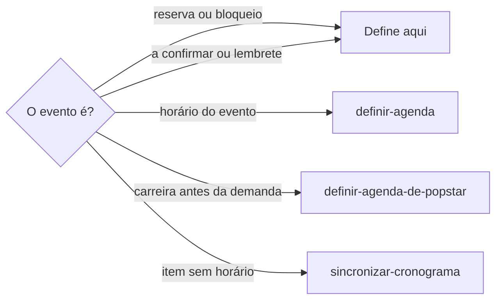
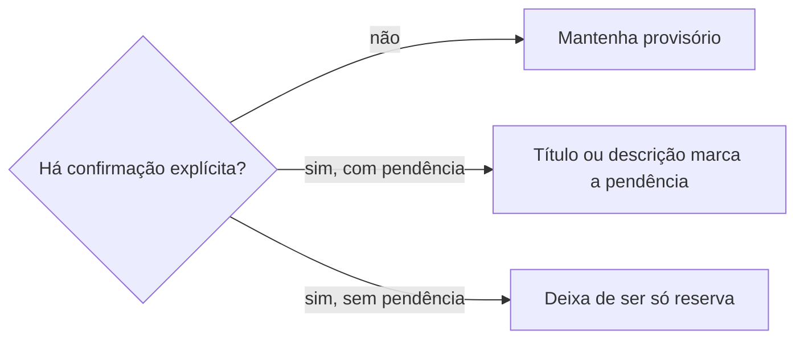

# Definir reserva

## Parâmetros de configuração

```yaml
{}
```

## Instruções

### Passo 1

As listas e o nome de cada propriedade vêm do mapeamento de dados do projeto. Rever reserva, bloqueio provisório, «a confirmar» ou lembrete, e a passagem para participação confirmada, é esta habilidade. A gravação do evento segue `definir-agenda`. A reserva de tempo de carreira, antes da demanda, segue `definir-agenda-de-popstar`. Item com data e sem início e fim confirmados segue `sincronizar-cronograma`. O uso do tempo segue `revisar-uso-do-tempo`.



### Passo 2

Sem confirmação explícita da pessoa ou da fonte, a natureza provisória permanece. A oportunidade aprovada não converte a reserva em participação confirmada.



### Passo 3

A pessoa confirmou a participação: título e descrição passam a dizer que deixou de ser só reserva. O título continua com o nome canônico. A gravação segue `definir-agenda`.

Participação que ainda depende de estoque, pagamento, curadoria, agenda, deslocamento ou confirmação de terceiros fica na descrição, ou o título mantém um marcador de incerteza. Não trate essa pendência como participação livre de condição.

## Problemas comuns

### Reserva que vira confirmação

Se você converter reserva, bloqueio, «a confirmar» ou lembrete em participação confirmada sem confirmação explícita, ou só porque a oportunidade está aprovada, o desejo vira fato.

1. Mantenha a natureza provisória.
2. A oportunidade aprovada não confirma a participação.
3. Confirme só quando a pessoa ou a fonte confirmar.

### Pendência apagada

Se você tirar o marcador de incerteza quando ainda faltam estoque, pagamento, curadoria, agenda, deslocamento ou confirmação de terceiros, a participação parece livre.

1. Registre a pendência na descrição ou mantenha o marcador no título.
2. Não trate a condição como já resolvida.
3. A gravação segue `definir-agenda`.

## Exemplos de entrada e saída

Estes exemplos ilustram fatos. Eles podem não estar no data source.

### revise essa reserva. a oportunidade já foi aprovada.

A reserva continuou provisória. A oportunidade aprovada não virou participação confirmada.

### a pessoa confirmou a participação

Título e descrição deixaram de dizer que era só reserva. A gravação ficou com `definir-agenda`.

### confirmou, mas ainda depende do pagamento

A confirmação ficou registrada. A descrição guardou a pendência de pagamento. O título manteve o marcador de incerteza.

## Casos-limite

- Reserva, bloqueio provisório, «a confirmar» ou lembrete sem confirmação explícita: mantenha a natureza provisória.
- A oportunidade aprovada: não converte a reserva em participação confirmada.
- A pessoa ou a fonte confirmou: atualize título e descrição. A gravação segue `definir-agenda`.
- Ainda depende de estoque, pagamento, curadoria, agenda, deslocamento ou terceiros: registre na descrição ou mantenha o marcador no título.
- Reserva de tempo de carreira, antes da demanda: `definir-agenda-de-popstar`.
- O pedido é o horário do evento: `definir-agenda`.

## Pegadinhas

- A oportunidade aprovada parece participação confirmada. A reserva continua reserva até confirmação explícita.
- «A confirmar» e lembrete parecem compromisso fechado. Sem confirmação explícita, a natureza provisória fica.
- Confirmar parece apagar a pendência. A lista de estoque, pagamento, curadoria, agenda, deslocamento ou terceiros continuam na descrição ou no título.

## Scripts disponíveis

- Nenhum.

1. Não há script para executar.
