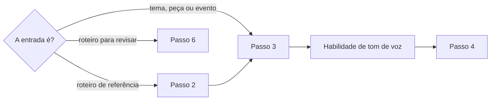

# Definir roteiro de vídeo

## Parâmetros de configuração

Leia cada valor nas instruções do projeto: primeiro na entrada com o nome desta habilidade, depois na entrada `Global` ou no primeiro nível do bloco. Quando um valor não estiver lá, use o padrão abaixo. `Habilidade de tom de voz` vazia quer dizer que as falas seguem só esta habilidade. `Arquétipos da marca` lista os arquétipos que a voz da marca assume. Vazio quer dizer que a persona é inferida do perfil autor e sai marcada como inferida. `Referências da estratégia de conteúdo` lista a página do Notion e outras referências com a estratégia de conteúdo original da marca. Uma referência que a pessoa der no pedido vale junto. Sem nenhuma, o objetivo vem só da pessoa.

```yaml
"Habilidade de tom de voz": ""
"Arquétipos da marca": []
"Referências da estratégia de conteúdo": []
"Modo de aprendizado": "perguntar"
```

## Instruções

### Passo 1

A saída padrão é um roteiro pronto para gravar no nicho da marca, rápido de aplicar. Não é pauta, lista de ideias nem tema solto. Esta habilidade devolve o roteiro. Guardar o roteiro num post é de quem chamou.

Antes de escrever, leia as `Referências da estratégia de conteúdo` e tenha o tema, quem narra, o perfil autor, o público e o objetivo. O roteiro serve à estratégia que elas descrevem. O que as fontes não deixam inferir com segurança, pergunte uma vez. Não invente.



### Passo 2

Um roteiro de referência, com ou sem a análise, é referência direta.

1. Nomeie os princípios que o fizeram performar: relevância emocional, conflito universal, contraste, familiaridade ou o que a análise der. Use exatamente esses princípios.
2. Mantenha o esqueleto, a tensão emocional e os gatilhos narrativos. Troque o tema literal por um do nicho da marca, com o mesmo peso emocional.
3. Personagem real ou famoso na referência pede personagem real, verificável e tão conhecido quanto. Busque na web uma história real que encaixe. Sem um nome seguro, pergunte.
4. Cada fato do roteiro leva a fonte, com link verificável.

A originalidade está na estrutura e nos gatilhos reaproveitados, não em ficção.

### Passo 3

Leia o modelo de saída `roteiro-de-video` quando for gerar a saída.

- O gancho ocupa de 0 a 3 segundos. Começa no conflito, na provocação ou na pergunta, sem saudação.
- Cada fala vai em blockquote, com a marcação entre colchetes antes do texto falado. A marcação serve à gravação, à direção e à voz gerada por IA.
- A marcação é específica: nomeia quem fala, o tom, o ritmo, o volume, a palavra da ênfase e o ponto da pausa. Tom genérico, como normal ou neutro, não serve.
- Cada cena tem a faixa de tempo, a ação e o texto na tela.
- Só entra fato confirmado nas fontes. Memória encenada leva o selo DRAMATIZAÇÃO na tela.
- Obra de referência entra como inspiração de linguagem. Não reproduza trilha, personagem, figurino nem cena.
- O fechamento traz um convite ligado à experiência de quem assiste.
- A parte de gravar vem primeiro e curta: cenas, falas e texto na tela. Fontes, saídas para empecilhos e a análise vêm depois.
- Marcação, ação de cena e direção de gravação nunca entram na fala, no texto na tela nem na legenda.

As palavras das falas e do texto na tela passam pela `Habilidade de tom de voz`.

### Passo 4

Para cada empecilho provável de gravar, o roteiro já traz a saída executável: falta de tempo, de equipamento ou de locação, áudio sem licença, rosto ou imagem de terceiros, e quem não quer aparecer. Áudio sem licença vira recriação com voz original. Não deixe desculpa sem resposta.

### Passo 5

Feche com a análise de por que o roteiro vai funcionar: os princípios do Passo 2 ou do tema, o que a pessoa precisa entender, como o texto se conecta com ela e o que faz sentir.

### Passo 6

Valide antes de mostrar. Corrija e repita até passar.

- [ ] Gancho sem saudação, em até 3 segundos.
- [ ] Toda fala está em blockquote, com a marcação específica antes.
- [ ] Nenhuma marcação, ação de cena ou direção de gravação aparece na fala, no texto na tela ou fora do roteiro.
- [ ] Todo fato tem fonte. Nada foi inventado.
- [ ] O áudio é licenciado ou recriado, e está no nicho.
- [ ] Cada empecilho tem saída.
- [ ] A persona segue `Arquétipos da marca`, ou sai marcada como inferida.

### Passo 7

Ao terminar, siga `evoluir-habilidade` conforme `Modo de aprendizado`.

## Problemas comuns

### Pauta no lugar de roteiro

Se você entregar tema, tópicos ou ideias soltas, a pessoa ainda precisa escrever antes de gravar.

1. Escreva as falas inteiras, cena a cena, com a marcação.
2. Dê o tempo de cada cena e o texto na tela.

### Tema copiado da referência

Se você repetir o tema literal do roteiro de referência, o vídeo vira cópia e sai do nicho.

1. Liste os princípios e os gatilhos da referência.
2. Aplique esses princípios a um tema do nicho, com o mesmo peso emocional.

### História inventada

Se você criar personagem, fala ou situação para encaixar na estrutura, o roteiro publica uma ficção como fato.

1. Busque uma história real e verificável.
2. Cite a fonte com link.
3. Sem uma história segura, pergunte.

### Marcação que vai ao ar

Se você deixar o texto entre colchetes ou a direção de gravação entrar na fala, no texto na tela ou na legenda, a orientação de produção é publicada.

1. Deixe a marcação só antes de cada fala.
2. Deixe a ação de cena e a direção de gravação nas seções delas.
3. Confira o texto na tela e qualquer texto que sai do roteiro.

### Áudio pelo alcance

Se você escolher áudio viral ou meme fora do nicho, o vídeo atrai quem não é público da marca.

1. Use áudio licenciado e ligado ao tema.
2. Sem licença, recrie com voz original ou trilha instrumental discreta.

## Exemplos de entrada e saída

Estes exemplos ilustram fatos. Eles podem não estar no data source.

### crie um roteiro de 15 segundos sobre o bastidor desta peça

O roteiro sai pronto para gravar: gancho de 0 a 3 segundos com a peça em close, falas marcadas com tom, ritmo, volume, ênfase e pausa, cenas com tempo e texto na tela, saída para quem não quer aparecer, e a análise de por que funciona. Antes, a habilidade perguntou quem narra, porque as fontes não diziam.

### adapte este roteiro que viralizou para a nossa marca, com a análise que eu fiz

O roteiro mantém a estrutura e os gatilhos que a análise apontou e troca o tema por um do nicho da marca. A pessoa famosa da referência virou outra pessoa real e tão conhecida, com a história e o link da fonte. Nada foi inventado.

## Casos-limite

- A referência usa pessoa famosa e a busca não acha história segura: pergunte quem usar.
- A pessoa diz que não tem tempo ou equipamento: o roteiro já traz a versão possível com o que há.
- O áudio da referência não está liberado: recrie com voz original.
- A pessoa pede só o gancho: entregue opções de gancho, cada uma com a marcação.
- O roteiro é para voz gerada por IA: a mesma marcação serve. Ela nunca é lida em voz alta.
- A memória encenada mistura passado e presente: o selo DRAMATIZAÇÃO separa a encenação do fato.

## Pegadinhas

- O texto entre colchetes parece parte da fala. Ele nunca é falado, exibido nem publicado.
- Um roteiro que viralizou parece pedir o mesmo tema. O que se reaproveita é a estrutura e os gatilhos.
- Uma história plausível parece bastar. Sem fonte verificável, ela não entra.
- Áudio em alta parece dar alcance. Fora do nicho, traz audiência sem fit.
- Encenar uma pessoa real parece livre. A caracterização não ridiculariza idade, corpo, origem nem aparência.

## Scripts disponíveis

- Nenhum.

1. Não há script para executar.
