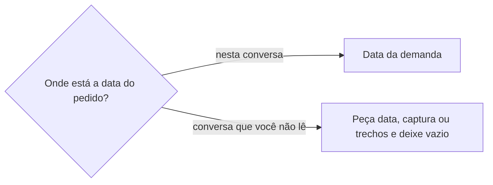

# Definir tarefa

## Parâmetros de configuração

Leia cada valor nas instruções do projeto: primeiro na entrada com o nome desta habilidade, depois na entrada `Global` ou no primeiro nível do bloco. Quando um valor não estiver lá, use o padrão abaixo. `Habilidade de grafia` vazia quer dizer que a grafia fica como a pessoa escreveu. `Habilidade do ponto de contato` vazia quer dizer que o ponto de contato só não entra no corpo da tarefa.

```yaml
"Formato da data com dia da semana": "terça-feira, 01/09/2026"
"Habilidade de grafia": ""
"Habilidade do ponto de contato": ""
```

## Instruções

### Passo 1

Peça o que será feito, ou as tarefas que já existem, e a lista. Se a pessoa passou o link de cada tarefa, essas são as tarefas. Não busque outras tarefas. Se a pessoa nomeou a tarefa que já existe e não passou o link, abra essa tarefa no workspace conectado. Se esse título não estiver nessa conexão, peça a lista e pare. Se não veio lista, nem link, nem o nome da tarefa que já existe, peça. Se ela não estiver no workspace conectado, pare. Não use a lista de outro workspace. O nome de cada propriedade e as opções de status vêm do mapeamento de dados do projeto. Este texto usa os conceitos: o título, o prazo, o status, a definição de concluído, os responsáveis, as observações, o link de referência, a data da demanda e a data do cadastro. O status concluído é a opção que encerra a tarefa.

### Passo 2

Se for tarefa nova e a lista já veio, siga `procurar-tarefa` com o mesmo assunto e a mesma lista. Se a tarefa já existe, mostre o nome, o status e o link, e pare. Não crie outra. Sem a lista, peça e pare. Não abra a busca.

Se for tarefa que já existe, leia o título, o prazo, o status, a definição de concluído, os responsáveis, as observações, o link de referência e o corpo da página de cada tarefa pedida. Não leia o workspace inteiro. Não busque a lista quando os links já vieram.

### Passo 3

Aplique estes critérios ao gravar e ao julgar.

Comece o título com um verbo no infinitivo. O verbo é o trabalho. "Sair para ir nas gráficas" não conta. "Ir às gráficas" também não passa: não diz o que será realizado. Não invente o que será realizado. Se começar com substantivo solto, reescreva: "Benchmarking" vira "Fazer benchmarking"; "Relatório" vira "Escrever relatório"; "Reunião" vira "Agendar reunião".

A frase é curta, fácil de ler na lista, sem contexto a mais. Diz o objeto ou o escopo. Quando fizer sentido, diz o artefato que resulta, como a lista pronta, o orçamento ou o comparativo.

Não use no título nem nas observações: "hoje", "amanhã", "até amanhã", "fim do dia", "até EOD", "essa semana", "semana que vem", "segunda", "terça", "com previsão de…", "até DD/MM", "até dia…". Se houver data alvo, grave no prazo. "Levar os itens para finalizar a montagem hoje" perde o "hoje". A data fica no prazo.

Não use termo vago: "o que der"; "avaliar opções" sem dizer opções de quê e para quê; "passar a relação" sem dizer relação de quê e para quem; "1x1" sem dizer 1 por 1 de quê.

Não ponha no título comentário de bloqueio, como "sem travar produção". Se isso importar, vá para as observações.

Orientação do tipo "faça sempre", "não faça" ou "siga esta regra", sem entrega clara, não é tarefa. "Enviar mensagem apenas em texto" não é tarefa. Crie só a entrega concreta, como "Enviar comprovante" ou "Confirmar data". A regra, se importar, fica nas observações de uma tarefa que tem entrega, ou como nota.

A definição de concluído é um checklist objetivo e curto. Cada item é evidência verificável: o que existe, foi enviado ou foi registrado. Não é intenção. Cada item está feito ou não está. "Comprovante enviado", "data informada" e "vaga confirmada" são itens. Se o texto vier embolado, separe entrega e boa prática. A entrega vira item da definição de concluído. A boa prática vai para as observações.

Não grave no corpo da página a oportunidade, o link nem a observação. O ponto de contato segue a `Habilidade do ponto de contato`, quando as instruções do projeto a indicarem. O link vai no link de referência. A observação vai nas observações.

A tarefa, no conjunto do título, da definição de concluído, dos responsáveis e do prazo, responde a cinco pontos. Específica: o que será realizado, quem é responsável e quais passos. Mensurável: quanto, com um indicador que dá para acompanhar e saber quando chegou. Atingível: a equipe consegue de forma razoável; se a tarefa veio de outra pessoa, as restrições ficam ditas. Relevante: por que ela existe e qual benefício traz. Temporal: até quando está feita, quando começa e quando termina. O prazo é o término. Se o começo não estiver dito, falta o começo. "Ir às gráficas" não responde o que será realizado nem quanto. Se algum ponto faltar, diga o que falta. Não invente o que será realizado, a quantidade, o benefício nem data que a pessoa não disse. Não preencha os responsáveis com alguém que a pessoa não nomeou.

### Passo 4

Se for tarefa nova e faltar um ponto, pergunte antes de criar. Não invente. Quando criar, mostre o nome, o status e o link. Não marque como concluída. Se o prazo já passou, a tarefa não está concluída e há alguém nos responsáveis, avise essa pessoa pelo nome que a tarefa está atrasada. Não marque como concluída por causa do atraso.

Se for tarefa que já existe, dê o veredicto e o que falta em específica, mensurável, atingível, relevante e temporal. Não pule um ponto. Título que não diz o que será realizado não é correção: "Ir às gráficas" não passa. Prazo vazio e título sem data: diga que está vazio. Não invente a data. Prazo anterior à revisão e status diferente de concluído: diga que venceu, há quantos dias, e avise quem está nos responsáveis. Não marque concluído. Palavra de tempo nas observações sai. A data que já está no prazo permanece. Boa prática sem entrega não permanece como item. Duas tarefas do mesmo trabalho: sugira mesclar e não mescle. "Ir às gráficas e avaliar opções" não permanece. Não copie a data de criação. Se só uma tiver prazo, essa data permanece. Não cite tarefa que a pessoa não pediu. Feche com a lista do que fazer. Não altere título, status, prazo, definição de concluído nem os responsáveis nesta passada. Se a pessoa disser o benefício, grave nas observações nessa resposta, mantendo o que já está, inclusive o fato que ela separou desta tarefa. O verbo fica no presente, como viabiliza e amplia. O status concluído não põe o fato no passado. Vai não entra. Grafia em dúvida: siga a `Habilidade de grafia`, quando as instruções do projeto a indicarem, e grave a forma correta. Não invente a grafia. Ao criar, siga o flowchart de Data fora do alcance.

### Passo 5

Se a pessoa pedir para aplicar ou editar, grave só a correção que ela aceitou. Com mais de uma tarefa, mostre cada mudança antes de gravar. Grave na definição de concluído e nos responsáveis só o que a pessoa disse. Não invente. Não marque como concluída. Não crie tarefa nova nessa passada.

### Passo 6

Se o gatilho for recorrente, em um cronograma, varra a lista. Não leia o workspace inteiro. Sinalize e não grave. Sinalize título com prazo, prazo no lugar errado, campo crítico faltando, tarefa que é só boa prática, e definição de concluído ausente, vaga ou que não dá para verificar.

Se o gatilho for página adicionada à base de dados ou propriedade atualizada na base de dados, revise só essa página. Grave a correção que a regra já determina, como tirar o prazo do nome. Garanta o nome sem prazo, a data no prazo quando houver data, a definição de concluído como checklist, e que boa prática não seja tarefa. Não varra a lista. A correção insegura fica no comentário.

Se faltar contexto, houver conflito de prioridade, o responsável estiver indefinido ou a intenção estiver em dúvida, não corrija. Comente na tarefa e marque a pessoa nos responsáveis, ou quem estiver definido como responsável por revisar. O comentário diz o que foi encontrado, por que não corrigiu e qual decisão falta. Não invente a pessoa. Não marque como concluída.

### Passo 7

Na resposta, no resumo e na tabela, a data sai no formato da data com dia da semana, calculada com a data, o horário e o fuso. Sem um deles, e se o dia puder mudar, peça. Cada data de um intervalo leva o próprio dia. Dia incompatível: sinalize e confirme antes de gravar o prazo. O prazo continua data válida. O título continua sem palavra de tempo.

## Problemas comuns

### Substantivo no título

Se você começar o título com "Benchmarking", "Relatório" ou "Reunião", o nome não começa com verbo.

1. Reescreva com verbo no infinitivo.
2. "Benchmarking" vira "Fazer benchmarking". "Relatório" vira "Escrever relatório". "Reunião" vira "Agendar reunião".

### Boa prática como tarefa

Se você criar ou aceitar "faça sempre", "não faça" ou "enviar mensagem apenas em texto", a lista ganha um item sem entrega.

1. Não crie a tarefa e não a deixe como item.
2. Crie só a entrega concreta, como "Enviar comprovante" ou "Confirmar data".
3. Se a regra importar, deixe nas observações de uma tarefa que tem entrega, ou como nota.

### Prazo no título

Se você deixar "amanhã", "fim do dia" ou um dia da semana no título, o nome diz quando em vez do que será feito.

1. Tire o prazo do título.
2. Reescreva mantendo o verbo e o objetivo.
3. Grave a data no prazo.

### Título vago

Se você usar "o que der", "avaliar opções", "passar a relação" ou "1x1" sem dizer de quê, o título não se explica na lista.

1. Diga o objeto ou o escopo.
2. Quando fizer sentido, diga o artefato que resulta.
3. Tire o termo vago.

### Verbo que não é o trabalho

Se você aceitar "Sair para ir nas gráficas" porque começa com verbo, o título descreve o deslocamento e não o trabalho.

1. O verbo do título é o trabalho.
2. "Ir às gráficas" também não passa. Não diz o que será realizado.

### Título que não diz o que será realizado

Se você corrigir para "Ir às gráficas", a tarefa continua sem dizer o que será realizado, quem faz, quais passos, quanto, por que e até quando.

1. O conjunto da tarefa responde aos cinco pontos: específica, mensurável, atingível, relevante e temporal.
2. Não invente o que falta.

### Tarefa que já existe

Se você criar sem conferir, a lista ganha a mesma tarefa de novo.

1. Siga `procurar-tarefa`.
2. Se ela já existe, mostre nome, status e link.
3. Pare sem criar outra.

### Corrigir sem pedido

Se você gravar a lista durante a revisão, a tarefa muda antes da pessoa aceitar.

1. Entregue o que falhou e a frase corrigida.
2. Grave título, status, prazo, definição de concluído e os responsáveis só depois que a pessoa pedir para aplicar.
3. O benefício que a pessoa acabou de dizer vai para as observações nessa resposta. Não pare na sugestão.
4. Com mais de uma tarefa, mostre as outras mudanças antes de gravar.

### Mesmo trabalho em duas tarefas

Se você marcar as duas como aprovadas, a lista continua com o mesmo trabalho duas vezes.

1. Diga que são o mesmo trabalho.
2. Dê um título só, que diga o que será realizado. "Ir às gráficas e avaliar opções" não permanece.
3. Sugira mesclar. Não mescle. Não copie a data de criação de uma para a outra.
4. Não cite tarefa que a pessoa não pediu.

### Só o título

Se você só disser que o título passou ou falhou, a revisão perde o prazo vencido, a duplicata e o que falta.

1. Para cada tarefa, dê o veredicto e o que falta em cada um dos cinco pontos.
2. Se o prazo for anterior ao dia da revisão, diga que venceu e avise quem está nos responsáveis.
3. Feche com a lista do que fazer. Não aplique título, status, prazo, definição de concluído nem os responsáveis.

### Busca no lugar do link

Se você receber os links e buscar a lista, a revisão traz tarefa que ninguém pediu.

1. Abra os links.
2. Não busque a lista.

### Conteúdo no corpo

Se você escrever oportunidade, link ou observação no corpo da página, a informação fica fora da propriedade.

1. O ponto de contato segue a `Habilidade do ponto de contato`, quando houver.
2. O link vai no link de referência.
3. A observação vai nas observações.

### Definição de concluído como intenção

Se você escrever uma intenção na definição de concluído, a tarefa não tem evidência para ser marcada como concluída.

1. Escreva um checklist curto.
2. Cada item é feito ou não feito: o que existe, foi enviado ou foi registrado.
3. A boa prática vai para as observações.

### Tempo nas observações

Se você deixar "hoje" ou "amanhã" nas observações, o campo fala de tempo em vez do que será feito.

1. Tire a palavra de tempo das observações.
2. A data fica no prazo.
3. Se o prazo já tiver a data, essa data permanece. Não invente outra.

### Prazo estourado sem aviso

Se você só anotar que o prazo venceu e não avisar quem está nos responsáveis, a pessoa não fica sabendo que a tarefa está atrasada.

1. Avise essa pessoa pelo nome que a tarefa está atrasada.
2. Não marque como concluída por causa do atraso.
3. Sugira renovar a data ou atualizar o status.

### Benefício parado na sugestão

Se você só sugerir o texto das observações depois que a pessoa disse o benefício, o ponto relevante continua vazio na tarefa.

1. Grave o benefício nas observações na mesma resposta.
2. Mantenha o que já está no campo.
3. Não espere outro pedido para aplicar essa gravação.

### Benefício no passado

Se você escrever o benefício no pretérito porque a tarefa está concluída, o evento parece já ocorrido.

1. Use o presente, como viabiliza e amplia.
2. Não use vai.

### Data fora do alcance

Se você deixar a data da demanda vazia nesta conversa, ou copiar início ou prazo, o dia do pedido se perde.

1. Siga o flowchart.
2. Não copie início nem prazo.
3. A data do cadastro fica automática.



### Correção insegura

Se você corrigir sem contexto, com conflito de prioridade, sem responsável ou com a intenção em dúvida, a tarefa muda no escuro.

1. Não corrija.
2. Comente o que foi encontrado, por que não corrigiu e qual decisão falta.
3. Marque a pessoa nos responsáveis, ou quem estiver definido como responsável por revisar. Não invente a pessoa.

### Cronograma que grava

Se você gravar a lista num gatilho em um cronograma, a varredura deixa de ser só um sinal.

1. Varra a lista e sinalize.
2. Não grave.
3. Inclua prazo no título, prazo no lugar errado, campo crítico faltando, boa prática sem entrega e definição de concluído ausente, vaga ou que não dá para verificar.

### Página que vira varredura

Se você varrer a lista porque o gatilho foi página adicionada à base de dados ou propriedade atualizada na base de dados, a revisão traz tarefa que o gatilho não pediu.

1. Revise só essa página.
2. Garanta nome sem prazo, data no prazo, checklist e entrega concreta.
3. Não varra a lista.

## Exemplos de entrada e saída

Estes exemplos ilustram fatos. Eles podem não estar no data source.

### cadastrar "Sair amanhã para ir nas gráficas" na lista indicada, e a tarefa ainda não existe.

não criei com o título "Ir às gráficas". Não diz o que será realizado nem quanto. O prazo recebe a data de amanhã. Peço o que falta antes de criar.

### cadastrar "Costurar etiquetas fim do dia amanhã".

título "Costurar etiquetas nas peças". O prazo recebe essa data. O prazo não está no título.

### cadastrar "Relatório de vendas".

título "Escrever relatório de vendas".

### cadastrar a orientação "enviar mensagem apenas em texto".

não criei tarefa. A orientação ficou como boa prática, nas observações se importar para uma tarefa que já existe, sem item na lista.

### cadastrar uma mensagem de feira que pede o comprovante, a data e a regra "enviar só texto".

a definição de concluído tem "comprovante enviado" e "data informada". A regra fica nas observações. Nada disso vai para o corpo da página.

### revisar a tarefa "Relatório de vendas".

o título não começa com verbo. A correção é "Escrever relatório de vendas". A lista não muda.

### revisar "Ir às gráficas e avaliar opções" e "Enviar mensagem apenas em texto".

a primeira não fica "Ir às gráficas": não diz o que será realizado nem quanto. A segunda é boa prática, sem entrega, e não permanece como item. Cada uma tem veredicto e o que falta. No final, a lista do que fazer. A lista não muda até a pessoa pedir para aplicar.

### revisar "Ir às gráficas e avaliar opções" e "Sair para ir nas gráficas". A primeira está com o prazo vazio. A segunda está com o prazo em 2026-09-27.

as duas são o mesmo trabalho. Sugiro mesclar. "Ir às gráficas e avaliar opções" não permanece. "Ir às gráficas" não passa: não diz o que será realizado nem quanto. A data permanece no prazo. Na resposta, domingo, 27/09/2026. A data de criação de uma não vai para a outra. A lista não muda.

### revisar uma tarefa cujas observações dizem "finalizar a montagem hoje" e o prazo é 2026-09-23.

"hoje" sai das observações. A data permanece no prazo. A lista não muda.

### o gatilho em um cronograma encontra uma tarefa com "amanhã" no título e a definição de concluído vazia.

sinalizo os dois problemas. Não gravo. Se faltar contexto para corrigir, comento e marco quem está nos responsáveis.

### o gatilho propriedade atualizada na base de dados dispara e o título é "Relatório de vendas".

reviso só essa página. O título fica "Escrever relatório de vendas". Não varro a lista.

### revisar a inscrição de apresentador num festival e a pessoa dizer o benefício: quem apresenta participa sem pagar e ganha autoridade ao apresentar; a empresa expõe, sem esta inscrição depender disso. A data do pedido está numa conversa de mensagens.

gravei o benefício no presente, como viabiliza e amplia, junto do que já estava. A grafia da empresa seguiu a habilidade de grafia. Pedi a data, uma captura ou a cópia dos trechos. Não preenchi a data da demanda nem o prazo.

## Casos-limite

- Nomeou a tarefa e não passou o link: abra essa tarefa. Título ausente na conexão: peça a lista e pare.
- Sem lista, sem link e sem nome: peça e pare.
- Benefício dito na revisão: grave nas observações nessa resposta, com o que já está. Não descarte o fato que ela separou desta tarefa.
- Começo só numa conversa que você não lê: siga o flowchart de Data fora do alcance.
- Prazo vazio e título sem data: diga que está vazio. Não traga data de outra conversa.
- Duas tarefas do mesmo trabalho: sugira mesclar. Não mescle. "Ir às gráficas" não permanece.
- O prazo passou, a tarefa não está concluída e há responsável: avise pelo nome. Não marque concluído.
- Gatilho em um cronograma: sinalize e não grave. Página adicionada ou propriedade atualizada: revise só essa página.
- Falta contexto ou a intenção está em dúvida: comente e marque a pessoa. Não corrija.

## Pegadinhas

- "Amanhã", "segunda" e "fim do dia" parecem parte do trabalho. São prazo. Saem do título e vão para o prazo.
- "Ir às gráficas e avaliar opções" parece o título que sobra na mescla. Não permanece. A data de criação de uma tarefa não vai para a outra.
- "Sair para ir nas gráficas" começa com verbo. O verbo não é o trabalho. É o mesmo trabalho da outra tarefa de gráficas. Mesclar não autoriza o título "Ir às gráficas".
- Os links já apontam as tarefas. Uma busca na lista traz tarefa que ninguém pediu.
- "Hoje" nas observações parece contexto. É tempo. Sai. A data permanece no prazo.
- O status concluído parece licença para viabilizou. O benefício fica no presente, como viabiliza e amplia. Vai não entra.
- Uma grafia torta parece o nome. Grave a forma correta, pela `Habilidade de grafia` quando houver.
- O pedido desta conversa parece data inventada. Siga o flowchart de Data fora do alcance.
- Gatilho de comentário, página removida, Slack, calendário ou mail: não revise a lista.
- O workspace conectado pode ser de outra empresa. A lista vem na execução. Se não estiver nessa conexão, pare. Não use a lista que a conexão mostrou no lugar.
- Um cronograma parece licença para corrigir tudo. Ele só sinaliza.

## Scripts disponíveis

- Nenhum.

1. Não há script para executar.
