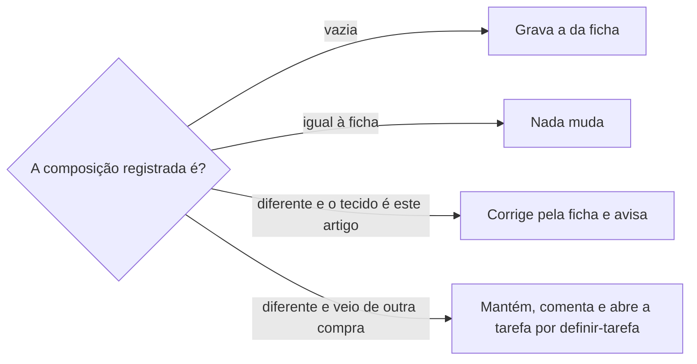

# Definir tecido

## Parâmetros de configuração

Leia cada valor nas instruções do projeto: primeiro na entrada com o nome desta habilidade, depois na entrada `Global` ou no primeiro nível do bloco. Quando um valor não estiver lá, use o padrão abaixo.

```yaml
"Modo de aprendizado": "perguntar"
# Nomes de banco e de campo: o projeto define. Vazios, pergunte uma vez e não escolha.
# `Banco de tecidos`: uma página por tecido e cor, ligada à empresa e à composição.
"Banco de tecidos": ""
# `Banco de composição`: uma linha por percentual e fibra, como `88% PES`.
"Banco de composição": ""
# `Campo do arquivo da ficha`: campo de arquivo do cadastro de tecidos que guarda o PDF da ficha. Vazio, o PDF vai no corpo da página, ou onde o sistema de cadastro usa para anexos.
"Campo do arquivo da ficha": ""
# `Siglas das fibras`: a sigla de cada fibra no nome da linha de composição.
"Siglas das fibras": {"algodão": "CO", "viscose": "CV", "poliéster": "PES", "poliamida": "PA", "elastano": "PUE", "linho": "LI", "seda": "SE"}
```

## Instruções

### Passo 1

Peça a ficha técnica ou a etiqueta e o fornecedor. Sem a ficha à mão, procure antes de pedir ao fornecedor: a cotação e a despesa da compra, a nota fiscal, as páginas dos produtos que usam o tecido, as fotos do tecido, as conversas com o fornecedor, inclusive os documentos delas, e o e-mail.

Mostre o que achou, com o link de cada fonte, e redija o pedido ao fornecedor só com o que faltar.

Os nomes dos bancos vêm das instruções do projeto. Com `Banco de tecidos` ou `Banco de composição` vazio, a pessoa informa o data source na execução e você não escolhe um. Se um dos dois não estiver no workspace conectado, pare. Não use o banco de outro workspace e não mude a estrutura de nenhum dos dois.

Leia o arquivo inteiro. Uma ficha de nota fiscal traz vários artigos, cada um a partir de um cabeçalho de dados técnicos com o código e o nome do produto. De cada artigo, tire o código, o nome, a composição, a largura, a gramatura, o rendimento, o encolhimento e os cuidados de lavar, passar e costurar.

### Passo 2

Leia de novo agora o `Banco de tecidos` filtrado pela empresa e pelo nome do artigo. A pessoa pode ter renomeado ou criado páginas desde a última leitura. Antes de criar uma página, busque com `identificar-duplicata`.

Um tecido é um artigo numa cor: o mesmo artigo em duas cores são duas páginas, com a mesma composição e a mesma ficha. Pergunte a cor que a ficha não diz. O nome segue o das páginas vizinhas, com o artigo e a cor. A página leva a empresa.

Monte o plano numa tabela antes de gravar: página, ação (criar, corrigir ou completar), composição de agora e composição da ficha. Mostre o plano e siga.

### Passo 3

A composição é a relação com linhas do `Banco de composição`, uma por fibra. O nome da linha é o percentual com ponto decimal e a sigla de `Siglas das fibras`, como `90.5% CO`. O percentual da fibra é a fração, como 0,905, e a linha liga a fibra. Use a linha que já existe com o mesmo nome e a mesma fibra. Crie só a que falta.



Quando o produto usa um tecido de outra compra, como uma etiqueta antiga, a composição dele fica como está. Comente no produto o que diverge e por quê, e abra a tarefa de conferência por `definir-tarefa`, com o link da tarefa no comentário.

### Passo 4

Leia o corpo de cada página antes de anexar. Se ela já tem a seção da ficha, atualize essa seção e não crie outra. Sem a seção, escreva no fim da página um título com o fornecedor, uma linha com o código, a nota fiscal e a data da ficha, e uma lista curta com a composição, as medidas, os cuidados e o alerta do fornecedor.

O PDF vai em `Campo do arquivo da ficha`, e o resumo diz que ele está lá. Com o parâmetro vazio, ou sem esse campo no cadastro, o PDF vai no fim do resumo. O mesmo PDF fica num lugar só. Cada página recebe o próprio envio do arquivo.

Na resposta, dê o link de cada página e de cada linha de composição criada, e a divergência que cabe à pessoa conferir.

### Passo 5

Ao terminar, siga `evoluir-habilidade` conforme `Modo de aprendizado`.

## Problemas comuns

### Ficha pedida sem procurar

Se você redigir o pedido da ficha ao fornecedor depois de olhar só o e-mail, o pedido repete o que a cotação, o produto ou a conversa já respondem.

1. Procure em cada fonte do Passo 1.
2. Mostre o que achou e o que falta.
3. Peça ao fornecedor só o que falta.

### Seção da ficha duplicada

Se você anexar a ficha sem ler a página, ela fica com duas seções iguais quando outra sessão já anexou.

1. Leia o corpo da página antes.
2. Atualize a seção que existe.

### Composição trocada entre artigos

Se você copiar a composição de outra página do mesmo fornecedor, o produto sai com a etiqueta errada.

1. Leia a composição no artigo da ficha, pelo código.
2. Confira cada página do plano contra o artigo dela.

### Página renomeada no meio da tarefa

Se você gravar pelo que leu no começo da conversa, a escrita desfaz o que a pessoa mudou.

1. Leia o banco de novo antes do plano.
2. Siga os nomes de agora.

### Divergência corrigida sem perguntar a origem

Se você corrigir a composição de um produto que usa um tecido de outra compra, o registro certo vira o errado.

1. Pergunte se o tecido do produto é o artigo da ficha.
2. De outra compra, mantenha, comente e abra a tarefa.

### Nome de banco inventado

Se você usar um nome de banco que o projeto não definiu, a escrita cai no banco errado ou num que não existe.

1. Leia `Banco de tecidos` e `Banco de composição` nas instruções do projeto.
2. Vazios, pergunte uma vez qual é o banco.
3. Não escolha um nome.

## Exemplos de entrada e saída

Estes exemplos ilustram fatos. Eles podem não estar no data source.

### Estes PDFs são as fichas das notas 111 e 222 do fornecedor

Quatro artigos: uma viscose lisa, um suede com foil, uma malha estampada em duas cores e uma malha bolha. O plano teve cinco páginas. Corrigi o suede de 100% PES para 88% PES e 12% PUE, criei a viscose lisa e as linhas 88% PES, 12% PUE, 90.5% CO e 9.5% PA, e anexei a ficha da nota de cada artigo. A camiseta diverge e usa tecido de outra compra: ficou como está, com comentário e tarefa.

### Qual a composição do tecido da etiqueta que anexei?

A etiqueta não tem ficha. Gravei a composição dela, com o link da fonte, e disse que a ficha e os cuidados ainda faltam.

## Casos-limite

- A ficha não diz a cor: pergunte. Não crie página sem cor quando o artigo tem mais de uma.
- O mesmo artigo em duas cores tem duas páginas, mas conta uma vez na etiqueta do produto, como `definir-composicao-textil` monta.
- A fibra não tem sigla em `Siglas das fibras`: pergunte a sigla antes de criar a linha.
- A composição vem só da etiqueta, sem ficha: grave a composição e diga que falta a ficha.
- A composição está só na nota fiscal ou na cotação: grave com o link da fonte e diga que os cuidados ainda faltam.
- Um banco ou o campo do arquivo está vazio nas instruções do projeto: pergunte uma vez e não escolha.

## Pegadinhas

- A ficha escreve o percentual com três casas, como `90.500%`. É 90,5%.
- A ficha diz elastano e o banco usa a sigla PUE. A sigla vem de `Siglas das fibras`, não da ficha.
- O envio do arquivo ao Notion vale para um anexo só. Duas páginas com a mesma ficha pedem dois envios.
- O PDF anexado no corpo de uma página não muda de lugar sozinho quando o campo de arquivo é criado. Mova-o para o campo e tire-o do corpo.
- Num cadastro fora do Notion, o campo de arquivo pode ter outro nome ou não existir. `Campo do arquivo da ficha` decide.
- A nota fiscal e a cotação costumam trazer a composição, a largura e a gramatura, mas não os cuidados. A falta de ficha não quer dizer falta de composição.
- A foto do tecido pode ter a composição só no nome do arquivo, sem texto legível no conteúdo.

## Scripts disponíveis

- Nenhum.

1. Não há script para executar.
