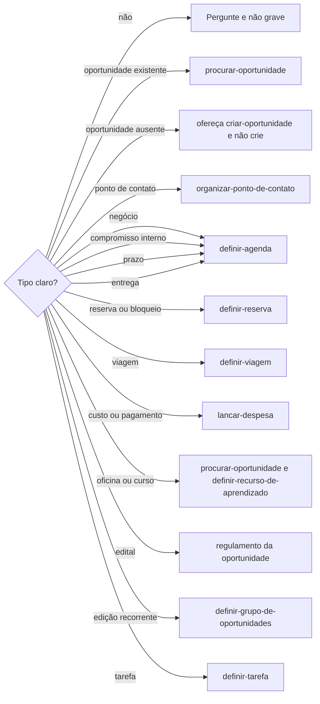

# Definir tipo do evento

## Parâmetros de configuração

```yaml
{}
```

## Instruções

### Passo 1

Saber o tipo real antes de criar, revisar ou alterar a agenda é esta habilidade. Feira, oportunidade, reunião, conversa, reserva, compromisso, ponto de contato, negócio, viagem, entrega, prazo e pagamento não bastam sozinhas. Sem tipo claro, pergunte. Não grave.



A gravação de negócio, compromisso interno, prazo e entrega segue `definir-agenda`. Reserva de tempo de carreira segue `definir-agenda-de-popstar`. Saber o que já está no dia ou na semana segue `procurar-agenda`.

### Passo 2

A mesma feira, marca, loja, pessoa ou organização pode ser oportunidade, negócio e ponto de contato. A oportunidade é a edição, a data, a curadoria e a possibilidade. Negócio é conversa, abordagem, negociação ou reunião comercial. O ponto de contato é a participação real. Reunião ou resenha não vira ponto de contato. A oportunidade aprovada sem os dias de participação: pergunte. Não grave o ponto. Os dias seguem `organizar-ponto-de-contato`. Prazo não é entrega. Compromisso interno não é evento externo.

## Problemas comuns

### Tipo gravado no escuro

Se você criar ou alterar antes do tipo, a agenda grava reunião no lugar de prazo, entrega, reserva, negócio ou pagamento.

1. Identifique o tipo antes de salvar.
2. Sem tipo claro, pergunte. Não grave.
3. Reunião ou resenha não vira ponto de contato. A oportunidade aprovada sem os dias de participação: pergunte. Não grave o ponto.

### Prazo no lugar da entrega

Se você tratar prazo e entrega como o mesmo tipo, o compromisso muda de natureza.

1. Mantenha prazo e entrega separados.
2. Os dois seguem `definir-agenda` só para gravar.
3. Não troque um pelo outro.

## Exemplos de entrada e saída

Estes exemplos ilustram fatos. Eles podem não estar no data source.

### agende essa conversa

O tipo não estava claro. Perguntei antes de criar. Não gravei.

### marque a resenha com a organização

Ficou como negócio. Não virou ponto de contato. A gravação segue `definir-agenda`.

### registre a feira aprovada na agenda

A oportunidade ficou como fonte da edição, da data, da curadoria e da possibilidade. Perguntei os dias em que a empresa participa. Não gravei o ponto de contato.

## Casos-limite

- O tipo não está claro: pergunte. Não grave.
- Custo ou pagamento: siga `lancar-despesa`. Não grave como reunião, prazo ou entrega.
- Prazo e entrega são tipos diferentes. Os dois gravam em `definir-agenda`.
- Negócio ou reunião comercial não é ponto de contato. Compromisso interno não é evento externo.
- Reunião ou resenha com uma organização: é negócio. Não vira ponto de contato.
- A oportunidade aprovada sem os dias de participação da empresa: pergunte. Não grave o ponto de contato.
- A oportunidade ainda não existe: ofereça `criar-oportunidade`. Não crie. A que já existe fica com `procurar-oportunidade`.
- O pedido é gerenciar viagem: siga `definir-viagem`.
- Reserva, bloqueio, «a confirmar» ou lembrete: `definir-reserva`. Reserva de carreira: `definir-agenda-de-popstar`.
- Oficina ou curso: `procurar-oportunidade` e `definir-recurso-de-aprendizado`. Edital: o regulamento da oportunidade. A edição recorrente: `definir-grupo-de-oportunidades`. Tarefa: `definir-tarefa`.

## Pegadinhas

- Reunião, conversa, compromisso e negócio parecem o mesmo evento. O tipo real vem antes de gravar. Sem clareza, pergunte.
- A mesma feira parece um ponto de contato só. A oportunidade é a edição e a possibilidade. Negócio é a conversa. O ponto de contato é a participação real, nos dias confirmados.
- Prazo e entrega parecem o mesmo compromisso. São tipos diferentes. A gravação dos dois segue `definir-agenda`.

## Scripts disponíveis

- Nenhum.

1. Não há script para executar.
