# Definir viagem

## Parâmetros de configuração

Leia cada valor nas instruções do projeto: primeiro na entrada com o nome desta habilidade, depois na entrada `Global` ou no primeiro nível do bloco. Quando um valor não estiver lá, use o padrão abaixo.

```yaml
"Modo de aprendizado": "perguntar"
```

## Instruções

### Passo 1

As listas e o nome de cada propriedade vêm do mapeamento de dados do projeto. Cadastrar, atualizar, deduplicar ou organizar uma viagem da empresa é esta habilidade. Passagem, roteiro, embarque, decolagem, pouso, transfer, hospedagem, orientação, alteração ou comprovante entra aqui. Perguntar se a viagem já existe, ou em que dia ela cai, também entra, e não cria página. A viagem canônica fica na lista de viagens. Cada marco operacional fica numa linha do cronograma, ligada a essa viagem. Origem e destino são páginas da lista de localidades. A fonte que o pedido usa tem de estar no workspace conectado. Sem ela, pare. Não use lista de outro workspace. Não crie a localidade aqui.

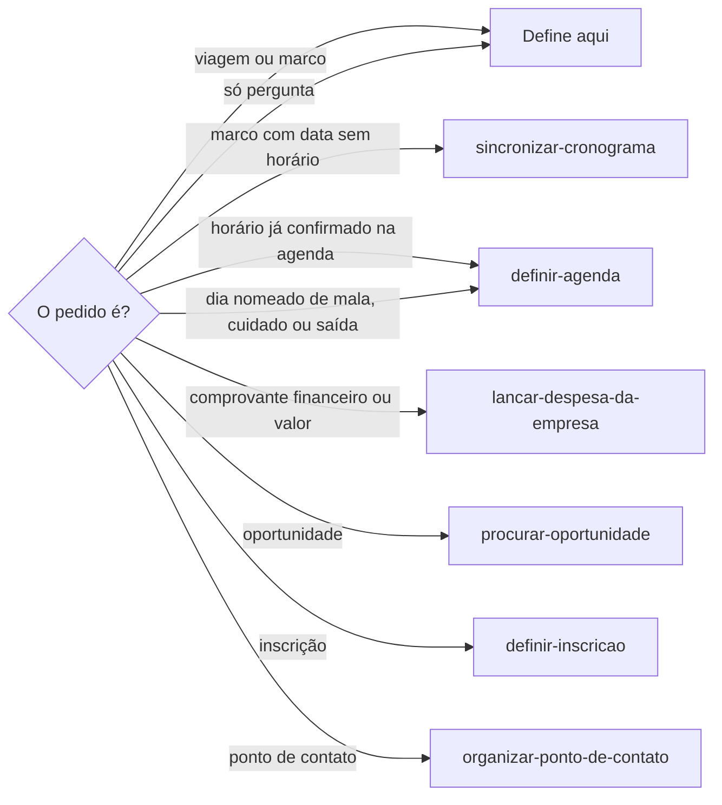

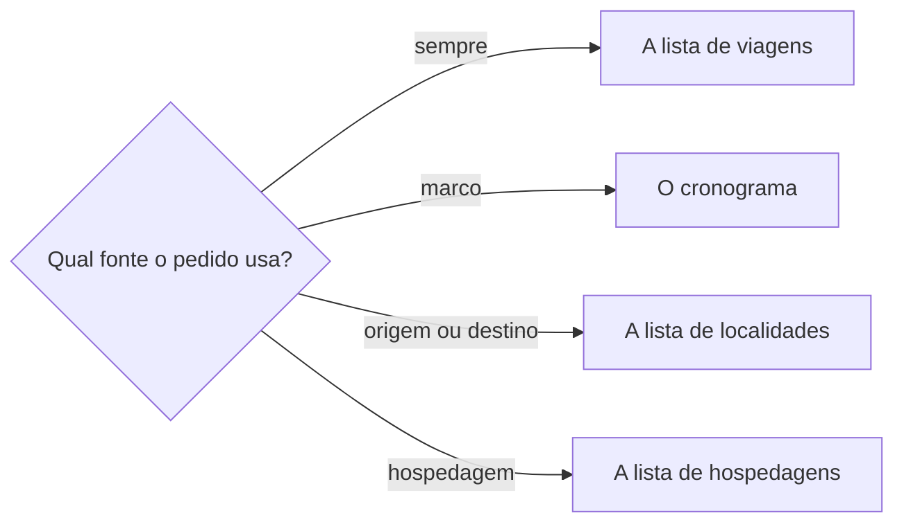

### Passo 2

Cadastrar a viagem nova e atualizar a que já existe ficam nesta habilidade. Antes de criar, busque na lista de viagens pela origem, pelo destino e pelas datas iguais ou sobrepostas. BH e Belo Horizonte são a mesma origem. RJ, Rio e Rio de Janeiro são o mesmo destino. Consulte a lista de localidades pelo nome ou pela sigla. O investimento que já existe se relaciona à viagem.

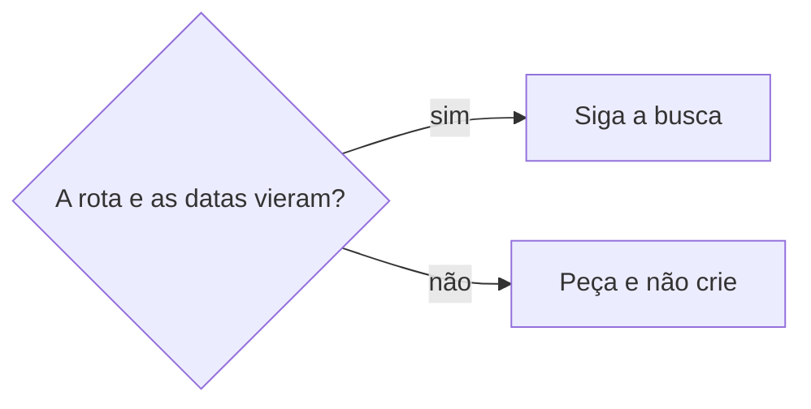

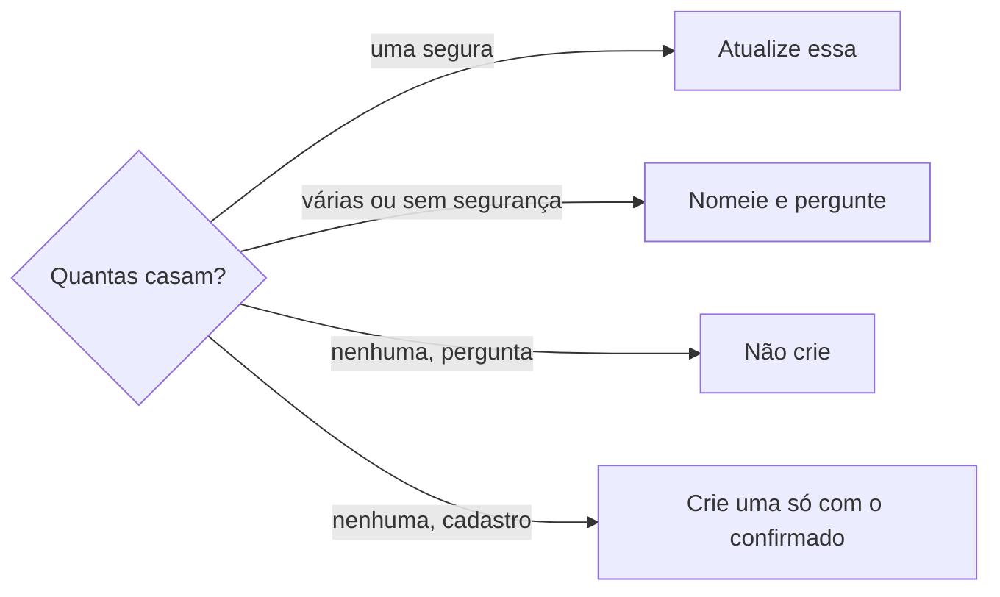

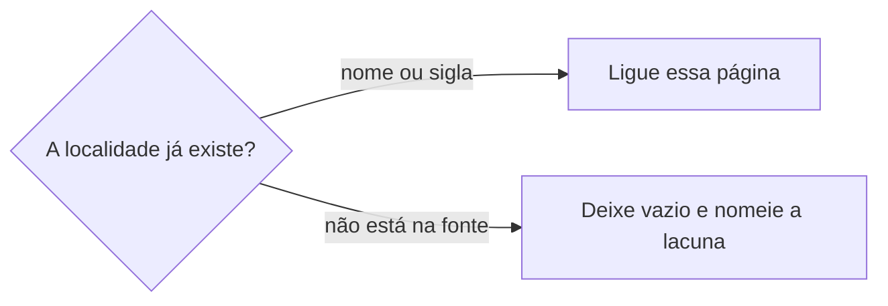

Na viagem criada, origem, destino, datas, hospedagem e os investimentos relacionados ficam nela. O título segue o padrão já descrito na propriedade de título. Não invente outro formato. O que a pessoa não confirmou fica vazio. Não promova o status a confirmado sem evidência de compromisso ou deslocamento assegurado. Cancelamento só com evidência explícita. Não invente status.

### Passo 3

Cada marco com data ou horário próprio fica numa linha do cronograma, ligada a essa viagem. Antes de criar, busque no cronograma pela viagem, pelo nome, pela etapa e pela data. Ida e volta também ficam em linhas distintas. Não substitua essas linhas por um bloco de vários dias. A etapa só recebe um valor que a lista já tem. Chegada ao aeroporto ainda não é uma etapa: o nome da linha carrega essa ação e a etapa fica vazia. Não escreva o marco, o voo, a hospedagem nem a orientação na página da oportunidade nem da inscrição. A oportunidade que a pessoa nomear, e que já existir, liga no marco. Sem ela, não invente. O ponto de contato segue `organizar-ponto-de-contato`.

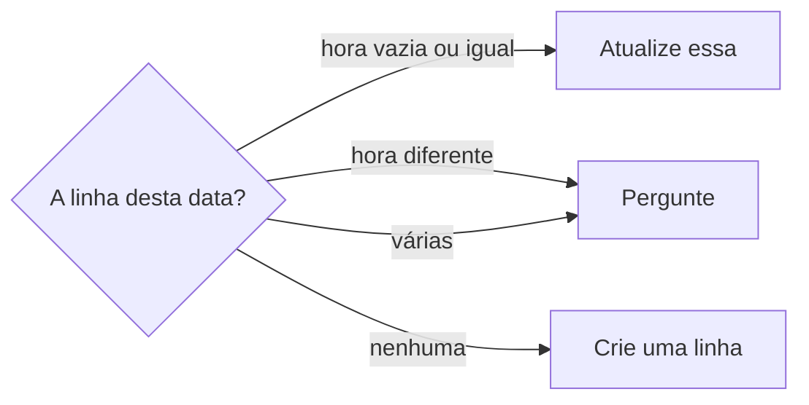

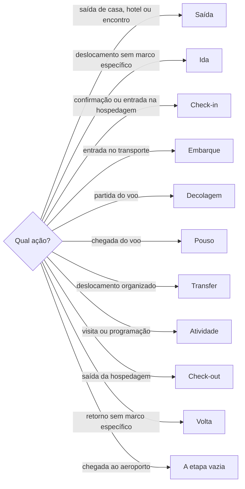

### Passo 4

O horário que a passagem ou a pessoa trouxe fica no marco correspondente. O horário do voo não vira embarque, e o embarque não vira decolagem. Transfer, atividade, check-in e chegada não ganham hora aproximada. Número de voo e outra informação sem propriedade própria entram no contexto do marco, sem repetir data, hora ou local. O responsável que a fonte nomear entra nos responsáveis. A nota daquele acontecimento entra no contexto. Cada hospedagem é um registro ligado à viagem, e só entra com nome ou endereço confiável. Sem nome confirmado, o título é o endereço em texto. Não invente o nome. Clima e vestuário é a orientação geral da época: frio, calor, seco, chuva e o tipo de roupa a levar. Não é produto nem variante da empresa. Não invente o campo. Valor coberto pela organização e despesa da pessoa participante permanecem distintos. Cidade, aeroporto, hotel, horário, transfer e responsabilidade só entram com fonte que os confirma. Lacuna, divergência e evidência relevante ficam no corpo da viagem. A oportunidade guarda a missão, o evento ou o compromisso que originou a viagem. O roteiro operacional não entra nela nem na inscrição. Não cole o comprovante no corpo da viagem, da hospedagem nem do marco.

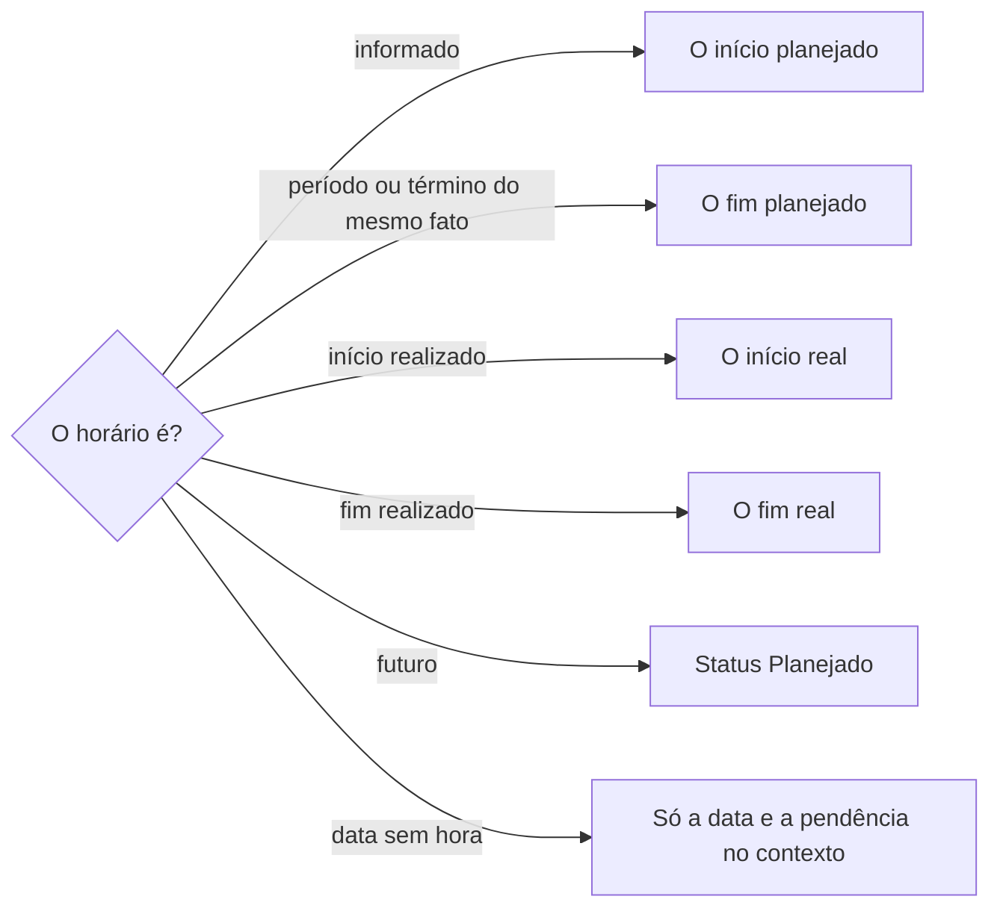

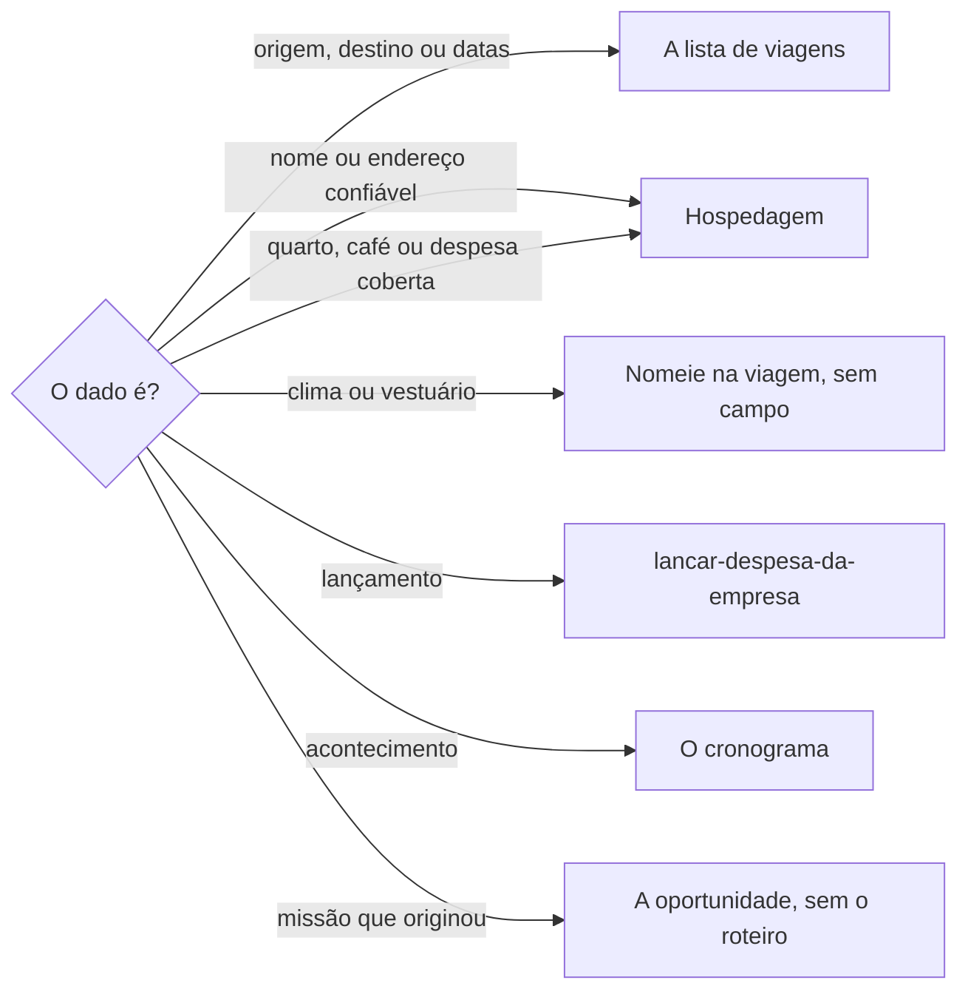

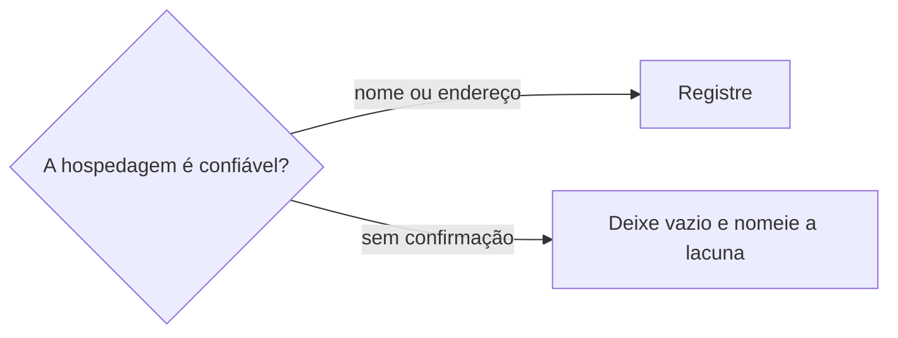

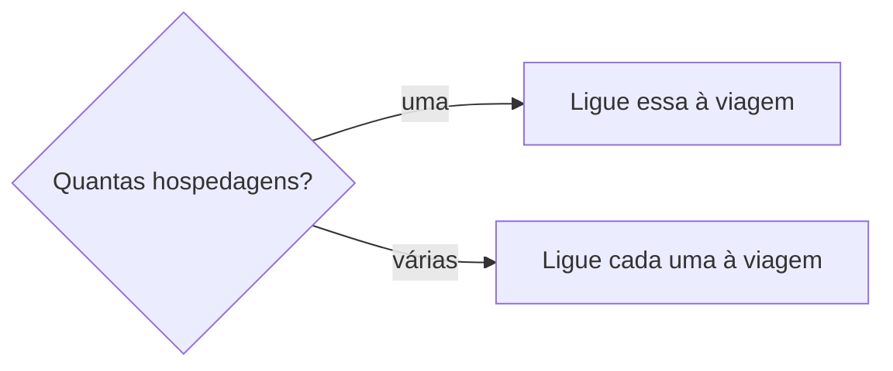

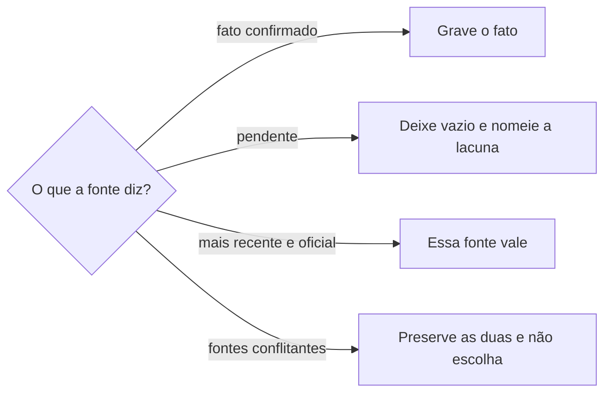

### Passo 5

A linha do cronograma guarda a data e deixa a hora vazia. O bloco que o flowchart do Passo 1 manda para outra habilidade não entra aqui. Não pergunte se pode registrar a viagem quando a pessoa já pediu para cadastrar, atualizar ou organizar.

### Passo 6

Diga a viagem canônica, o que entrou, o que ficou vazio, a lacuna, a divergência e os marcos que ficaram separados. Na pergunta, diga o que a busca encontrou e não crie. A data na resposta sai com o dia da semana. Sem horário ou sem fuso, e se o dia puder mudar, peça. Não invente. Planejar quem leva, quem busca ou se cabe ônibus fica nesta habilidade.

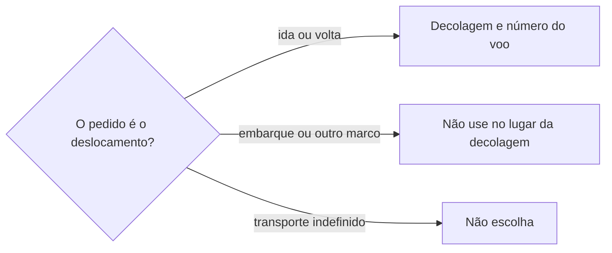

### Passo 7

Ao terminar, siga `evoluir-habilidade` conforme `Modo de aprendizado`.

## Problemas comuns

### Localidade inventada

Se você gravar a cidade como texto solto, ou criar a localidade, a origem deixa de apontar para a página que já existe.

1. Consulte a lista de localidades.
2. Siga o flowchart do Passo 2.
3. Não crie a localidade.

### Viagem sem rota

Se você criar a viagem sem origem, destino ou datas, o título canônico não fecha e a busca não tem chave.

1. Siga o flowchart do Passo 2.
2. Peça a rota ou as datas que faltam.
3. Não crie até elas existirem.

### Marco duplicado pela hora

Se você criar outra linha porque a hora chegou depois, o marco que só tinha data nasce de novo.

1. Siga o flowchart do Passo 3.
2. Hora vazia na linha que já existe recebe a hora.
3. Hora já preenchida e diferente: pergunte.

### Segunda viagem

Se você criar outra viagem porque chegou uma passagem ou um trecho novo, a mesma rota fica partida.

1. Case origem, destino e datas iguais ou sobrepostas, com a sigla e o nome da mesma cidade.
2. Atualize a viagem que já casou.
3. Só crie quando nenhuma casar e o pedido for cadastrar.

### Marcos fundidos

Se você juntar embarque, decolagem, pouso e transfer numa linha só, a linha do tempo deixa de ser atômica.

1. Siga o flowchart do Passo 3.
2. Mantenha ida e volta em linhas distintas.
3. Não substitua essas linhas por um bloco de vários dias.

### Embarque no lugar da decolagem

Se você usar o horário de embarque, ou de outro marco, para dizer quando a pessoa precisa ir ou voltar do aeroporto, a ida e a busca ficam na hora errada.

1. Siga o flowchart do Passo 6.
2. Use a decolagem da ida e a decolagem da volta, com o número do voo de cada trecho.
3. Não escolha ônibus nem carona enquanto a pessoa não definir.

### Hora inventada

Se você preencher a hora que a passagem não trouxe, ou copiar a hora do marco seguinte, o cronograma mente.

1. Siga o flowchart do Passo 4.
2. Com data e sem hora, grave só a data e nomeie a pendência no contexto.
3. Não use dia inteiro nem hora aproximada no lugar da hora ausente.

### Hora emprestada

Se você usar o horário do voo no embarque, ou o do embarque na decolagem, os marcos trocam de hora.

1. Siga o flowchart do Passo 4.
2. O horário informado entra no início planejado desse marco.
3. O fim planejado só com período ou término do mesmo acontecimento. O início real e o fim real só depois da realização ou de confirmação posterior, cada um com o próprio horário.

### Dado na oportunidade

Se você escrever o roteiro operacional na oportunidade ou na inscrição, a viagem deixa de ser a fonte canônica.

1. Deixe rota, datas, lacuna e divergência na viagem. Cada hospedagem confiável fica ligada a ela.
2. Deixe cada marco no cronograma, ligado a essa viagem e à oportunidade que já existir.
3. A oportunidade guarda a missão que originou a viagem. A inscrição não substitui a viagem nem a linha do tempo.

### Peça no lugar da orientação

Se você tratar clima e vestuário como produto ou variante da empresa, a orientação da viagem vira cadastro de produto.

1. Nomeie a orientação na viagem.
2. Não crie produto nem variante.
3. Não invente a propriedade.

### Orientação no cronograma

Se você gravar condição de hospedagem, despesa coberta ou orientação geral numa linha do cronograma, o cronograma vira depósito de informação geral.

1. Siga o flowchart do Passo 4.
2. Deixe no cronograma só o acontecimento operacional.
3. Siga o flowchart do Passo 4.

### Complemento na viagem

Se você gravar o endereço ou o complemento na viagem, ou juntar duas hospedagens num registro só, a segunda perde o endereço.

1. Siga o flowchart do Passo 4.
2. Endereço, complemento e lugar no mapa ficam nessa hospedagem.
3. Cada hospedagem fica ligada à viagem.

### Incerteza promovida

Se você marcar a viagem como confirmada, ou cancelada, sem a evidência, o status passa na frente do que se sabe.

1. Informação incompleta permanece no status de registro inicial.
2. Confirmado só com compromisso ou deslocamento assegurado.
3. Cancelado só com evidência explícita.

### Fato inventado

Se você preencher cidade, aeroporto, hotel, horário, transfer ou responsabilidade que a fonte não confirmou, a viagem mente.

1. Siga o flowchart do Passo 4.
2. Deixe a pendência vazia e nomeada.
3. Preserve as duas fontes quando nenhuma for a mais recente e explicitamente oficial.

### Escolha entre fontes

Se você escolher uma versão que não é a mais recente e explicitamente oficial, a divergência some.

1. Siga o flowchart do Passo 4.
2. A fonte mais recente e explicitamente oficial vale.
3. Sem isso, preserve as duas.

## Exemplos de entrada e saída

Estes exemplos ilustram fatos. Eles podem não estar no data source.

### cadastre esta viagem, e já existe uma com a mesma origem, o mesmo destino e as mesmas datas.

Usei a viagem que já existia. Não criei outra. O que não veio ficou vazio.

### registre embarque e decolagem no cronograma, sem hora de decolagem.

Gravei embarque e decolagem em linhas separadas do cronograma, na mesma viagem. A decolagem ficou sem horário.

### já existe uma viagem para essas datas?

Procurei na lista de viagens. Respondi o que encontrei. Não cadastrei.

### adicione as orientações da hospedagem.

O endereço entrou no endereço. O complemento entrou no complemento do endereço. A hospedagem ficou ligada à viagem. A orientação geral entrou no corpo da viagem. O cronograma ficou só com o acontecimento operacional.

### Nossa viagem é na terça?

Respondi com a data e o dia da semana da viagem que casou. Não cadastrei.

### a cidade e o horário não vieram, e duas fontes divergem sobre o hotel.

O fato confirmado entrou. A cidade e o horário ficaram vazios e nomeados. As duas fontes do hotel permaneceram, sem escolha.

### a passagem nova repete a decolagem, e a cidade veio como BH.

A viagem que já casava foi atualizada. BH entrou como a mesma origem de Belo Horizonte. A decolagem que já tinha a mesma viagem, o mesmo nome, a mesma etapa, a mesma data e o mesmo horário foi atualizada.

## Casos-limite

- A lista não está no workspace conectado: pare. Não use lista de outro workspace. Não crie a localidade.
- Várias viagens casam: siga o flowchart do Passo 2.
- A pergunta não pede cadastro: siga o flowchart do Passo 2.
- Ida e volta, ou dois voos no mesmo dia, são marcos distintos. Não funda.
- Sem hora: a data fica, a hora fica vazia e a pendência fica no contexto. Não invente. Não copie o próximo marco. Não use hora aproximada.
- Quem leva ou busca: siga o flowchart do Passo 6.
- Chegada sem hora, e a dúvida se dá tempo de trabalhar: não invente o horário. Não grave o bloco de produção aqui.
- O dia nomeado de mala, cuidado ou saída segue `definir-agenda`.
- Mais de uma hospedagem: siga o flowchart do Passo 4.
- Lacuna ou divergência: siga o flowchart do Passo 4.
- Marco da mesma viagem, do mesmo nome, da mesma etapa e da mesma data: siga o flowchart do Passo 3.
- Comprovante financeiro ou valor segue `lancar-despesa-da-empresa`. Passagem e reserva sem valor ficam na viagem.
- A oportunidade ou inscrição não recebe o texto da viagem.

## Pegadinhas

- Uma passagem nova parece uma viagem nova. Origem, destino e datas que já casam são a mesma viagem.
- Embarque e decolagem parecem o mesmo marco. Cada um tem horário próprio e fica numa linha. A ida e a busca no aeroporto usam a decolagem.
- A hora que falta parece dia inteiro, hora aproximada ou a hora do marco seguinte. A data fica e a hora fica vazia até a confirmação.
- O horário do voo parece o do embarque, e o do embarque parece o da decolagem. Cada um fica no próprio marco. O fim planejado só entra com o término desse mesmo fato.
- Ida e Volta parecem cobrir embarque, decolagem, pouso e transfer. Elas entram quando não há marco mais específico.
- Não há propriedade de número do voo. O número entra no contexto do marco, sem repetir data, hora ou local.
- A orientação da hospedagem parece nota do cronograma. A condição fica na hospedagem. A despesa coberta e a orientação geral ficam na viagem. O cronograma fica com o acontecimento operacional.
- Clima e vestuário parecem produto da empresa. São frio, calor, seco, chuva e o tipo de roupa a levar. Siga o flowchart do Passo 4.
- O endereço parece campo da viagem. Ele fica na hospedagem ligada a ela. Uma viagem pode ter mais de uma.
- Duas fontes parecem uma escolha. As duas permanecem, salvo a mais recente e explicitamente oficial. A lacuna fica vazia e nomeada.
- BH parece outra cidade. É a mesma origem de Belo Horizonte. RJ, Rio e Rio de Janeiro são o mesmo destino. Datas sobrepostas são a mesma viagem quando a rota casa.
- A cidade parece texto livre. Origem e destino são páginas da lista de localidades. Siga o flowchart do Passo 2.
- Passagem ou reserva parecem despesa. Sem valor, ficam na viagem.
- «Nossa viagem é na terça?» parece pedido de cadastro. É pergunta. Não cria.

## Scripts disponíveis

- Nenhum.

1. Não há script para executar.
