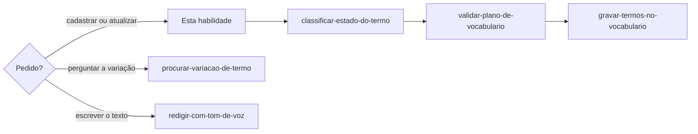

# Definir vocabulário

## Parâmetros de configuração

```yaml
"Modo de aprendizado": "perguntar"
"Categorias": {}
"Validação dos campos": "warn"
"Domínio do e-mail de quem decide": ""
```

## Instruções

### Passo 1

A pessoa responsável pelo tom de voz quer cadastrar ou atualizar termos. Perguntar se um termo ou uma variação faltou segue `procurar-variacao-de-termo`. Monte o plano com idioma, modo e a lista. Cada item tem `state`, `term`, `categories` e os campos desse nível. Use só o que a pessoa enviou.

O idioma de cada linha é o da comunicação inteira, não o do arquivo que já existe. Comunicação inteira em inglês, como um e-mail, uma review ou uma mensagem, grava o termo e a frase em `en`. Comunicação principalmente em português que só leva um termo em inglês no meio, como `header`, grava em `pt-BR`. Idioma ambíguo: pergunte. Sem idioma ou sem termo, pare e peça.



### Passo 2

Classifique cada termo com `classificar-estado-do-termo`: ele lê as fontes da marca e decide o `state`, as `tags`, o `allowed_in` e o `forbidden_in`. Contexto ainda ambíguo: ele pergunta. Não responda e não grave.

### Passo 3

Cadastrar o que ainda não está usa `insert`. Corrigir o que já está usa `update`. Gravar novos e corrigir os que já estão usa `upsert`. Se a pessoa pedir para cadastrar e não disser o modo, use `insert`.

### Passo 4

Valide o plano com `validar-plano-de-vocabulario`. Passe `Categorias`, `Validação dos campos` e `Domínio do e-mail de quem decide`. Validação falha: corrija e valide de novo. Não grave.

### Passo 5

Grave com `gravar-termos-no-vocabulario`. Passe `Validação dos campos`. Ele corrige sem apagar o resto da linha, pesquisa a grafia, testa com dry run e grava o plano inteiro numa escrita só. Não confirme o cadastro sem a resposta dele.

### Passo 6

Ao terminar, siga `evoluir-habilidade` conforme `Modo de aprendizado`.

## Problemas comuns

### Idioma pelo arquivo à mão

Se você gravar no arquivo que já existe sem olhar o idioma da comunicação inteira, a frase em inglês entra no vocabulário errado.

1. Leia o texto inteiro: em inglês, `en`; em português com um termo em inglês, `pt-BR`.
2. Texto ambíguo: pergunte.
3. Sem o arquivo do idioma, crie-o com `{}` e grave.

## Exemplos de entrada e saída

Estes exemplos ilustram fatos. Eles podem não estar no data source.

### Cadastre `i'll refund the order` e `kind regards`, de um e-mail inteiro em inglês que pede um reembolso.

A comunicação inteira era em inglês: as duas frases foram para `en`, não para `pt-BR`. O `en.json` não existia: criei `{}` e gravei.

### Cadastre `header`, de uma mensagem em português.

A mensagem era em português e só levava uma palavra em inglês. A linha ficou em `pt-BR`.

## Casos-limite

- Permitidos, proibidos e situacionais juntos: um lote e um modo.
- A pessoa pergunta se um termo ou uma variação faltou: `procurar-variacao-de-termo`.
- O pedido é escrever a frase: `redigir-com-tom-de-voz`.
- O pedido é saber se a frase pode: não é esta habilidade.
- Sem terminal e sem o servidor `vocabulary`, como num agente do Notion: pare. `gravar-termos-no-vocabulario` explica o motivo.

## Pegadinhas

- Uma palavra em inglês dentro do texto em português parece termo do vocabulário em inglês. Ela mora no vocabulário desse texto.
- Um `pt-BR.json` à mão parece o lugar de tudo. O e-mail inteiro em inglês mora em `en`, com a frase inteira.

## Scripts disponíveis

- Nenhum.
