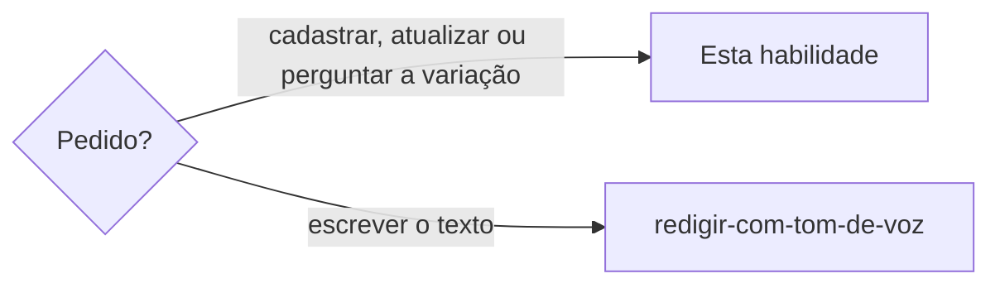

# Definir vocabulário

## Parâmetros de configuração

```yaml
"Modo de aprendizado": "perguntar"
```

## Instruções

### Passo 1

A pessoa responsável pelo tom de voz quer cadastrar ou atualizar termos. Monte o plano com idioma, modo e a lista. Cada item tem `state`, `term`, `category`, `description` e os campos desse estado. Sem idioma ou sem termo, pare e peça. Use só o que a pessoa enviou.



### Passo 2

Antes de responder se o termo cabe na marca, e antes de gravar, leia as fontes da marca que as instruções do projeto nomeiam. A pessoa informa essas fontes. Se uma não estiver no workspace conectado, pare. Não invente persona, posicionamento nem modelo. Gosto, estética isolada e julgamento genérico não fecham permitido, proibido nem situacional. Tensão entre intenção criativa e viabilidade comercial fica em `description` ou `when`.

Canal, público, coleção, vertente, intenção comercial ou situação de uso ainda ambíguos: pergunte. Não responda e não grave.

O termo que só cabe num desses contextos fica `situationally_allowed`, e o `when` guarda essa situação. `allowed` e `forbidden` são regra geral da marca. Não use esses estados para um contexto específico. A escrita recusa `when` nesses dois estados.

### Passo 3

Cadastrar o que ainda não está usa `insert`. Corrigir o que já está usa `update`. Gravar novos e corrigir os que já estão usa `upsert`. Se a pessoa pedir para cadastrar e não disser o modo, use `insert`.

### Passo 4

Valide o plano antes de gravar.

- `category` é uma palavra em inglês, em qualquer idioma, como `punctuation`. Termo, descrição e notas ficam no idioma do vocabulário.
- `allowed` pede `reason` e `examples`, e não leva alternativa. `description` explica a palavra. `reason` diz por que usamos. Não copie um no outro.
- `forbidden` pede `substitution`, `rejected` e `alternatives`. A escrita recusa `examples`.
- `situationally_allowed` pede `when` e `examples`.
- Um termo não é o próprio exemplo. A mesma grafia não entra duas vezes.
- Emoji, combinação e uso simbólico são termo. A combinação junta é um termo. Não é decoração.
- `state` é a permissão. `description` não repete o estado.
- Evitar, proibido, ruim, desalinhado ou restrito ficam `forbidden`. O exemplo ruim vai em `rejected`.
- Exemplo de contexto e exemplo mais longo ficam em `examples`. Termo já cadastrado fica em `related`.
- Documentação complementar só quando a pessoa pedir.
- Clichê, genérico, automatizado ou gasto por IA, útil como intenção e não como palavra final: categoria `cliche`, estado `forbidden`. A `description` pede imagem, cena, ação, efeito ou situação. A frase literal entra em `rejected`. `substitution` repete a troca e não vira sinônimo. A escrita recusa `cliche` em permitido ou situacional. Variação recorrente entra proibida e ligada, ou só sugerida. Não invente a variação.
- Frase descartada por perda consumada, cobrança agressiva, exclusão, capacitismo, ameaça real, culpa ou sensação incompatível entra `forbidden`. O motivo fica na `description`. A alternativa mantém desejo, urgência e conversa natural, sem dizer que a chance já passou. Sem alternativa, pergunte. Não invente a frase.
- Validação falha: corrija e valide de novo. Não grave.

### Passo 5

Pesquise a grafia no vocabulário antes de gravar, com a consulta de Scripts disponíveis. Com terminal, rode o comando. Sem terminal, chame a ferramenta do servidor `vocabulary`. Sem os dois, como num agente do Notion, pare antes de pesquisar. Diga que o cadastro roda numa ferramenta de código com o projeto aberto. Não leia o vocabulário de memória. Outra caixa e acento que não muda a letra são o mesmo termo: a linha que já está recebe a orientação. Não cadastre uma segunda linha dessa grafia. Uma forma igual, com os mesmos campos, volta sem alteração.

Plural, singular, feminino, masculino e outra palavra do mesmo assunto são linhas próprias. Cada uma tem o próprio estado. Casas e moradias convivem. Casa e casas convivem. Gato e gata convivem. Não junte essas linhas.

Se a consulta trouxer duas grafias da mesma palavra, só por caixa ou acento, pare. Ela nomeia as linhas e diz qual permanecer: a que já tem descrição e exemplos; no empate, a que vem antes. A escrita recusa o lote com essa mesma sugestão e deixa o vocabulário como estava. Repita a sugestão e pergunte. Não grave de novo, não apague e não junte enquanto a pessoa não escolher.

Termo que não existe e vai entrar como proibido, sem termos relacionados: pare e pergunte se a pessoa quer cadastrar um ou mais. Eles entram em `alternatives`. Se ela não quiser, a lista fica vazia. Não invente. Termo que já existe não pede essa pergunta.

Se a pessoa perguntar se um termo faltou, pesquise. Se não existe, diga que não existe e sugira o cadastro, com o estado que ela escolher. Se for variação de gênero, número ou grafia de um termo que já está, diga isso também. Não grave nessa resposta. Quando as duas linhas existirem, `related` aponta de uma para a outra. `related` vale nos três estados e não cria termo ausente. A escrita recusa o ponteiro solto.

Se a pessoa perguntar as variações de gênero, número ou grafia de um termo que acabou de entrar, pesquise cada forma. Diga quais estão cadastradas e quais não estão. Sugira o cadastro das ausentes e pergunte quais são proibidas, situacionais e permitidas. Não grave nessa resposta. Não copie o estado do termo que acabou de entrar. Pontuação e emoji não têm essa variação.

### Passo 6

Grave o plano inteiro numa escrita só, com a escrita de Scripts disponíveis. Com terminal, rode o comando. Sem terminal, chame a ferramenta do servidor `vocabulary`. Termo que não existia fica em minúsculas. A linha que já existia conserva a grafia guardada. Se nenhum termo do plano existia, a resposta começa com a quantidade e segue com a lista do que entrou. Depois sugira plural, singular, feminino, masculino e outra grafia quando a palavra tiver. Não grave a sugestão. Pergunte o estado de cada forma. Pontuação e emoji não ganham essa sugestão. Diga também o que foi atualizado e o que já existia sem alteração. Um exemplo que também vem completo no lote permanece com essa linha. Um exemplo citado e ausente do lote nasce no estado desse vínculo. Uma falha deixa o vocabulário como estava. Não confirme o cadastro sem essa resposta.

### Passo 7

Ao terminar, siga `evoluir-habilidade` conforme `Modo de aprendizado`.

## Problemas comuns

### Categoria no idioma do texto

Se você gravar a categoria no idioma do vocabulário, a palavra do texto entra no lugar da categoria em inglês.

1. Reescreva a categoria em inglês, em minúsculas.
2. Mantenha o termo e a descrição no idioma do vocabulário.
3. Valide de novo antes de gravar.

### Lote pela metade

Se você gravar um termo e seguir para o próximo depois de uma falha, o vocabulário fica incompleto.

1. Pare.
2. Corrija o plano.
3. Grave o lote inteiro de novo.

### Variação cadastrada de novo

Se você criar outra linha para a mesma palavra em outra caixa ou sem o acento que não muda a letra, o vocabulário repete a grafia.

1. Busque a grafia antes de gravar.
2. Atualize a linha que já está.
3. Diga o que foi criado, o que foi atualizado e o que já existia sem alteração.

### Duplicidade já no vocabulário

Se você gravar uma das linhas enquanto outra do mesmo termo continua lá, a orientação nova fica numa e some da outra.

1. Pare.
2. Repita as linhas e a sugestão que a consulta ou a escrita devolveu.
3. Espere a escolha. Não apague e não junte.

### Formas parecidas

Se você juntar o plural, o gênero ou outra palavra do mesmo assunto numa linha só, cada forma perde o próprio estado.

1. Deixe uma linha para cada forma.
2. Grave o estado que a pessoa definiu para essa forma.
3. Não copie o estado da forma vizinha.

### Regra geral num contexto só

Se você gravar como permitido ou proibido um termo que só vale num canal, público, coleção, vertente, intenção comercial ou situação de uso, a marca inteira herda uma regra local.

1. Pare.
2. Leia as fontes da marca que as instruções do projeto nomeiam. Se faltar fonte, peça.
3. Se o contexto continuar ambíguo, pergunte.
4. Grave como situacional, com o quando usar. Não grave como regra geral.

### Emoji como enfeite

Se você deixar o emoji fora do vocabulário, ou gravar sem estado, descrição e exemplo, o símbolo entra na marca sem regra de usar ou evitar.

1. Grave o emoji como termo, com o estado que a pessoa definiu.
2. Não repita o estado na descrição.
3. Ponha um exemplo. Se só cabe num contexto, o estado é situacional. Se a marca evita o emoji, o exemplo ruim vai em `rejected`.

### Variação gravada junto

Se você cadastrar o plural, o gênero ou outra grafia junto com a palavra nova, a forma vizinha ganha um estado que a pessoa não escolheu.

1. Grave só o que ela enviou, em minúsculas.
2. Diga a quantidade e a lista.
3. Sugira as outras formas e espere o estado.

### Variação sem dizer quais faltam

Se você disser que todas as formas entraram, ou gravar as ausentes com o estado do termo novo, a pessoa não escolhe proibido, situacional ou permitido.

1. Pesquise cada forma de gênero, número e grafia.
2. Diga quais estão cadastradas e quais não estão.
3. Sugira o cadastro das ausentes e pergunte o estado de cada uma. Não grave nessa resposta.

### Variação que faltou

Se você disser que a variação já está, ou gravar o ponteiro para um termo ausente, a pessoa não escolhe o estado dessa forma.

1. Diga que o termo não existe.
2. Sugira o cadastro, com o estado que ela escolher.
3. Só então aponte `related` de uma linha para a outra.

### Proibido sem termo relacionado

Se você gravar o proibido novo sem perguntar pelos termos relacionados, a pessoa perde a chance de ligar o que usar no lugar.

1. Pare antes de gravar.
2. Pergunte se ela quer um ou mais termos relacionados.
3. Se sim, grave em `alternatives`. Se não, siga com a lista vazia.

### Frase descartada sem motivo

Se você só apagar a frase, o motivo some.

1. Grave a frase proibida com o motivo na descrição.
2. A alternativa mantém desejo, urgência e conversa natural, sem dizer que a chance já passou.

### Clichê virando sinônimo

Se você trocar o clichê por outra palavra, ou gravar a frase a evitar como exemplo permitido, a marca continua dizendo a fórmula.

1. Grave `forbidden` com a categoria `cliche`.
2. Na descrição, peça imagem, cena, ação, efeito ou situação com a mesma sensação.
3. A frase literal a evitar entra em `rejected`. A variação recorrente entra proibida e ligada, ou fica só sugerida.

### Descrição no lugar do motivo

Se você repetir em `description` por que usamos, a explicação da palavra some.

1. `description` explica a palavra.
2. Em `allowed`, `reason` diz por que usamos.
3. Não copie um no outro.

### Termo inventado

Se você completar descrição ou exemplo que a pessoa não deu, o vocabulário ganha uma frase que ela não escolheu.

1. Use só o que ela enviou.
2. Se faltar campo, peça.
3. Não grave até o plano fechar.

## Exemplos de entrada e saída

Estes exemplos ilustram fatos. Eles podem não estar no data source.

### Descarte "você perdeu".

A frase entrou proibida. A descrição registrou a perda consumada. A alternativa manteve o desejo sem dizer que a chance acabou.

### Proíba exclusivo porque é clichê. A intenção ainda serve.

A categoria ficou cliche. A descrição pediu imagem, cena, ação, efeito ou situação no lugar da palavra. A frase literal foi para rejected. Sugeri a variação recorrente e não gravei sem a forma. Não criei um sinônimo permitido.

### Cadastre o termo que a pessoa enviou como permitido.

A descrição explicou a palavra. O reason disse por que a marca usa o termo. Não copiei um no outro.

### A pessoa pediu um exemplo mais longo.

O exemplo expandido ficou em examples.

### Cadastre o travessão como proibido no vocabulário de pt-BR, com a frase rejeitada e as alternativas.

O plano ficou em insert. A categoria ficou punctuation. O termo, a descrição Travessão e as frases ficaram em português. A frase rejeitada nasceu proibida e as alternativas nasceram permitidas. Não inventei termo.

### Atualize a reticências que já está e ignore a que não está.

O plano ficou em update. A reticências que já estava foi reescrita, com o quando usar. A que não estava voltou em skipped e não foi criada.

### Cadastre de novo o ponto de exclamação com os mesmos campos.

A busca achou o termo. Os campos eram os mesmos. Ele voltou sem alteração. Não criei outra linha.

### Permita o termo só no canal que a pessoa nomeou.

Li as fontes da marca que as instruções do projeto nomeiam. O estado ficou situacional, com esse quando usar. Não gravei como permitido geral.

### Cadastre o emoji que a pessoa enviou, com o estado e a descrição que ela deu.

O emoji ficou um termo. A combinação junta ficou um termo só. O estado, a descrição e o exemplo ficaram nos campos desse estado. Não tratei como decoração. Não inventei se ele é permitido.

### Quais variações de casa e moradias?

Casa e moradias acabaram de entrar. Pesquisei casas e moradia. Nenhuma das duas estava. Disse isso e perguntei quais são proibidas, situacionais e permitidas. Não gravei.

### Faltou casas?

A busca não achou casas. Casa já estava. Disse que casas não existe e sugeri o cadastro. Não gravei.

### Cadastre o termo novo como proibido. Ainda não está.

Perguntei se ela queria termos relacionados. Ela pediu um. Ele entrou em alternatives, permitido. Não inventei outro.

### Cadastre Casa e Moradias.

As duas não estavam. Ficaram casa e moradias. A resposta foi: cadastrei 2 termos: casa, moradias. Sugeri casas e moradia, sem gravar.

### Cadastre casas como proibido e moradias como situacional. Casa já está permitida.

Casa ficou permitida. Casas ganhou a própria linha, proibida. Moradias ganhou a própria linha, situacional. Não juntei as três.

## Casos-limite

- Um termo só: o lote tem um item.
- Permitidos, proibidos e situacionais juntos: um lote e um modo.
- Cadastrar sem modo: `insert`.
- Corrigir o que já está: `update`.
- Gravar novos e corrigir os que já estão: `upsert`.
- Categoria no idioma do texto: reescreva em inglês e valide de novo.
- Um termo do lote é exemplo de outro: a linha completa prevalece.
- A validação falha: o vocabulário fica como estava.
- O termo já está, só muda a caixa ou o acento que não muda a letra: a linha que já está é atualizada, ou fica sem alteração se os campos forem os mesmos.
- Plural, singular, feminino, masculino ou outra palavra do mesmo assunto: cada forma tem a própria linha e o próprio estado.
- Nenhum termo do plano existe: grave em minúsculas, diga a quantidade e a lista, e sugira as variações sem gravar.
- Termo novo e proibido, sem termos relacionados: pergunte antes de gravar. Eles entram em `alternatives`. Se a pessoa não quiser, a lista fica vazia.
- A pessoa pergunta se um termo faltou e ele não existe: diga isso e sugira o cadastro. `related` só aponta para termo que já está.
- A pessoa pergunta as variações de um termo que acabou de entrar: diga quais estão e quais não estão. Sugira o cadastro das ausentes e pergunte o estado. Não grave nessa resposta.
- O termo já existe e a pessoa manda descrição, exemplos, estado, termos relacionados ou outra orientação: isso entra na linha dessa grafia.
- A busca acha duas grafias da mesma palavra, por caixa ou acento: pare, nomeie, sugira a que permanece e espere. Não apague e não junte.
- Falta uma fonte da marca que as instruções do projeto nomeiam: pare e peça. Não invente.
- Sem terminal e sem o servidor `vocabulary`, como num agente do Notion: pare. O cadastro roda numa ferramenta de código com o projeto aberto. Não confirme nada.
- O termo só cabe num contexto: `situationally_allowed` com `when`. Não use `allowed` nem `forbidden`.
- O termo é emoji, combinação ou uso simbólico: grave estado, descrição e exemplo. A combinação junta é um termo. Não é decoração.
- Evitar, proibido, ruim, desalinhado ou restrito: o estado é `forbidden` e o exemplo ruim fica em `rejected`.
- `description` explica a palavra. Em `allowed`, `reason` diz por que usamos. Não copie um no outro.
- A pessoa pede documentação complementar: o exemplo mais longo entra em `examples`.
- Termo proibido por clichê, genérico, automatizado ou gasto por IA, útil como intenção e não como palavra final: categoria `cliche`, descrição com a troca por imagem, cena, ação, efeito ou situação, frase a evitar em `rejected`, variação recorrente proibida e ligada ou só sugerida.
- Frase descartada por perda consumada, cobrança agressiva, exclusão, capacitismo, ameaça real, culpa ou sensação incompatível com o tom: o motivo fica na `description` dessa frase proibida. A alternativa mantém desejo, urgência e conversa natural, sem dizer que a chance já passou.
- O pedido é escrever a frase: `redigir-com-tom-de-voz`.
- O pedido é saber se a frase pode: não é esta habilidade.

## Pegadinhas

- A categoria parece seguir o idioma do vocabulário. Ela é uma palavra em inglês em qualquer idioma.
- Cadastrar parece reescrever o que já está. Com `insert`, a linha que já existe fica.
- A maiúscula do pedido parece a grafia a guardar. Termo novo fica em minúsculas. A linha que já existe conserva a grafia guardada.
- Termo proibido parece exigir um substituto inventado. Sem a resposta da pessoa, `alternatives` fica vazio.
- Uma variação ausente parece já ligada pela palavra vizinha. Ela não existe até ser cadastrada. `related` não a cria.
- O termo que acabou de entrar parece levar as variações junto. Cada forma só está se a consulta achar a linha dela. A ausente espera o estado.
- Casa e caça parecem a mesma palavra sem acento. O cedilha muda a letra. As duas linhas ficam. Caixa e acento que não muda a letra não criam outra linha. Plural, gênero e outra palavra do mesmo assunto criam.
- Duas linhas do mesmo termo parecem um convite a apagar a mais curta. A escrita não apaga. Sinalize e espere a escolha.
- Um exemplo citado parece herdar a descrição do termo. Se ele não vem como item do lote, nasce só com o estado daquele vínculo.
- Uma palavra em inglês dentro do texto em português parece termo do vocabulário em inglês. Ela mora no vocabulário desse texto.
- Gosto, estética isolada ou julgamento genérico parecem fechar o estado. Sem as fontes da marca que as instruções do projeto nomeiam, ele espera. A tensão entre intenção e viabilidade fica em `description` ou `when`.
- Emoji parece enfeite. No vocabulário ele é termo, com estado, descrição e exemplo.
- `description` e `reason` parecem a mesma frase. A primeira explica a palavra. A segunda diz por que usamos.
- Clichê parece pedir um sinônimo permitido. A troca é imagem, cena, ação, efeito ou situação. A frase literal fica em `rejected`.
- Uma frase descartada parece sumir sem registro. O motivo fica na descrição dela. A alternativa não diz que a pessoa já perdeu a chance.

## Scripts disponíveis

- `node node_modules/vocabulary/dist/cli.js lookup --language <idioma> --term <termo>` lê um termo e devolve se ele existe e a linha guardada.
- `node node_modules/vocabulary/dist/cli.js exists --language <idioma> --text <trecho>` devolve só o registro de cada token do trecho para se ele existe.
- `node node_modules/vocabulary/dist/cli.js terms` grava o lote. `--language` e `--mode` valem para o lote. Cada `--term` abre um termo, com `--state`, `--category`, `--description`, `--reason`, `--when` e `--substitution`. `--examples`, `--rejected`, `--alternatives` e `--related` repetem, um valor por vez.
- `--glossary`, antes do comando, aponta outro vocabulário.
- `lookup_term`, `exists_in_text` e `write_terms`, no servidor `vocabulary`, fazem a mesma consulta e a mesma escrita quando não há terminal.

1. Com terminal, rode `lookup` para um termo e `exists` para um trecho.
2. Com terminal, rode `terms` com `--language`, `--mode` e um `--term` para cada termo.
3. Sem terminal, chame `lookup_term`, `exists_in_text` e `write_terms` com os mesmos campos.
4. Sem terminal e sem o servidor `vocabulary`, pare.
