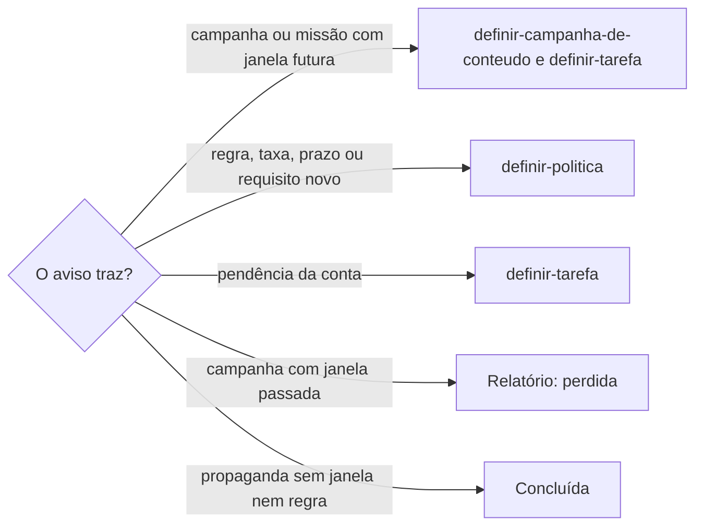

# Delegar aviso de plataforma

## Parâmetros de configuração

Leia cada valor nas instruções do projeto: primeiro na entrada com o nome desta habilidade, depois na entrada `Global` ou no primeiro nível do bloco. Quando um valor não estiver lá, use o padrão abaixo.
```yaml
"Formato da data com dia da semana": "terça-feira, 01/09/2026"
# `Antecedência da tarefa`: quantos dias antes do fim da inscrição, ou do início da campanha quando não há inscrição, a tarefa vence, salvo prazo da plataforma mais cedo.
"Antecedência da tarefa": 7
"Modo de aprendizado": "perguntar"
```

## Instruções

### Passo 1

Leia o corpo inteiro de cada aviso. Remetente, assunto e trecho não bastam: um e-mail de marketing da plataforma pode trazer o prazo de inscrição de uma campanha, a regra nova de envio ou uma cobrança automática.

Um aviso é de plataforma quando vem de um lugar onde o negócio vende ou divulga, como marketplace, rede social, loja virtual ou meio de pagamento. Convite de evento, feira ou edital é oportunidade e segue `organizar-emails`.

### Passo 2

Classifique o aviso pelo que ele pede ao negócio.



Campanha de vendas, oferta relâmpago, missão de LIVE ou desafio com datas é uma janela da plataforma. Busque a campanha pela janela em `definir-campanha-de-conteudo`; sem ela, crie a campanha com a janela da plataforma como âncora. Uma campanha própria do negócio na mesma data, como a Black Friday, recebe a janela da plataforma como uma seção, sem abrir outra campanha.

Na mesma rodada, siga `procurar-tarefa` e, sem tarefa, `definir-tarefa`, com o responsável que a área da plataforma tem, o prazo mais cedo entre `Antecedência da tarefa` antes do fim da inscrição e cada prazo da própria plataforma, como o dos anúncios antes do início, e o link do aviso.

A tarefa da campanha traz o que a plataforma exige para entrar: prazo de inscrição, preço-alvo, estoque, anúncios e as LIVEs com missão e duração. Quando a plataforma cria anúncio automático e cobra do negócio quem não configura a tempo, isso vai em destaque na tarefa. Um prazo da plataforma que já passou também vai em destaque, e a tarefa pede a decisão antes de inscrever qualquer produto.

Mudança de política, taxa, prazo, métrica ou requisito segue `definir-politica`, com a regra, a data de vigência e o link do aviso. Quando a regra pede uma ação até uma data, também vira tarefa.

Pendência da conta, como aprovação que pede o primeiro produto, documento ou verificação, segue `procurar-tarefa` e `definir-tarefa`.

### Passo 3

O aviso que repete uma campanha ou regra já delegada ganha o link da tarefa ou da página e não abre outra. Entre os lembretes da mesma campanha, o mais novo fica com ação pendente e os anteriores ficam concluídos.

O estado da conversa segue `rotular-item`. A conversa delegada fica com ação pendente até a tarefa terminar, e a propaganda sem janela nem regra fica concluída.

### Passo 4

Relate cada aviso numa linha: o tipo, o que foi criado ou atualizado, com o link, o responsável e o prazo no `Formato da data com dia da semana`. A campanha com janela passada aparece como perdida, com a próxima edição quando o aviso a cita, para o planejamento seguinte.

### Passo 5

Ao terminar, siga `evoluir-habilidade` conforme `Modo de aprendizado`.

## Problemas comuns

### Aviso concluído sem delegar

Se você marcar como concluído o convite de campanha ou de LIVE, o negócio só descobre a janela quando ela já passou.

1. Leia o corpo e ache a janela e o prazo de inscrição.
2. Crie ou atualize a campanha e a tarefa com responsável e prazo.
3. Deixe a conversa com ação pendente até a tarefa terminar.

### Regra nova sem política

Se você só etiquetar a mudança de política, o processo do negócio continua com a regra antiga.

1. Siga `definir-politica` com a regra, a vigência e o link.
2. Crie a tarefa quando a regra pede ação até uma data.

### Tarefa repetida

Se você abrir uma tarefa para cada lembrete da mesma campanha, a lista enche de duplicatas.

1. Siga `procurar-tarefa` pela campanha e pela janela antes de criar.
2. Ponha o link do lembrete na tarefa que já existe.

## Exemplos de entrada e saída

Estes exemplos ilustram fatos. Eles podem não estar no data source.

### chegou o convite da Black Friday do marketplace, com inscrição até o dia 12

A campanha entrou com a janela da plataforma como âncora. A tarefa saiu com o responsável de vendas, vencendo 7 dias antes do fim da inscrição, com o preço-alvo, o estoque e o aviso de que a plataforma cria anúncio automático e cobra de quem não configura. A conversa ficou com ação pendente.

### a plataforma reduziu o prazo de revisão de reembolso para 2 dias úteis

A política de devolução ganhou a regra nova, com a vigência e o link do aviso. Como a loja ainda não tinha pedido, não saiu tarefa. A conversa ficou concluída.

## Casos-limite

- O aviso traz uma campanha cuja janela já passou: relate como perdida e não abra tarefa.
- A janela está aberta, mas um prazo da plataforma dentro dela já passou, como o dos anúncios: a tarefa sai e diz o risco em destaque.
- A loja ainda não pode participar, como sem produto cadastrado: a tarefa da campanha depende da pendência da conta, e as duas saem ligadas.
- O aviso é propaganda de recurso, sem janela nem regra: concluída.
- A área não tem responsável nas instruções do projeto: a tarefa sai sem responsável e a resposta pergunta quem assume.
- O aviso vem de um endereço que não recebe resposta: não responda, e a dúvida vai pela central da plataforma.

## Pegadinhas

- E-mail na aba de promoções parece propaganda. Ele pode trazer o prazo de inscrição da campanha do ano.
- Aviso "a todos os vendedores" parece não dizer respeito ao negócio. Ele muda a regra que o negócio segue na próxima venda.
- O fim da inscrição parece o prazo da tarefa. A plataforma pode ter um prazo mais cedo, como os anúncios 7 dias antes do início, e é ele que vence primeiro.
- Participar de campanha parece grátis. Algumas plataformas exigem anúncio ativo e criam um anúncio automático cobrado de quem não configura a tempo.
- Responder ao e-mail do suporte da plataforma parece abrir um chamado. O endereço pode não receber mensagens, e a resposta volta sem entrega.

## Scripts disponíveis

- Nenhum.

1. Não há script para executar.
