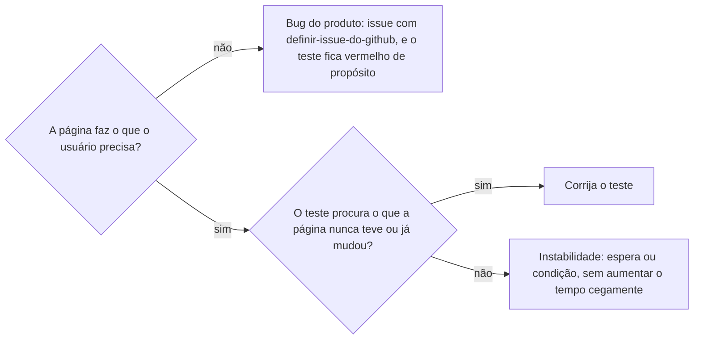

# Diagnosticar E2E vermelho

## Parâmetros de configuração

```yaml
# `Pasta dos workflows` é onde ficam os arquivos do CI que rodam o E2E.
"Pasta dos workflows": ".github/workflows"
# `Variáveis de credencial` lista os nomes das variáveis de ambiente que o teste lê para entrar numa conta. Vazio, o teste não precisa de login.
"Variáveis de credencial": []
"Modo de aprendizado": "perguntar"
```

## Instruções

### Passo 1

Peça o teste que está vermelho, o ambiente em que ele falhou, o link da execução e a tarefa do conserto.
Sem a tarefa, siga `preparar-tarefa-do-pull-request` antes de mexer no teste.
Trabalhe numa cópia de trabalho, não no clone da pessoa.

### Passo 2

Antes de dizer onde ou quando o E2E roda, leia o gatilho do workflow na `Pasta dos workflows`: os eventos em `on`, os filtros de branch e de caminho.
Um E2E que roda só em `push` na branch principal não roda no PR nem na fila de merge. Isso muda quando a falha aparece e quando a correção pode ser provada.
Não afirme o gatilho de memória nem pelo nome do workflow.

### Passo 3

Ache quando o teste começou a falhar, no histórico de execuções do workflow na branch em que ele roda.
Marque a última execução verde e a primeira vermelha, e liste os commits entre as duas.
Leia o log da primeira vermelha e o da mais recente. Se os dois falham no mesmo passo, a causa é uma só.
Uma falha que alterna entre verde e vermelho no mesmo commit é instabilidade, não regressão.

### Passo 4

Reproduza a falha antes de propor o conserto: rode o teste contra o ambiente em que ele falhou, ou abra o mesmo caminho num navegador real e compare com o que o teste espera.
O que o teste procura (papel, texto, `data-testid`) tem de existir na página exatamente como ele escreve. Confira no navegador o que o elemento é de fato.
Escreva a causa em uma frase, com a evidência que a mostra: o passo do log e o que a página tem no lugar.

### Passo 5

Decida de quem é o conserto.



Não troque a expectativa do teste para escondê-lo quando o produto está errado.

### Passo 6

Para um teste que entra numa conta, a pessoa exporta as `Variáveis de credencial` no terminal dela, e o teste as lê do ambiente.
Nunca digite, peça no chat nem grave em arquivo uma senha, um token ou um documento de identificação. Nunca crie conta nem dado real, em produção ou em outro ambiente que não é de teste da pessoa.
Se o teste cria dado de verdade (cadastro, pedido, pagamento), diga isso antes de rodar, com o ambiente, e deixe a pessoa decidir se roda e onde.
Sem as variáveis no ambiente, diga que o login não foi provado e rode só o que não precisa dele.

### Passo 7

Corrija o teste com `escrever-teste`, só o que a causa pede.
Rode os testes que a tarefa pede, no ambiente em que falharam e, quando o teste vai rodar depois do merge, no ambiente mais próximo possível.
Conte o resultado como "X de Y testes passaram", com o que cada um fez. Não escreva "sem regressão": diga o que foi procurado e o que foi visto.
Um teste que falhou por outro motivo, fora do que a tarefa pede, entra como "não conferido" ou "falhou", nunca omitido.

### Passo 8

Registre o resultado na tarefa com `registrar-resultados-da-validacao-na-tarefa`, num comentário só, que você edita a cada resultado novo.
O comentário diz a causa, a correção, o ambiente, o que passou e falhou antes e depois, e o que não foi conferido.
Enquanto o E2E não ficar verde onde ele roda de fato, a tarefa e a issue do teste não fecham.

### Passo 9

Ao terminar, siga `evoluir-habilidade` conforme `Modo de aprendizado`.

## Problemas comuns

### Gatilho suposto

Se você disser que o E2E roda no PR ou na fila de merge sem ler o workflow, a pessoa espera uma prova que aquele evento nunca gera.

1. Leia os eventos e os filtros em `on`.
2. Diga em qual evento e em qual branch o teste roda.
3. Se o PR não o roda, diga como a correção será provada antes do merge.

### Conserto antes da causa

Se você mudar o seletor ou a espera antes de reproduzir a falha, o teste fica verde por sorte e volta a falhar.

1. Reproduza no ambiente da falha ou num navegador real.
2. Escreva a causa com a evidência.
3. Só então mude o teste.

### Credencial no chat

Se você pedir a senha, digitá-la ou gravá-la num arquivo para o teste entrar, o segredo passa por onde não devia.

1. Peça à pessoa que exporte as variáveis no terminal dela.
2. Confirme só que elas existem, sem ler o valor.
3. Sem elas, diga que o login não foi provado.

### Dado real criado sem aviso

Se você rodar um teste de cadastro em produção sem dizer, ele cria contas ou pedidos que ninguém pediu.

1. Leia o teste e veja se ele cria dado.
2. Diga o que cria e onde, antes de rodar.
3. Espere a decisão da pessoa.

### Verde parcial contado como conserto

Se você disser que o teste passou quando só parte dos testes da tarefa rodou, a tarefa fecha com um teste vermelho.

1. Liste todos os testes da tarefa.
2. Conte "X de Y" com o motivo de cada falha.
3. Não feche com um teste falhando.

## Exemplos de entrada e saída

Estes exemplos ilustram fatos. Eles podem não estar no data source.

### O E2E do login ficou vermelho na main, tarefa ABC-12

Li o workflow: ele roda só em `push` na `main`, não no PR. O histórico mostra a última execução verde e a primeira vermelha, com três commits entre elas, e as duas falham no mesmo passo. No navegador, o item de login é um link sem `href`, e o teste o procura pelo papel `link`. A página está certa, então o conserto é do teste. Corrigi o seletor, rodei os 4 testes da tarefa e 3 de 4 passaram. O quarto cria uma conta de verdade e não rodei, porque você não decidiu onde. Registrei tudo no comentário da tarefa.

### Rode o teste com a minha conta

Pedi que você exporte `E2E_LOGIN_EMAIL` e `E2E_LOGIN_PASSWORD` no seu terminal. Confirmei que as duas existem, sem ler o valor, e rodei só o teste de login. Não digitei a senha nem a gravei em arquivo.

## Casos-limite

- O teste falha só às vezes no mesmo commit: é instabilidade. Mostre as execuções verdes e vermelhas e corrija a condição de espera.
- O E2E roda em vários ambientes e falha em um só: compare o ambiente que falha com o que passa antes de mexer no teste.
- A causa é um bug do produto: abra a issue com `definir-issue-do-github` e deixe o teste vermelho.
- O teste precisa de login e as variáveis não estão no ambiente: rode o que não precisa dele e diga o que ficou sem prova.
- O log da execução expirou: diga isso, reproduza no navegador e marque a data da falha como não confirmada.

## Pegadinhas

- Um workflow com `on: push` na branch principal não roda em PR nem na fila de merge. A fila só roda o que assina o evento `merge_group`.
- Em Playwright, `getByRole('link')` não acha um `<a>` sem `href`. O elemento aparece como `generic`.
- Um menu que abre ao passar o mouse não abre pelo `click` do teste em todo navegador. O teste faz `hover` antes e espera o item aparecer.
- O erro de timeout aparece no passo que esperava, não no passo que causou o problema. Leia os passos anteriores do log.
- A variável exportada num terminal não existe em outro terminal aberto. Quem roda o teste confere na aba onde exportou.
- Aumentar o tempo de espera costuma esconder a causa. Só vale depois de a causa ser uma lentidão provada.

## Scripts disponíveis

- `gh run list --workflow <arquivo> --branch <branch> --json conclusion,headSha,createdAt,url`: execuções do workflow no Passo 3.
- `gh run view <id> --log-failed`: log dos passos que falharam, no Passo 3.
- `sed -n '1,40p' <Pasta dos workflows>/<arquivo>`: gatilho do workflow, no Passo 2.
- `read -rs <VARIÁVEL> && export <VARIÁVEL>`: a pessoa exporta uma credencial no terminal dela, no Passo 6.
- `npx playwright test <arquivo> --reporter=line`: roda um arquivo de teste, no Passo 7, quando o projeto usa Playwright.

1. Leia o gatilho, ache a primeira execução vermelha, reproduza, decida de quem é o conserto, rode os testes da tarefa e registre o resultado.
