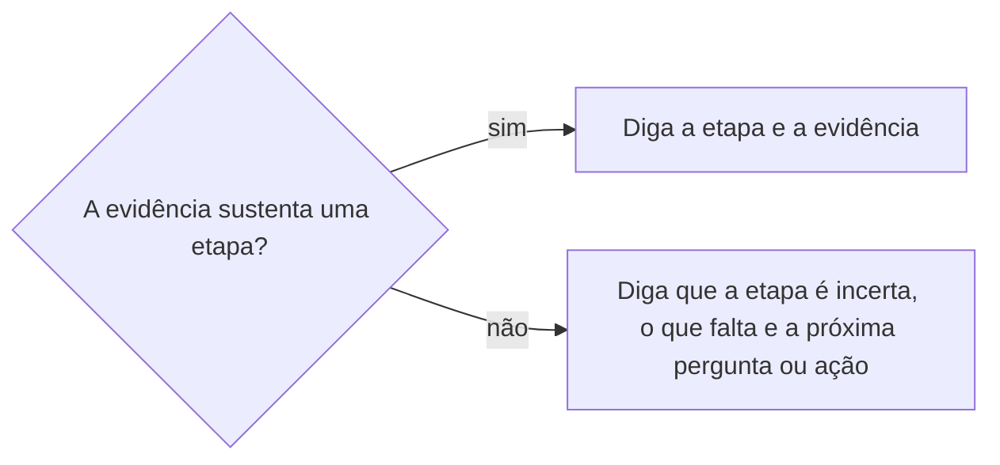

# Diagnosticar funil

## Parâmetros de configuração

Leia cada valor nas instruções do projeto: primeiro na entrada com o nome desta habilidade, depois na entrada `Global`. Quando um valor não estiver lá, use o padrão abaixo.

```yaml
# `Recursos de aprendizado do funil` lista as páginas de recurso de aprendizado que descrevem as etapas do funil do negócio. Vazio, peça os recursos e pare. Não invente as etapas.
"Recursos de aprendizado do funil": []
"Modo de aprendizado": "perguntar"
```

## Instruções

### Passo 1

As etapas do funil vêm de `Recursos de aprendizado do funil`. Leia cada recurso, por `definir-recurso-de-aprendizado`, e use só as etapas que ele descreve. Sem os recursos, peça-os e pare. Se eles não estiverem no workspace conectado, pare: não use as etapas de memória nem as de outro negócio.

### Passo 2

Leia o contexto da oportunidade, da conversa, do retorno recebido, da negociação e da próxima ação necessária. Escolha a etapa em que ela está e justifique com a evidência disponível, como o primeiro contato, a resposta recebida, o fit percebido, a objeção, a abertura para conversa, a negociação, a inscrição em andamento, a aprovação, a perda ou o acompanhamento que falta.



### Passo 3

A explicação da etapa entra na resposta final sempre que esta habilidade é usada, mesmo quando a entrega principal é só uma mensagem pronta para copiar e enviar. Ela diz a etapa, a evidência que a sustenta e, na etapa incerta, o que falta saber.

### Passo 4

Ao terminar, siga `evoluir-habilidade` conforme `Modo de aprendizado`.

## Problemas comuns

### Etapa sem evidência

Se você escolher a etapa porque a conversa parece estar nela, a pessoa age sobre um diagnóstico que ninguém conferiu.

1. Aponte a evidência de cada etapa escolhida, como a resposta recebida ou a objeção.
2. Sem evidência, diga que a etapa é incerta e o que falta saber.
3. Sugira a pergunta ou a ação que destrava o diagnóstico.

### Etapa que só você leu

Se você entregar a mensagem pronta sem dizer a etapa, a pessoa não sabe por que aquela abordagem foi escolhida.

1. Ponha a etapa e a evidência na resposta final.
2. Faça isso mesmo quando a entrega é só o texto para enviar.

### Etapa de memória

Se você usar as etapas de um funil que não está nos recursos do negócio, o diagnóstico fala de um processo que ele não tem.

1. Leia os recursos de `Recursos de aprendizado do funil`.
2. Sem eles, peça e pare.

## Exemplos de entrada e saída

Estes exemplos ilustram fatos. Eles podem não estar no data source.

### a organização respondeu que vai olhar o portfólio, em que etapa estamos?

Li os recursos do funil. A organização abriu a conversa e pediu material, sem confirmar nada, e a evidência é essa resposta de ontem. Estamos na etapa de abertura para conversa, antes da negociação. A próxima ação é mandar o portfólio.

### a Lia disse que gostou, mas não falou mais nada

A evidência é uma frase de interesse, sem pedido nem objeção. A etapa é incerta: falta saber se há abertura para conversa. A próxima pergunta é o que a Lia pretende fazer com o interesse.

## Casos-limite

- Os recursos do funil estão vazios ou fora do workspace conectado: peça-os e pare.
- Duas etapas cabem na mesma evidência: diga as duas, com o que falta para escolher.
- O pedido é só uma mensagem pronta: entregue a mensagem e, junto dela, a etapa e a evidência.

## Pegadinhas

- Uma resposta educada parece avanço de etapa. Sem pedido, objeção ou abertura, a etapa é incerta.
- A mensagem pronta parece bastar como resposta. A etapa e a evidência vão junto dela.

## Scripts disponíveis

- Nenhum.

1. Não há script para executar.
