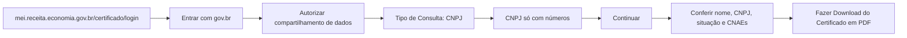

# Emitir documento oficial

## Parâmetros de configuração

Leia cada valor nas instruções do projeto: primeiro na entrada com o nome desta habilidade, depois na entrada `Global` ou no primeiro nível do bloco. Quando um valor não estiver lá, use o padrão abaixo.

```yaml
# `Fonte dos dados do titular` é o nome do banco, da página ou do cofre onde ficam o CNPJ, o CPF e o nome do titular. Vazio, pergunte.
"Fonte dos dados do titular": ""
# `Onde guardar os documentos` é a pasta ou o banco onde cada documento emitido fica, com a data de emissão. Vazio, pergunte.
"Onde guardar os documentos": ""
"Modo de aprendizado": "perguntar"
```

## Instruções

### Passo 1

Liste os documentos que o pedido exige. Um edital costuma pedir vários de uma vez.
Para cada um, ache a seção dele no Passo 4.
Um documento sem seção não é emitido de memória: diga que falta o caminho e peça uma sessão gravada, ou o endereço do serviço, para criar a seção com `evoluir-habilidade`.

### Passo 2

Leia o CNPJ, o CPF e o nome do titular na `Fonte dos dados do titular`. Nunca use um número de memória nem de uma conversa anterior.
Se a ferramenta que você usa não deixa digitar documento de identificação, peça à pessoa que digite o número no portal.

### Passo 3

Confira se o navegador já entrou no gov.br com a conta do titular.
Se o portal pedir login, pare e peça à pessoa que entre. Não digite senha.
Antes de clicar em autorizar o compartilhamento de dados ou aceitar um termo, diga o que a tela pede e espere a confirmação da pessoa.

### Passo 4

Siga o caminho de cliques do documento, numa das seções abaixo.
Feche os avisos que cobrem a tela, como dicas, tradutor e pesquisa de satisfação. Nos cookies, recuse o que não é essencial.
Antes de baixar, confira no documento o nome, o número e a situação do titular.

Cada documento conhecido tem um caminho de cliques em Mermaid, gravado de uma sessão real, e as armadilhas dele. Um documento novo entra aqui como uma seção.

#### CCMEI

Certificado da Condição de Microempreendedor Individual. Comprova que a empresa é MEI. Não é uma certidão negativa.



- Outro caminho: a página `gov.br/empresas-e-negocios/pt-br/empreendedor/servicos-para-mei/emissao-de-comprovante-ccmei`, no botão azul "Emissão de Comprovante (CCMEI)", à direita. A imagem "App MEI" leva a outra página.
- O PDF sai como `CCMEI_<CNPJ>.pdf`, na pasta de downloads.
- Com a situação cadastral diferente de ativa, emita mesmo assim e diga a situação na resposta.

### Passo 5

Guarde cada PDF em `Onde guardar os documentos`, com a data de emissão no nome ou no campo de data.
Um documento reflete a situação do dia em que foi emitido. Para um edital, emita uma versão nova.
Responda com o documento, a data, a situação que ele mostra e onde ficou guardado.

### Passo 6

Ao terminar, siga `evoluir-habilidade` conforme `Modo de aprendizado`.

## Problemas comuns

### Documento emitido de memória

Se você seguir um caminho de cliques que não está no Passo 4, o agente clica no botão errado e o portal muda sem aviso.

1. Pare.
2. Peça uma sessão gravada ou o endereço do serviço.
3. Grave a seção com `evoluir-habilidade` e só então emita.

### Número do titular errado

Se você emitir com um CNPJ ou CPF de memória, o documento sai para outra empresa ou pessoa.

1. Leia o número na `Fonte dos dados do titular`.
2. Confira no documento antes de baixar.
3. Emita de novo com o número certo.

### Autorização sem a pessoa

Se você clicar em autorizar o compartilhamento de dados sem perguntar, a pessoa concede um acesso que não decidiu.

1. Diga o que a tela pede.
2. Espere a confirmação.

### Sessão expirada

Se você vir a tela de login do gov.br no meio do caminho, a sessão expirou.

1. Pare e peça à pessoa que entre de novo.
2. Não digite a senha.

## Exemplos de entrada e saída

Estes exemplos ilustram fatos. Eles podem não estar no data source.

### Preciso do CCMEI para o edital da prefeitura

Li o CNPJ na fonte de verdade, segui o caminho do CCMEI e pedi a sua confirmação antes de autorizar o compartilhamento. Conferi nome, CNPJ e situação ativa, baixei o PDF e guardei na pasta de documentos com a data de hoje.

### O edital pede CCMEI e certidão negativa de débitos federais

Emiti o CCMEI. A certidão federal não tem seção no Passo 4, então não emiti e pedi uma sessão gravada para criar o caminho dela.

## Casos-limite

- O navegador não entrou no gov.br: pare e peça à pessoa que entre.
- O número do titular não está na fonte de verdade: peça o número antes de emitir.
- A pessoa pede "certidão do MEI": é o CCMEI. Confirme se o edital não pede uma certidão negativa.
- A pessoa não diz onde guardar e o parâmetro está vazio: pergunte antes de guardar.
- O documento pedido não tem seção: não emita. Peça o caminho.

## Pegadinhas

- O número de memória parece certo. A fonte de verdade pode ter mudado.
- A sessão do gov.br parece permanente. Ela expira no meio do caminho.
- Um documento antigo parece valer. Ele mostra a situação do dia da emissão.
- Os avisos sobre a tela parecem parte do fluxo. Feche-os antes de clicar.
- Um certificado e uma certidão negativa parecem a mesma coisa. Confira o nome exato que o edital pede.

## Scripts disponíveis

- Nenhum.

1. Não há script para executar.
