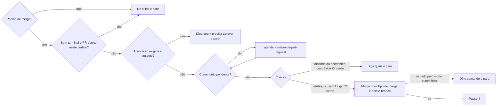

# Encerrar pull request

## Parâmetros de configuração

Leia cada valor nas instruções do projeto: primeiro na entrada com o nome desta habilidade, depois na entrada `Global` ou no primeiro nível do bloco. Quando um valor não estiver lá, use o padrão abaixo. `Repositório` vem do remoto `origin` quando as instruções não dizem.

```yaml
"Repositório": ""
"Tipo de merge": "squash"
"Exigir CI verde": "sim"
# `Exigir aprovação de outra pessoa`: `nunca`, `só sem terminal` ou `sempre`.
"Exigir aprovação de outra pessoa": "só sem terminal"
"Comunicar novidade após o merge": "sim"
# `Idioma do comentário de fechamento`: `o idioma do PR` segue `Idioma do PR` de `criar-pull-request`.
"Idioma do comentário de fechamento": "o idioma do PR"
# `Apagar a branch ao fechar`: `sim` apaga a branch remota junto com o fechamento sem merge.
"Apagar a branch ao fechar": "sim"
"Modo de aprendizado": "perguntar"
```

## Instruções

### Passo 1

Leia o estado do PR agora: aberto, mesclado ou fechado, rascunho ou pronto.
Se a pessoa avisou que mesclou, confirme o estado MERGED e o hash e vá para o Passo 4.
Se ele já foi mesclado sem aviso, diga isso e vá para o Passo 4.
Já fechado sem merge: diga isso e pare.
Pedido para fechar sem merge: vá para o Passo 3.

### Passo 2

Mescle só com pedido explícito, como "mescla", "coloca na main" ou "pode mesclar".
Abrir o PR, "faça o PR" e "sobe isso" não pedem merge.



A aprovação de `Exigir aprovação de outra pessoa` é de outra pessoa no PR: check verde não conta, e ser dona do repositório não dispensa.
Comentário pendente é thread de revisão sem resolver, revisão que pede mudança ou comentário da conversa sem resposta, de pessoa ou de bot. Aviso de bot que só informa, como link de preview, não conta. Thread que espera decisão da pessoa segura o merge até ela decidir.
Leia os checks uma vez. Pendentes: diga quais faltam e pare, sem esperar em loop. Com `Exigir CI verde` em `não`, mescle e diga quais não passaram.
Se o modo automático negar o merge, não tente de outro jeito: nada de auto-merge, API ou outra ferramenta. Entregue o comando pronto e diga que a decisão é da pessoa.

### Passo 3

Feche sem merge só com pedido da pessoa ou quando outra habilidade manda, como `atualizar-branch-do-pull-request` ao renomear a branch e `atender-revisao-de-pull-request` ao recriar o PR.
PR de outra pessoa só fecha com pedido explícito dela, naquele PR.
Antes de escrever, ache um link para cada fato do comentário: o PR que repete ou substitui este, o commit e o arquivo na base, ou a issue, a decisão ou o comentário que mudou o rumo.
Fato sem link: pergunte o motivo à pessoa e não feche.
Quando o comentário diz que nada se perde, compare cada arquivo do PR com a base e diga quais diferem e por quê.
Escreva o comentário no `Idioma do comentário de fechamento`: o motivo na primeira linha, um fato com link por item, e o que acontece com a branch na última linha.
Publique o comentário e feche na mesma operação, com `Apagar a branch ao fechar`, e confirme o estado CLOSED.
Uma thread de revisão aberta vai para o PR que substitui este, como `fatiar-pull-request` faz.
Siga para o Passo 4.

### Passo 4

Depois do merge ou do fechamento, feito aqui ou avisado pela pessoa, faça tudo isto na mesma resposta, antes de responder:

- [ ] Confirme o estado, MERGED com o hash do commit na base ou CLOSED com o link do comentário.
- [ ] Leia os comentários de revisão que ninguém tratou: thread sem resolver, comentário da conversa sem resposta e revisão pendente, que só aparece para quem a escreveu e não segura o merge. Elogio e aviso que só informa não contam.
- [ ] Procure as tarefas ligadas ao PR: as issues que ele fecha, a chave do card no título ou na branch, e as tarefas que citam o PR.
- [ ] Para cada tarefa achada, siga `sincronizar-status-da-tarefa`.
- [ ] Se não achar nenhuma, escreva na resposta que o PR não tem tarefa ligada e onde você procurou. A pessoa decide se liga uma tarefa ou se o PR não precisa de uma.
- [ ] Se o projeto sincroniza o repositório com outra ferramenta, como as páginas de habilidade no Notion, confira a sincronização.
- [ ] Depois do merge, com `Comunicar novidade após o merge` em `sim`, siga `comunicar-novidade-do-produto` para o PR.
- [ ] Siga `limpar-copias-de-trabalho` para a cópia de trabalho e a branch local do PR.

A tarefa do PR nunca fica no status de antes do merge ou do fechamento.

O comentário sem tratamento depende de quem abriu o PR.
A pessoa é o login do `gh`.
PR da pessoa: abra um PR novo a partir da base com os ajustes, sem perguntar. Classifique e aplique cada sugestão por `atender-revisao-de-pull-request`, abra por `criar-pull-request` e cite o PR mesclado.
PR de outra pessoa: para cada comentário, a pessoa escolhe uma ação só: resolver a thread, responder perguntando o que foi feito, abrir uma issue com o que ficou de fora por `definir-issue-do-github` ou abrir um PR que cubra o que faltou.
Pergunte pela tela de perguntas do cliente, como a do Claude ou a do Cursor: uma pergunta por comentário, com as quatro ações como opções de escolha única.
Sem essa tela, mande uma lista numerada dos comentários, com as quatro ações, e peça a escolha de cada um.
Espere a resposta antes de agir.

### Passo 5

Se perguntarem "já mesclou?", responda primeiro sim ou não e depois o que falta.
Abra a resposta com o link do PR, `[#123](url)`, e diga o hash, o estado de cada item do Passo 4 e, se houver, quem precisa aprovar ou mesclar.
Cada PR, issue e commit citado vai como link clicável em markdown.

### Passo 6

Ao terminar, siga `evoluir-habilidade` conforme `Modo de aprendizado`.

## Problemas comuns

### Merge negado

Se você repetir o merge por outro caminho depois que o modo automático negou, está contornando a decisão.

1. Pare.
2. Entregue o comando de merge pronto.
3. Diga que a pessoa pode mesclar pelo botão do PR ou liberar o comando nas permissões.

### Aviso de merge tratado como informação

Se você só agradece quando a pessoa diz que mesclou, a tarefa fica no status de antes e a cópia de trabalho sobra.

1. Confirme o estado MERGED.
2. Faça o checklist do Passo 4 inteiro na mesma resposta.

### Merge com conversa aberta

Se você mesclar com thread sem resolver ou comentário sem resposta, a revisão se perde depois do merge.

1. Leia as threads e a conversa antes do merge.
2. Siga `atender-revisao-de-pull-request` e volte.
3. Thread que espera a pessoa segura o merge.

### Revisão esquecida no merge

Se você só limpar a cópia depois do merge, o comentário que ninguém tratou se perde, ainda mais o de uma revisão pendente.

1. Leia as threads, a conversa e as revisões pendentes do PR mesclado.
2. PR da pessoa: abra o PR dos ajustes a partir da base.
3. PR de outra pessoa: peça uma ação para cada comentário, pela tela de perguntas do cliente ou numa lista numerada.

### Fechado sem motivo ou sem prova

Se você fechar o PR sem comentário, só com "duplicado", ou afirmar que a mudança já está na base sem conferir, quem abrir o PR depois não sabe por que ele parou, e um arquivo que só existia nele some.

1. Escreva o motivo na primeira linha e um link por fato.
2. Compare cada arquivo do PR com a base antes de dizer que nada se perde.
3. Fato sem link ou diferença sem explicação: pergunte antes de fechar.

## Exemplos de entrada e saída

Estes exemplos ilustram fatos. Eles podem não estar no data source.

### Só coloca isso na main

O pedido autoriza o merge. Sem PR aberto, `criar-pull-request` abre antes. Sem comentário pendente e com checks verdes, mesclei com `Tipo de merge`, confirmei MERGED, sincronizei a issue ligada e limpei a cópia de trabalho.

### PR #42 mesclado

Confirmei MERGED e o hash. A issue ligada foi para concluído. Nenhum comunicado: a mudança não aparece para quem usa.

### PR #57 mesclado com revisão pendente

O PR mudava a mensagem de erro do CI para uma branch com o prefixo de um agente de código. A revisão pendente da pessoa, nunca enviada, pedia que a mensagem mandasse o agente conferir se as próprias instruções já tinham a regra antes de criá-la. O PR era dela: abri um PR novo a partir da base com a mensagem corrigida, citando o #57, além do resto do Passo 4.

### Pode fechar o #12, ele repete o #13 que já entrou

Comentei no #12 que ele repete o #13, com o link do commit de merge e da pasta da skill na base. Conferi que 9 dos 11 arquivos eram iguais aos da base e que os outros dois só diferiam por entradas de PRs mesclados depois, cada um com link. Fechei com a branch apagada e a resposta trouxe o link do PR e do comentário.

## Casos-limite

- O PR está em rascunho: diga isso e pergunte se tira do rascunho antes. O merge não tira sozinho.
- A pessoa pede para mesclar a base na branch: isso é `atualizar-branch-do-pull-request`, que usa rebase.
- O PR é de release, como o do Release Please: depois do merge, a tag sai pelo CI. Atualize o plugin instalado quando as instruções do projeto mandarem.
- Vários PRs: mescle na ordem de dependência e faça o Passo 4 para cada um.
- Renomear a branch fecha o PR sem comentário: comente depois, como o Passo 3 manda, com o link do PR novo.
- A sugestão já está na base, por outro PR: resolva a thread com o link desse PR e não abra outro.

## Pegadinhas

- Depois do squash, a branch local não aparece como mesclada. Só o estado do PR diz que o trabalho entrou.
- `mergeStateStatus` `BLOCKED` com checks verdes costuma ser aprovação ou check exigido que ainda não rodou. Leia os dois antes de dizer por quê.
- O aviso "mesclado" parece encerrar o assunto. É o gatilho do Passo 4.
- O "Closed with unmerged commits" do GitHub parece explicar o fechamento. Ele não diz o motivo nem para onde a mudança foi.
- O PR da mesma mudança pode ter título diferente, como um `!` a mais. Compare os arquivos, não só o título.
- Uma revisão pendente não aparece para mais ninguém e não segura o merge. Só quem a escreveu a vê, então leia as revisões com o `gh` da pessoa.

## Scripts disponíveis

- Nenhum.

1. Estado: `gh pr view <número> --repo <Repositório> --json state,isDraft,mergeCommit,mergeStateStatus,reviewDecision,closingIssuesReferences`.
2. Threads, com os comentários da revisão pendente: `gh api graphql -f query='query{repository(owner:"<dono>",name:"<nome>"){pullRequest(number:<número>){reviewDecision reviewThreads(first:100){nodes{isResolved path line comments(first:20){nodes{author{login} body}}}}}}}'`.
3. Checks: `gh pr checks <número> --repo <Repositório>`.
4. Merge: `gh pr merge <número> --repo <Repositório> --<Tipo de merge> --delete-branch`.
5. Fechamento: `gh pr diff <número> --repo <Repositório> --name-only`, `git diff --quiet <commit do PR> origin/<base> -- <arquivo>`, `gh pr comment <número> --repo <Repositório> --body-file <arquivo>` e `gh pr close <número> --repo <Repositório> --delete-branch`.
6. Autor, revisões e conversa: `gh pr view <número> --repo <Repositório> --json author,reviews,comments` e `gh api user --jq .login`.
