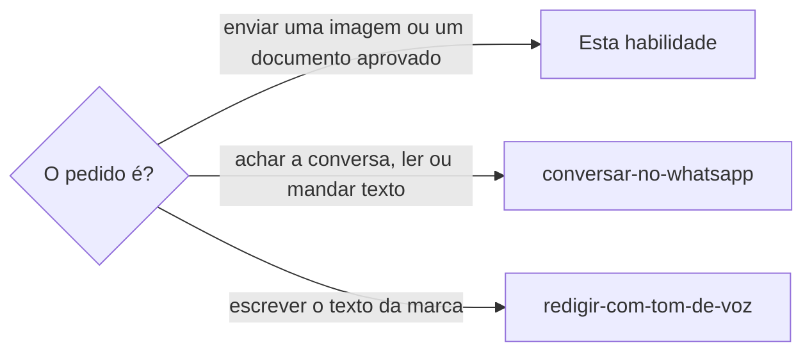

# Enviar imagem no WhatsApp

## Parâmetros de configuração

```yaml
"Modo de aprendizado": "perguntar"
```

## Instruções

### Passo 1



Quem chama já tem o destino, o arquivo e o sim da pessoa a essa imagem e a esse destino. Sem o sim, não envie.
Use o WhatsApp Web no Chrome da pessoa, pela extensão Claude in Chrome, como `conversar-no-whatsapp` manda: a aba que já estiver aberta, o botão do aviso "Usar nesta janela" e o QR code. O navegador embutido do app não serve.
Use PNG ou JPEG. Converta o WebP antes, por exemplo com `sips -s format png <arquivo> --out <pasta da sessão>/<nome>.png`.

### Passo 2

O menu Anexar tem Documento, Fotos e vídeos e Nova figurinha. A única entrada de arquivo que existe na página é a da Nova figurinha: mandar por ela envia uma figurinha. A entrada de Fotos e vídeos só nasce quando se clica nessa opção, e o seletor de arquivos nativo não se opera pela automação. Por isso o script de captura roda antes do clique.

- [ ] Abra o destino e o menu Anexar.
- [ ] Rode o script de captura.
- [ ] Clique em Fotos e vídeos, ou em Documento para um documento.
- [ ] Confira a entrada capturada: `data-wa-captured` preenchido e, para foto, `accept` com `video`. A que já existia, só com `image/*`, é a da figurinha: não use.
- [ ] Ache o novo `file-input` com `find` ou `read_page` e envie o arquivo a ele com `file_upload`.
- [ ] Confira a pré-visualização. Foto tem o campo de legenda e o botão de mais. Sem legenda é figurinha: feche no X e recomece.
- [ ] Envie.
- [ ] Rode o script de restauração.
- [ ] Releia a lista de conversas: a prévia da linha diz "Foto" ou o nome do documento, nunca "Figurinha".

### Passo 3

O texto aprovado junto da imagem vai no campo de legenda. Texto que a pessoa aprovou como mensagem separada segue `conversar-no-whatsapp`.
Em grupo e em canal o caminho é o mesmo, com o destino aberto.

### Passo 4

Se a lista disser "Figurinha", diga isso à pessoa, proponha apagar para todos e reenviar como foto, e só apague com o sim dela. Apagar para todos deixa "Mensagem apagada" na conversa.

### Passo 5

Ao terminar, siga `evoluir-habilidade` conforme `Modo de aprendizado`.

## Problemas comuns

### Imagem enviada como figurinha

Se você enviar o arquivo à única entrada de arquivo da página, sem capturar a de Fotos e vídeos, a imagem sai como figurinha, pequena e sem legenda, e a pessoa só descobre depois.

1. Rode o script de captura antes de clicar em Fotos e vídeos.
2. Confira a pré-visualização: sem campo de legenda, feche e recomece.
3. Depois do envio, leia a prévia da lista.

### Página deixada com o clique alterado

Se você não rodar o script de restauração, o clique de qualquer entrada de arquivo continua alterado na aba.

1. Rode o script de restauração depois do envio, também quando cancelar.

## Exemplos de entrada e saída

Estes exemplos ilustram fatos. Eles podem não estar no data source.

### mande o comprovante do Pix ao Caio, depois do sim da pessoa

Converti o WebP para PNG, capturei a entrada de Fotos e vídeos, enviei o arquivo, vi a legenda na pré-visualização e enviei. A lista do Caio passou a dizer "Foto". Restaurei a aba.

### a lista diz Figurinha depois do envio

Avisei a pessoa e propus apagar para todos e reenviar como foto. Esperei o sim e não apaguei antes.

## Casos-limite

- Vídeo, áudio e documento sem teste de ponta a ponta: diga isso à pessoa antes de enviar.
- Mais de um arquivo: a entrada de foto aceita vários, e cada arquivo é uma imagem do mesmo envio.
- A extensão não responde: diga isso e peça para a pessoa abrir o Chrome.
- Status e figurinha de propósito: não são esta habilidade.

## Pegadinhas

- A imagem enviada pela entrada que já existe na página vira figurinha, mesmo com a pré-visualização aberta. O campo de legenda é o que diferencia.
- O botão "Usar nesta janela" derruba a conexão da janela da pessoa. Avise ao terminar.
- O menu de anexos fica aberto atrás da pré-visualização, e o botão de enviar continua funcionando.
- A prévia da lista de conversas mostra "Foto" no lugar do texto quando a imagem é a última mensagem.

## Scripts disponíveis

- Captura, antes de clicar em Fotos e vídeos. Faz o WhatsApp entregar a entrada de arquivo que ele cria ao clicar:

```js
window.__waInputs = [];
window.__origClick = window.__origClick || HTMLInputElement.prototype.click;
HTMLInputElement.prototype.click = function () {
  if (this.type === 'file') {
    this.setAttribute('data-wa-captured', String(window.__waInputs.length));
    this.style.display = 'none';
    document.body.appendChild(this);
    window.__waInputs.push(this);
    return;
  }
  return window.__origClick.call(this);
};
```

- Restauração, depois do envio:

```js
HTMLInputElement.prototype.click = window.__origClick;
document.querySelectorAll('input[data-wa-captured]').forEach(e => e.remove());
```

1. Rode cada script com a ferramenta de JavaScript do Chrome, na aba do WhatsApp Web.
