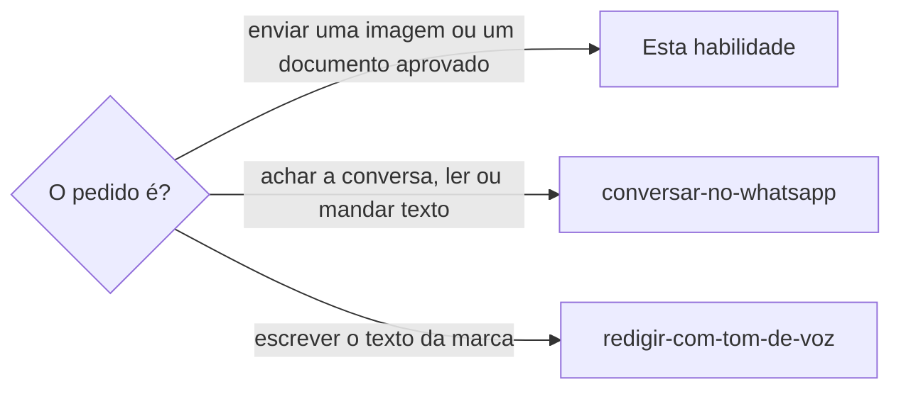

# Enviar imagem no WhatsApp

## Parâmetros de configuração

```yaml
"Modo de aprendizado": "perguntar"
```

## Instruções

### Passo 1



Quem chama já tem o destino, o arquivo e o sim da pessoa a essa imagem e a esse destino. Sem o sim, não envie.
O acesso ao WhatsApp Web e o anexo, com os scripts de captura e restauração, seguem `usar-whatsapp-web`: a mesma aba, o aviso de outra janela, o QR code e a sessão dona.
Antes de anexar, confira no cabeçalho o nome do destino: a aba pode estar noutra conversa. Use PNG ou JPEG. Converta o WebP antes, por exemplo com `sips -s format png <arquivo> --out <pasta da sessão>/<nome>.png`.

### Passo 2

Anexe como `usar-whatsapp-web` manda no Passo 4, com a imagem como foto e nunca como figurinha. Releia a lista de conversas: a prévia da linha diz "Foto" ou o nome do documento, nunca "Figurinha".

### Passo 3

O texto aprovado junto da imagem vai no campo de legenda. Texto que a pessoa aprovou como mensagem separada segue `conversar-no-whatsapp`.
Em grupo e em canal o caminho é o mesmo, com o destino aberto.

### Passo 4

Se a lista disser "Figurinha", diga isso à pessoa, proponha apagar para todos e reenviar como foto, e só apague com o sim dela. Apagar para todos deixa "Mensagem apagada" na conversa.

### Passo 5

Ao terminar, siga `evoluir-habilidade` conforme `Modo de aprendizado`.

## Problemas comuns

### Imagem enviada como figurinha

Se você enviar a imagem sem seguir o anexo de `usar-whatsapp-web`, ela sai como figurinha, pequena e sem legenda, e a pessoa só descobre depois.

1. Anexe como o Passo 4 de `usar-whatsapp-web` manda.
2. Depois do envio, leia a prévia da lista.
3. Se disser "Figurinha", siga o Passo 4 daqui.

## Exemplos de entrada e saída

Estes exemplos ilustram fatos. Eles podem não estar no data source.

### mande o comprovante do Pix ao Caio, depois do sim da pessoa

Converti o WebP para PNG, anexei pelo `usar-whatsapp-web`, enviei o arquivo, vi a legenda na pré-visualização e enviei. A lista do Caio passou a dizer "Foto". Restaurei a aba.

### a lista diz Figurinha depois do envio

Avisei a pessoa e propus apagar para todos e reenviar como foto. Esperei o sim e não apaguei antes.

## Casos-limite

- Vídeo, áudio e documento sem teste de ponta a ponta: diga isso à pessoa antes de enviar.
- Mais de um arquivo: a entrada de foto aceita vários, e cada arquivo é uma imagem do mesmo envio.
- Status e figurinha de propósito: não são esta habilidade.

## Pegadinhas

- A imagem enviada pela entrada que já existe na página vira figurinha, mesmo com a pré-visualização aberta. O campo de legenda é o que diferencia: veja `usar-whatsapp-web`.
- O botão "Usar nesta janela" derruba a conexão da janela da pessoa. Avise ao terminar.
- A prévia da lista de conversas mostra "Foto" no lugar do texto quando a imagem é a última mensagem.

## Scripts disponíveis

- Nenhum. Os scripts de captura e restauração ficam em `usar-whatsapp-web`.

1. Não há script para executar.
