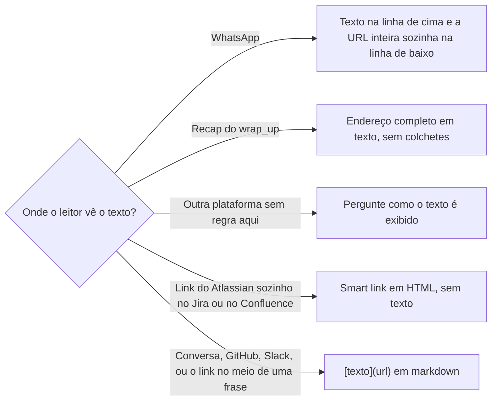

# Escrever link

## Parâmetros de configuração

```yaml
# `Texto do link de PR` e `Texto do link de issue` dizem o que aparece no link, como `número` para `[#123](url)`.
"Texto do link de PR": "número"
"Texto do link de issue": "número"
# `Texto do link de card` é `chave` para `[ABC-12](url)` ou `título` para o título do card.
"Texto do link de card": "chave"
# `Texto do link de página` é `título` para o título da página e `nome` para o nome do arquivo.
"Texto do link de página": "título"
"Modo de aprendizado": "perguntar"
```
## Instruções

### Passo 1

Leia o endereço na fonte antes de escrever o link.
O PR e a issue vêm do campo `url` do `gh`. O repositório vem do remoto `origin`. O card, a página e o comentário vêm do retorno da ferramenta que os criou ou leu.
Nunca monte o endereço de memória nem ponha o login pessoal como dono do repositório.
Sem ter lido, leia agora. Se não der, diga que falta o link e não escreva um.

### Passo 2

Escolha o texto do link pelo tipo do alvo, com os parâmetros `Texto do link de PR`, `Texto do link de issue`, `Texto do link de card` e `Texto do link de página`.
O texto diz o que o leitor abre. Um PR é `#123`, um card é a chave ou o título e uma página é o título dela.
`aqui`, `clique aqui` e `link` não dizem nada e não entram.
Um item citado só pelo número, como `#123` ou `PR 123`, não é link. Uma chave solta também não é. Uma URL crua no meio da frase só serve onde o Passo 3 manda.
Num link do Atlassian que fica sozinho, o texto não entra: o smart link do Passo 3 mostra o título atual da página.
Cite cada alvo como link toda vez que ele aparece, inclusive numa lista, num resumo, num título e quando já foi citado antes.

### Passo 3

Escolha a sintaxe pela plataforma onde o leitor vê o texto.



- Conversa com a IA, descrição e comentário no GitHub, mensagem no Slack pelo conector e um link no meio de uma frase no Jira ou no Confluence aceitam `[texto](url)`. O Slack e o Jira mostram uma URL crua como texto comprido, que quebra em duas linhas.
- Um link do Atlassian que fica sozinho numa linha, numa lista de referências, ou no fim de uma frase que termina em dois-pontos, vira smart link: `<a href="url" data-card-appearance="inline"></a>`, com o texto vazio. O Atlassian mostra o ícone e o título atual da página, e o título nunca fica desatualizado. No Jira, o comentário vai com `contentFormat` em `html`. No Confluence, o corpo da página é HTML. `block` serve para um link que a página destaca.
- O WhatsApp não usa Markdown e não tem link entre colchetes. O texto que descreve o alvo vai numa linha e a URL inteira, sozinha, na linha seguinte, para o WhatsApp tornar clicável e mostrar a prévia.
- O recap de um fim de turno não renderiza markdown nem torna o endereço clicável. Ele leva o endereço completo em texto, como `https://github.com/<dono>/<repo>/pull/123`, nunca só `dono/repo#123`. O texto escrito antes desse recap abre com uma linha só de links em markdown, que é a que a pessoa consegue clicar.
- No Slack, o texto pode ir para colar quando há um link só. Em canal compartilhado com outra organização, se o rascunho falhar, entregue as URLs soltas, uma por linha, e avise que o Slack só pré-visualiza os 5 primeiros links.

### Passo 4

Depois de publicar, releia o texto no lugar onde o leitor o vê, ou no retorno da ferramenta, e confira o link.
O link tem texto, o endereço abre o alvo certo e nenhuma URL ficou crua. Se ficou, edite o item publicado.
Antes de entregar uma resposta, releia o próprio texto atrás de número de PR ou de chave de card sem link.

### Passo 5

Na conversa com a pessoa, tudo o que o turno publicou ou abriu volta com o link direto do item, não o da página-mãe.
Uma review volta com o `html_url` dela. Um comentário volta com o do comentário, `#issuecomment-<id>` ou `#discussion_r<id>`. Um card, uma página e uma thread voltam com o próprio endereço.
Antes de publicar, ainda não há link, e a resposta diz isso.

### Passo 6

Ao terminar, siga `evoluir-habilidade` conforme `Modo de aprendizado`.

## Problemas comuns

### URL crua no texto

Se você escrever o endereço no meio da frase, a plataforma o mostra como texto comprido e a pessoa não sabe o que abre.

1. Troque por `[texto](url)`, com o texto do Passo 2.
2. No WhatsApp, ponha o texto numa linha e a URL inteira na linha de baixo.
3. Releia o item publicado e confira.

### Texto comprido num link do Atlassian

Se você escrever o título inteiro de uma página como texto de um link que fica sozinho no Jira ou no Confluence, o link vira uma linha comprida e o título pode ficar desatualizado.

1. Troque por um smart link, com o texto vazio.
2. Deixe o texto do link só quando o link está no meio de uma frase.

### Número solto

Se você citar `#123`, `PR 123` ou só a chave, quem lê não consegue abrir o item.

1. Escreva `[#123](url)` ou `[ABC-12](url)`, com a URL lida da fonte.
2. Faça isso em toda menção, também em lista, resumo e título.
3. Releia o texto antes de entregar.

### Endereço montado de memória

Se você montar a URL ou usar o login pessoal como dono do repositório, o link abre outro repositório ou não abre.

1. Leia o campo `url` do `gh` ou o remoto `origin`.
2. No card ou na página, use o endereço do retorno da ferramenta.
3. Sem ter lido, leia antes de citar.

### Colchetes no WhatsApp

Se você escrever `[texto](url)` numa mensagem de WhatsApp, a pessoa vê os colchetes e os parênteses como estão.

1. Use o texto numa linha e a URL inteira na linha de baixo.
2. Não use Markdown.

### Recap sem endereço

Se você puser só `dono/repo#123` no recap de um fim de turno, ele não renderiza e não é clicável.

1. Escreva o endereço completo em texto no recap.
2. Abra o texto antes do recap com uma linha de links em markdown.

### Item publicado sem link

Se você disser que publicou uma review ou um comentário e não devolver o link dele, a pessoa tem de procurar.

1. Devolva o link direto do item.
2. Antes de publicar, diga que ainda não há link.

## Exemplos de entrada e saída

Estes exemplos ilustram fatos. Eles podem não estar no data source.

### comente no card ABC-12 o link da página da ata que acabei de criar.

Li o endereço no retorno da criação da página. O comentário saiu em HTML, com a frase de abertura e o link sozinho, como smart link e sem texto. Reli o comentário no Jira e o link carrega a marca `smart-link` e aponta para a página. Nenhuma URL ficou crua.

### cite no resumo os dois PRs que abri hoje.

Cada PR entrou como `[#123](url)` e `[#124](url)`, com a URL lida do `gh`. Reli o resumo atrás de número solto e não achei.

### mande no WhatsApp o link do PR 123 para a Ana.

Escrevi "PR 123: corrige o filtro" numa linha e a URL inteira na linha de baixo. Sem colchetes, porque o WhatsApp não usa Markdown.

## Casos-limite

- O texto vai para uma plataforma que esta habilidade não descreve, como e-mail: pergunte como o texto é exibido. Não invente a sintaxe.
- Não deu para ler o endereço: diga que falta o link e não escreva um.
- O mesmo PR aparece três vezes no mesmo texto: cada menção é um link.
- A ferramenta devolve o texto publicado com o link como URL crua: edite o item publicado.
- O alvo ainda não existe porque o texto é um rascunho: escreva o rascunho com o link quando existir e diga que falta.
- Canal compartilhado com outra organização no Slack: se o rascunho falhar, entregue as URLs soltas, uma por linha.

## Pegadinhas

- A leitura do comentário pela API mostra o smart link com a URL como texto e a marca `title="smart-link"`. O cartão com o título aparece na tela do Jira. Confirme pela marca e diga que o título só aparece na tela.
- O smart link descarta o texto do link. Num link que precisa ler como parte da frase, use `[texto](url)`.
- O Jira e o Slack não tornam o endereço cru um link com texto. A pessoa vê a URL inteira, comprida, quebrada em duas linhas.
- O WhatsApp mostra colchetes e parênteses como estão.
- O recap de um fim de turno no app não renderiza markdown. O endereço dele só funciona completo.
- O Slack só pré-visualiza os 5 primeiros links de uma mensagem.
- Um comentário no GitHub tem endereço próprio, `#issuecomment-<id>` ou `#discussion_r<id>`. O endereço do PR não leva ao comentário.
- O login pessoal de quem escreve não é o dono do repositório. O dono vem do `origin`.

## Scripts disponíveis

- Nenhum.

1. Não há script para executar.
