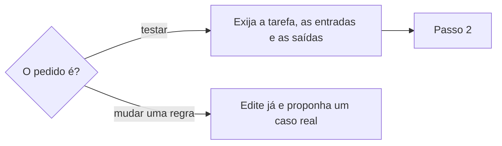

# Evoluir habilidade

## Parâmetros de configuração

Leia cada valor nas instruções do projeto: primeiro na entrada com o nome desta habilidade, depois na entrada `Global` ou no primeiro nível do bloco. Quando um valor não estiver lá, use o padrão abaixo.
```yaml
"Tokens do corpo": 5000
"Modo de aprendizado": "perguntar"
"Pasta das habilidades": ".agents/skills"
# `Executar testes` é `sob pedido` ou `sempre`.
"Executar testes": "sob pedido"
```
## Instruções

### Passo 1



Exija a skill, pelo nome ou pelo caminho. Antes de editar, confira de onde ela vem. O repositório não é uma entrada: a skill fica em `Pasta das habilidades`, no repositório de origem. A cópia que um projeto recebe pronta, por dependência ou plugin, não se edita: a próxima instalação apaga a alteração. Para testar, exija também a tarefa, os arquivos ou links de entrada e as saídas, e peça o que faltar antes de avaliar. Um pedido para testar uma skill entra aqui, mesmo sem dizer evoluir.
Um pedido para acrescentar, tirar ou trocar uma regra também entra aqui e só exige a skill e a mudança. Edite já no repositório de origem, suba `metadata.version` e atualize o que a mudança deixa desatualizado. Depois, proponha um caso real. Sem execução, a mudança não conta como validada. Um feedback sobre o comportamento do agente também entra aqui: o alvo são as instruções do projeto, tratadas como uma skill. Edite seguindo o formato de `definir-instrucoes-do-projeto` e suba `metadata.version`. Elas não têm `evals/` nem `features/`.

### Passo 2

O `evals/evals.json` já existe e começa com `evals` vazio. Acrescente um caso só depois que a pessoa executar o prompt com você. Nunca invente um caso.
Cada caso gravado tem `id`, `prompt`, `expected_output` e `files`. `files` fica vazio quando não há arquivo de entrada. O prompt é a mensagem que a pessoa escreveu. O resultado esperado descreve, para uma pessoa, o que foi sucesso nessa execução.
Quando houver mais de um caso, varie a redação, o detalhe e a formalidade. Pelo menos um caso testa um limite. Use o contexto real da execução. A skill só sai de `0.x` depois de 3 casos validados com a pessoa.
Saber se um prompt dispara a skill fica em `descrever-habilidade-ou-schema`. Esse teste entra no mesmo `evals/evals.json`, com `should_trigger` e `split`. Não crie outro arquivo de eval. Para a qualidade da saída, use o caso cujo `expected_output` descreve o resultado da tarefa.
O teste funcional é um arquivo Gherkin em `features/`, um arquivo por funcionalidade. O Gherkin testa o que a pessoa usa. Passo interno, formato do texto e diff não são funcionalidade. Não crie um arquivo por passo. A primeira linha é `# language: pt`. O texto fica em português. As palavras são `Funcionalidade`, `Regra`, `Exemplo`, `Contexto`, `Esquema do Cenário`, `Exemplos`, `Dado`, `Quando`, `Então`, `E` e `Mas`. `Funcionalidade`, `Regra`, `Exemplo`, `Contexto`, `Esquema do Cenário` e `Exemplos` levam dois-pontos. O passo não leva.
Cada critério de aceite que a pessoa enviou vira um `Exemplo`. Grave quando ela enviar. Não invente critério. Ele só conta como validado depois da execução com você.
O `Exemplo` tem de 3 a 5 passos. `Dado` é o contexto já ocorrido e abre sempre com `Dado que`: a palavra-chave não concorda com o substantivo. `Quando` é a ação. `Então` é a saída observável. `E` e `Mas` continuam o passo anterior. Saída válida, chamada que sucede, erro tratado e limite entram quando o critério falar disso.
Uma `Regra` agrupa os exemplos da mesma regra. O `Contexto` só repete um `Dado` curto em todos os exemplos da funcionalidade ou da regra. Valores que variam usam `Esquema do Cenário` e `Exemplos`.

```json
{
  "skill_name": "nome-da-skill",
  "evals": []
}
```

### Passo 3

Com `Executar testes` em `sob pedido`, os Passos 3 e 4 só rodam quando a pessoa pede a execução. Sem o pedido, edite, grave o Gherkin e diga numa linha que o caso pode rodar depois. Com `sempre`, eles rodam a cada teste.
Cada execução começa limpa, sem resto de execução anterior nem do desenvolvimento da skill. O agente segue só as instruções da skill.
Com subagente, cada caso é uma tarefa filha. Sem subagente, use uma sessão separada.
Para cada execução, entregue o caminho da skill, o prompt, os arquivos de entrada e o diretório de saída. Na execução sem skill, não entregue o caminho da skill.

### Passo 4

Rode o caso com a versão atual, com a versão anterior quando ela existir, e sem skill.
Compare sem skill e com skill. Sem skill, a pessoa repete a instrução a cada vez: conte idas e vindas, chamadas que falharam e pediram nova tentativa, e tokens. Com skill, o fluxo executa: conte só as perguntas que ainda faltaram. Os números saem do registro. Não os invente.
Grave o resultado em `workspace/iteration-N/` dentro da skill. Cada caso fica em `eval-{nome}/`. A versão atual e a anterior ficam em `with_skill/{semver}/`. A execução sem skill fica em `without_skill/`.
Dentro de cada uma: `outputs/`, `timing.json` e `grading.json`. O `benchmark.json` fica em `iteration-N/`. Esses JSON nascem nessa comparação. Não os escreva à mão.

### Passo 5

A skill é um documento vivo. A iteração parte do feedback.
Resultado inconsistente, falha de chamada e correção da pessoa: melhore a instrução e acrescente o tratamento do erro.
Antes de editar, confira de onde a skill vem e leia a skill inteira, as `related` e os parâmetros. A cópia instalada por dependência ou plugin não se edita. A frase nova não contradiz nenhuma: quando a regra muda, reescreva a frase que já existe e cada repetição dela em `Problemas comuns`, `Exemplos de entrada e saída`, `Casos-limite` e `Pegadinhas`. Não acrescente exceção noutro lugar. Valor que muda de um projeto para outro, como pasta, caminho ou nome de banco, vira parâmetro; o passo cita a chave. Decisão sobre palavra, como usar um termo ou outro, ou como escrever uma frase, não entra na skill nem num parâmetro: vai para o vocabulário, por `definir-vocabulario`.
Subdisparo e sobredisparo vão para `descrever-habilidade-ou-schema`.
O teste sempre edita a skill validada no repositório de origem, nesta mesma conversa. Sem essa edição, o teste não vale.
Incorpore todos os resultados, não só as falhas. A edição vem do que a execução mostrou.
Pergunte o que gerou falso positivo, o que passou despercebido e o que pode sair. Se a execução já mostrou a resposta, edite com ela. Quando a pessoa responder o que ainda faltava, edite de novo na mesma conversa.
Leia o registro da execução, não só o resultado final. Se o agente gasta tempo em etapa improdutiva, a instrução está vaga, não se aplica à tarefa, ou oferece opções sem escolha padrão. Se o próximo trecho deixar o corpo sem folga abaixo de `Tokens do corpo`, separe a responsabilidade em outra habilidade antes de escrever. Antes de commitar, rode a checagem que o lefthook roda no pre-commit. Sem `.git/hooks/pre-commit`, rode `.agents/scripts/check-skill/run-check.sh`. Falha, ou corpo no limite, barra o commit e o push. Não diga que está pronto. O tamanho e o profiling seguem `medir-habilidade`. O teste e a edição continuam aqui.

### Passo 6

Sempre que a skill for executada, compare os rastros do agente entre os casos. Se ele reinventar sozinho a mesma lógica em cada execução, como gerar um gráfico, analisar um formato ou validar a saída, avise a pessoa.
Proponha um script testado uma vez. Com o aceite, grave em `scripts/` quando só esta skill usa, ou em `.agents/scripts/<nome>/` quando várias usam. Passe a chamá-lo. A lógica deixa de ser reescrita a cada execução. O script que valida as próprias skills é o caso global: a checagem roda igual, em vez de o agente rederivar as regras.

### Passo 7

Quando outra habilidade chega aqui ao terminar, siga `Modo de aprendizado`. Com `não`, encerre. Com `perguntar`, pergunte uma vez se a pessoa quer registrar as lições da execução. Com `sim`, ou com a resposta sim, grave cada lição como um commit numa branch com nome em inglês e envie a branch. No primeiro commit, abra um PR em rascunho seguindo `criar-pull-request`, que já leva a pessoa atribuída e o rótulo no comando. A cada lição, confira o título e a descrição contra o código atual e atualize o que deixou de contar o que a branch faz. Tire do rascunho quando a pessoa encerrar a sequência.

## Problemas comuns

### Título deixado no primeiro commit

Se você atualizar só a descrição a cada lição, o título continua contando o primeiro commit.

1. A cada lição, confira o título e a descrição contra o código atual.
2. Atualize o que deixou de contar o que a branch faz, como `criar-pull-request` manda.

### Skill publicada acima do limite

Se você disser que a edição está pronta sem a checagem, o pull request sobe com o corpo acima de `Tokens do corpo`.

1. Rode a checagem antes do commit.
2. Acima do limite, separe a responsabilidade. Não enxugue regra que a pessoa pediu para ficar.
3. Não faça push e não diga que está pronto.

### Falha de execução anotada

Se você vir resultado inconsistente, falha de chamada ou correção da pessoa, e só anotar, a próxima execução repete o erro.

1. Melhore a instrução.
2. Acrescente o tratamento do erro.
3. Subdisparo e sobredisparo vão para `descrever-habilidade-ou-schema`.

### Repositório pedido à pessoa

Se você pedir o repositório numa cópia, sincronizada ou instalada por dependência ou plugin, a pessoa responde o que a skill já diz e a mudança não sai.

1. Confira as conexões e a pasta de trabalho antes de dizer que falta acesso. Uma chamada que falhou não prova falta de acesso.
2. Sem o repositório de origem nem uma conexão que escreva nele, entregue a mudança pronta: a skill, o passo e o texto novo. A cópia instalada não é esse repositório.
3. Diga que a gravação acontece numa sessão com o repositório de origem, no Claude, no Cursor ou em outro harness, e que essa sessão segue `criar-commit` e `criar-pull-request`.

### Regra contraditória

Se você acrescentar uma frase sem ler o resto da skill, ela pode mandar o oposto de outra, e o agente escolhe uma das duas.

1. Confira de onde a skill vem e leia a skill inteira, as `related` e os parâmetros antes de editar. A cópia instalada por dependência ou plugin não se edita.
2. Reescreva a frase que já existe e cada repetição dela. Não acrescente exceção noutro lugar.
3. Valor que muda de um projeto para outro vira parâmetro. O passo cita a chave.

### Feedback sem edição

Se você só anotar o teste, ou só anotar o que a pessoa respondeu, e não editar a skill validada, a próxima execução repete o mesmo resultado.

1. Edite a skill validada no repositório de origem, na mesma conversa do teste.
2. Se a pessoa responder o que ainda faltava, edite de novo.
3. Suba a versão.

### Caso inventado

Se você gravar um caso que a pessoa não enviou e não executou, a skill finge uma validação.

1. Apague o caso.
2. Critério de aceite que a pessoa enviou entra em BDD. Outro caso espera a execução.
3. Ele só conta como validado depois que a pessoa executar o prompt com você. Mantenha a versão em `0.x` até haver 3 casos validados com ela.

### Passo virando feature

Se você gravar um Gherkin para um passo, o formato do texto ou o diff, a skill ganha um teste da escrita e não do que a pessoa usa.

1. Apague o arquivo.
2. Deixe o Gherkin para o que a pessoa usa.
3. Não crie um arquivo por passo.

### Critério fora do Gherkin

Se você deixar o critério de aceite só no passo da skill, ou escrever o teste sem arquivo Gherkin, a execução não tem o que conferir.

1. Grave o critério que a pessoa enviou em `features/`, um arquivo por funcionalidade.
2. Comece com `# language: pt` e use `Funcionalidade`, `Regra`, `Exemplo`, `Dado`, `Quando` e `Então`.
3. Cubra saída válida, chamada que sucede, erro tratado e limite, quando o critério falar disso.

### Gherkin inválido

Se você começar com `# language: pt-br`, escrever as palavras em inglês, ou puser dois-pontos no passo, o arquivo deixa de ser Gherkin.

1. A primeira linha é `# language: pt`.
2. O passo não leva dois-pontos.
3. Mantenha de 3 a 5 passos, com `Então` observável.

### Comparação sem registro

Se você estimar idas e vindas, falhas ou tokens, a comparação não serve.

1. Leia o registro da execução sem skill e com skill.
2. Conte só o que o registro mostra.
3. Se o número não estiver lá, diga que falta.

### Prompt vago

Se você usar um prompt como "processe estes dados", o caso não testa a skill.

1. Reescreva com caminho, coluna ou contexto que a pessoa usaria.
2. Diga no `expected_output` o que é sucesso.
3. Mantenha pelo menos um caso de limite.

### Contexto sujo

Se você reaproveitar a sessão em que a skill foi escrita, o agente não segue só as instruções da skill.

1. Abra uma tarefa filha ou uma sessão nova.
2. Entregue só o caminho da skill, o prompt, os arquivos e o diretório de saída.
3. Na execução sem skill, omita o caminho da skill.

### Só o resultado final

Se você ler só o arquivo gerado e ignorar o registro, a etapa improdutiva fica na skill.

1. Leia o registro da execução.
2. Tire a instrução vaga, a que não se aplica, ou a opção sem padrão.
3. Grave `timing.json` e `grading.json` dessa execução.

### Lógica reinventada

Se você deixar o agente reescrever a mesma lógica em cada caso, a saída muda sem mudança na tarefa.

1. Compare os rastros entre os casos.
2. Avise a pessoa e proponha um script em `scripts/`, ou em `.agents/scripts/<nome>/` se várias skills usam.
3. Com o aceite, teste o script uma vez e passe a chamá-lo.

## Exemplos de entrada e saída

Estes exemplos ilustram fatos. Eles podem não estar no data source.

### teste a skill `resumir-reuniao` 0.2.0, com a ata `ata.md`, e compare com a 0.1.0 e sem skill.

`evals/evals.json` com três casos, um deles informal e um no limite. A rodada grava `workspace/iteration-1/eval-ata-sem-decisao/with_skill/0.2.0/`, `with_skill/0.1.0/` e `without_skill/`.

### compare criar um projeto com 5 tarefas, com skill e sem skill.

Dado que há o nome "Planejamento do trimestre" e 5 descrições de tarefa. Quando a skill executa o fluxo. Então o projeto existe, as 5 tarefas têm as propriedades certas, estão ligadas ao projeto e não há erro de chamada. Sem skill, o registro mostrou 15 idas e vindas, 3 chamadas que falharam e 12000 tokens. Com skill, o fluxo executou e fez 2 perguntas. Esses números só entram se o registro mostrar.

## Casos-limite

- Não existe versão anterior: rode a versão atual e a execução sem skill.
- Não há subagente: uma sessão separada para cada execução.
- O pedido não traz nome nem caminho da skill: pare e peça. Para testar, peça também tarefa, entradas e saídas.
- A mesma lógica aparece numa execução só: não proponha script.
- A pessoa recusa o script: a lógica fica na instrução.
- O script já existe: chame o script em vez de reescrever a lógica.
- O pedido é testar a skill: entra aqui. O teste edita a skill validada no repositório de origem, na mesma conversa.
- O pedido é saber se um prompt dispara a skill: use `descrever-habilidade-ou-schema`.
- O pedido é só revisar, sem executar: use `revisar-habilidade`.
- O critério já foi enviado e ainda não rodou: grave em BDD e deixe sem validar até a execução. Com `Executar testes` em `sob pedido`, a execução espera o pedido da pessoa.
- O pedido muda uma regra, um passo, o formato do texto ou o diff: edite já, suba a versão e proponha um caso real. Não grave Gherkin de passo, formato ou diff.
- A comparação não tem o número no registro: diga que falta.
- O pedido chega por uma cópia, sincronizada ou instalada por dependência ou plugin: não edite a cópia. A escrita segue `criar-commit` e `criar-pull-request` no repositório de origem.
- A cópia não tem o repositório de origem nem conexão que escreva nele: não peça o repositório. Entregue a mudança pronta, por skill e passo, para a sessão com o repositório de origem.
- O pedido é só o tamanho ou o tempo: use `medir-habilidade`. Não edite a skill.
- Cada lição muda o que a branch faz: o título e a descrição passam pela conferência de `criar-pull-request`.

## Pegadinhas

- A skill parece pronta na primeira versão. Ela é um documento vivo. A iteração parte do feedback.
- Atualizar a descrição parece bastar. O título também tem de continuar contando o que o código faz.
- "Testar" parece só conferir a saída. O teste edita a skill validada no repositório de origem, nessa conversa.
- Uma mudança pedida parece exigir execução antes. Ela entra direto. A validação vem depois, com um caso real.
- Um critério novo parece pedir a rodada de execuções. Com `Executar testes` em `sob pedido`, ela espera o pedido da pessoa, porque cada rodada gasta muitos tokens.
- Não invente caso. Critério de aceite que a pessoa enviou entra em BDD. Ele só conta como validado depois da execução com você.
- Um passo, o formato do texto ou o diff parecem funcionalidade. O Gherkin testa o que a pessoa usa. Não crie um arquivo por passo.
- `# language: pt-br` parece o código do português. O Gherkin usa `pt` para essas palavras.
- Cada execução começa limpa, sem a sessão em que a skill foi escrita.
- Consulta de disparo não mede a qualidade da saída. Disparo fica em `descrever-habilidade-ou-schema`.
- A mesma lógica reescrita em cada caso vira script, com o aceite da pessoa. Script de várias skills fica em `.agents/scripts/<nome>/`.
- Pedido feito numa cópia, sincronizada ou instalada por dependência ou plugin, parece permissão para gravá-la. A cópia é só leitura. A edição vai no repositório de origem. Siga `criar-commit`.
- Pedir o repositório parece o passo que falta. A skill fica em `Pasta das habilidades`, no repositório de origem. A cópia instalada não é esse repositório. Sem acesso, a mudança pronta é a entrega.

## Scripts disponíveis

- Nenhum.

1. Não há script para executar.
