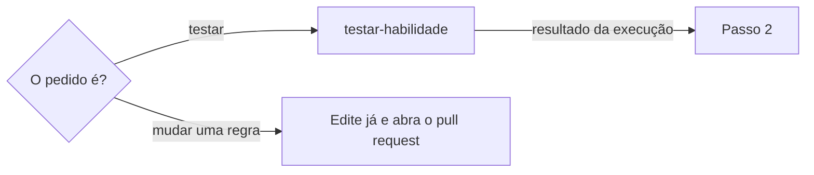
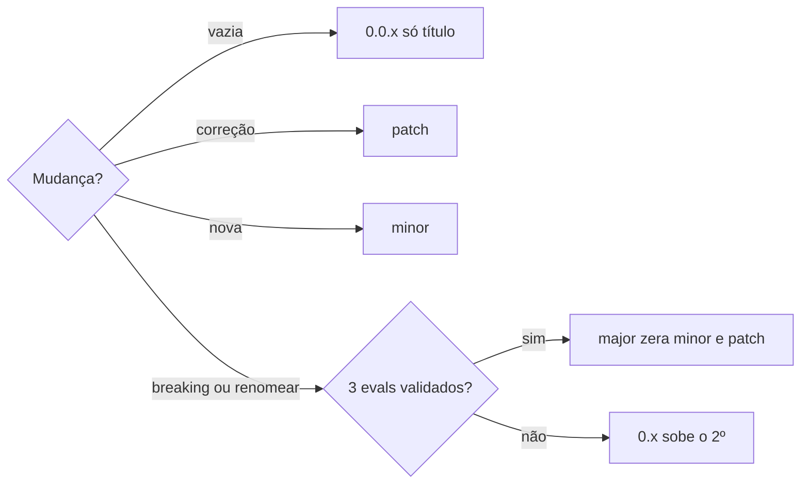

# Evoluir habilidade

## Parâmetros de configuração

Leia cada valor nas instruções do projeto: primeiro na entrada com o nome desta habilidade, depois na entrada `Global` ou no primeiro nível do bloco. Quando um valor não estiver lá, use o padrão abaixo.
```yaml
"Tokens do corpo": 5000
# `Modo de aprendizado` é `não`, `perguntar` ou `sim`. `não` encerra. `perguntar` e `sim` gravam a lição e abrem o pull request, sem perguntar se a pessoa quer o commit. A abertura segue `Criar pull request ao terminar` de `criar-pull-request`.
"Modo de aprendizado": "perguntar"
"Pasta das habilidades": ".agents/skills"
# `Cópia de trabalho` é `Global` e cada skill pode sobrescrevê-lo. `worktree` edita num git worktree novo a partir da `main`, nunca no clone da pessoa.
"Cópia de trabalho": "worktree"
```
## Instruções

### Passo 1



Exija a skill, pelo nome ou pelo caminho. Antes de editar, confira de onde ela vem. O repositório não é uma entrada: a skill fica em `Pasta das habilidades`, no repositório de origem. A cópia que um projeto recebe pronta, por dependência ou plugin, não se edita: a próxima instalação apaga a alteração. Um pedido para testar uma skill segue `testar-habilidade`, que volta aqui com o resultado da execução.

Um pedido para acrescentar, tirar ou trocar uma regra também entra aqui e só exige a skill e a mudança. Edite já no repositório de origem, seguindo `Cópia de trabalho`. Suba `metadata.version` e atualize o que a mudança deixa desatualizado.



Renomear uma skill é mudança que quebra: o assunto do commit leva `!` depois do tipo, o rodapé começa com `BREAKING CHANGE:` com o nome antigo e o novo, e cada nome anterior entra em `metadata.aliases`, sem tirar os que já existiam.

No mesmo turno, grave o commit e abra o pull request seguindo `criar-commit` e `criar-pull-request`. Não pergunte se a pessoa quer a lição em um commit. `Criar pull request ao terminar` decide a abertura: `rascunho` abre em rascunho, `sim` abre pronto, `não` não publica e a resposta diz o nome da branch.

Depois, proponha um caso real. Sem execução, a mudança não conta como validada.

Um feedback sobre o comportamento do agente também entra aqui. O alvo é a skill da tarefa em que o comportamento aconteceu, como a que redige a mensagem ou a que publica a resposta. As instruções do projeto só recebem a regra que vale para toda tarefa e não cabe em nenhuma skill: edite seguindo o formato de `definir-instrucoes-do-projeto` e suba `metadata.version`. Elas não têm `evals/` nem `features/`.

### Passo 2

A skill é um documento vivo. A iteração parte do feedback.
Resultado inconsistente, falha de chamada e correção da pessoa: melhore a instrução e acrescente o tratamento do erro.
Antes de editar, confira de onde a skill vem e leia a skill inteira, as `related` e os parâmetros. Leia o modelo de saída `skill-md` quando for gerar a saída. A cópia instalada por dependência ou plugin não se edita. A frase nova não contradiz nenhuma: quando a regra muda, reescreva a frase que já existe e cada repetição dela em `Problemas comuns`, `Exemplos de entrada e saída`, `Casos-limite` e `Pegadinhas`. Não acrescente exceção noutro lugar. Valor que muda de um projeto para outro, como pasta, caminho ou nome de banco, vira parâmetro; o passo cita a chave. A explicação do parâmetro fica nos comentários YAML acima da chave, nunca no texto do passo. Decisão sobre palavra, como usar um termo ou outro, ou como escrever uma frase, não entra na skill nem num parâmetro: vai para o vocabulário, por `definir-vocabulario`.
Subdisparo e sobredisparo vão para `descrever-habilidade-ou-schema`.
O resultado de `testar-habilidade` edita a skill validada no repositório de origem, na mesma conversa do teste. Sem essa edição, o teste não vale.
Incorpore todos os resultados, não só as falhas. A edição vem do que a execução mostrou.
Pergunte o que gerou falso positivo, o que passou despercebido e o que pode sair. Se a execução já mostrou a resposta, edite com ela. Quando a pessoa responder o que ainda faltava, edite de novo na mesma conversa.
Leia o registro da execução, não só o resultado final. Se o agente gasta tempo em etapa improdutiva, a instrução está vaga, não se aplica à tarefa, ou oferece opções sem escolha padrão. Se o próximo trecho deixar o corpo sem folga abaixo de `Tokens do corpo`, veja antes se ele é a forma de uma saída, como a estrutura de um arquivo: a forma vira um modelo de saída citado pelo nome, sem skill nova. O que não é forma vira outra habilidade, com a responsabilidade separada antes de escrever. Antes de mover para um modelo ou separar, mostre por que, para onde vai cada trecho e o nome de cada modelo ou habilidade, e espere a escolha da pessoa. Antes de commitar, rode a checagem que o lefthook roda no pre-commit. Sem `.git/hooks/pre-commit`, rode `.agents/scripts/check-skill/run-check.sh`. Falha, ou corpo no limite, barra o commit e o push. Não diga que está pronto. O tamanho e o profiling seguem `medir-habilidade`.

Antes de commitar, releia as linhas que a edição acrescentou.
Cada parágrafo trata de um tema, e só as frases que fazem sentido juntas ficam na mesma linha, como o modelo de saída `skill-md` manda.
Um bloco de várias frases em uma linha é refeito antes do commit, sem tirar nenhuma regra.

### Passo 3

Sempre que a skill for executada, compare os rastros do agente entre os casos. Se ele reinventar sozinho a mesma lógica em cada execução, como gerar um gráfico, analisar um formato ou validar a saída, avise a pessoa.
Proponha um script testado uma vez. Com o aceite, grave em `scripts/` quando só esta skill usa, ou em `.agents/scripts/<nome>/` quando várias usam. Passe a chamá-lo. A lógica deixa de ser reescrita a cada execução. O script que valida as próprias skills é o caso global: a checagem roda igual, em vez de o agente rederivar as regras.

### Passo 4

Quando outra habilidade chega aqui ao terminar, siga `Modo de aprendizado`. Com `não`, encerre. Com `perguntar` ou `sim`, grave cada lição como um commit numa branch com nome em inglês e siga `criar-pull-request`. Antes de gravar numa branch que já teve PR, confira o estado dele no GitHub. Aberto, a lição entra nessa branch. Mesclado ou fechado, a lição vai numa branch nova a partir da base atualizada, com PR próprio, e a descrição do PR mesclado não muda. Não pergunte se a pessoa quer a lição em um commit. `Criar pull request ao terminar` decide a abertura: `rascunho` abre em rascunho, `sim` abre pronto, `não` não publica. O comando já leva a pessoa atribuída e o rótulo. Depois do push, uma vez, confira o título e a descrição. Várias lições no mesmo push não repetem a conferência. Com `rascunho`, tire do rascunho quando a pessoa encerrar a sequência.

## Problemas comuns

### Pergunta antes do pull request

Se você perguntar se a pessoa quer a lição em um commit, o pull request não existe e a resposta não tem link.

1. Grave a lição e siga `criar-pull-request`.
2. Não pergunte.
3. `Criar pull request ao terminar` em `rascunho` abre em rascunho. Em `sim`, abre pronto. Em `não`, não publique e diga o nome da branch.

### Lição na branch mesclada

Se você gravar a lição na branch de um PR que já foi mesclado, o commit não chega à base e a descrição do PR passa a contar o que não entrou.

1. Antes do commit, confira o estado do PR da branch no GitHub.
2. Mesclado ou fechado: crie uma branch nova a partir da base atualizada e abra outro PR, com o link do anterior.
3. Não edite a descrição do PR mesclado para incluir a lição nova.

### Conferência a cada lição

Se você conferir o título e a descrição a cada lição, a conferência se repete no mesmo push.

1. Grave as lições e envie a branch.
2. Depois do push, uma vez, confira o título e a descrição, como `criar-pull-request` manda.

### Skill publicada acima do limite

Se você disser que a edição está pronta sem a checagem, o pull request sobe com o corpo acima de `Tokens do corpo`.

1. Rode a checagem antes do commit.
2. Acima do limite, mova a forma para um modelo de saída ou separe a responsabilidade, como o Passo 2 manda. Não enxugue regra que a pessoa pediu para ficar.
3. Não faça push e não diga que está pronto.

### Falha de execução anotada

Se você vir resultado inconsistente, falha de chamada ou correção da pessoa, e só anotar, a próxima execução repete o erro.

1. Melhore a instrução.
2. Acrescente o tratamento do erro.
3. Subdisparo e sobredisparo vão para `descrever-habilidade-ou-schema`.

### Repositório pedido à pessoa

Se você pedir o repositório numa cópia, sincronizada ou instalada por dependência ou plugin, a pessoa responde o que a skill já diz e a mudança não sai.

1. Confira as conexões e a pasta de trabalho antes de dizer que falta acesso. Uma chamada que falhou não prova falta de acesso.
2. Sem o repositório de origem nem uma conexão que escreva nele, entregue a mudança pronta: a skill, o passo e o texto novo. A cópia instalada não é esse repositório.
3. Diga que a gravação acontece numa sessão com o repositório de origem, no Claude, no Cursor ou em outro harness, e que essa sessão segue `criar-commit` e `criar-pull-request`.

### Regra contraditória

Se você acrescentar uma frase sem ler o resto da skill, ela pode mandar o oposto de outra, e o agente escolhe uma das duas.

1. Confira de onde a skill vem e leia a skill inteira, as `related` e os parâmetros antes de editar. A cópia instalada por dependência ou plugin não se edita.
2. Reescreva a frase que já existe e cada repetição dela. Não acrescente exceção noutro lugar.
3. Valor que muda de um projeto para outro vira parâmetro. O passo cita a chave.

### Rename fora do breaking change

Se você renomear o `name` e tratar a versão como correção ou funcionalidade, ou commitar sem breaking change, o nome antigo quebra sem aviso.

1. Suba o major e zere minor e patch. Sem 3 evals validados, suba o segundo número, zere o patch, e mantenha `0.x`.
2. Ponha `!` depois do tipo no assunto.
3. Comece o rodapé com `BREAKING CHANGE:` e cite o nome antigo e o novo.
4. Grave cada nome anterior em `metadata.aliases` e mantenha os que já existiam.

### Feedback sem edição

Se você só anotar o teste, ou só anotar o que a pessoa respondeu, e não editar a skill validada, a próxima execução repete o mesmo resultado.

1. Edite a skill validada no repositório de origem, na mesma conversa do teste.
2. Se a pessoa responder o que ainda faltava, edite de novo.
3. Suba a versão.

### Lógica reinventada

Se você deixar o agente reescrever a mesma lógica em cada caso, a saída muda sem mudança na tarefa.

1. Compare os rastros entre os casos.
2. Avise a pessoa e proponha um script em `scripts/`, ou em `.agents/scripts/<nome>/` se várias skills usam.
3. Com o aceite, teste o script uma vez e passe a chamá-lo.

## Exemplos de entrada e saída

Estes exemplos ilustram fatos. Eles podem não estar no data source.

### corrija-se pra sempre abrir o PR sem perguntar se eu quero a lição em um commit

A skill mudou no repositório de origem e o pull request saiu no mesmo turno, em rascunho, porque `Criar pull request ao terminar` estava em `rascunho`. A resposta trouxe o link e propôs um caso real para validar.

## Casos-limite

- O pedido não traz nome nem caminho da skill: pare e peça.
- A mesma lógica aparece numa execução só: não proponha script.
- A pessoa recusa o script: a lógica fica na instrução.
- O script já existe: chame o script em vez de reescrever a lógica.
- O pedido é testar a skill: use `testar-habilidade`. O resultado volta aqui e edita a skill validada no repositório de origem, na mesma conversa.
- O pedido é saber se um prompt dispara a skill: use `descrever-habilidade-ou-schema`.
- O pedido é só revisar, sem executar: use `revisar-habilidade`.
- O pedido muda uma regra, um passo, o formato do texto ou o diff: edite já, suba a versão, abra o pull request conforme `Criar pull request ao terminar` e proponha um caso real. Não pergunte se a pessoa quer o commit. Não grave Gherkin de passo, formato ou diff.
- O pedido chega por uma cópia, sincronizada ou instalada por dependência ou plugin: não edite a cópia. A escrita segue `criar-commit` e `criar-pull-request` no repositório de origem.
- A cópia não tem o repositório de origem nem conexão que escreva nele: não peça o repositório. Entregue a mudança pronta, por skill e passo, para a sessão com o repositório de origem.
- O pedido é só o tamanho ou o tempo: use `medir-habilidade`. Não edite a skill.
- Várias lições sobem no mesmo push: a conferência do título e da descrição é uma, depois do push.
- A branch da lição já tem PR mesclado ou fechado: a lição vai numa branch nova a partir da base, com PR próprio.

## Pegadinhas

- A skill parece pronta na primeira versão. Ela é um documento vivo. A iteração parte do feedback.
- Conferir a cada lição parece necessário. A conferência é uma vez, depois do push.
- O corpo cheio parece pedir uma skill nova. Quando o trecho é forma, como a estrutura de um arquivo, um modelo de saída resolve sem pesar no catálogo.
- Uma mudança pedida parece exigir execução antes. Ela entra direto. A validação vem depois, com um caso real.
- A mesma lógica reescrita em cada caso vira script, com o aceite da pessoa. Script de várias skills fica em `.agents/scripts/<nome>/`.
- Pedido feito numa cópia, sincronizada ou instalada por dependência ou plugin, parece permissão para gravá-la. A cópia é só leitura. A edição vai no repositório de origem. Siga `criar-commit`.
- Pedir o repositório parece o passo que falta. A skill fica em `Pasta das habilidades`, no repositório de origem. A cópia instalada não é esse repositório. Sem acesso, a mudança pronta é a entrega.

## Scripts disponíveis

- Nenhum.

1. Não há script para executar.
