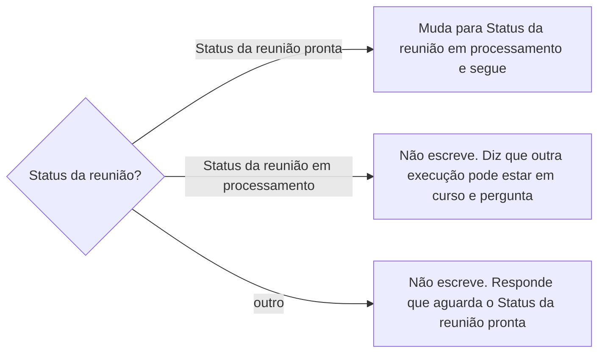
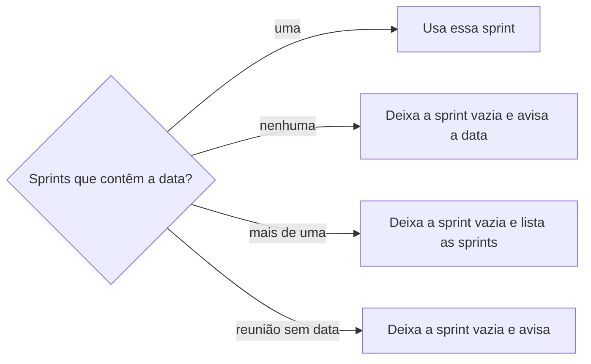
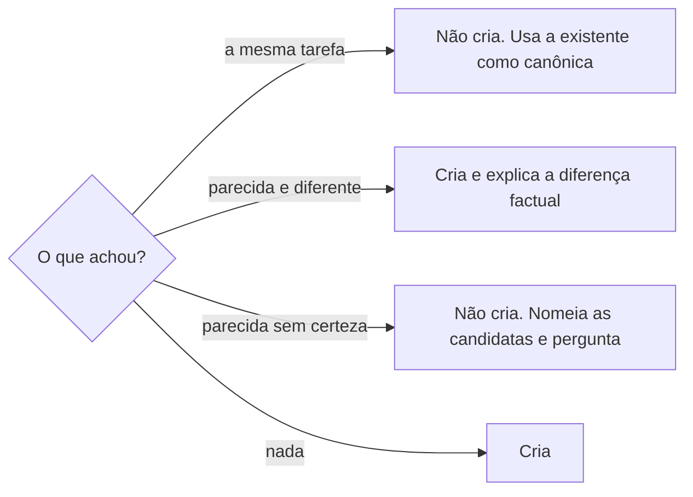

# Extrair tarefas da reunião

## Parâmetros de configuração

Leia cada valor nas instruções do projeto: primeiro na entrada com o nome desta habilidade, depois na entrada `Global` ou no primeiro nível do bloco. Quando um valor não estiver lá, use o padrão abaixo.

```yaml
"Status da reunião pronta": "Pronta para processar"
"Status da reunião em processamento": "Em processamento"
"Status da reunião processada": "Concluída"
"Status da tarefa nova": "Não iniciada"
"Modo de aprendizado": "perguntar"
```

## Instruções

### Passo 1

A reunião, a lista de tarefas e a lista de sprints vêm do mapeamento de dados do projeto, no workspace conectado, com o nome de cada propriedade. Este texto usa os conceitos: o status e a data da reunião; o título, o status, os responsáveis e a sprint da tarefa; o período da sprint. Se uma das três listas não estiver nessa conexão, pare. Não use a lista de outro workspace. Leia o status da reunião antes de qualquer escrita.



### Passo 2

Leia o resumo e a transcrição da reunião e liste os action items. Um action item é uma frase curta com verbo no infinitivo que descreve um resultado observável: verbo, objeto e o mínimo de contexto. Contexto, opinião, hipótese, histórico e decisão sem entrega ficam fora. Dois trechos que pedem a mesma entrega são um item só.

Para cada item, guarde o responsável só quando o texto nomeia quem faz. Pronome e posição da fala não nomeiam ninguém, como diz `definir-registro-de-reuniao`.

### Passo 3

Ache a sprint cujo período contém a data da reunião, com o início e o fim inclusivos. A data é a da reunião, não a do registro nem a de hoje.



### Passo 4

Para cada item, siga `procurar-tarefa` com o pedaço do assunto e a lista de tarefas, e a ordem de `identificar-duplicata` antes de criar: título, siglas, apelidos, nome antigo e versões anteriores.



### Passo 5

Antes de escrever, monte o plano: cada item com o título canônico, o desfecho do Passo 4, o responsável, a sprint e, quando houver, o link da tarefa existente e a diferença factual. Valide o plano contra as listas:

- [ ] Nenhum par de itens do plano cria a mesma tarefa.
- [ ] Cada título passa nos critérios de `definir-tarefa`.
- [ ] A sprint de cada item é a do Passo 3.
- [ ] Nenhum responsável veio de pronome.

Corrija e valide de novo até passar.

### Passo 6

Crie cada tarefa nova com `definir-tarefa`: o título canônico, o `Status da tarefa nova`, a sprint do Passo 3 e o responsável, só quando nomeado. Não altere tarefa existente nesta habilidade.

### Passo 7

Mude o status da reunião para `Status da reunião processada`. Responda com uma linha por item: o título, criada ou já existente com o link, a sprint e o responsável. Diga a diferença de cada item parecido, a pergunta de cada item incerto e o aviso de sprint.

### Passo 8

Ao terminar, siga `evoluir-habilidade` conforme `Modo de aprendizado`.

## Problemas comuns

### Item criado duas vezes

Se você checar cada item só contra a lista de tarefas, dois itens da mesma reunião com palavras diferentes viram duas tarefas.

1. Junte os itens da reunião que pedem a mesma entrega antes de buscar.
2. Confira o plano contra ele mesmo no Passo 5.

### Reunião presa em processamento

Se você mudar o status para em processamento e parar no meio, a reunião não volta a disparar.

1. Diga na resposta onde parou e o que já foi criado.
2. Não volte o status por conta própria. A pessoa decide.

### Status reaberto

Se você processar de novo uma reunião que voltou a pronta para processar, as tarefas da primeira execução aparecem como existentes.

1. Siga o Passo 4 normalmente.
2. Conte as existentes como já existentes. Não crie outra.

## Exemplos de entrada e saída

Estes exemplos ilustram fatos. Eles podem não estar no data source.

### a reunião de 14/10/2026 está pronta para processar e diz "a Ana manda o orçamento revisado ao fornecedor" e "achamos o preço alto".

Mudei o status para em processamento. Um item: "Enviar orçamento revisado ao fornecedor", com a Ana como responsável e a sprint de 12/10 a 25/10. "Achamos o preço alto" é opinião e ficou fora. Criei a tarefa e mudei a reunião para concluída.

### a reunião está em rascunho e a pessoa pede as tarefas.

Não criei nem alterei nada. Aguardo a reunião ficar pronta para processar.

### a reunião traz "fechar a arte do cartaz" e a lista já tem "Finalizar arte do cartaz da feira".

Não criei. A tarefa existente é a canônica, e passei o link dela.

## Casos-limite

- O item só existe numa tarefa concluída: é a mesma tarefa. Não reabra nem crie outra.
- A transcrição diz "eu faço" sem identificar quem fala: o item entra sem responsável.
- A reunião não tem action item: diga isso e mude o status para processada.
- A data da reunião cai no último dia de uma sprint: essa sprint contém a data.

## Pegadinhas

- O status pronto para processar é o gatilho, mas a criação acontece com a reunião já em processamento. Não exija o status pronto ao criar.
- A tarefa existente pode estar sem sprint ou numa sprint antiga. Isso não autoriza a mudar a sprint dela aqui.
- O nome de uma pessoa citada no item não a torna responsável. Responsável é quem o texto diz que faz.

## Scripts disponíveis

- Nenhum.

1. Não há script para executar.
